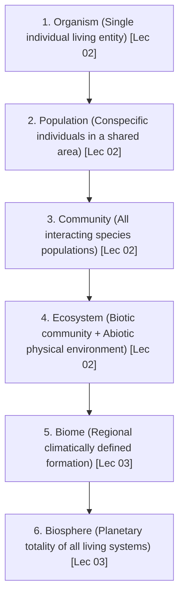
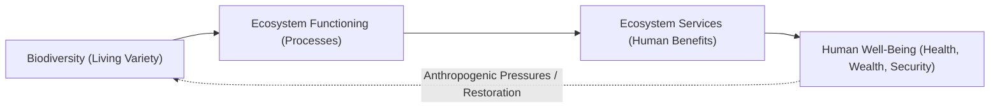

# Week 01 Cheat Sheet: Introduction to Biodiversity, Ecology & Sustainability

**Course:** Biodiversity for Sustainability  
**Instructor:** Dr. Ankur Awadhiya, IFS  
**Lectures Covered:** Lecture 01 to Lecture 05  
**Quizzes Cross-Referenced:** `quiz_week_1.txt` ($N=10$) & `quiz_week_0.txt` (Practice)  

---

## 1. High-Yield Terminological & Definitional Matrix

| Citation | Term / Concept | Operational Scientific Definition | Exam Archetype | Exam Question Tag |
| :--- | :--- | :--- | :--- | :--- |
| `[Lec 01]` | **Invisible Biodiversity** | Hidden living components: genes, microbes, fungi, soil life (nematodes, mycorrhizae), and silent ecological processes (decomposition, nutrient cycling). | Set Classification | `[TESTED - 30% REPEAT POOL]` (W1-Q1) |
| `[Lec 01]` | **Ecosystem Services** | The practical, material and non-material benefits that people obtain from ecosystems. | Forward Definition | `[TESTED - 30% REPEAT POOL]` (W1-Q9) |
| `[Lec 01]` | **Ecological Resilience** | The ability of a system to spring back, absorb disturbance, and recover function without collapsing into an alternate degraded state. | Forward Definition | `[UNSEEN HIGH-YIELD - 70% FINAL POOL]` |
| `[Lec 01]` | **Sustainable Development (Brundtland)** | Development that meets present needs without compromising the ability of future generations to meet their own needs; founded on *Needs* and *Limits*. | Forward Definition | `[UNSEEN HIGH-YIELD - 70% FINAL POOL]` |
| `[Lec 02]` | **Ecology (Scientific Definition 1)** | The scientific study of interactions among organisms and between organisms and their abiotic environment. | Forward Definition | `[UNSEEN HIGH-YIELD - 70% FINAL POOL]` |
| `[Lec 02]` | **Ecology (Scientific Definition 2 - Krebs)** | The scientific study of interactions that determine the distribution and abundance of organisms. | Forward Definition | `[UNSEEN HIGH-YIELD - 70% FINAL POOL]` |
| `[Lec 02]` | **Distribution** | Geographic and spatial occurrence: *where* organisms occur across space and time. | Forward Definition | `[TESTED - 30% REPEAT POOL]` (W1-Q2) |
| `[Lec 02]` | **Abundance** | Quantitative density or population size: *how many* organisms occur in a given area. | Forward Definition | `[UNSEEN HIGH-YIELD - 70% FINAL POOL]` |
| `[Lec 02]` | **Habitat** | A functionally suitable, species-specific setting providing required physical (temperature, water) and biotic (food, shelter, safety) conditions for an organism to live. | Reverse Definition | `[TESTED - 30% REPEAT POOL]` (W1-Q4) |
| `[Lec 02]` | **Ecology vs. Environmental Concern** | Ecology is an objective, empirical scientific discipline providing evidence and causal explanations; Environmental Concern is a normative, ethical, or political social response. | Contrastive Pair | `[TESTED - 30% REPEAT POOL]` (W1-Q5) |
| `[Lec 02]` | **Community (Ecological)** | Populations of different species living together in a defined area and actively interacting through biotic networks. | Forward Definition | `[TESTED - 30% REPEAT POOL]` (W1-Q8) |
| `[Lec 02]` | **Community Interaction** | Direct or indirect biological relationships between co-occurring species; exemplified by predation, mutualism, competition, herbivory, and parasitism. | Applied Scenario | `[TESTED - 30% REPEAT POOL]` (W1-Q6) |
| `[Lec 02]` | **Theoretical Ecology** | Ecological research branch using mathematical models, concepts, and predictive equations to simplify reality and identify generalizable patterns. | Reverse Definition | `[TESTED - 30% REPEAT POOL]` (W0-Q1) |
| `[Lec 02]` | **Laboratory Ecology** | Empirical ecological branch using controlled experiments and systematic manipulation of isolated variables to establish rigorous cause-and-effect relationships. | Reverse Definition | `[TESTED - 30% REPEAT POOL]` (W0-Q10) |
| `[Lec 02]` | **Field Ecology** | Empirical ecological branch observing and measuring wild organisms in natural, unmanipulated habitats (grounding science in ecological realism). | Forward Definition | `[UNSEEN HIGH-YIELD - 70% FINAL POOL]` |
| `[Lec 03]` | **Biodiversity (Full Scientific Scope)** | The variety of life in all its forms and at all levels of biological organization (from genes to ecosystems). | Forward Definition | `[UNSEEN HIGH-YIELD - 70% FINAL POOL]` |
| `[Lec 03]` | **Species Richness** | The absolute count of different species in a defined area ($S$); distinct from biodiversity because it omits relative abundance, genetic variation, and functional roles. | Quantitative Metric | `[UNSEEN HIGH-YIELD - 70% FINAL POOL]` |
| `[Lec 03]` | **Genetic Diversity** | Heritable nucleotide and allele variation within a single species or population, providing the raw substrate for natural selection and adaptation. | Reverse Definition | `[TESTED - 30% REPEAT POOL]` (W0-Q3) |
| `[Lec 03]` | **Ecosystem Diversity** | The structural variety of ecological communities, habitats, biophysical processes, and landscapes across geographic space. | Reverse Definition | `[TESTED - 30% REPEAT POOL]` (W0-Q4) |
| `[Lec 03]` | **Functional Diversity** | The range and variety of ecological roles, functional traits, and trophic behaviors performed by organisms within an ecosystem. | Reverse Definition | `[TESTED - 30% REPEAT POOL]` (W0-Q9) |
| `[Lec 03]` | **Ecological Niche** | The functional role and multidimensional position of an organism within its environment, including resource use, spatial habitat, and interspecific interactions. | Forward Definition | `[UNSEEN HIGH-YIELD - 70% FINAL POOL]` |
| `[Lec 03]` | **Biome** | A broad, regional ecological formation characterized by uniform climatic regimes and dominant vegetation types (e.g., temperate coniferous forest). | Forward Definition | `[UNSEEN HIGH-YIELD - 70% FINAL POOL]` |
| `[Lec 03]` | **Biosphere** | The global, planetary-scale sum of all living organisms, ecosystems, and life-supporting biophysical zones on Earth. | Forward Definition | `[TESTED - 30% REPEAT POOL]` (W1-Q7) |
| `[Lec 04]` | **Essential Needs vs. Wants** | Needs represent irreducible biophysical requirements for survival and dignity (food, clean water, shelter, basic health); Wants represent consumption desires (e.g., luxury automobiles). | Contrastive Pair | `[UNSEEN HIGH-YIELD - 70% FINAL POOL]` |
| `[Lec 04]` | **Ecological Carrying Capacity** | The maximum population size or environmental pressure an ecosystem can sustain indefinitely without degradation of its resource base. | Causal Threshold | `[UNSEEN HIGH-YIELD - 70% FINAL POOL]` |
| `[Lec 04]` | **Triple Bottom Line (TBL)** | Framework evaluating institutional and developmental performance across three concurrent dimensions: Social (People), Environmental (Planet), and Economic (Profit). | Management Tool | `[UNSEEN HIGH-YIELD - 70% FINAL POOL]` |
| `[Lec 05]` | **Greenwashing** | Presenting an activity, policy, or project as environmentally sustainable or eco-friendly through superficial rhetoric while ignoring underlying ecological degradation. | Reverse Definition | `[UNSEEN HIGH-YIELD - 70% FINAL POOL]` |

---

## 2. Six Levels of Ecological Organization Hierarchy

* `[Lec 02]` **Organism Level:** Focuses on the physiology, behavioral responses, survival, and stress tolerance of a single living individual `[TESTED - 30% REPEAT POOL]` (W1-Q10).
* `[Lec 02]` **Population Level:** Focuses on conspecifics capable of interbreeding in a defined spatial area; tracks demographic parameters: birth rate ($B$), death rate ($D$), immigration ($I$), emigration ($E$), abundance trends, and carrying capacity ($K$) `[UNSEEN HIGH-YIELD - 70% FINAL POOL]`.
* `[Lec 02]` **Community Level:** Focuses on multi-species coexistence networks, predation pressure, interspecific competition, symbiotic mutualisms, and food web architecture `[TESTED - 30% REPEAT POOL]` (W1-Q8).
* `[Lec 02]` **Ecosystem Level:** Integrates the living community with abiotic parameters (soil chemistry, hydrology, microclimate); governed by **unidirectional energy flow** and **cyclic nutrient recycling** `[UNSEEN HIGH-YIELD - 70% FINAL POOL]`.
* `[Lec 03]` **Biome Level:** Macro-scale regional complexes shaped by macroclimate (mean annual precipitation and temperature) and characteristic climax vegetation `[UNSEEN HIGH-YIELD - 70% FINAL POOL]`.
* `[Lec 03]` **Biosphere Level:** Planetary envelope of life encompassing the lower atmosphere (troposphere), hydrosphere, and upper lithosphere `[TESTED - 30% REPEAT POOL]` (W1-Q7).

---

## 3. Four Dimensions of Biodiversity

* `[Lec 03]` **Genetic Diversity:** Variation within a species across genes, chromosomes, and alleles. Enables evolutionary adaptation to pathogens, climatic extremes, and habitat shifts. High homozygosity reduces survival resilience `[TESTED - 30% REPEAT POOL]` (W0-Q3).
* `[Lec 03]` **Species Diversity:** Variety and abundance of different biological species in an area. Encompasses both species richness (count) and species evenness (equitability of abundances) `[UNSEEN HIGH-YIELD - 70% FINAL POOL]`.
* `[Lec 03]` **Ecosystem Diversity:** Structural variation among physical habitats, biophysical zones, and ecological complexes across spatial landscapes (forests, wetlands, grasslands, coral reefs) `[TESTED - 30% REPEAT POOL]` (W0-Q4).
* `[Lec 03]` **Functional Diversity:** Diversity of biological roles, trophic mechanisms, and physiological traits (pollinators, nitrogen fixers, primary decomposers, apex predators, seed dispersers). Two ecosystems with identical species counts can have vastly different functional diversity `[TESTED - 30% REPEAT POOL]` (W0-Q9).

---

## 4. Empirical Biological Entities, Field Cases & Scientific Taxa

| Citation | Common Name / Case Study | Scientific Name / Taxonomic Group | Geographic Region / Site | Tested Ecological Principle & Mechanism |
| :--- | :--- | :--- | :--- | :--- |
| `[Lec 01]` | **Andamans Intact Forest vs. Finland Monoculture** | Multi-tiered Tropical Rain Forest vs. Industrial Plantation | Andaman & Nicobar Islands (India) vs. Finland | Intact layered complexity provides multi-pathway resilience; simplified monoculture tree farms are fragile, highly vulnerable to pests, and devoid of wildlife `[UNSEEN HIGH-YIELD - 70% FINAL POOL]`. |
| `[Lec 02]` | **Chital (Spotted Deer) & Hanuman Langur Mutualism** | *Axis axis* (Chital) & *Semnopithecus entellus* (Langur) | Indian Deciduous Forests | Interspecific cooperative foraging & anti-predator vigilance: Langurs drop high-canopy leaves/fruits for deer; alert deer with arboreal alarm calls against leopards/tigers `[UNSEEN HIGH-YIELD - 70% FINAL POOL]`. |
| `[Lec 02]` | **Sea Urchin Herbivory Removal Experiment** | Class Echinoidea (Sea Urchins) & Macroalgae | Marine Intertidal Rocky Shore | Experimental manipulation in laboratory/controlled ecology: Removing grazing urchins causes dramatic explosion in algal cover, proving top-down herbivory control `[UNSEEN HIGH-YIELD - 70% FINAL POOL]`. |
| `[Lec 02]` | **Dhole (Asiatic Wild Dog) Puppies Monitoring** | *Cuon alpinus* (Canidae) | Indian Protected Areas | Field ecology protocol: Direct observation, litter counting, pack structure analysis, and behavioral monitoring in native wilderness `[UNSEEN HIGH-YIELD - 70% FINAL POOL]`. |
| `[Lec 02]` | **Penguin Artificial Nesting Structures** | Family Spheniscidae | Temperate/Sub-antarctic Breeding Colonies | Applied ecological intervention: Providing artificial burrows/boxes to protect eggs and chicks from thermal stress and surface predation `[UNSEEN HIGH-YIELD - 70% FINAL POOL]`. |
| `[Lec 03]` | **Temperate Coniferous Forest Biome** | *Cedrus deodara* (Deodar), *Pinus* spp. (Pine) | Manali, Western Himalayas (Himachal Pradesh, India) | Biome-level climatic adaptation: Cold temperature tolerance, conical canopy shedding snow loads, acidic needle leaf litter `[UNSEEN HIGH-YIELD - 70% FINAL POOL]`. |
| `[Lec 03]` | **Bengal Tiger Direct vs. Indirect Signs** | *Panthera tigris* | Indian Tiger Reserves | Wildlife survey methodology: Direct sighting (rare, nocturnal) vs. Indirect evidence (pugmarks, territorial scrape marks on bark, scat/droppings, vocalizations) `[UNSEEN HIGH-YIELD - 70% FINAL POOL]`. |
| `[Lec 03]` | **Five-Step Food Chain Pesticide Biomagnification** | Grass $\rightarrow$ Insect $\rightarrow$ Frog $\rightarrow$ Snake $\rightarrow$ Hawk | Terrestrial Agro-ecosystem | Trophic toxin accumulation: Non-biodegradable pesticides concentrate at apex level; loss of hawks unleashes snake surge, collapsing frogs, exploding insects, destroying grass cover `[UNSEEN HIGH-YIELD - 70% FINAL POOL]`. |
| `[Lec 03]` | **Lantana Alien Shrub Invasion** | *Lantana camara* (Verbenaceae) | Dehradun (Uttarakhand, India); native to Central/South America | Masked degradation: Green canopy with visiting butterflies creates illusion of health, but aggressive allelopathic thickets displace native understory flora `[UNSEEN HIGH-YIELD - 70% FINAL POOL]`. |
| `[Lec 04]` | **Mechanized Commercial Logging Machinery** | Industrial Feller-Bunchers / Forestry Harvesters | Commercial Production Forests | Technology Paradox: Advanced machinery increases resource extraction speed and spatial scale; without ecological governance, efficiency accelerates collapse `[UNSEEN HIGH-YIELD - 70% FINAL POOL]`. |

---

## 5. Interspecific Biotic Interaction Taxa Classification

| Citation | Interaction Type | Species A Effect | Species B Effect | Concrete Biological Mechanism & Transcript Example |
| :--- | :--- | :---: | :---: | :--- |
| `[Lec 02]` | **Competition** | **$-$** | **$-$** | Both organisms compete for the same limiting resource (light, water, nutrients, territory); mutually reduces individual fitness. |
| `[Lec 02]` | **Predation** | **$+$** | **$-$** | One organism (predator) captures, kills, and consumes another (prey) `[TESTED - 30% REPEAT POOL]` (W1-Q6). |
| `[Lec 02]` | **Herbivory** | **$+$** | **$-$** | Primary consumer feeds on living autotrophic plant tissues without necessarily killing the entire organism immediately. |
| `[Lec 02]` | **Mutualism** | **$+$** | **$+$** | Reciprocal biological cooperation benefiting both participants (e.g., Angiosperm pollination by insects; Chital deer and Hanuman langurs). |
| `[Lec 02]` | **Parasitism** | **$+$** | **$-$** | Parasite derives nutritional/reproductive sustenance directly from a living host, reducing host fitness, vigor, or reproductive output. |
| `[Lec 02]` | **Commensalism** | **$+$** | **$0$** | One organism benefits (shelter, transport, feeding access) while the host partner experiences neither measurable benefit nor harm. |

---

## 6. The Three Pillars of Sustainability Framework

* `[Lec 01, 04]` **Environmental Pillar (Foundational):** Conserves biophysical carrying capacities, protects ecosystem service integrity, maintains air/water/soil quality, and preserves biodiversity. Without biophysical stability, socio-economic superstructures collapse `[TESTED - 30% REPEAT POOL]` (W0-Q7).
* `[Lec 04]` **Social Pillar:** Guarantees intra-generational equity, environmental justice, health protection, community self-determination, and fair democratic access to life-support resources `[UNSEEN HIGH-YIELD - 70% FINAL POOL]`.
* `[Lec 04]` **Economic Pillar:** Focuses on long-term resource productivity, natural capital accounting, life-cycle durability, and internalizing ecological degradation costs, rather than maximizing short-term GDP `[UNSEEN HIGH-YIELD - 70% FINAL POOL]`.
* `[Lec 04]` **Three-Legged Stool Model:** Weakening any single pillar causes catastrophic instability of the entire societal structure, regardless of the apparent strength of the other two legs `[UNSEEN HIGH-YIELD - 70% FINAL POOL]`.

---

## 7. Causal Mechanism Chains & Ecological Feedbacks

### 7.1 The Four-Stage Core Linkage Chain

* `[Lec 01, 04, 05]` **The Forward Sequence:** Living variation ($\text{Biodiversity}$) underpins functional processes ($\text{Functioning}$), which deliver life-support benefits ($\text{Services}$), sustaining livelihoods, food security, and public health ($\text{Human Well-Being}$).
* `[Lec 05]` **The Anthropogenic Feedback Loop:** Human activities (land conversion, pollution, chemical runoff, overexploitation) exert reverse destructive feedback on biodiversity; conversely, ecological restoration, sustainable design, and protected-area governance close the loop constructively `[UNSEEN HIGH-YIELD - 70% FINAL POOL]`.

### 7.2 Food Security Ecological Dependency Chain
* `[Lec 01, 05]` Crop yield depends on **animal pollination** (bees, wasps, butterflies) + **soil microbial nutrient cycling** (nitrogen fixation, mineralization) + **crop genetic diversity** (pest/drought resistance). High-tech inputs cannot substitute for degraded ecological foundations `[TESTED - 30% REPEAT POOL]` (W0-Q5).

### 7.3 Hydrological Stability & Wetland Mechanics
* `[Lec 01, 04, 05]` Wetlands serve as **natural hydrological buffers**: store excess storm runoff, attenuate peak flood velocities, filter suspended particulate matter and chemical contaminants, and recharge depleted aquifers. Degradation turns minor rainfall into severe municipal flood disasters `[TESTED - 30% REPEAT POOL]` (W1-Q3).

### 7.4 Forest Climate Regulation
* `[Lec 01]` Forests regulate local and macro-climate by serving as massive **terrestrial carbon sinks**, driving evapotranspiration to elevate local humidity, and moderating extreme surface temperature fluctuations `[TESTED - 30% REPEAT POOL]` (W0-Q2).

---

## 8. Contrasting Models & Diagnostic Trap Summary

* `[Lec 02]` **Etymological Trap:** Ecology derived from Greek *oikos* (household / dwelling environment) + *logos* (systematic study) $\rightarrow$ "Study of life at home" `[UNSEEN HIGH-YIELD - 70% FINAL POOL]`.
* `[Lec 02]` **Distribution vs. Abundance:** Distribution = spatial coordinates (*Where*); Abundance = population count/density (*How many*). Questions invert these two dimensions `[TESTED - 30% REPEAT POOL]` (W1-Q2).
* `[Lec 02]` **Habitat vs. Geographic Location:** A location is a dot on a map; a habitat is functionally suitable, resource-equipped, and species-specific. An area may exist geographically but be completely uninhabitable for a species `[TESTED - 30% REPEAT POOL]` (W1-Q4).
* `[Lec 02]` **Energy Flow vs. Nutrient Cycling:** Energy enters as solar radiation, flows in a **strict unidirectional (one-way) trajectory**, and dissipates as metabolic heat; Nutrients (C, N, P) move through **cyclic pathways and are reused indefinitely** `[UNSEEN HIGH-YIELD - 70% FINAL POOL]`.
* `[Lec 03]` **Species Richness vs. Biodiversity Integrity:** 
  * *Forest 1:* 50 species, but 1 tree represents $90\%$ of individuals, 49 species represent $10\%$.
  * *Forest 2:* 50 species, evenly distributed abundances, diverse functional guilds.
  * *Exam Trap:* Species richness is identical ($S = 50$), but Forest 2 has far greater evenness, functional buffering, and genetic resilience `[UNSEEN HIGH-YIELD - 70% FINAL POOL]`.
* `[Lec 04]` **Growth vs. Sustainable Development:** Economic growth tracks quantitative expansion of output (GDP); Sustainable development tracks qualitative durability, equity, and permanence within biophysical thresholds `[UNSEEN HIGH-YIELD - 70% FINAL POOL]`.
* `[Lec 04]` **Absolute Distractor Warning (`EXAM_PATTERN.md`):** Options asserting that sustainability *"rejects all economic development"*, *"eliminates all technology"*, or relies *"only on environmental protection"* are engineered false distractors. Correct answers always emphasize *needs guided by limits and long-term durability*.
