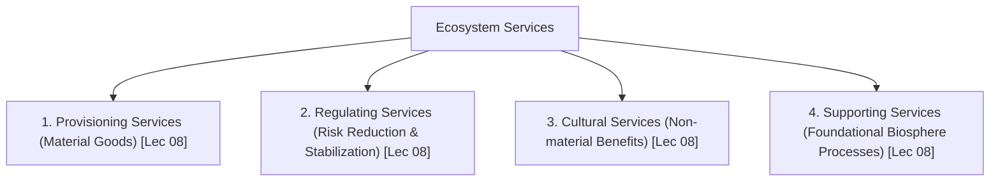

# Week 02 Cheat Sheet: Sustainability & Sustainable Development

**Course:** Biodiversity for Sustainability  
**Instructor:** Dr. Ankur Awadhiya, IFS  
**Lectures Covered:** Lecture 06 to Lecture 10  
**Quizzes Cross-Referenced:** `quiz_week_2.txt` ($N=10$) & `quiz_week_0.txt` (Practice)  

---

## 1. High-Yield Terminological & Definitional Matrix

| Citation | Term / Concept | Operational Scientific Definition | Exam Archetype | Exam Question Tag |
| :--- | :--- | :--- | :--- | :--- |
| `[Lec 06]` | **Direct Ecological Feedback** | Immediate, localized ecological signals (soil yield drops, seasonal shifts, water scarcity) experienced by early societies due to spatial proximity to natural resources. | Causal Rationale | `[TESTED - 30% REPEAT POOL]` (W2-Q6) |
| `[Lec 06]` | **Industrial Disconnect (Triad)** | The transformation in **Speed** (faster than natural renewal), **Scale** (landscape-wide transformation), and **Distance** (decoupling extraction from consumption), allowing ecological damage to be masked. | Mechanistic Contrast | `[TESTED - 30% REPEAT POOL]` (W2-Q8) |
| `[Lec 06]` | **Brundtland Formula (1987)** | Sustainable development meets the needs of the present without compromising the ability of future generations to meet their own needs; integrates *Priority Needs* and *Biophysical Limits*. | Legal / Institutional | `[UNSEEN HIGH-YIELD - 70% FINAL POOL]` |
| `[Lec 06]` | **Environmental Injustice** | A condition where marginalized and vulnerable communities disproportionately bear environmental hazards, pollution, and resource extraction, while benefits flow to affluent elites. | Social Framework | `[TESTED - 30% REPEAT POOL]` (W0-Q8) |
| `[Lec 07]` | **Environmental Sustainability** | Protecting ecological processes, biodiversity, natural resource integrity, and system resilience so that life-support systems persist indefinitely. | Forward Definition | `[TESTED - 30% REPEAT POOL]` (W2-Q4) |
| `[Lec 07]` | **Social Sustainability** | Securing equity, public health, community resilience, democratic participation, and fair distribution of environmental benefits and burdens across human populations. | Forward Definition | `[UNSEEN HIGH-YIELD - 70% FINAL POOL]` |
| `[Lec 07]` | **Economic Sustainability** | Maintaining long-term resource productivity, internalizing ecological costs, and investing in durable capital, rather than maximizing short-term financial turnover. | Forward Definition | `[UNSEEN HIGH-YIELD - 70% FINAL POOL]` |
| `[Lec 07]` | **Sustainability Trade-Off** | An unavoidable decision-making conflict where real, tangible benefits and real, severe ecological or social harms occur simultaneously. | Forward Definition | `[TESTED - 30% REPEAT POOL]` (W2-Q2) |
| `[Lec 07]` | **Sustainability Synergy** | A win-win management intervention where action on one pillar simultaneously generates mutually reinforcing benefits across the other two pillars. | Forward Definition | `[UNSEEN HIGH-YIELD - 70% FINAL POOL]` |
| `[Lec 07]` | **Ecological Threshold (Tipping Point)** | A critical non-linear biophysical boundary beyond which a small additional perturbation causes abrupt, catastrophic, and potentially irreversible system change. | Causal Threshold | `[TESTED - 30% REPEAT POOL]` (W2-Q9) |
| `[Lec 07]` | **Natural Capital Accounting** | Quantitative economic framework recognizing that ecosystems (soils, forests, water systems, wetlands, and biodiversity) constitute foundational productive capital with real economic value. | Economic Metric | `[TESTED - 30% REPEAT POOL]` (W2-Q10) |
| `[Lec 08]` | **Regulating Services** | Ecological processes that buffer risks, stabilize environmental conditions, and moderate extremes (flood control, water filtration, climate moderation, disease suppression). | Forward Definition | `[TESTED - 30% REPEAT POOL]` (W2-Q3) |
| `[Lec 08]` | **Provisioning Services** | Tangible, material products directly extracted by humans from biological systems (food, fresh water, timber, fiber, medicinal plants, fuelwood). | Forward Definition | `[UNSEEN HIGH-YIELD - 70% FINAL POOL]` |
| `[Lec 08]` | **Cultural Services** | Non-material benefits derived from ecosystem contact (recreational ecotourism, spiritual inspiration, aesthetic appreciation, cognitive development, cultural identity). | Forward Definition | `[UNSEEN HIGH-YIELD - 70% FINAL POOL]` |
| `[Lec 08]` | **Supporting Services** | Fundamental, underlying ecological processes necessary for the production of all other ecosystem services (photosynthesis/primary production, soil formation, nutrient cycling). | Forward Definition | `[UNSEEN HIGH-YIELD - 70% FINAL POOL]` |
| `[Lec 08]` | **Natural Infrastructure** | Living, self-sustaining ecosystems (especially wetlands and coastal mangroves) performing continuous municipal functions (storm storage, filtration, coastal buffering) without engineered construction costs. | Applied Concept | `[TESTED - 30% REPEAT POOL]` (W2-Q5) |
| `[Lec 08]` | **Functional Diversity** | The variety of biological traits and ecological roles performed by different coexisting species in maintaining ecosystem stability and service generation. | Forward Definition | `[TESTED - 30% REPEAT POOL]` (W2-Q1) |
| `[Lec 09]` | **Good Sustainability Indicator** | A measurable metric that accurately represents important realities, is scientifically credible, easily understandable to decision-makers, and directly supports policy action. | Criteria Set | `[TESTED - 30% REPEAT POOL]` (W2-Q7) |
| `[Lec 09]` | **Composite Indicator** | A single aggregated numerical index combining multiple distinct indicators; provides high-level communication but risks obscuring serious underlying trade-offs and component declines. | Metric Diagnostic | `[UNSEEN HIGH-YIELD - 70% FINAL POOL]` |
| `[Lec 09]` | **Shifting Baseline Syndrome** | Gradual generational amnesia where each generation of scientists or managers accepts the degraded condition of an ecosystem at the start of their career as the "natural" baseline. | Cognitive Bias | `[UNSEEN HIGH-YIELD - 70% FINAL POOL]` |
| `[Lec 10]` | **Multifunctional Landscape** | A spatial territory concurrently delivering multiple ecological, productive, and social functions (timber, water conservation, biodiversity habitat, and local tribal livelihoods). | Applied Management | `[UNSEEN HIGH-YIELD - 70% FINAL POOL]` |

---

## 2. Four Millennium Ecosystem Assessment (MEA) Service Classes

| Citation | Service Category | Core Functional Role | Specific Concrete Examples Extracted from Transcripts | Exam Trap Alert |
| :--- | :--- | :--- | :--- | :--- |
| `[Lec 08]` | **Provisioning Services** | Direct material yield extracted for human consumption and economic trade. | Timber, food crops, forage for livestock, fresh drinking water, fuelwood, fiber, and medicinal plants. | *Warehouse Fallacy:* Treating nature only as a warehouse of harvestable products causes severe degradation of regulating processes `[UNSEEN HIGH-YIELD - 70% FINAL POOL]`. |
| `[Lec 08]` | **Regulating Services** | Dampening biophysical fluctuations, buffering hazards, and purifying flows `[TESTED - 30% REPEAT POOL]` (W2-Q3). | Flood control by wetlands, water filtration by riparian strips, microclimate cooling by canopy cover, carbon storage by forests, biological pest suppression, disease buffering. | *Invisible Value:* Operates continuously without an invoice; typically recognized by municipal authorities only after catastrophic loss occurs. |
| `[Lec 08]` | **Cultural Services** | Intellectual, spiritual, and psychological enrichment without physical extraction. | Ecotourism revenue in mangrove reserves, aesthetic appreciation of landscapes, spiritual reverence for sacred groves, recreational birdwatching, and mental well-being in urban parks. | *Market Exclusion:* Difficult to price in traditional accounting, leading developers to dismiss them as zero-value land. |
| `[Lec 08]` | **Supporting Services** | Biophysical engines enabling the existence of provisioning, regulating, and cultural services. | Primary production (photosynthetic biomass accumulation), pedogenesis (soil formation), biochemical nutrient cycling (N, P, C), and provision of physical habitat structures. | *Intermediacy:* Does not interface with humans directly; never buy/sell supporting services in markets; foundation of all life. |

---

## 3. Historical Evolution & Landmark Treaties Matrix

| Citation | Historical Event / Milestone | Year / Era | Key Trigger, Document or Catalyst | Tested Core Finding & Conceptual Impact |
| :--- | :--- | :---: | :--- | :--- |
| `[Lec 06]` | **Pre-Industrial Agrarian Societies** | Pre-$18^{\text{th}}$ Century | Resource proximity & localized living | Direct ecological feedback: Overuse immediately caused localized famine, soil erosion, or drought, enforcing operational awareness of limits `[TESTED - 30% REPEAT POOL]` (W2-Q6). |
| `[Lec 06]` | **Industrial Revolution & Decoupling** | $18^{\text{th}}$–$20^{\text{th}}$ Century | Fossil energy, mechanized harvesting & global trade | Increased **Speed, Scale, and Distance**: Resource extraction detached from consumption centers; enabled spatial export and masking of ecological damage `[TESTED - 30% REPEAT POOL]` (W2-Q8). |
| `[Lec 06]` | **Chemical Pollution Wake-Up Call** | **1962** | Publication of *Silent Spring* by Rachel Carson | DDT insecticide bioaccumulated through food chains, causing eggshell thinning and avian raptor crashes; proved persistent synthetic toxins travel far from application points `[UNSEEN HIGH-YIELD - 70% FINAL POOL]`. |
| `[Lec 06]` | **Brundtland Commission Report** | **1987** | UN World Commission on Environment and Development (WCED) | Published *Our Common Future*; coined official definition of Sustainable Development; reconciled human needs with biophysical planetary limits `[UNSEEN HIGH-YIELD - 70% FINAL POOL]`. |
| `[Lec 06]` | **Environmental Justice Movement** | Late $20^{\text{th}}$ Century | Industrial toxic dumping & waste siting | Demonstrated systemic inequality: Toxic facilities, polluting industries, and landfills are disproportionately sited in socio-economically marginalized areas `[TESTED - 30% REPEAT POOL]` (W0-Q8). |

---

## 4. Five Real-World Case Studies Analysis (Lecture 10)

| Citation | Case Study Name | Dominant Ecological Tension | Conflicting Stakeholder Interests | Sustainable Redesign & Management Pathways |
| :--- | :--- | :--- | :--- | :--- |
| `[Lec 10]` | **1. Forests and Livelihoods** | Monoculture timber logging vs. Hydrological integrity, non-timber forest products (NTFPs), and carbon sequestration. | Commercial timber concessionaires vs. Indigenous forest-dwelling communities dependent on NTFPs, grazing, and local water pathways. | Shift from clear-felling to **limit-based harvesting** pegged strictly to biological regeneration rates; co-management with local forest rights holders. |
| `[Lec 10]` | **2. Wetlands and Urban Expansion** | Real estate reclamation of wetlands vs. Natural municipal stormwater retention and groundwater recharge. | Property developers seeking low-cost building land vs. Downstream urban citizens bearing catastrophic monsoon flood risks. | Recognize wetlands as **natural infrastructure**; redirect municipal expansion to low-functioning upland areas; design cities around natural drainage basins. |
| `[Lec 10]` | **3. Agriculture and Biodiversity** | Chemical intensification (pesticides, synthetic fertilizers) vs. Soil biodiversity, pollinator survival, and aquatic runoff. | Agrochemical agribusiness maximizing short-term seasonal yields vs. Long-term farm viability threatened by soil sterility and pollinator crashes. | Integrated pest management (IPM); maintaining hedge-rows and pollinator corridors; relying on microbial bioremediation and natural soil nutrient cycling. |
| `[Lec 10]` | **4. Mangroves, Coasts, and Development** | Clearing coastal mangroves for tourism resorts and aquaculture ponds vs. Invaluable storm surge buffering and fishery nursery grounds. | Resort developers and construction contractors profiting from engineered **gabion rock check dams** vs. Artisanal fishers, coastal taxpayers, and cyclone victims. | Retain intact mangrove belts as free, self-repairing biophysical defenses; develop non-destructive ecotourism; eliminate contractor-incentivized seawalls. |
| `[Lec 10]` | **5. Urban Green Spaces and Livability** | Commercial real estate expansion vs. Urban heat island mitigation, stormwater infiltration, and psychological public health. | Commercial developers maximizing rentable floor space vs. Low-income urban residents trapped in high-temperature concrete heat sinks. | Mandate minimum per-capita urban green cover; equitably distribute parks to lower-income neighborhoods; plant multi-species indigenous shade trees. |

---

## 5. Sustainability Metrics, Indicators & Diagnostic Limits

### 5.1 Criteria of High-Quality Sustainability Indicators
* `[Lec 09]` **Core Diagnostic Criteria `[TESTED - 30% REPEAT POOL]` (W2-Q7):**
  1. **Representative:** Accurately reflects critical ecological and social processes, not merely what is easiest to count.
  2. **Scientifically Credible:** Methodologically sound, repeatable, and resistant to administrative manipulation.
  3. **Understandable:** Communicable to policymakers, public stakeholders, and civil society without misleading jargon.
  4. **Cost-Effective & Feasible:** Logistically realistic for continuous long-term monitoring.
  5. **Sensitive:** Detects early warning changes before an ecological threshold is crossed.
  6. **Action-Oriented:** Directly informs management interventions, policy adjustments, and zoning decisions.

### 5.2 Single vs. Composite Indicators vs. Dashboard Approach
* `[Lec 09]` **Single Indicator:** Focuses on one specific variable (e.g., coliform count, dissolved oxygen in ppm, canopy density percentage). High precision, but lacks systemic scope `[UNSEEN HIGH-YIELD - 70% FINAL POOL]`.
* `[Lec 09]` **Composite Indicator:** Aggregates multi-dimensional variables into a single combined numerical score (e.g., 0 to 100). Useful for political communication, but **dangerously masks critical component collapses** (e.g., an economic gain can numerically mask an ecological collapse in the same index) `[UNSEEN HIGH-YIELD - 70% FINAL POOL]`.
* `[Lec 09]` **Dashboard Approach:** Displays diverse ecological, social, and economic indicators side-by-side without mathematical conflation, preventing hidden trade-offs `[UNSEEN HIGH-YIELD - 70% FINAL POOL]`.

### 5.3 Shifting Baseline Syndrome Mechanics
* `[Lec 09]` **The Numerical Illusion:**
  * Year $-100$: Population $= 10,000,000$ individuals.
  * Year $-1$: Population $= 1,000$ individuals.
  * Year $0$ (Current Year): Population $= 1,001$ individuals.
  * *The Trap:* An analyst comparing only Year $0$ to Year $-1$ reports a $+0.1\%$ increase and claims "successful population stability." A long-term baseline reveals that the population has suffered a catastrophic $99.99\%$ collapse! `[UNSEEN HIGH-YIELD - 70% FINAL POOL]`.

---

## 6. Contrastive Pairs & Diagnostic Trap Summary

* `[Lec 06]` **Direct vs. Decoupled Feedback Trap:** Early societies were bound by local feedback; modern industrial systems export environmental externalities across oceans and continents, making damage invisible to end consumers `[TESTED - 30% REPEAT POOL]` (W2-Q8).
* `[Lec 07]` **Trade-Off vs. Synergy:** 
  * *Trade-Off:* Dam construction generates hydro-power (+Economic) but drowns riparian biodiversity (-Environmental) and displaces communities (-Social) `[TESTED - 30% REPEAT POOL]` (W2-Q2).
  * *Synergy:* Urban tree planting lowers ambient heat (+Environmental), reduces respiratory stress (+Social), and cuts municipal cooling costs (+Economic) `[UNSEEN HIGH-YIELD - 70% FINAL POOL]`.
* `[Lec 07]` **Linear vs. Threshold Dynamics:** Environmental degradation does not always proceed along a smooth, predictable linear slope. Systems often appear resilient until an **ecological threshold** is breached, triggering abrupt, irreversible regime shift `[TESTED - 30% REPEAT POOL]` (W2-Q9).
* `[Lec 08]` **Natural Infrastructure vs. Engineered Infrastructure:** 
  * *Engineered:* Expensive concrete seawalls, gabion rock check dams, artificial drainage channels; require continuous capital maintenance, decay over time, and offer zero biodiversity value `[UNSEEN HIGH-YIELD - 70% FINAL POOL]`.
  * *Natural:* Mangrove forests, salt marshes, floodplain wetlands; free, self-repairing, self-regenerating, store carbon, and serve as commercial fish nurseries `[TESTED - 30% REPEAT POOL]` (W2-Q5).
* `[Lec 08]` **Natural Capital Accounting vs. Pure Market Pricing:** Market prices record only the exchange value of harvested commodities (e.g., market value of logged timber). Natural capital accounting includes unpriced regulating services (e.g., watershed water filtration and soil retention worth millions) `[TESTED - 30% REPEAT POOL]` (W2-Q10).
* `[Lec 09]` **Distractor Traps (`EXAM_PATTERN.md`):** Options claiming that indicators should *"count whatever is easiest to measure"*, that natural capital values nature *"only when it produces market goods"*, or that trade-offs *"can always be eliminated by modern technology"* are standard false distractors.
