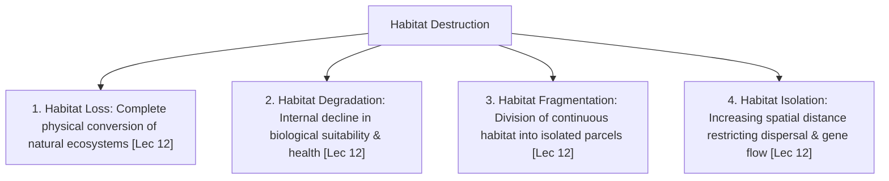

# Week 03 Cheat Sheet: Threats in the Modern World - I

**Course:** Biodiversity for Sustainability  
**Instructor:** Dr. Ankur Awadhiya, IFS  
**Lectures Covered:** Lecture 11 to Lecture 15  
**Quizzes Cross-Referenced:** `quiz_week_3.txt` ($N=10$) & `quiz_week_0.txt` (Practice)  

---

## 1. High-Yield Terminological & Definitional Matrix

| Citation | Term / Concept | Operational Scientific Definition | Exam Archetype | Exam Question Tag |
| :--- | :--- | :--- | :--- | :--- |
| `[Lec 11]` | **Specialist Species** | Organisms adapted to a very narrow, specific set of environmental conditions, food sources, or breeding microhabitats; highly vulnerable to early decline under disturbance. | Mechanistic Rationale | `[TESTED - 30% REPEAT POOL]` (W3-Q1) |
| `[Lec 11]` | **Generalist Species** | Disturbance-tolerant organisms possessing broad ecological niches, capable of shifting diet, behavior, or habitat use under changing environmental conditions. | Reverse Definition | `[UNSEEN HIGH-YIELD - 70% FINAL POOL]` |
| `[Lec 11]` | **Ecological Footprint of Energy** | The total spatial, material, and hydrological demand required by energy infrastructure (land conversion, mining, access roads, cooling water, dams, transmission corridors). | Causal Rationale | `[TESTED - 30% REPEAT POOL]` (W3-Q9) |
| `[Lec 11]` | **Per Capita Consumption** | The average quantity of energy, biological resources, water, and materials consumed per person within a given population or economic system. | Forward Definition | `[UNSEEN HIGH-YIELD - 70% FINAL POOL]` |
| `[Lec 12]` | **Habitat Loss** | The complete physical clearing, destruction, or conversion of natural ecosystems into anthropic landscapes (urban, agriculture, open-cast mines). | Forward Definition | `[UNSEEN HIGH-YIELD - 70% FINAL POOL]` |
| `[Lec 12]` | **Habitat Degradation** | A decline in the structural quality, biological suitability, or ecological integrity of a habitat while its physical volume or canopy remains standing. | Forward Definition | `[TESTED - 30% REPEAT POOL]` (W3-Q3) |
| `[Lec 12]` | **Habitat Fragmentation** | The breaking up of continuous, intact natural habitat into smaller, isolated patches separated by a human-dominated matrix. | Forward Definition | `[TESTED - 30% REPEAT POOL]` (W3-Q2) |
| `[Lec 12]` | **Human-Dominated Matrix** | The surrounding transformed landscape (croplands, highways, urban settlements) enclosing and ecologically isolating fragmented natural habitat parcels. | Spatial Definition | `[UNSEEN HIGH-YIELD - 70% FINAL POOL]` |
| `[Lec 12]` | **Dissection** | The initial stage of landscape fragmentation where linear infrastructure (roads, railways, powerlines) cuts through continuous forest, causing negligible area loss but major ecological cleavage. | Stage Classification | `[UNSEEN HIGH-YIELD - 70% FINAL POOL]` |
| `[Lec 12]` | **Perforation** | The second stage of fragmentation where localized clearings and openings (roadside shops, grazing clearings, cattle sheds) are punched into the interior forest matrix. | Stage Classification | `[UNSEEN HIGH-YIELD - 70% FINAL POOL]` |
| `[Lec 12]` | **Attrition** | The final, terminal stage of habitat fragmentation marked by the progressive shrinkage, erosion, and complete disappearance of remnant habitat patches. | Stage Classification | `[UNSEEN HIGH-YIELD - 70% FINAL POOL]` |
| `[Lec 13]` | **Overexploitation** | The harvesting or extraction of biological resources from natural populations at a rate exceeding their natural reproductive capacity to regenerate. | Forward Definition | `[TESTED - 30% REPEAT POOL]` (W3-Q10) |
| `[Lec 13]` | **Renewable Resource Collapse** | The state where an otherwise naturally regenerating biological stock becomes functionally non-renewable because harvesting continuously outpaces recruitment. | Mechanistic Rationale | `[TESTED - 30% REPEAT POOL]` (W3-Q5) |
| `[Lec 13]` | **Sustainable Use Principle** | The mandatory ecological baseline dictating that harvest removal rates must strictly remain below the population's biological regeneration capacity. | Management Rule | `[TESTED - 30% REPEAT POOL]` (W3-Q7) |
| `[Lec 13]` | **Tragedy of the Commons** | Economic scenario where unregulated, open-access resources incentivize rational individuals to maximize extraction, inevitably leading to collective resource collapse. | Socio-Ecological Law | `[UNSEEN HIGH-YIELD - 70% FINAL POOL]` |
| `[Lec 13]` | **Scarcity-Price Spiral** | Economic feedback loop where resource depletion increases market rarity, driving up commodity prices and creating intense economic incentives to poach the last remaining individuals. | Economic Dynamic | `[UNSEEN HIGH-YIELD - 70% FINAL POOL]` |
| `[Lec 14]` | **Native Species** | A species that occurs naturally within a specific geographic region without human intervention, having evolved as part of its long-term ecological community. | Forward Definition | `[TESTED - 30% REPEAT POOL]` (W3-Q6) |
| `[Lec 14]` | **Alien / Exotic Species** | A species intentionally or accidentally introduced by human agency outside its native, historical biogeographic distribution range. | Forward Definition | `[UNSEEN HIGH-YIELD - 70% FINAL POOL]` |
| `[Lec 14]` | **Invasive Alien Species (IAS)** | A non-native species that establishes self-sustaining populations, spreads aggressively beyond its introduction point, and causes ecological or economic harm. | Criteria Set | `[UNSEEN HIGH-YIELD - 70% FINAL POOL]` |
| `[Lec 14]` | **Enemy Release Hypothesis** | Theory explaining invasive dominance: introduced species flourish because they escape specialized predators, herbivores, parasites, and pathogens from their native range. | Mechanistic Hypothesis | `[UNSEEN HIGH-YIELD - 70% FINAL POOL]` |
| `[Lec 15]` | **Ghost Nets** | Commercial synthetic fishing nets that are lost, abandoned, or discarded at sea, continuing to trap, entangle, and drown marine wildlife indefinitely. | Reverse Definition | `[TESTED - 30% REPEAT POOL]` (W3-Q4) |
| `[Lec 15]` | **Light Pollution** | Excessive, misdirected, or obtrusive artificial lighting at night (ALAN) that alters natural day-night rhythms, disorientation, foraging, and reproductive phenology. | Causal Rationale | `[TESTED - 30% REPEAT POOL]` (W3-Q8) |
| `[Lec 15]` | **Eutrophication** | Accelerated biological productivity and algal blooms triggered by excess nitrogen ($N$) and phosphorus ($P$) runoff, culminating in severe aquatic hypoxia. | Causal Mechanism | `[UNSEEN HIGH-YIELD - 70% FINAL POOL]` |
| `[Lec 15]` | **Biomagnification** | The progressive increase in chemical concentration of persistent, non-biodegradable toxins (e.g., DDT, methylmercury) at successively higher trophic levels. | Reverse Definition | `[UNSEEN HIGH-YIELD - 70% FINAL POOL]` |

---

## 2. Four Distinct Forms of Habitat Destruction (Lecture 12)

* `[Lec 12]` **1. Habitat Loss:** Complete physical transformation (e.g., tropical rainforest cleared for oil palm or open-cast coal mining). Area drops to zero for native forest taxa `[UNSEEN HIGH-YIELD - 70% FINAL POOL]`.
* `[Lec 12]` **2. Habitat Degradation:** Forest stands remain physically upright, but soil topsoil is eroded, understory is invaded by alien weeds, or industrial air/chemical contaminants poison food chains `[TESTED - 30% REPEAT POOL]` (W3-Q3).
* `[Lec 12]` **3. Habitat Fragmentation:** Landscape broken into discrete fragments enclosed in an inhospitable human matrix; creates dangerous perimeter-to-area **edge effects** `[TESTED - 30% REPEAT POOL]` (W3-Q2).
* `[Lec 12]` **4. Habitat Isolation:** Physical distance exceeds the maximum natal dispersal distance or behavioral crossing threshold of native species, causing genetic drift and local inbreeding depression `[UNSEEN HIGH-YIELD - 70% FINAL POOL]`.

---

## 3. Four Sequential Stages of Landscape Fragmentation

| Citation | Fragmentation Stage | Physical Transformation Mechanics | Accompanying Ecological Degradation Pressures | Real-World Narrative Example |
| :--- | :--- | :--- | :--- | :--- |
| `[Lec 12]` | **1. Dissection** | Linear infrastructure (paved highways, railways, canals, transmission lines) carves through continuous interior forest. | Negligible canopy loss ($<1\%$), but bisects animal movement, introduces traffic mortality, vehicle noise, and poacher access. | Highway construction proposals citing "minimal forest diversion" while masking landscape cleavage. |
| `[Lec 12]` | **2. Perforation** | Small holes and clearings are punched into the interior forest matrix. | Creates artificial internal microclimatic edges; increases sunlight, raises temperature, lowers humidity, and invites invasive weeds. | Roadside tea/samosa shop opens, followed by cow grazing, woodcutting, shed construction, and family settlement. |
| `[Lec 12]` | **3. Fragmentation** | Expanding perforations coalesce; continuous canopy is severed into discrete, disjunct forest patches. | Interior core habitat collapses; wide-ranging mammals cannot cross hostile agricultural matrix; edge predators proliferate. | Agricultural expansion separating elephant herds into small, isolated forest pockets. |
| `[Lec 12]` | **4. Attrition** | Progressive physical shrinkage and piecemeal erosion of the remnant forest fragments until they disappear entirely. | Displaced wildlife is crowded into marginal, barren hilltops lacking forage; species face starvation, human-wildlife conflict, and extirpation. | Industrial plants and commercial monoculture tree plantations devouring the last green hilltop patches. |

---

## 4. Quantitative Baselines, Statistics & Historic Whaling Collapse

Whaling logbook records provide concrete empirical proof of overexploitation crashing long-lived marine megafauna to tiny fractions of their pre-industrial baselines:

| Citation | Marine Taxa / Common Name | Scientific Binomial | Historic Baseline Year | Current Residual Population Level (%) |
| :--- | :--- | :--- | :---: | :---: |
| `[Lec 12]` | **Blue Whale** *(Largest animal on Earth)* | *Balaenoptera musculus* | 1890 | **$\approx 1\%$** of historic baseline `[UNSEEN HIGH-YIELD - 70% FINAL POOL]` |
| `[Lec 12]` | **Bowhead Whale & Right Whale** | *Balaena mysticetus* & *Eubalaena* spp. | Pre-whaling | **$\approx 11\%$** of historic baseline `[UNSEEN HIGH-YIELD - 70% FINAL POOL]` |
| `[Lec 12]` | **Fin Whale** | *Balaenoptera physalus* | Pre-whaling | **$\approx 14\%$** of historic baseline `[UNSEEN HIGH-YIELD - 70% FINAL POOL]` |
| `[Lec 12]` | **Humpback Whale** | *Megaptera novaeangliae* | Pre-whaling | **$\approx 18\%$** of historic baseline `[UNSEEN HIGH-YIELD - 70% FINAL POOL]` |

---

## 5. Comprehensive Taxa, Case Studies & Invasive Taxonomies

| Citation | Organism / Scenario | Scientific Name / Taxon | Geographic Locale | Tested Ecological Mechanism & Vulnerability |
| :--- | :--- | :--- | :--- | :--- |
| `[Lec 11]` | **Giant Panda** *(Specialist archetype)* | *Ailuropoda melanoleuca* | Bamboo forests of Southwest China | Dietary extreme specialist: Diet consists almost entirely ($>99\%$) of bamboo; cannot switch food sources; declines first when habitat fragments `[TESTED - 30% REPEAT POOL]` (W3-Q1). |
| `[Lec 11]` | **Palash Tree** *(Generalist archetype)* | *Butea monosperma* (Fabaceae) | Degraded Indian Dry Deciduous Forests | Disturbance-tolerant generalist: Persists and flowers aggressively in degraded, overgrazed, and fragmented rural landscapes `[UNSEEN HIGH-YIELD - 70% FINAL POOL]`. |
| `[Lec 12]` | **Overgrazing on Arid Slopes** | Domestic Cattle / Small Ruminants | Arid and Semi-Arid Drylands | Vegetation loss destroys protective root binding; unanchored topsoil blows away, accelerating active desertification `[UNSEEN HIGH-YIELD - 70% FINAL POOL]`. |
| `[Lec 12]` | **Faulty Sloping Cultivation** | Flood Irrigation on Steep Hill Slopes | Agricultural Highlands | Rill and gully erosion strips biologically active topsoil; downstream siltation chokes riverbeds and smothers benthic aquatic life `[TESTED - 30% REPEAT POOL]` (W3-Q3). |
| `[Lec 13]` | **Commercial Shark Overharvesting** | Superorder Selachimorpha (Apex Predators) | Global Marine Fisheries | Non-selective harvest across all age cohorts (juveniles + mature adults); crashes recruitment; triggers marine trophic cascades `[UNSEEN HIGH-YIELD - 70% FINAL POOL]`. |
| `[Lec 14]` | **Andaman Bulletwood** *(Native archetype)* | *Mimusops andamanensis* / *Manilkara littoralis* | Andaman Islands (India) | Native baseline: Species evolved naturally within insular insular community networks without anthropogenic introduction `[TESTED - 30% REPEAT POOL]` (W3-Q6). |
| `[Lec 14]` | **Eucalyptus Plantation Tree** | *Eucalyptus* spp. (Myrtaceae) | Introduced across India from Australia | Deliberate introduction for fast timber/fuelwood; can lower local water tables and alters native understory composition `[UNSEEN HIGH-YIELD - 70% FINAL POOL]`. |
| `[Lec 14]` | **Lantana Weed & Parakeet Dispersal** | *Lantana camara* (Verbenaceae) | Introduced as ornamental from Central America to India | Profuse seeder; seeds dispersed by birds (parakeets); forms dense allelopathic thickets; actively uprooted in Mudumalai Tiger Reserve `[UNSEEN HIGH-YIELD - 70% FINAL POOL]`. |
| `[Lec 14]` | **Brown Tree Snake Insular Devastation** | *Boiga irregularis* | Island of Guam (Western Pacific) | Accidental transport via military cargo; drove Guam flycatcher to total extinction; extirpated 10 of 12 native forest bird species on Guam `[UNSEEN HIGH-YIELD - 70% FINAL POOL]`. |
| `[Lec 14]` | **Ross Island Feral Rabbits** | *Oryctolagus cuniculus* | Ross Island, Andamans (India) | Pet/domestic escape on predator-free island; explosive population boom causing severe ground vegetation denudation `[UNSEEN HIGH-YIELD - 70% FINAL POOL]`. |
| `[Lec 14]` | **Ballast Water Marine Invasions** | Aquatic Plankton / Zebra Mussels (*Dreissena*) | International Commercial Shipping Lanes | Ships intake ballast water with larvae, eggs, cysts in one port and discharge into distant ports, driving global aquatic bio-invasions `[UNSEEN HIGH-YIELD - 70% FINAL POOL]`. |
| `[Lec 14]` | **African Catfish Invasion** | *Clarias gariepinus* | Keoladeo Ghana National Park (Bharatpur, Rajasthan) | Aquaculture escape; aggressive predatory invader in wetlands, outcompeting native fish and altering food availability for Sarus Cranes `[UNSEEN HIGH-YIELD - 70% FINAL POOL]`. |
| `[Lec 14]` | **American Bullfrog Disease Vector** | *Lithobates catesbeianus* | Global Amphibian Habitats | Asymptomatic carrier/reservoir of lethal chytrid fungus (*Batrachochytrium dendrobatidis*), decimating native frog populations `[UNSEEN HIGH-YIELD - 70% FINAL POOL]`. |
| `[Lec 14]` | **Scottish Wildcat Genetic Swamping** | *Felis silvestris silvestris* | Scottish Highlands (UK) | Interspecific hybridization with feral domestic cats (*Felis catus*); pure genetic lineage pushed to functional extinction `[UNSEEN HIGH-YIELD - 70% FINAL POOL]`. |
| `[Lec 14]` | **Feral Cats in Tiger Reserves** | *Felis catus* | Manas Tiger Reserve (Assam, India) | Formidable invasive mesopredator; heavy predatory pressure decimating native avifauna, small reptiles, and rodents `[UNSEEN HIGH-YIELD - 70% FINAL POOL]`. |
| `[Lec 15]` | **Sea Turtle Hatchling Disorientation** | Superfamily Chelonioidea | Tropical Nesting Beaches | Light pollution (ALAN): Hatchlings misorient away from dark coastal dunes and toward bright hotel lighting, dying of exhaustion or traffic `[TESTED - 30% REPEAT POOL]` (W3-Q8). |
| `[Lec 15]` | **Ghost Nets Entanglement** | Abandoned Nylon Monofilament Nets | Global Ocean & Coral Reefs | Non-selective, continuous passive killing of cetaceans, pinnipeds, sea turtles, diving seabirds, and physical tearing of coral reefs `[TESTED - 30% REPEAT POOL]` (W3-Q4). |
| `[Lec 15]` | **Nilgiri Tahr Plastic Ingestion** | *Nilgiritragus hylocrius* | Mukurthi National Park (Nilgiris, Tamil Nadu) | Microplastic and plastic bag contamination inside strict wilderness zones; causes lethal gastrointestinal tract blockage `[UNSEEN HIGH-YIELD - 70% FINAL POOL]`. |
| `[Lec 15]` | **Raptor Eggshell Thinning from DDT** | Apex Birds of Prey (Hawks, Eagles) | Agricultural Watersheds | Bioaccumulation & biomagnification of organochlorine pesticide DDT; impairs calcium metabolism; thin shells crush under parent's body `[UNSEEN HIGH-YIELD - 70% FINAL POOL]`. |
| `[Lec 15]` | **Persistent Heavy Metal Toxicity** | Lead (Pb), Mercury (Hg), Cadmium (Cd), Arsenic (As) | Industrial Waterways & Estuaries | Non-biodegradable; persistent in sediments for decades; biomagnifies through aquatic food webs, causing multi-trophic neurological failure `[UNSEEN HIGH-YIELD - 70% FINAL POOL]`. |

---

## 6. Contrastive Paradigms & Distractor Diagnostic Traps

* `[Lec 11]` **Specialist vs. Generalist Extinction Risk:** Specialists possess narrow resource tolerances (e.g., Giant Panda $\rightarrow$ bamboo); Generalists shift diets easily (e.g., Palash tree). Distractor options claiming specialists *"reproduce faster"* or are *"disturbance-tolerant"* invert ecological reality `[TESTED - 30% REPEAT POOL]` (W3-Q1).
* `[Lec 12]` **Loss vs. Degradation vs. Fragmentation:** 
  * *Loss:* Area $= 0$.
  * *Degradation:* Area $> 0$, but ecological suitability collapses from within `[TESTED - 30% REPEAT POOL]` (W3-Q3).
  * *Fragmentation:* Area $> 0$, but severed into isolated parcels within a human matrix `[TESTED - 30% REPEAT POOL]` (W3-Q2).
* `[Lec 13]` **Renewable vs. Effectively Non-Renewable:** A biological resource is theoretically renewable via birth and growth; however, when harvest extraction exceeds natural recruitment, the biological capital is consumed, rendering it effectively non-renewable `[TESTED - 30% REPEAT POOL]` (W3-Q5).
* `[Lec 13]` **Legal vs. Sustainable Extraction Trap:** Distractors claiming *"Any legal extraction is automatically sustainable"* are false. Legal harvesting quotas frequently exceed ecological carrying capacity or lack enforcement against illegal poaching `[TESTED - 30% REPEAT POOL]` (W3-Q7).
* `[Lec 14]` **Introduced vs. Invasive Trap:** Not all non-native species are invasive! 
  * *Introduced/Alien:* Any organism transported across geographic boundaries.
  * *Invasive:* Must fulfill three rigorous criteria: **(1) Establishes, (2) Spreads, and (3) Causes ecological/economic harm**. Only a small percentage of aliens become invasive `[UNSEEN HIGH-YIELD - 70% FINAL POOL]`.
* `[Lec 14]` **Invasive Management Cascade:** Prevention (border biosecurity/quarantine; $>90\%$ cost-effective) $\gg$ Early Detection & Rapid Response (EDRR) $\gg$ Containment $\gg$ Control $\gg$ Eradication (virtually impossible once widespread) `[UNSEEN HIGH-YIELD - 70% FINAL POOL]`.
* `[Lec 15]` **Appearance vs. Ecological Health Trap:** The absence of a visible die-off crisis is NOT evidence of ecological health. Chemical residues, sub-lethal endocrine disruption, behavioral paralysis, and reproductive collapse operate invisibly long before adult mortality is detected `[UNSEEN HIGH-YIELD - 70% FINAL POOL]`.
