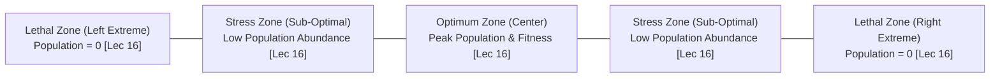
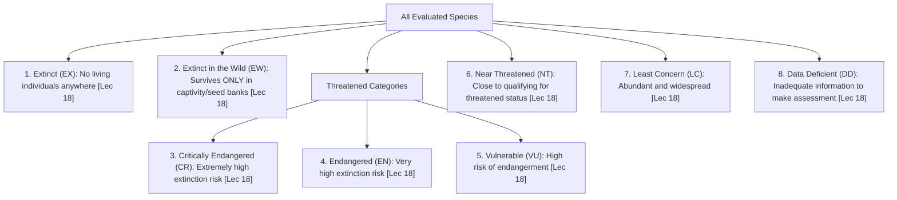
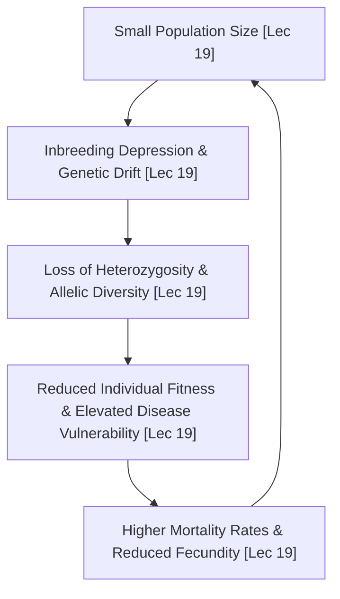

# Week 04 Cheat Sheet: Threats in the Modern World - II

**Course:** Biodiversity for Sustainability  
**Instructor:** Dr. Ankur Awadhiya, IFS  
**Lectures Covered:** Lecture 16 to Lecture 20  
**Quizzes Cross-Referenced:** `quiz_week_4.txt` ($N=10$) & `quiz_week_0.txt` (Practice)  

---

## 1. High-Yield Terminological & Definitional Matrix

| Citation | Term / Concept | Operational Scientific Definition | Exam Archetype | Exam Question Tag |
| :--- | :--- | :--- | :--- | :--- |
| `[Lec 16]` | **Classical Climate Period (WMO)** | The standard baseline period of **30 consecutive years** used by the World Meteorological Organization (WMO) to calculate statistical climatic normals and averages. | Numerical Baseline | `[TESTED - 30% REPEAT POOL]` (W4-Q2) |
| `[Lec 16]` | **Shelford’s Law of Tolerance** | Ecological principle stating that organism abundance and distribution are determined by a bell-shaped tolerance curve across environmental factors; population reaches zero at lethal extremes. | Graphic / Law | `[TESTED - 30% REPEAT POOL]` (W4-Q4) |
| `[Lec 16]` | **Major Climatic Changes Set** | The four primary interconnected global climatic alterations: (1) Rising temperatures, (2) Changing rainfall patterns, (3) More frequent extreme weather events, and (4) Shifting biological seasons. | Criteria Set | `[TESTED - 30% REPEAT POOL]` (W4-Q6) |
| `[Lec 16]` | **Specialist Climate Vulnerability** | Specialist species decline earliest because they possess narrow physiological and ecological tolerances and lack alternative diet, habitat, or thermal options. | Mechanistic Rationale | `[TESTED - 30% REPEAT POOL]` (W4-Q3) |
| `[Lec 16]` | **Phenological Mismatch** | Asynchrony caused when climate warming shifts the seasonal timing of interacting species at unequal rates (e.g., insect emergence desynchronizing from migratory bird chick hatching). | Temporal Disruption | `[UNSEEN HIGH-YIELD - 70% FINAL POOL]` |
| `[Lec 17]` | **Ocean Acidification** | The reduction in oceanic pH driven by the absorption of excess atmospheric anthropogenic carbon dioxide ($CO_2$), depleting seawater carbonate ions ($CO_3^{2-}$). | Chemical Process | `[UNSEEN HIGH-YIELD - 70% FINAL POOL]` |
| `[Lec 17]` | **Eutrophication** | Rapid, excessive algal and phytoplankton proliferation triggered by agricultural and domestic nutrient runoff (Nitrogen and Phosphorus), causing oxygen depletion and aquatic dead zones. | Causal Mechanism | `[TESTED - 30% REPEAT POOL]` (W4-Q8) |
| `[Lec 17]` | **Desertification** | Biological and physical degradation of dryland ecosystems resulting from human exploitation (overgrazing, deforestation, poor irrigation) compounded by climatic variations. | Land Degradation | `[UNSEEN HIGH-YIELD - 70% FINAL POOL]` |
| `[Lec 17]` | **Phosphorus Cycle Anomaly** | The fundamental biogeochemical distinction: unlike the carbon, nitrogen, and hydrological cycles, the phosphorus cycle has **no major atmospheric gaseous reservoir**. | Chemical Comparison | `[UNSEEN HIGH-YIELD - 70% FINAL POOL]` |
| `[Lec 17]` | **Decomposers' Ecological Role** | Heterotrophic organisms (bacteria, fungi, detritivores) that break down dead organic biomass and metabolic wastes, recycling locked elements back into the abiotic nutrient pool. | Functional Role | `[TESTED - 30% REPEAT POOL]` (W4-Q10) |
| `[Lec 18]` | **Overexploitation (Awadhiya Formulation)** | Harvesting or extracting biological organisms and forest resources faster than natural reproduction and recruitment can replace them. | Forward Definition | `[TESTED - 30% REPEAT POOL]` (W4-Q1) |
| `[Lec 18]` | **IUCN Extinct in the Wild (EW)** | Red List status assigned to a species that no longer possesses wild free-ranging populations and survives exclusively in captivity, zoos, botanical gardens, or seed banks. | Framework Category | `[TESTED - 30% REPEAT POOL]` (W4-Q5) |
| `[Lec 18]` | **Functional Extinction** | A state where a tiny population remains alive (e.g., only two post-reproductive females), but can no longer reproduce, sustain genetic diversity, or perform its ecological role. | Reverse Definition | `[UNSEEN HIGH-YIELD - 70% FINAL POOL]` |
| `[Lec 18]` | **Chytridiomycosis** | Epidemic fungal infection caused by *Batrachochytrium dendrobatidis* (Bd); disrupts amphibian cutaneous respiration and electrolyte transport, causing $>90$ species extinctions globally. | Infectious Disease | `[UNSEEN HIGH-YIELD - 70% FINAL POOL]` |
| `[Lec 19]` | **Allee Effect** | A positive density-dependent phenomenon where individual biological fitness, group foraging efficiency, or per-capita reproductive success fails when population density falls below a critical threshold. | Population Dynamic | `[TESTED - 30% REPEAT POOL]` (W4-Q9) |
| `[Lec 19]` | **Genetic Rescue** | Deliberate introduction of unrelated, genetically diverse individuals from an outside population into an inbred, declining population to restore heterozygosity and reduce deleterious defects. | Applied Genetics | `[TESTED - 30% REPEAT POOL]` (W4-Q7) |
| `[Lec 19]` | **Extinction Vortex** | A self-reinforcing downward spiral where small population size triggers inbreeding and genetic drift, causing lower fitness, higher mortality, and even smaller population size. | System Feedback | `[UNSEEN HIGH-YIELD - 70% FINAL POOL]` |
| `[Lec 19]` | **Demographic Stochasticity** | Random chance fluctuations in births, deaths, litter sizes, or sex ratios that disproportionately threaten small, isolated populations with sudden extinction. | Statistical Risk | `[UNSEEN HIGH-YIELD - 70% FINAL POOL]` |
| `[Lec 19]` | **Genetic Swamping (Pollution)** | Deleterious hybridization where rare wild populations interbreed with abundant domestic, feral, or exotic relatives, erasing locally adapted genotypes. | Genetic Threat | `[UNSEEN HIGH-YIELD - 70% FINAL POOL]` |
| `[Lec 20]` | **Sixth Mass Extinction (Anthropocene)** | The ongoing global extinction crisis driven by human overexploitation, habitat destruction, pollution, and climate change; distinguished by occurring orders of magnitude faster than historical background rates. | Macro-Evolutionary | `[UNSEEN HIGH-YIELD - 70% FINAL POOL]` |

---

## 2. Shelford's Law of Tolerance & Ecological Zones

* `[Lec 16]` **Optimum Center (Green):** Optimal thermal/moisture conditions where metabolic efficiency is maximized; supports high reproductive output, competitive dominance, and peak population density `[UNSEEN HIGH-YIELD - 70% FINAL POOL]`.
* `[Lec 16]` **Zones of Physiological Stress (Yellow):** Flanking sub-optimal conditions; organism survives with elevated metabolic expenditure, but exhibits stunted growth, suppressed reproduction, and declining abundance `[UNSEEN HIGH-YIELD - 70% FINAL POOL]`.
* `[Lec 16]` **Lethal Limits of Intolerance (Red):** Environmental conditions exceed physiological coping mechanisms entirely; **the population drops to zero** `[TESTED - 30% REPEAT POOL]` (W4-Q4).
* `[Lec 16]` **Simultaneous Constraint Rule:** Organisms do not face single isolated variables; survival requires fitting within the optimum/tolerable zones across multiple physical gradients simultaneously (temperature, moisture, salinity, pH) `[UNSEEN HIGH-YIELD - 70% FINAL POOL]`.

---

## 3. Biogeochemical Cycles: Comparative Metabolic Matrix

| Citation | Biogeochemical Cycle | Primary Natural Reservoirs | Key Biological / Geochemical Processes | Anthropogenic Perturbation & Ecological Consequence |
| :--- | :--- | :--- | :--- | :--- |
| `[Lec 17]` | **Carbon Cycle ($C$)** | Ocean waters, sedimentary rocks, fossil fuels, terrestrial vegetation, atmosphere. | Photosynthesis captures atmospheric $CO_2$; respiration, microbial decomposition, and combustion return $CO_2$ to air; ocean-atmosphere gas exchange. | Fossil fuel burning and deforestation accelerate active cycling $\rightarrow$ Greenhouse warming and severe ocean acidification `[UNSEEN HIGH-YIELD - 70% FINAL POOL]`. |
| `[Lec 17]` | **Nitrogen Cycle ($N$)** | Atmosphere ($78\%$ as inert $N_2$ gas), soil organic matter, living biomass. | Biological nitrogen fixation (Rhizobium, cyanobacteria), ammonification, nitrification ($NO_2^-, NO_3^-$), and bacterial denitrification. | Haber-Bosch industrial synthesis and massive synthetic fertilizer runoff $\rightarrow$ Atmospheric emissions and severe aquatic eutrophication `[UNSEEN HIGH-YIELD - 70% FINAL POOL]`. |
| `[Lec 17]` | **Phosphorus Cycle ($P$)** | Sedimentary rocks, marine sediments, soils (NO atmospheric gas phase!). | Weathering of phosphate minerals, plant uptake from soil water, trophic transfer, bacterial decomposition, long-term oceanic sedimentation. | Phosphate mining, detergent release, and agricultural runoff $\rightarrow$ Massive freshwater eutrophication and algal blooms `[UNSEEN HIGH-YIELD - 70% FINAL POOL]`. |
| `[Lec 17]` | **Hydrological Cycle ($H_2O$)** | Oceans ($97\%$), cryosphere glaciers/ice caps, groundwater, surface water, atmosphere. | Evaporation, evapotranspiration, atmospheric condensation, precipitation, surface runoff, soil infiltration, and groundwater percolation. | Deforestation reduces transpiration, increasing surface flash runoff; land clearing and climate change accelerate dryland desertification `[UNSEEN HIGH-YIELD - 70% FINAL POOL]`. |

---

## 4. Empirical Biological Entities, Scientific Binomials & Regional Taxa

| Citation | Common Name / Case Study | Scientific Name / Taxonomic Group | Geographic Region / Site | Tested Ecological Mechanism, Vulnerability & Conservation Status |
| :--- | :--- | :--- | :--- | :--- |
| `[Lec 16]` | **Coral Reef Ecosystems** | Class Anthozoa (Scleractinian Corals) | Tropical Shallow Oceans | Ocean Acidification Vulnerability: Lower seawater pH reduces available carbonate ions ($CO_3^{2-}$); inhibits calcium carbonate ($CaCO_3$) aragonite skeleton deposition `[UNSEEN HIGH-YIELD - 70% FINAL POOL]`. |
| `[Lec 18]` | **Northern White Rhinoceros** | *Ceratotherium simum cottoni* | Ol Pejeta Conservancy, Kenya | Functional Extinction archetype: Only 2 living individuals remain on Earth, both females (Najin and Fatu); natural breeding is biologically impossible `[UNSEEN HIGH-YIELD - 70% FINAL POOL]`. |
| `[Lec 18]` | **Great Indian Bustard (GIB)** | *Ardeotis nigriceps* (Otididae) | Desert National Park, Thar Desert, Rajasthan (India) | Critically Endangered (CR) heavy-bodied bird; poor frontal vision prevents avoiding overhead high-voltage power lines; low fecundity (1 egg/year) prevents population recovery `[UNSEEN HIGH-YIELD - 70% FINAL POOL]`. |
| `[Lec 18]` | **Javan & Sumatran Rhinoceros** | *Rhinoceros sondaicus* & *Dicerorhinus sumatrensis* | Southeast Asian Rain Forests (Java & Sumatra) | Critically Endangered (CR): Extreme population crashes; fewer than 80 wild individuals survive in fragmented jungle reserves `[UNSEEN HIGH-YIELD - 70% FINAL POOL]`. |
| `[Lec 18]` | **Laysan Albatross Chicks** | *Phoebastria immutabilis* | Midway Atoll, Pacific Ocean | Marine Plastic Pollution: Pelagic parents mistake floating surface plastic debris for squid/fish; chicks starve to death with stomachs impacted with plastic `[UNSEEN HIGH-YIELD - 70% FINAL POOL]`. |
| `[Lec 19]` | **Dodo** *(Flightless insular bird)* | *Raphus cucullatus* (Columbidae) | Mauritius (Indian Ocean, east of Madagascar) | Extinct (EX) archetype: Giant flightless dove (~1 m tall); lacked evolutionary fear of predators; ground nests destroyed by sailors and introduced pigs, monkeys, rats within $<100$ years `[UNSEEN HIGH-YIELD - 70% FINAL POOL]`. |
| `[Lec 19]` | **Asiatic Wild Dog / Dhole** | *Cuon alpinus* (Canidae) | Indian Forest Landscapes | Allee Effect archetype: Obligate cooperative pack hunters; hunting success relies on coordinated packs exhausting ungulate prey; pack decline below threshold causes hunting failure and starvation `[TESTED - 30% REPEAT POOL]` (W4-Q9). |
| `[Lec 19]` | **Florida Panther Genetic Rescue** | *Puma concolor coryi* | South Florida Swamps (USA) | Genetic Rescue archetype: Population crashed to ~30 in 1990s; inbreeding caused kinked tails, atrial septal heart defects, and cryptorchidism; 8 Texas cougars (*P. c. stanleyana*) introduced in 1995 rebounded population to $>200$ `[TESTED - 30% REPEAT POOL]` (W4-Q7). |

---

## 5. IUCN Red List Categories Hierarchy (Lecture 18)

* `[Lec 18]` **Extinct (EX):** Comprehensive field surveys fail to locate a single living individual anywhere on Earth (e.g., Dodo *Raphus cucullatus*, Passenger Pigeon *Ectopistes migratorius*) `[UNSEEN HIGH-YIELD - 70% FINAL POOL]`.
* `[Lec 18]` **Extinct in the Wild (EW):** Survives **only** in zoos, botanical gardens, captive breeding facilities, or seed banks; free-ranging populations completely vanished from historic geographic range `[TESTED - 30% REPEAT POOL]` (W4-Q5).
* `[Lec 18]` **Critically Endangered (CR):** Facing an extremely high risk of extinction in the wild in the immediate future; evaluated by severe population reduction, tiny geographic range, or adult count $<50$ (e.g., Great Indian Bustard) `[UNSEEN HIGH-YIELD - 70% FINAL POOL]`.

---

## 6. The Extinction Vortex Feedback Loop (Lecture 19)

* `[Lec 19]` **Vortex Mechanics:** Small populations do not decline linearly; they enter an accelerating, positive-feedback extinction spiral where internal genetic decay multiplies external ecological vulnerabilities `[UNSEEN HIGH-YIELD - 70% FINAL POOL]`.
* `[Lec 19]` **Tripartite Stochastic Threats:**
  1. *Demographic Stochasticity:* Random fluctuations in sex ratio (e.g., all remaining offspring born male) `[UNSEEN HIGH-YIELD - 70% FINAL POOL]`.
  2. *Environmental Stochasticity:* Unpredictable annual fluctuations in rainfall, temperature, or food availability.
  3. *Natural Catastrophes:* Singular severe events (cyclones, wildfires, epizootic outbreaks) wiping out remaining clusters.

---

## 7. Contrastive Pairs & Diagnostic Trap Summary

* `[Lec 16]` **Climate vs. Weather Trap:** Weather is short-term atmospheric variation; Climate is the statistical distribution of weather over the **30-year classical baseline** `[TESTED - 30% REPEAT POOL]` (W4-Q2).
* `[Lec 16]` **Shelford Curve Boundary Trap:** Distractors claiming that outside tolerance limits *"species immediately adapt genetically"* or *"shift to optimum range"* are false. Beyond tolerance limits, **the population drops to zero** `[TESTED - 30% REPEAT POOL]` (W4-Q4).
* `[Lec 17]` **Eutrophication Nutrient Trap:** Eutrophication is driven primarily by **Nitrogen and Phosphorus**; distractors substitute carbon or heavy metals. Oxygen is NOT released; it is severely depleted by bacterial decomposition of dead algae `[TESTED - 30% REPEAT POOL]` (W4-Q8).
* `[Lec 17]` **Decomposer Role Trap:** Distractors claiming decomposers *"remove producers"* or *"convert nutrients into fossil fuels"* are absurd; their role is to return elements to the abiotic nutrient pool `[TESTED - 30% REPEAT POOL]` (W4-Q10).
* `[Lec 18]` **Extinct vs. Extinct in the Wild:** Extinct = zero individuals on Earth; Extinct in the Wild = survives in captive, human-managed settings `[TESTED - 30% REPEAT POOL]` (W4-Q5).
* `[Lec 19]` **Allee Effect Trap:** Distractors define Allee effect as *"increased survival at high nutrients"* or *"faster adaptation"*; correct answer is strictly **fitness/reproductive failure at low density/size** `[TESTED - 30% REPEAT POOL]` (W4-Q9).
* `[Lec 19]` **Genetic Rescue vs. Genetic Swamping:** 
  * *Rescue:* Positive, scientifically guided introduction of diverse conspecifics to relieve inbreeding depression `[TESTED - 30% REPEAT POOL]` (W4-Q7).
  * *Swamping:* Harmful dilution of rare wild gene pools by fertile domestic or invasive relatives `[UNSEEN HIGH-YIELD - 70% FINAL POOL]`.
