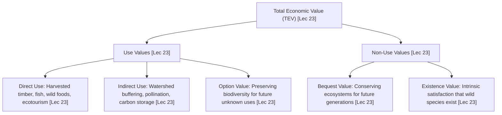
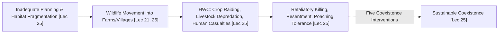

# Week 05 Cheat Sheet: Benefits of Coexistence

**Course:** Biodiversity for Sustainability  
**Instructor:** Dr. Ankur Awadhiya, IFS  
**Lectures Covered:** Lecture 21 to Lecture 25  
**Quizzes Cross-Referenced:** `quiz_week_5.txt` ($N=10$) & `quiz_week_0.txt` (Practice)  

---

## 1. High-Yield Terminological & Definitional Matrix

| Citation | Term / Concept | Operational Scientific Definition | Exam Archetype | Exam Question Tag |
| :--- | :--- | :--- | :--- | :--- |
| `[Lec 21]` | **Fortress Conservation Limits** | The flawed assumption that biodiversity can be sustained solely by strictly isolating it within fenced reserves; fails because $>80\%$ of land is outside PAs and species must move across boundaries. | Critical Concept | `[TESTED - 30% REPEAT POOL]` (W5-Q7) |
| `[Lec 21]` | **Reserve Movement Spillover** | The ecological reality that wildlife constantly traverses protected area borders into surrounding human matrices for forage, water, mates, or seasonal migration. | Spatial Dynamic | `[TESTED - 30% REPEAT POOL]` (W5-Q2) |
| `[Lec 21]` | **Shared Landscapes (Matrix)** | Working human-dominated mosaics (agroforestry, croplands, community pastures) managed to support both local livelihoods and wildlife dispersal corridors. | Applied Management | `[UNSEEN HIGH-YIELD - 70% FINAL POOL]` |
| `[Lec 21]` | **Ecosystem Engineer (Keystone)** | A species (e.g., Asian Elephant) that physically creates, modifies, and maintains habitat structures, nutrient flows, and water holes essential for multiple coexisting species. | Ecological Role | `[UNSEEN HIGH-YIELD - 70% FINAL POOL]` |
| `[Lec 22]` | **Microclimate Regulation** | Biophysical moderation of local ambient climate by vegetation through canopy shading, lowering surface temperatures ($10\text{--}15^\circ\text{C}$), and humidifying air via evapotranspiration. | Forward Definition | `[TESTED - 30% REPEAT POOL]` (W5-Q5) |
| `[Lec 22]` | **Hydrological Soil Regulation** | The regulation of water flows by root architecture and living soil communities, increasing rainwater infiltration, recharging aquifers, and attenuating surface storm runoff. | Forward Definition | `[TESTED - 30% REPEAT POOL]` (W5-Q8) |
| `[Lec 22]` | **Biological Pest Suppression** | The regulation of agricultural herbivorous pests by natural multi-species predator assemblages (insectivorous bats, birds, parasitoid wasps, spiders) without chemical inputs. | Applied Service | `[UNSEEN HIGH-YIELD - 70% FINAL POOL]` |
| `[Lec 23]` | **Non-Timber Forest Products (NTFPs)** | Wild biological resources harvested from forests without felling timber: fruits, edible nuts, resins, gums, medicinal plants, bamboo, fibers, honey, and tendu leaves. | Set Classification | `[TESTED - 30% REPEAT POOL]` (W5-Q4) |
| `[Lec 23]` | **Option Value** | The economic and societal benefit of preserving biological diversity today to keep it available for unforeseen, future utilitarian applications (e.g., novel pharmaceuticals, genes). | Economic Metric | `[TESTED - 30% REPEAT POOL]` (W5-Q3) |
| `[Lec 23]` | **Total Economic Value (TEV)** | Comprehensive valuation framework encompassing all direct use, indirect use, option, bequest, and existence values of ecosystems. | Economic Framework | `[UNSEEN HIGH-YIELD - 70% FINAL POOL]` |
| `[Lec 23]` | **Bequest Value** | Non-use value reflecting the satisfaction or moral duty derived from ensuring that biodiversity is conserved intact for future human generations. | Forward Definition | `[UNSEEN HIGH-YIELD - 70% FINAL POOL]` |
| `[Lec 23]` | **Existence Value** | Non-use value derived purely from the knowledge that wild species and wilderness areas exist, independent of any present or anticipated human utilization. | Forward Definition | `[UNSEEN HIGH-YIELD - 70% FINAL POOL]` |
| `[Lec 24]` | **Cultural Services of Biodiversity** | Non-material ecosystem benefits: recreation, aesthetic beauty, spiritual inspiration, artistic creation, educational enrichment, cultural heritage, and shared civic spaces. | Criteria Set | `[TESTED - 30% REPEAT POOL]` (W5-Q6) |
| `[Lec 24]` | **Health Support via Ecosystems** | Protection of human physical and mental health through biological filtration of air/water pollutants, suppression of infectious zoonoses, and biophilic psychological restoration. | Applied Health | `[TESTED - 30% REPEAT POOL]` (W5-Q10) |
| `[Lec 24]` | **Ethnopharmacology & TEK** | The scientific study of indigenous medical knowledge and bioactive compounds derived from wild plants (e.g., Artemisinin from *Artemisia annua*). | Ethnobotany | `[UNSEEN HIGH-YIELD - 70% FINAL POOL]` |
| `[Lec 25]` | **Human-Wildlife Conflict (HWC)** | Situations where wildlife requirements or behavior clash directly with human interests, causing crop damage, livestock predation, human injury/death, fear, and retaliation. | Forward Definition | `[TESTED - 30% REPEAT POOL]` (W5-Q1) |
| `[Lec 25]` | **Inadequate Spatial Planning** | Uncoordinated construction of linear infrastructure (roads, railways, canals), urban sprawl, and farming expansion that fragments corridors and drives HWC outbreaks. | Causal Rationale | `[TESTED - 30% REPEAT POOL]` (W5-Q9) |
| `[Lec 25]` | **Coexistence Principle: Risk Reduction** | Proactive preventive management (early warning telemetry, predator-proof corrals, bio-fencing, spatial zoning) implemented before conflict incidents happen. | Management Protocol | `[UNSEEN HIGH-YIELD - 70% FINAL POOL]` |

---

## 2. Total Economic Value (TEV) Framework for Biodiversity

* `[Lec 23]` **Direct Use Value:** Extractive goods directly harvested from ecosystems (timber, fuelwood, fish, medicinal plants) and non-extractive services (hiking, ecotourism, scientific research) `[UNSEEN HIGH-YIELD - 70% FINAL POOL]`.
* `[Lec 23]` **Indirect Use Value:** Functional ecological services that support human economic activity without direct physical extraction (e.g., wetland water filtration saving millions in municipal sewage treatment costs; forest carbon sequestration) `[UNSEEN HIGH-YIELD - 70% FINAL POOL]`.
* `[Lec 23]` **Option Value:** The willingness to pay to preserve biological diversity today as an insurance policy for potential future discoveries (e.g., uncharacterized rainforest plant compounds curing novel diseases) `[TESTED - 30% REPEAT POOL]` (W5-Q3).
* `[Lec 23]` **Bequest Value:** Non-utilitarian valuation placed on passing intact biological heritage, evolutionary lineages, and functioning landscapes to descendants `[UNSEEN HIGH-YIELD - 70% FINAL POOL]`.
* `[Lec 23]` **Existence Value:** Valuation completely divorced from human contact; people value knowing that blue whales, snow leopards, and polar bears survive in wilderness `[UNSEEN HIGH-YIELD - 70% FINAL POOL]`.

---

## 3. Human-Wildlife Conflict (HWC) to Coexistence Cascade

### 3.1 Five Core Principles of Coexistence Management (Lecture 25)
1. `[Lec 25]` **Proactive Risk Reduction:** Early warning trip-wires/SMS alerts; predator-proof chain-link corrals (kraals) for nocturnal livestock; unpalatable barrier crops (chili, ginger, tea) along forest edges; physical/solar fencing `[UNSEEN HIGH-YIELD - 70% FINAL POOL]`.
2. `[Lec 25]` **Rapid, Fair Compensation & Insurance:** Immediate, transparent financial reimbursement for verified crop raiding and livestock losses to prevent retaliatory poisoning or electrocution `[UNSEEN HIGH-YIELD - 70% FINAL POOL]`.
3. `[Lec 25]` **Community Empowerment & Participatory Governance:** Inclusion of local tribal and pastoral leaders in anti-depredation squads and reserve comanagement committees `[UNSEEN HIGH-YIELD - 70% FINAL POOL]`.
4. `[Lec 25]` **Equitable Conservation Benefit-Sharing:** Direct channeling of national park gate receipts, eco-tourism revenues, and forestry employment to frontline communities bearing the direct costs of living with dangerous wildlife `[UNSEEN HIGH-YIELD - 70% FINAL POOL]`.
5. `[Lec 25]` **Long-Term Institutional Relationship Management:** Continuous communication, approachable field staff, and sustained social trust, replacing ad-hoc post-disaster crisis intervention `[UNSEEN HIGH-YIELD - 70% FINAL POOL]`.

---

## 4. Empirical Biological Entities, Scientific Binomials & Regional Taxa

| Citation | Common Name / Case Study | Scientific Name / Taxonomic Group | Regional Landscape / Site | Ecological & Socio-Economic Coexistence Mechanism |
| :--- | :--- | :--- | :--- | :--- |
| `[Lec 21]` | **Asian Elephant Keystone Engineering** | *Elephas maximus* | Deciduous/Evergreen Forest Corridors (India) | Ecosystem Engineer archetype: Migrates through human-dominated matrix; knocks down tree canopies to create browse; excavates dry riverbed water holes used by other wildlife; disperses large seeds `[UNSEEN HIGH-YIELD - 70% FINAL POOL]`. |
| `[Lec 22]` | **Terraced Agro-ecosystems Slope Roots** | Multi-species Tree-Crop Mosaics | Himalayan and Western Ghats Highlands | Mechanical Slope Stabilization: Deep and fibrous root networks physically bind topsoil and subsoil, preventing rainfall-induced shallow landslides and mudflows `[UNSEEN HIGH-YIELD - 70% FINAL POOL]`. |
| `[Lec 22]` | **Insectivorous Bats & Raptors Pest Control** | Order Chiroptera (Bats) & Family Falconidae (Falcons) | Agricultural Production Belts | Biological Pest Regulation: Consume nocturnal moth pests (e.g., armyworms) and rodents, preventing thousands of dollars in crop destruction without chemical pesticides `[UNSEEN HIGH-YIELD - 70% FINAL POOL]`. |
| `[Lec 23]` | **Tendu Leaf & Mahua Tree NTFPs** | *Diospyros melanoxylon* (Tendu) & *Madhuca longifolia* (Mahua) | Central Indian Tribal Belts (Madhya Pradesh, Chhattisgarh) | NTFP Economic Support: Tendu leaves harvested for bidi manufacturing; Mahua flowers/seeds harvested for food, oil, and fermented beverages; forms 40–60% of rural cash income `[TESTED - 30% REPEAT POOL]` (W5-Q4). |
| `[Lec 24]` | **Sweet Wormwood & Artemisinin** | *Artemisia annua* (Asteraceae) | Traditional Chinese Medicine / Global Tropics | Ethnopharmacology archetype: Ancient herbal remedy for intermittent fevers yielded the sesquiterpene lactone **Artemisinin**, the frontline global anti-malarial drug `[UNSEEN HIGH-YIELD - 70% FINAL POOL]`. |
| `[Lec 24]` | **Sacred Groves of India** | *Ficus religiosa* (Peepal), *Ficus benghalensis* (Banyan) | *Deorais* (Maharashtra), *Kaavu* (Kerala), *Orans* (Rajasthan) | Cultural Service archetype: Community-protected climax forest patches dedicated to local folk deities; act as micro-refugia preserving rare endemic flora and medicinal herbs `[UNSEEN HIGH-YIELD - 70% FINAL POOL]`. |
| `[Lec 25]` | **Common Leopard Conflict in Agro-Pastoral Belts** | *Panthera pardus* | Sugarcane Belts of Maharashtra & Tea Gardens of Assam | HWC Manifestation: Leopards use dense tall sugarcane/tea bush cover as daytime daytime breeding/resting habitat; prey on domestic dogs and goats; trigger extreme human panic and retaliation `[UNSEEN HIGH-YIELD - 70% FINAL POOL]`. |

---

## 5. Ecosystem Services of Coexistence in Shared Landscapes

| Citation | Service Mechanism | Specific Physical / Ecological Action | Concrete Human & Economic Benefit |
| :--- | :--- | :--- | :--- |
| `[Lec 22]` | **Canopy Shading & Evapotranspiration** | Intercepts solar radiation; converts sensible heat into latent heat through water transpiration. | Mitigates urban heat island stress; lowers ground temperature by $10\text{--}15^\circ\text{C}$; slashes cooling energy demand `[TESTED - 30% REPEAT POOL]` (W5-Q5). |
| `[Lec 22]` | **Soil Infiltration & Runoff Attenuation** | Leaf litter layers absorb raindrop impact; fungal mycelia and root macropores enhance percolation. | Prevents flash flooding; reduces municipal storm drain expenditures; recharges agricultural groundwater wells `[TESTED - 30% REPEAT POOL]` (W5-Q8). |
| `[Lec 24]` | **Particulate & Contaminant Filtration** | Tree foliage traps suspended particulate matter ($PM_{2.5}, PM_{10}$); wetland root beds bio-remediate nitrates and heavy metals. | Lowers incidence of urban respiratory illnesses; purifies drinking water supplies for downstream towns `[TESTED - 30% REPEAT POOL]` (W5-Q10). |
| `[Lec 24]` | **Biophilic Mental Health Restoration** | Exposure to multi-sensory natural environments (bird calls, foliage color variation, green vistas). | Accelerates convalescence in hospitals; lowers chronic cortisol stress markers; supports cognitive development in school children `[TESTED - 30% REPEAT POOL]` (W5-Q6). |

---

## 6. Contrastive Paradigms & Distractor Diagnostic Traps

* `[Lec 21]` **Fortress Conservation vs. Coexistence Paradigm:**
  * *Fortress:* Fences, fines, strict exclusion of humans; assumes parks are self-contained islands `[TESTED - 30% REPEAT POOL]` (W5-Q7).
  * *Coexistence:* Integrates protected areas into the surrounding human matrix; builds local tolerance; manages buffer corridors `[TESTED - 30% REPEAT POOL]` (W5-Q2).
* `[Lec 23]` **Option Value vs. Existence Value:**
  * *Option Value:* Tangible future utilitarian benefit (e.g., potential future medicine or crop gene) `[TESTED - 30% REPEAT POOL]` (W5-Q3).
  * *Existence Value:* Non-utilitarian moral satisfaction that wild species simply exist in nature `[UNSEEN HIGH-YIELD - 70% FINAL POOL]`.
* `[Lec 23]` **Timber vs. NTFPs:** 
  * *Timber:* High-volume extractive logging felling standing tree trunks.
  * *NTFPs:* Non-destructive extraction of renewable plant parts (fruits, gums, resins, bamboo, fibers) `[TESTED - 30% REPEAT POOL]` (W5-Q4). Distractors listing *"coal, cement, steel, cars, buildings"* are immediate absolute exclusions.
* `[Lec 24]` **Cultural vs. Regulating vs. Conflict Items:**
  * *Cultural Services:* Recreation, inspiration, education, heritage, shared green spaces `[TESTED - 30% REPEAT POOL]` (W5-Q6).
  * *Distractors:* Distractors splice in regulating services (flood control, carbon storage) or conflict harms (crop raiding, livestock loss, fear) to trap inattentive students.
* `[Lec 25]` **Reactive Emergency vs. Proactive Coexistence:** Proactive spatial planning and early warnings prevent conflict; emergency-only armed response after someone is killed deepens community rage and political backlash `[TESTED - 30% REPEAT POOL]` (W5-Q9).
