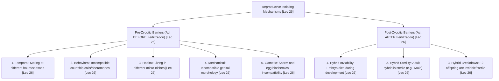
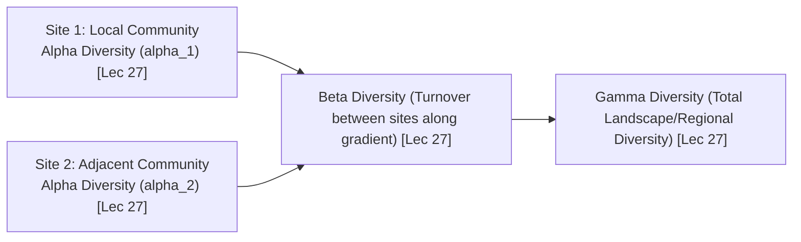

# Week 06 Cheat Sheet: Understanding Biodiversity

**Course:** Biodiversity for Sustainability  
**Instructor:** Dr. Ankur Awadhiya, IFS  
**Lectures Covered:** Lecture 26 to Lecture 30  
**Quizzes Cross-Referenced:** `quiz_week_6.txt` ($N=10$) & `quiz_week_0.txt` (Practice)  

---

## 1. High-Yield Terminological & Definitional Matrix

| Citation | Term / Concept | Operational Scientific Definition | Exam Archetype | Exam Question Tag |
| :--- | :--- | :--- | :--- | :--- |
| `[Lec 26]` | **Ecological Species Concept (Van Valen)** | Defines a species as a lineage that occupies a distinct adaptive zone and ecological niche, utilizing specific resources and environmental conditions. | Reverse Definition | `[TESTED - 30% REPEAT POOL]` (W6-Q1) |
| `[Lec 26]` | **Biological Species Concept (Mayr)** | Defines a species as groups of actually or potentially interbreeding natural populations that are reproductively isolated from other such groups. | Reverse Definition | `[UNSEEN HIGH-YIELD - 70% FINAL POOL]` |
| `[Lec 26]` | **Morphological Species Concept** | Defines a species primarily through shared anatomical structures, diagnostic phenotypes, and structural distinctiveness. | Reverse Definition | `[UNSEEN HIGH-YIELD - 70% FINAL POOL]` |
| `[Lec 26]` | **Evolutionary Species Concept (Simpson)** | Defines a species as a single lineage of ancestral-to-descendant populations maintaining its own evolutionary identity, tendencies, and historical fate. | Reverse Definition | `[UNSEEN HIGH-YIELD - 70% FINAL POOL]` |
| `[Lec 26]` | **Species as a Scientific Concept** | A flexible conceptual tool rather than a rigid formula, operationalized depending on context to emphasize interbreeding, diagnostic form, lineage, or niche. | Conceptual Tool | `[TESTED - 30% REPEAT POOL]` (W6-Q10) |
| `[Lec 26]` | **Speciation** | The macro-evolutionary splitting of a single ancestral biological lineage into two or more independently evolving, reproductively isolated descendant species. | Forward Definition | `[TESTED - 30% REPEAT POOL]` (W6-Q9) |
| `[Lec 26]` | **Temporal Isolation** | A pre-zygotic reproductive barrier where closely related sympatric species breed at different hours of the day, different seasons, or different lunar cycles. | Reverse Definition | `[TESTED - 30% REPEAT POOL]` (W6-Q5) |
| `[Lec 26]` | **Hybrid Sterility** | A post-zygotic reproductive barrier where hybrid offspring survive to healthy adulthood but are sterile due to meiotic chromosome pairing failure (e.g., Mule). | Reverse Definition | `[UNSEEN HIGH-YIELD - 70% FINAL POOL]` |
| `[Lec 27]` | **Biological Diversity (Full Definition)** | The variety of life within species (genetic diversity), among species (species diversity), and among ecosystems (ecosystem diversity). | Forward Definition | `[TESTED - 30% REPEAT POOL]` (W6-Q8) |
| `[Lec 27]` | **Genetic Diversity** | The total variation in hereditary nucleotide sequences, alleles, and chromosomal architecture among individuals and populations of a species. | Reverse Definition | `[TESTED - 30% REPEAT POOL]` (W6-Q3) |
| `[Lec 27]` | **Biodiversity Hotspot Criteria** | A biogeographic region combining three indispensable criteria: **(1) High species richness, (2) High endemism ($\ge 1,500$ vascular plants), and (3) Significant threat ($\ge 70\%$ primary loss)**. | Criteria Set | `[TESTED - 30% REPEAT POOL]` (W6-Q4) |
| `[Lec 27]` | **Alpha ($\alpha$) Diversity** | Local species richness observed within a single, uniform habitat, site, or community. | Quantitative Metric | `[UNSEEN HIGH-YIELD - 70% FINAL POOL]` |
| `[Lec 27]` | **Beta ($\beta$) Diversity** | The rate of species turnover or compositional change between different communities along an environmental, elevational, or spatial gradient. | Quantitative Metric | `[UNSEEN HIGH-YIELD - 70% FINAL POOL]` |
| `[Lec 27]` | **Gamma ($\gamma$) Diversity** | The total regional species diversity across all habitats and ecosystems within an entire geographic landscape or biome. | Quantitative Metric | `[TESTED - 30% REPEAT POOL]` (W6-Q7) |
| `[Lec 28]` | **Transplant Experiment** | Field experimental protocol moving organisms outside their occupied range: survival indicates dispersal limitation; mortality indicates abiotic or biotic physiological limits. | Experimental Method | `[UNSEEN HIGH-YIELD - 70% FINAL POOL]` |
| `[Lec 29]` | **Habitat Quality Five-Factor Set** | The five primary determinants of wildlife habitat suitability: **Food, Water, Shelter/Cover, Breeding Sites, and Low Anthropogenic Disturbance**. | Criteria Set | `[TESTED - 30% REPEAT POOL]` (W6-Q2) |
| `[Lec 29]` | **Allelopathy** | Biochemical warfare where an organism releases secondary metabolites into surrounding soil or water that inhibit the germination, growth, or survival of competitor plants. | Biochemical Action | `[TESTED - 30% REPEAT POOL]` (W6-Q6) |
| `[Lec 29]` | **Fundamental vs. Realized Niche** | Fundamental Niche: physiological range occupied in the absence of biotic enemies; Realized Niche: actual restricted range occupied under interspecific competition and predation. | Contrastive Pair | `[UNSEEN HIGH-YIELD - 70% FINAL POOL]` |
| `[Lec 30]` | **Hamilton’s Rule of Kin Selection** | Evolutionary inequality governing the selection of altruistic social behavior: $r \cdot b > c$ (Relatedness $\times$ Recipient Benefit exceeds Actor Cost). | Mathematical Rule | `[UNSEEN HIGH-YIELD - 70% FINAL POOL]` |
| `[Lec 30]` | **Territory Size-Resource Inversion** | Ecological law stating that territory size is inversely proportional to resource density (high food density = smaller defended territory; sparse food = large territory). | Behavioral Dynamic | `[UNSEEN HIGH-YIELD - 70% FINAL POOL]` |
| `[Lec 30]` | **Ethogram** | Standardized, objective catalogue or descriptive inventory of all distinct behavioral phenotypes exhibited by an animal species. | Research Tool | `[UNSEEN HIGH-YIELD - 70% FINAL POOL]` |

---

## 2. Reproductive Isolation Barriers Diagnostic Matrix (Lecture 26)

| Citation | Reproductive Barrier Class | Specific Barrier Type | Exact Biological Mechanism | Concrete Lecture Example |
| :--- | :--- | :--- | :--- | :--- |
| `[Lec 26]` | **Pre-Zygotic** | **Temporal Isolation** | Sympatric species mate during different diurnal hours, seasons, or months `[TESTED - 30% REPEAT POOL]` (W6-Q5). | Closely related frogs calling and breeding in spring vs. late summer. |
| `[Lec 26]` | **Pre-Zygotic** | **Behavioral Isolation** | Courtship displays, plumage patterns, or species-specific pheromones are not recognized by other species. | Unique flash patterns in sympatric firefly species preventing cross-mating. |
| `[Lec 26]` | **Pre-Zygotic** | **Habitat (Ecological) Isolation** | Species occupy different microhabitats or vegetation layers within the same broad geographical landscape. | Canopy-dwelling bird species vs. forest-floor ground dwellers never encountering each other. |
| `[Lec 26]` | **Pre-Zygotic** | **Mechanical Isolation** | Structural or anatomical incompatibility of reproductive organs ("lock and key" genital mismatch). | Specialized floral morphology allowing pollination only by specific long-tongued hawk-moths. |
| `[Lec 26]` | **Pre-Zygotic** | **Gametic Isolation** | Molecular and chemical incompatibility; sperm cannot survive in female reproductive tract or bind to egg ovum. | Broadcast-spawning marine sea urchins whose sperm surface proteins fail to bind foreign eggs. |
| `[Lec 26]` | **Post-Zygotic** | **Hybrid Inviability (Embryo Inviability)** | Genetic incompatibilities arrest developmental mitosis; hybrid zygote or embryo dies prematurely before hatching/birth. | Incompatible gene expression during cleavage stages leading to spontaneous embryonic abortion. |
| `[Lec 26]` | **Post-Zygotic** | **Hybrid Sterility** | Interspecific hybrid develops into a vigorous adult, but homologous chromosomes cannot pair during meiosis. | Mule: Female Horse ($2n = 64$) $\times$ Male Donkey ($2n = 62$) $\rightarrow$ Mule ($2n = 63$); odd chromosome number causes sterility `[UNSEEN HIGH-YIELD - 70% FINAL POOL]`. |
| `[Lec 26]` | **Post-Zygotic** | **Hybrid Breakdown** | First-generation ($F_1$) hybrids are viable and fertile, but subsequent $F_2$ generations are feeble, sterile, or inviable. | Crop hybridization where backcrossed progeny suffer catastrophic chromosomal rearrangements. |

---

## 3. Spatial Diversity Scales: Alpha ($\alpha$), Beta ($\beta$), Gamma ($\gamma$)

* `[Lec 27]` **Alpha ($\alpha$) Diversity:** Local within-site species richness. E.g., the exact count of bird species observed in a single wetland marsh `[UNSEEN HIGH-YIELD - 70% FINAL POOL]`.
* `[Lec 27]` **Beta ($\beta$) Diversity:** Species turnover along an environmental gradient between distinct habitats. E.g., comparing how many species are replaced when transitioning from a riparian marsh to an upland dry scrub forest `[UNSEEN HIGH-YIELD - 70% FINAL POOL]`.
* `[Lec 27]` **Gamma ($\gamma$) Diversity:** Regional, macro-scale species richness across the entire geographical landscape `[TESTED - 30% REPEAT POOL]` (W6-Q7).
* `[Lec 27]` **The Island Swamp Thought Experiment:** An island contains a dry forest, a rocky slope, and a freshwater swamp. If the swamp is drained, a swamp-specialist lizard is extirpated. Even if generalist species temporarily occupy the site, **island-wide Gamma ($\gamma$) diversity falls permanently from 3 to 2** `[UNSEEN HIGH-YIELD - 70% FINAL POOL]`.

---

## 4. Norman Myers Biodiversity Hotspot Quantitative Framework

* `[Lec 27]` **Three Core Conceptual Features `[TESTED - 30% REPEAT POOL]` (W6-Q4):**
  1. Exceptionally high **Species Richness**.
  2. Exceptionally high levels of **Endemism** (taxa restricted exclusively to that geographic zone).
  3. Severe, imminent **Anthropogenic Threat**.
* `[Lec 27]` **Strict Quantitative Benchmarks (`EXAM_PATTERN.md`):**
  * **Endemism Threshold:** Must contain at least **$1,500$ species of vascular plants as endemics** ($>0.5\%$ of the world's total plant diversity).
  * **Threat Threshold:** Must have suffered a loss of at least **$70\%$ of its original primary native vegetation** (retaining $\le 30\%$ of pristine habitat).
* `[Lec 27]` **Indian Hotspots Represented:**
  * *Western Ghats:* Humid evergreen forests with extreme amphibian and tree endemism.
  * *Eastern Himalayas:* Elevational diversity gradient; high orchid, floral, and avifaunal richness.

---

## 5. Empirical Biological Entities, Scientific Binomials & Regional Taxa

| Citation | Common Name / Case Study | Scientific Name / Taxonomic Group | Geographic Locale / Ecosystem | Tested Ecological Principle, Behavioral Rule & Conservation Context |
| :--- | :--- | :--- | :--- | :--- |
| `[Lec 26]` | **Mule Hybrid Sterility** | *Equus caballus* $\times$ *Equus asinus* | Domestic Hybridization | Post-zygotic barrier archetype: Female horse ($2n = 64$) $\times$ male donkey ($2n = 62$) yields sterile mule ($2n = 63$); odd chromosome number prevents meiotic pairing `[UNSEEN HIGH-YIELD - 70% FINAL POOL]`. |
| `[Lec 27]` | **Deodar & Coniferous Canopy** | *Cedrus deodara* (Pinaceae) | Western Himalayas (Himachal Pradesh) | Ecosystem diversity archetype: Cool temperate climate with seasonal snowfall supporting structural coniferous canopy diversity `[UNSEEN HIGH-YIELD - 70% FINAL POOL]`. |
| `[Lec 28]` | **Sea Urchin Herbivory Range Boundary** | Class Echinoidea & Marine Macroalgae | Intertidal Rocky Shores | Biotic range limitation: High sea urchin grazing density clears algae; low urchin density allows algae proliferation; biotic interaction dictates distribution `[UNSEEN HIGH-YIELD - 70% FINAL POOL]`. |
| `[Lec 29]` | **Black Walnut Allelopathy** | *Juglans nigra* (Juglandaceae) | Temperate Deciduous Forests | Allelopathy archetype: Roots exude biochemical toxin **Juglone** (5-hydroxy-1,4-naphthoquinone), inhibiting respiration and germination of tomatoes and pines `[TESTED - 30% REPEAT POOL]` (W6-Q6). |
| `[Lec 29]` | **Lantana Biochemical Exudates** | *Lantana camara* (Verbenaceae) | Subtropical Woodlands (India) | Allelopathic weed competition: Releases phenolic secondary compounds into the soil that suppress germination of native forest saplings `[TESTED - 30% REPEAT POOL]` (W6-Q6). |
| `[Lec 29]` | **Shola-Grassland High-Altitude Mosaic** | Stunted Montane Evergreen Forest & Grassland | High Elevations of Western Ghats (Nilgiris, Anamalais) | Microclimate and endemic refuge: Stunted evergreen trees ("Sholas") restricted to mist-filled valley folds; acts as a regional water sponge feeding peninsular rivers `[UNSEEN HIGH-YIELD - 70% FINAL POOL]`. |
| `[Lec 29]` | **Gharial Sand Mining Threat** | *Gavialis gangeticus* | National Chambal Sanctuary (Morena, Madhya Pradesh) | Habitat Quality degradation: Critically Endangered crocodilian; illegal commercial riverbed sand mining destroys basking and egg-laying sandbars; managed by *ex-situ* egg head-starting `[UNSEEN HIGH-YIELD - 70% FINAL POOL]`. |
| `[Lec 29]` | **Gangetic Dolphin & Red-crowned Turtle** | *Platanista gangetica* & *Batagur kachuga* | Chambal River Ecosystem | Riverine endemic co-inhabitants; threatened by motorized water extraction, sand excavation, and fishing nets `[UNSEEN HIGH-YIELD - 70% FINAL POOL]`. |
| `[Lec 30]` | **Lion Coalition Kin Cooperation** | *Panthera leo* (Felidae) | Savannah Woodlands / Gir Forest (Gujarat) | Hamilton's Kin Selection ($r \cdot b > c$): Related male coalitions defend pride territory and protect cubs from infanticide; collective benefit exceeds shared paternity cost `[UNSEEN HIGH-YIELD - 70% FINAL POOL]`. |

---

## 6. Mathematical & Behavioral Models (Lecture 30)

### 6.1 Hamilton's Rule of Kin Selection
$$\mathbf{r \cdot b > c}$$
* `[Lec 30]` $\mathbf{r}$ = Coefficient of genetic relatedness between actor and recipient:
  * Parent-Offspring: $r = 0.5$
  * Full Sibling: $r = 0.5$
  * Half Sibling: $r = 0.25$
  * First Cousin: $r = 0.125$
* `[Lec 30]` $\mathbf{b}$ = Additional reproductive fitness benefit gained by the recipient.
* `[Lec 30]` $\mathbf{c}$ = Direct reproductive fitness cost suffered by the altruistic actor.
* `[Lec 30]` *Core Principle:* Altruistic or cooperative behaviors are evolutionarily favored when genetic relatedness weighted by benefit exceeds personal cost `[UNSEEN HIGH-YIELD - 70% FINAL POOL]`.

### 6.2 Territory Size vs. Resource Density Inverse Law
$$\mathbf{\text{Territory Size}} \propto \frac{1}{\mathbf{\text{Resource Density}}}$$
* `[Lec 30]` **High Resource Density:** High food/prey availability concentrated in space $\rightarrow$ Animal can meet energetic needs in a compact zone $\rightarrow$ **Territory size contracts** `[UNSEEN HIGH-YIELD - 70% FINAL POOL]`.
* `[Lec 30]` **Sparse Resource Density:** Resources scattered widely $\rightarrow$ Animal must patrol a massive boundary to secure minimum calories $\rightarrow$ **Territory size expands** `[UNSEEN HIGH-YIELD - 70% FINAL POOL]`.

---

## 7. Contrastive Paradigms & Distractor Diagnostic Traps

* `[Lec 26]` **Pre-Zygotic vs. Post-Zygotic Traps (`EXAM_PATTERN.md` Gold Example 2):**
  * *Stem asks:* "Which barrier acts BEFORE fertilization?"
  * *Correct Answer:* **Temporal isolation** `[TESTED - 30% REPEAT POOL]` (W6-Q5).
  * *Engineered Distractors:* Hybrid sterility, hybrid breakdown, embryo inviability (all three are post-zygotic barriers from the adjacent slide column!).
* `[Lec 26]` **Four Species Concepts Diagnostic Rules:**
  * *Ecological:* Focuses on **niche, environmental conditions, and resource use** `[TESTED - 30% REPEAT POOL]` (W6-Q1).
  * *Biological:* Focuses on **interbreeding and reproductive isolation** `[UNSEEN HIGH-YIELD - 70% FINAL POOL]`.
  * *Morphological:* Focuses on **anatomical form and structural phenotypes** `[UNSEEN HIGH-YIELD - 70% FINAL POOL]`.
  * *Evolutionary:* Focuses on **independent ancestor-descendant lineages** `[UNSEEN HIGH-YIELD - 70% FINAL POOL]`.
* `[Lec 27]` **Biodiversity Hotspot Traps (`EXAM_PATTERN.md` Gold Example 1):**
  * *Stem asks:* "A biodiversity hotspot combines which three features?"
  * *Correct Answer:* **High species richness, high endemism, and significant threat** `[TESTED - 30% REPEAT POOL]` (W6-Q4).
  * *Engineered Distractors:* Replace criteria with plausible geographical correlates (*"High rainfall, high elevation, high productivity"*) or invert the terms (*"low disturbance, low threat"*).
* `[Lec 27]` **Alpha vs. Gamma Diversity Trap:**
  * *Alpha:* Diversity within one wetland marsh `[UNSEEN HIGH-YIELD - 70% FINAL POOL]`.
  * *Gamma:* Total diversity across a **larger regional landscape** `[TESTED - 30% REPEAT POOL]` (W6-Q7).
* `[Lec 29]` **Allelopathy vs. Social Grouping Trap:**
  * *Allelopathy:* Chemical plant inhibition `[TESTED - 30% REPEAT POOL]` (W6-Q6).
  * *Distractors:* Describe anti-predator grouping, altitudinal shifts, or interbreeding.
* `[Lec 29]` **Habitat Quality Five-Factor Trap:**
  * *Correct:* **Food, water, shelter, breeding sites, and low disturbance** `[TESTED - 30% REPEAT POOL]` (W6-Q2).
  * *Distractors:* Claim habitat quality depends *"only on legal status on paper"* or *"whether it appears on a map"*.
