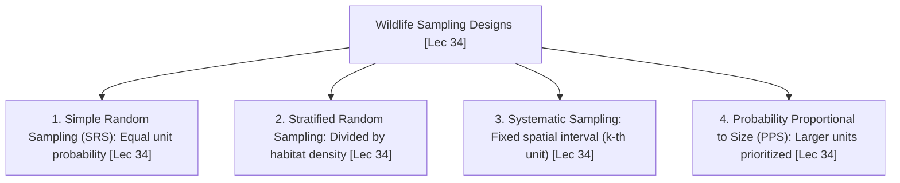
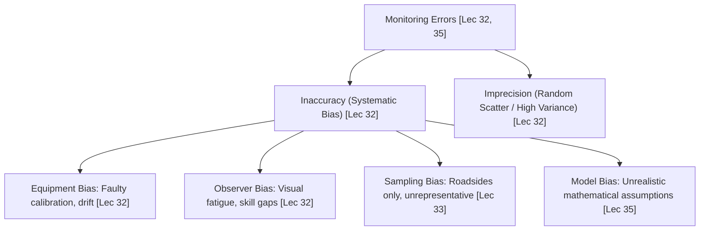

# Week 07 Cheat Sheet: Measuring Biodiversity

**Course:** Biodiversity for Sustainability  
**Instructor:** Dr. Ankur Awadhiya, IFS  
**Lectures Covered:** Lecture 31 to Lecture 35  
**Quizzes Cross-Referenced:** `quiz_week_7.txt` ($N=10$) & `quiz_week_0.txt` (Practice)  

---

## 1. High-Yield Terminological & Definitional Matrix

| Citation | Term / Concept | Operational Scientific Definition | Exam Archetype | Exam Question Tag |
| :--- | :--- | :--- | :--- | :--- |
| `[Lec 31]` | **Population in Wildlife Studies** | Individuals of the same biological species occupying a defined geographical area that are capable of naturally interbreeding. | Forward Definition | `[TESTED - 30% REPEAT POOL]` (W7-Q7) |
| `[Lec 31]` | **Population Gains Pair** | The two demographic mechanisms that increase population size: **Births (Natality)** and **Immigration ($B + I$)**. | Set Pair | `[TESTED - 30% REPEAT POOL]` (W7-Q8) |
| `[Lec 31]` | **Population Losses Pair** | The two demographic mechanisms that decrease population size: **Deaths (Mortality)** and **Emigration ($D + E$)**. | Set Pair | `[TESTED - 30% REPEAT POOL]` (W7-Q6) |
| `[Lec 31]` | **Absolute vs. Relative Abundance** | Absolute: total number of individual organisms in an area; Relative: an index or proxy metric of abundance (e.g., encounter rate, dung piles/km) used to track temporal trends. | Contrastive Pair | `[UNSEEN HIGH-YIELD - 70% FINAL POOL]` |
| `[Lec 32]` | **Accuracy (Correctness)** | The closeness of a measured or estimated value to the actual, true underlying population parameter. | Forward Definition | `[UNSEEN HIGH-YIELD - 70% FINAL POOL]` |
| `[Lec 32]` | **Precision (Repeatability)** | The degree of mutual agreement, closeness, or clustering among repeated independent measurements of the same quantity under identical conditions. | Forward Definition | `[UNSEEN HIGH-YIELD - 70% FINAL POOL]` |
| `[Lec 32]` | **Systematic Bias** | Consistent directional deviation of a sample estimate from the true population value caused by flawed equipment, unrepresentative design, or observer error. | Forward Definition | `[TESTED - 30% REPEAT POOL]` (W7-Q4) |
| `[Lec 32]` | **Equipment Bias** | Systematic distortion in data collection resulting directly from the physical failure, drift, or faulty calibration of a measuring instrument. | Reverse Definition | `[TESTED - 30% REPEAT POOL]` (W7-Q3) |
| `[Lec 32]` | **Observer Bias** | Systematic differences in detection, counting, or measurement caused by variations in observer visual acuity, field experience, alertness, or search speed. | Reverse Definition | `[UNSEEN HIGH-YIELD - 70% FINAL POOL]` |
| `[Lec 32]` | **Sampling Intensity Formula** | The ratio of the number of sample units surveyed ($n$) to the total population units existing in the defined study area ($N$): $\text{Sampling Intensity} = n / N$. | Exact Formula | `[TESTED - 30% REPEAT POOL]` (W7-Q10) |
| `[Lec 33]` | **Tiger Camera-Trap Identification** | Methodology using remote sensor camera traps to identify individual Bengal tigers based on their unique, lifelong, asymmetrical flank stripe patterns. | Applied Survey | `[TESTED - 30% REPEAT POOL]` (W7-Q5) |
| `[Lec 33]` | **Passive Acoustic Monitoring (PAM)** | Continuous recording of underwater or terrestrial soundscapes using automated hydrophones/recorders to detect vocalizations of deep-diving cetaceans, bats, or birds. | Field Protocol | `[UNSEEN HIGH-YIELD - 70% FINAL POOL]` |
| `[Lec 33]` | **Pugmark Census Method** | Historical Indian forestry tracking protocol recording plaster casts or tracings of the left-hind pugmark on Pugmark Impression Pads (PIPs) to estimate carnivore numbers. | Field Method | `[UNSEEN HIGH-YIELD - 70% FINAL POOL]` |
| `[Lec 34]` | **Simple Random Sampling (SRS)** | Probability sampling design where every sampling unit in the target population has an equal, non-zero, and independent probability of being selected ($1/N$). | Forward Definition | `[TESTED - 30% REPEAT POOL]` (W7-Q1) |
| `[Lec 34]` | **Stratified Random Sampling** | Sampling design partitioning a heterogeneous landscape into non-overlapping homogeneous strata (e.g., habitat types); applied when animal density varies across habitats. | Applied Design | `[TESTED - 30% REPEAT POOL]` (W7-Q2) |
| `[Lec 34]` | **Probability Proportional to Size (PPS)** | Sampling design where larger sampling units (by geographical area, biomass, or volume) have a proportionally higher mathematical probability of being selected. | Forward Definition | `[TESTED - 30% REPEAT POOL]` (W7-Q9) |
| `[Lec 34]` | **Systematic Sampling** | Selection of sampling units at regular spatial or temporal intervals ($k^{\text{th}}$ unit) along transects or grids; vulnerable to hidden landscape periodicity. | Applied Design | `[UNSEEN HIGH-YIELD - 70% FINAL POOL]` |
| `[Lec 34]` | **Pan Trapping for Pollinators** | Standardized insect survey using shallow bowls painted in UV-reflective primary colors (yellow, blue, white) filled with soapy water placed at surrounding vegetation height. | Invertebrate Gear | `[UNSEEN HIGH-YIELD - 70% FINAL POOL]` |
| `[Lec 34]` | **Lincoln-Petersen Capture-Recapture** | Classical two-sample estimator for closed populations based on the proportion of marked animals recaptured in a subsequent trapping session: $N = (M \cdot n) / m$. | Mathematical Model | `[UNSEEN HIGH-YIELD - 70% FINAL POOL]` |
| `[Lec 35]` | **Distance Sampling (Line Transect)** | Density estimation method that models the detection probability function $g(y)$ as a decreasing function of perpendicular distance $y$ from the surveyed centerline. | Statistical Model | `[UNSEEN HIGH-YIELD - 70% FINAL POOL]` |
| `[Lec 35]` | **Zero Distance Detection Assumption: $g(0) = 1$** | Fundamental premise of distance sampling: all individual animals located directly on the centerline transect ($y = 0$) are detected with absolute $100\%$ certainty. | Critical Assumption | `[UNSEEN HIGH-YIELD - 70% FINAL POOL]` |
| `[Lec 35]` | **Effective Strip Half-Width ($\mu$ / ESHW)** | The perpendicular distance from a transect line such that the number of animals missed within $\mu$ equals the number detected beyond $\mu$: $\mu = \int_0^w g(y)\,dy$. | Quantitative Metric | `[UNSEEN HIGH-YIELD - 70% FINAL POOL]` |
| `[Lec 35]` | **Akaike Information Criterion (AIC)** | An information-theoretic statistical metric used in distance sampling to select the most parsimonious detection function model by balancing goodness-of-fit against parameters. | Model Metric | `[UNSEEN HIGH-YIELD - 70% FINAL POOL]` |

---

## 2. Core Quantitative Formulas & Mathematical Models

### 2.1 Basic Population Balancing Equation
$$\mathbf{N_{t+1} = N_t + (B + I) - (D + E)}$$
* `[Lec 31]` $N_{t+1}$ = Population size at time step $t+1$.
* `[Lec 31]` $N_t$ = Initial population size at time step $t$.
* `[Lec 31]` **Gains $\mathbf{(B + I)}$:** Births / Natality ($B$) and In-migration / Immigration ($I$) `[TESTED - 30% REPEAT POOL]` (W7-Q8).
* `[Lec 31]` **Losses $\mathbf{(D + E)}$:** Deaths / Mortality ($D$) and Out-migration / Emigration ($E$) `[TESTED - 30% REPEAT POOL]` (W7-Q6).

### 2.2 Sampling Intensity Formula
$$\mathbf{\text{Sampling Intensity}} = \frac{\mathbf{\text{Sample Units surveyed } (n)}}{\mathbf{\text{Total Population Units in universe } (N)}}$$
* `[Lec 32, 34]` Expresses the surveyed proportion of the target landscape or total administrative compartments `[TESTED - 30% REPEAT POOL]` (W7-Q10).

### 2.3 Lincoln-Petersen Capture-Recapture Index
$$\frac{\mathbf{M}}{\mathbf{N}} = \frac{\mathbf{m}}{\mathbf{n}} \implies \mathbf{N = \frac{M \cdot n}{m}}$$
* `[Lec 34]` $M$ = Number of individuals captured, marked, and released in Session 1.
* `[Lec 34]` $n$ = Total number of individuals (both marked and unmarked) captured in Session 2.
* `[Lec 34]` $m$ = Number of marked individuals recaptured in Session 2.
* `[Lec 34]` $N$ = Estimated total population size.
* `[Lec 34]` **Three Inviolate Assumptions:** (1) The population is demographically closed (no births, deaths, immigration, emigration); (2) Marks are neither lost nor overlooked; (3) Marked and unmarked individuals exhibit **equal catchability** `[UNSEEN HIGH-YIELD - 70% FINAL POOL]`.

### 2.4 Distance Sampling Wildlife Density Estimator
$$\mathbf{\hat{D} = \frac{n}{2 \cdot L \cdot \mu}}$$
* `[Lec 35]` $\hat{D}$ = Estimated animal density per unit area.
* `[Lec 35]` $n$ = Number of animals detected from the transect line.
* `[Lec 35]` $L$ = Total cumulative length of the surveyed line transect.
* `[Lec 35]` $\mu$ = Effective Strip Half-Width: $\mu = \int_0^w g(y)\,dy$.
* `[Lec 35]` $w$ = Truncation distance (maximum perpendicular distance recorded) `[UNSEEN HIGH-YIELD - 70% FINAL POOL]`.

---

## 3. Four Probability Sampling Designs Comparative Matrix (Lecture 34)

| Citation | Sampling Design | Mathematical Selection Rule | Primary Field Use Condition | Major Field Risk / Advantage |
| :--- | :--- | :--- | :--- | :--- |
| `[Lec 34]` | **Simple Random Sampling (SRS)** | Every sampling unit has an identical probability: $P(i) = 1/N$ `[TESTED - 30% REPEAT POOL]` (W7-Q1). | Homogeneous landscapes where animal distribution is uniform and terrain is easily accessible. | Advantage: Completely unbiased; Risk: Can cluster units randomly, leaving large remote sectors entirely unvisited. |
| `[Lec 34]` | **Stratified Random Sampling** | Landscape divided into mutually exclusive strata; units sampled randomly within each stratum `[TESTED - 30% REPEAT POOL]` (W7-Q2). | **Heterogeneous landscapes where animal density varies sharply across habitat types** (e.g., riparian vs. dry scrub). | Advantage: Substantially lowers overall estimate variance; ensures rare habitats are adequately sampled. |
| `[Lec 34]` | **Systematic Sampling** | First unit selected randomly; subsequent units chosen at a fixed regular spacing ($k = N/n$). | Linear surveys along logging trails, transect lines, or regular compass grid points. | Risk: **Periodic alignment trap** — if interval matches a repeating environmental feature (e.g., parallel ridges), estimates become severely biased `[UNSEEN HIGH-YIELD - 70% FINAL POOL]`. |
| `[Lec 34]` | **Probability Proportional to Size (PPS)** | Unit selection probability is directly proportional to its auxiliary size metric: $P(i) \propto \text{Size}_i$ `[TESTED - 30% REPEAT POOL]` (W7-Q9). | Watersheds, forest compartments, or lakes of vastly unequal geographical area or biomass. | Advantage: Prevents tiny fragments from having the same sampling weight as massive continuous forest blocks. |

---

## 4. Sources of Bias & Errors in Ecological Monitoring

* `[Lec 32]` **Accuracy vs. Precision Independence:** A survey method can be **highly precise but completely inaccurate** (e.g., an uncalibrated rangefinder yielding identical but systematically shifted distances) `[UNSEEN HIGH-YIELD - 70% FINAL POOL]`.
* `[Lec 32]` **Equipment Bias:** Defective instruments, miscalibrated GPS units, faulty laser rangefinders, or misaligned camera-trap PIR motion sensors `[TESTED - 30% REPEAT POOL]` (W7-Q3).
* `[Lec 32]` **Observer Bias:** Individual differences in visual acuity, hearing thresholds, species identification confidence, and fatigue. Mitigated by joint calibration walks and blind double-observer protocols `[UNSEEN HIGH-YIELD - 70% FINAL POOL]`.
* `[Lec 33]` **Convenience / Access Bias:** Placing transects exclusively along paved safari tracks and roadsides; over-represents disturbance-tolerant generalists and omits deep interior specialists `[UNSEEN HIGH-YIELD - 70% FINAL POOL]`.
* `[Lec 35]` **Visibility Bias in Distance Sampling:** Dense vegetative cover, fog, or steep terrain suppresses the detection curve $g(y)$ faster than in open grasslands; distance sampling corrects for this by estimating effective strip width per habitat `[UNSEEN HIGH-YIELD - 70% FINAL POOL]`.

---

## 5. Applied Wildlife Census Methodologies & Species Case Studies

| Citation | Survey Method | Target Wildlife Taxa | Operational Field Protocol & Scientific Metric | Conservation Application & Institutional Context |
| :--- | :--- | :--- | :--- | :--- |
| `[Lec 33]` | **Camera Trapping Capture-Recapture** | Bengal Tiger (*Panthera tigris*), Common Leopard (*Panthera pardus*) | Motion-triggered paired camera traps deployed on trails; captures left and right flank stripe/rosette patterns `[TESTED - 30% REPEAT POOL]` (W7-Q5). | National Tiger Conservation Authority (NTCA) All-India Tiger Estimation; generates spatially explicit capture-recapture (SECR) density estimates. |
| `[Lec 33]` | **Pugmark Census Method (PIP)** | Large Felids (Tigers, Leopards) | Tracking tracks on prepared soft-earth Pugmark Impression Pads; measurements taken of total length, width, and stride. | Historical Indian Forest Service method; largely superseded by camera trapping due to high observer bias across soil substrates `[UNSEEN HIGH-YIELD - 70% FINAL POOL]`. |
| `[Lec 33]` | **Dung / Pellet Group Counting** | Asian Elephant (*Elephas maximus*), Spotted Deer (*Axis axis*) | Line transects counting dung piles; requires calculating the daily defecation rate ($D$) and dung decay/disappearance rate ($r$). | Enables non-invasive density estimation in dense tropical rainforests where animals are rarely seen; fresh dung yields fecal DNA for microsatellites `[UNSEEN HIGH-YIELD - 70% FINAL POOL]`. |
| `[Lec 33]` | **Passive Acoustic Monitoring (PAM)** | Cetaceans (Whales, Dolphins), Bats (Microchiroptera) | Submerged moored hydrophones recording ultrasonic echolocation clicks and mating songs continuously. | Surveys deep-diving pelagic species that surface only briefly; monitors noise pollution impacts from shipping corridors `[UNSEEN HIGH-YIELD - 70% FINAL POOL]`. |
| `[Lec 33]` | **Satellite Earth Observation** | Mangrove Forest Canopies (*Rhizophora*, *Avicennia*) | Landsat, Sentinel-2 remote sensing; multispectral NDVI mapping across Sundarbans, Mahanadi Delta, and Andaman Islands. | Detects large-scale canopy dieback, illegal coastal embankment construction, and tracks coastal carbon stocks `[UNSEEN HIGH-YIELD - 70% FINAL POOL]`. |
| `[Lec 34]` | **Coloured Pan Traps** | Wild Pollinators (Hymenoptera, Diptera) | Shallow yellow, blue, and white plastic bowls with $1\%$ unscented surfactant soap water, elevated to inflorescence height. | Passive, standardized entomological sampling for assessing wild bee abundance and crop pollination security `[UNSEEN HIGH-YIELD - 70% FINAL POOL]`. |
| `[Lec 35]` | **Line Transect Distance Sampling** | Ungulate Communities (Chital, Sambar, Nilgai) | Observers walk straight cut-lines recording sighting distance ($r$) and sighting angle ($\theta$); perpendicular distance $y = r \cdot \sin(\theta)$. | Generates detection curves $g(y)$ via program DISTANCE; standard protocol for herbivore prey density estimation in tiger reserves `[UNSEEN HIGH-YIELD - 70% FINAL POOL]`. |

---

## 6. Contrastive Paradigms & Distractor Diagnostic Traps

* `[Lec 31]` **Gains vs. Losses Set Traps:**
  * *Gains:* **Births and Immigration** `[TESTED - 30% REPEAT POOL]` (W7-Q8).
  * *Losses:* **Mortality and Emigration** `[TESTED - 30% REPEAT POOL]` (W7-Q6).
  * *Distractors:* Frequently pair one gain with one loss (*"Births and deaths"* or *"Immigration and emigration"*) to trap students who do not read both items in the pair.
* `[Lec 32]` **Accuracy vs. Precision Trap:**
  * *Accuracy:* How close the estimate is to the **true population value** `[UNSEEN HIGH-YIELD - 70% FINAL POOL]`.
  * *Precision:* Closeness of **repeated measurements to each other** (low variance).
  * *Distractor Definition of Bias:* Claims bias is *"random scatter around a true value"* (which is random error!); correct definition is **systematic deviation from the true value** `[TESTED - 30% REPEAT POOL]` (W7-Q4).
* `[Lec 34]` **Sampling Design Selection Traps:**
  * *Simple Random Sampling:* **Every unit has an equal chance** `[TESTED - 30% REPEAT POOL]` (W7-Q1).
  * *Stratified Sampling:* Used specifically when **density varies across habitat types** `[TESTED - 30% REPEAT POOL]` (W7-Q2).
  * *PPS Sampling:* **Larger units receive a higher chance of selection** `[TESTED - 30% REPEAT POOL]` (W7-Q9).
* `[Lec 34]` **Sampling Intensity Formula Trap:**
  * *Correct:* $\text{Sample units} / \text{Total population units}$ `[TESTED - 30% REPEAT POOL]` (W7-Q10).
  * *Distractors:* Invert into animal density (*"Total animals / Total area"*) or capture ratios (*"Marked / Recaptured"*).
* `[Lec 35]` **Zero Distance Assumption Trap:** On the transect line ($y = 0$), detection probability $g(0)$ MUST equal $1.0$. Distractors claim detection is equal at all distances or that animal movement before detection does not matter.
