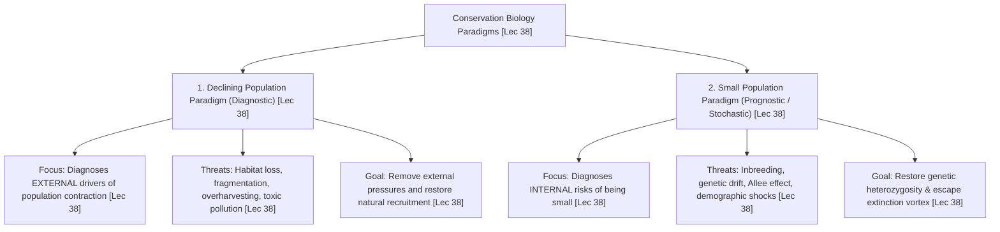
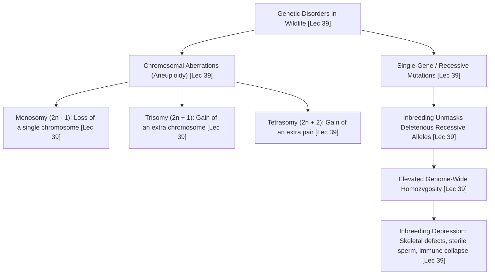

# Week 08 Cheat Sheet: Biodiversity — Genetic Aspects

**Course:** Biodiversity for Sustainability  
**Instructor:** Dr. Ankur Awadhiya, IFS  
**Lectures Covered:** Lecture 36 to Lecture 40  
**Quizzes Cross-Referenced:** `quiz_week_8.txt` ($N=10$) & `quiz_week_0.txt` (Practice)  

---

## 1. High-Yield Terminological & Definitional Matrix

| Citation | Term / Concept | Operational Scientific Definition | Exam Archetype | Exam Question Tag |
| :--- | :--- | :--- | :--- | :--- |
| `[Lec 36]` | **Conservation Genetics** | Applied discipline employing molecular genetic tools and population genetic theory to preserve biodiversity, reduce extinction risk, and manage wild populations. | Forward Definition | `[TESTED - 30% REPEAT POOL]` (W8-Q1) |
| `[Lec 36]` | **Chromosomes** | Cellular filamentous structures composed of condensed DNA wrapped around histone proteins, carrying hundreds to thousands of linear genes. | Forward Definition | `[TESTED - 30% REPEAT POOL]` (W8-Q3) |
| `[Lec 36]` | **Phenotype** | The physical, physiological, anatomical, or behavioral observable expression of an organism's traits, produced by genotype-environment interactions. | Reverse Definition | `[TESTED - 30% REPEAT POOL]` (W8-Q8) |
| `[Lec 36]` | **Genotype** | The underlying, heritable genetic and allelic constitution of an individual organism at specified gene loci. | Forward Definition | `[UNSEEN HIGH-YIELD - 70% FINAL POOL]` |
| `[Lec 36]` | **Codominance** | Pattern of inheritance where both distinct alleles at a locus are fully, simultaneously, and independently expressed in the heterozygote without phenotypic blending. | Reverse Definition | `[TESTED - 30% REPEAT POOL]` (W8-Q7) |
| `[Lec 36]` | **Incomplete Dominance** | Pattern of inheritance where the heterozygote displays an intermediate, blended phenotype between the two homozygous parental traits (e.g., Red $\times$ White $\rightarrow$ Pink). | Reverse Definition | `[UNSEEN HIGH-YIELD - 70% FINAL POOL]` |
| `[Lec 37]` | **Allele Frequency** | The relative mathematical proportion or percentage of a specific allele among all copies of that gene locus within a defined population gene pool. | Forward Definition | `[TESTED - 30% REPEAT POOL]` (W8-Q2) |
| `[Lec 37]` | **Evolutionary Fitness ($w$)** | Relative lifetime reproductive success: the genetic contribution of an individual or genotype to the fertile offspring of subsequent generations. | Forward Definition | `[TESTED - 30% REPEAT POOL]` (W8-Q4) |
| `[Lec 37]` | **Hardy-Weinberg Equilibrium** | Principle stating that allele and genotype frequencies in a sexually reproducing population remain constant across generations in the absence of evolutionary forces. | Mathematical Law | `[UNSEEN HIGH-YIELD - 70% FINAL POOL]` |
| `[Lec 38]` | **Declining Population Paradigm** | Conservation biology perspective asking *what external anthropogenic or ecological forces drove a population down to small size?*; focuses on diagnosing primary causes. | Reverse Definition | `[TESTED - 30% REPEAT POOL]` (W8-Q6) |
| `[Lec 38]` | **Small Population Paradigm** | Conservation perspective asking *what internal stochastic, demographic, and genetic hazards threaten a population once it is already small?* | Reverse Definition | `[UNSEEN HIGH-YIELD - 70% FINAL POOL]` |
| `[Lec 38]` | **Population Viability Analysis (PVA)** | Quantitative predictive modeling assessing the mathematical probability that a population will persist over a specified time horizon (e.g., $\ge 95\%$ persistence over 100 years). | Management Tool | `[UNSEEN HIGH-YIELD - 70% FINAL POOL]` |
| `[Lec 38]` | **Minimum Viable Population (MVP)** | The smallest isolated wild population size that possesses a high statistical confidence of surviving ecological and genetic stochasticity over long periods. | Quantitative Metric | `[UNSEEN HIGH-YIELD - 70% FINAL POOL]` |
| `[Lec 38]` | **Allee Effect (Demographic Trap)** | Inverse density dependence where per-capita reproductive rate or individual survival crashes when population density falls below a critical minimum threshold. | Population Dynamic | `[TESTED - 30% REPEAT POOL]` (W8-Q9) |
| `[Lec 39]` | **Founder Effect** | Severe loss of genetic diversity occurring when a new colony is established by a very small number of individuals carrying only a biased fraction of the source gene pool. | Forward Definition | `[TESTED - 30% REPEAT POOL]` (W8-Q5) |
| `[Lec 39]` | **Genetic Drift** | Random fluctuations in population allele frequencies across generations due to stochastic sampling error; causes non-adaptive fixation or total loss of alleles in small populations. | Evolutionary Mechanism | `[UNSEEN HIGH-YIELD - 70% FINAL POOL]` |
| `[Lec 39]` | **Inbreeding Depression** | Reduction in biological fitness, fertility, and survival resulting from mating between closely related kin, which increases genome-wide homozygosity and unmasks deleterious recessives. | Genetic Hazard | `[UNSEEN HIGH-YIELD - 70% FINAL POOL]` |
| `[Lec 40]` | **Genetic Rescue** | Deliberate introduction of outside, unrelated breeding individuals into an inbred, isolated population to restore heterozygosity, suppress defects, and elevate demographic growth. | Applied Genetics | `[TESTED - 30% REPEAT POOL]` (W8-Q10) |
| `[Lec 40]` | **Outbreeding Depression** | A fitness reduction occurring in offspring when two highly differentiated, locally adapted parent populations are crossed, caused by ecological maladaptation or genetic incompatibility. | Genetic Risk | `[UNSEEN HIGH-YIELD - 70% FINAL POOL]` |
| `[Lec 40]` | **Soft Release vs. Hard Release** | Soft release: animals acclimatized in pre-release bomas with transitional food and care; Hard release: animals released directly into wilderness without post-release support. | Applied Translocation | `[UNSEEN HIGH-YIELD - 70% FINAL POOL]` |

---

## 2. Hardy-Weinberg Equilibrium: Five Conditions & Exact Calculation

### 2.1 The Two Fundamental Equations
$$\mathbf{p + q = 1} \quad \text{(Allele Frequencies)}$$
$$\mathbf{p^2 + 2pq + q^2 = 1} \quad \text{(Genotype Frequencies)}$$
* `[Lec 37]` $p =$ frequency of dominant allele ($R$).
* `[Lec 37]` $q =$ frequency of recessive allele ($r$).
* `[Lec 37]` $p^2 =$ expected frequency of homozygous dominant genotype ($RR$).
* `[Lec 37]` $2pq =$ expected frequency of heterozygous genotype ($Rr$).
* `[Lec 37]` $q^2 =$ expected frequency of homozygous recessive genotype ($rr$).

### 2.2 Standard Population Allele Frequency Calculation (Lecture 37)
* `[Lec 37]` **Given Wild Population:** $N = 1,000$ diploid animals ($2N = 2,000$ total gene copies):
  * $640\text{ }RR$ (Homozygous Dominant)
  * $320\text{ }Rr$ (Heterozygous)
  * $40\text{ }rr$ (Homozygous Recessive)
* `[Lec 37]` **Step 1: Calculate Frequency of Allele $R$ ($p$):**
  $$\text{Count of } R = (640 \times 2) + 320 = 1,280 + 320 = 1,600$$
  $$\mathbf{p = f(R) = \frac{1,600}{2,000} = 0.80 \quad (80\%)} \quad \text{`[UNSEEN HIGH-YIELD - 70% FINAL POOL]`}$$
* `[Lec 37]` **Step 2: Calculate Frequency of Allele $r$ ($q$):**
  $$\text{Count of } r = (40 \times 2) + 320 = 80 + 320 = 400$$
  $$\mathbf{q = f(r) = \frac{400}{2,000} = 0.20 \quad (20\%)} \quad \text{`[UNSEEN HIGH-YIELD - 70% FINAL POOL]`}$$
* `[Lec 37]` **Step 3: Verification:** $p + q = 0.80 + 0.20 = 1.00$ ($100\%$).

### 2.3 Five Mandatory Conditions for Hardy-Weinberg Stasis (No Evolution)
1. `[Lec 37]` **Infinitely Large Population Size:** Eliminates sampling error and random genetic drift.
2. `[Lec 37]` **Completely Random Mating (Panmixia):** No mate choice, sexual selection, or inbreeding.
3. `[Lec 37]` **No Mutations:** No spontaneous biochemical conversion of one allele to another.
4. `[Lec 37]` **No Gene Flow / Migration:** Completely closed genetic system with zero immigration or emigration.
5. `[Lec 37]` **No Natural Selection:** All genotypes possess identical evolutionary fitness ($w = 1.0$).

---

## 3. Dual Conservation Paradigms Framework (Graeme Caughley, Lecture 38)

| Diagnostic Metric | Declining Population Paradigm `[TESTED - 30% REPEAT POOL]` (W8-Q6) | Small Population Paradigm `[UNSEEN HIGH-YIELD - 70% FINAL POOL]` |
| :--- | :--- | :--- |
| **Core Scientific Question** | *What external environmental pressures made the population small?* | *What internal genetic and demographic hazards threaten a population once it is already small?* |
| **Primary Threats Evaluated** | Habitat destruction, linear infrastructure, toxic chemical pollution, invasive alien species, overexploitation. | Inbreeding depression, loss of heterozygosity, accumulation of deleterious alleles, genetic drift, Allee effect. |
| **Underlying Disciplinary Base** | Field ecology, biogeography, wildlife management, landscape planning. | Theoretical population genetics, mathematical modeling, pedigree analysis, studbook management. |
| **Key Management Solutions** | Protected area creation, corridor restoration, anti-poaching enforcement, pollution abatement. | Genetic rescue translocations, captive breeding programs, artificial insemination, biobanking. |

---

## 4. Empirical Wildlife Case Studies & Genetic Disorders

| Citation | Common Name / Case Study | Scientific Binomial | Geographic Site / Habitat | Documented Genetic Disorder & Ecological Mechanism |
| :--- | :--- | :--- | :--- | :--- |
| `[Lec 39]` | **Isle Royale Island Wolves** | *Canis lupus* | Isle Royale National Park, Lake Superior (USA) | Severe inbreeding depression: Closed founder pack ($N < 30$) suffered extreme spinal malformations (lumbosacral vertebral deformities) and cataract blindness; population collapsed to 2; moose (*Alces alces*) exploded and devastated balsam fir `[UNSEEN HIGH-YIELD - 70% FINAL POOL]`. |
| `[Lec 39]` | **Tasmanian Devil Facial Tumor Disease** | *Sarcophilus harrisii* | Island of Tasmania (Australia) | Contagious clonally transmissible cancer (DFTD) spread by social face-biting; historical founder effect caused near-zero diversity at Major Histocompatibility Complex (MHC); host immune system fails to recognize tumor cells as foreign `[UNSEEN HIGH-YIELD - 70% FINAL POOL]`. |
| `[Lec 37, 40]` | **Gir Forest Asiatic Lions** | *Panthera leo persica* | Gir National Park & Sanctuaries, Gujarat (India) | Extreme historic bottleneck (~20 individuals around 1900); high homozygosity, low sperm motility ($>70\%$ morphological abnormalities), kinked tail tips; highly vulnerable to catastrophic single-pathway epidemics (e.g., Canine Distemper Virus) `[UNSEEN HIGH-YIELD - 70% FINAL POOL]`. |
| `[Lec 40]` | **Florida Panther Genetic Rescue** | *Puma concolor coryi* | Big Cypress / Everglades, Florida (USA) | Population declined to ~30 in 1990s; inbreeding manifested as kinked tails, atrial septal heart defects, and cryptorchidism; introduction of 8 female Texas pumas (*P. c. stanleyana*) restored gene flow, rebounding population to $>200$ `[TESTED - 30% REPEAT POOL]` (W8-Q10). |
| `[Lec 40]` | **Indian Translocation Case Studies** | Gaur (*Bos gaurus*), Gharial (*Gavialis gangeticus*) | Bandhavgarh Tiger Reserve & Chambal River (India) | Planned reintroductions: Gaur translocated from Kanha to Bandhavgarh; captive-reared Gharial hatchlings soft-released into Chambal River to re-establish breeding colonies `[UNSEEN HIGH-YIELD - 70% FINAL POOL]`. |

---

## 5. Genetic Disorders, Aneuploidy & Inbreeding Mechanics (Lecture 39)

* `[Lec 39]` **Aneuploidy Classifications:**
  * *Monosomy ($2n - 1$):* Missing one chromosome from a diploid set; usually lethal during embryonic development.
  * *Trisomy ($2n + 1$):* One extra chromosome present; severely disrupts developmental gene dosage balance.
  * *Tetrasomy ($2n + 2$):* Two extra homologous chromosomes present `[UNSEEN HIGH-YIELD - 70% FINAL POOL]`.
* `[Lec 39]` **Founder Effect vs. Bottleneck Effect:**
  * *Founder Effect:* A small detachment of individuals departs to colonize an isolated island or novel habitat `[TESTED - 30% REPEAT POOL]` (W8-Q5).
  * *Bottleneck Effect:* A catastrophic environmental shock, epidemic, or slaughter decimates an established population down to a handful of survivors `[UNSEEN HIGH-YIELD - 70% FINAL POOL]`.

---

## 6. Contrastive Paradigms & Distractor Diagnostic Traps

* `[Lec 36]` **Codominance vs. Incomplete Dominance vs. Complete Dominance:**
  * *Codominance:* **Both alleles are fully and simultaneously expressed** (e.g., AB blood type) `[TESTED - 30% REPEAT POOL]` (W8-Q7).
  * *Incomplete Dominance:* Heterozygote shows an **intermediate blended trait** (Red $\times$ White $\rightarrow$ Pink) `[UNSEEN HIGH-YIELD - 70% FINAL POOL]`.
  * *Complete Dominance:* Dominant allele completely masks recessive allele ($AA = Aa$).
* `[Lec 36]` **Phenotype vs. Genotype Trap:**
  * *Phenotype:* **Observable expression of physical, physiological, or behavioral traits** `[TESTED - 30% REPEAT POOL]` (W8-Q8).
  * *Genotype:* The internal, non-visible genetic sequence/allelic combination.
* `[Lec 37]` **Evolutionary Fitness Trap:** Distractors define fitness as *"physical strength, fighting prowess, or body speed"*; correct evolutionary definition is strictly **relative reproductive success across generations** `[TESTED - 30% REPEAT POOL]` (W8-Q4).
* `[Lec 37]` **Allele Frequency Definition Trap:** Correct answer is **the proportion of a particular allele among all copies of that gene** `[TESTED - 30% REPEAT POOL]` (W8-Q2). Distractors define it as *"a fixed number of animals"* or *"movement across habitats"*.
* `[Lec 38]` **Declining vs. Small Population Paradigm Trap (`EXAM_PATTERN.md` Gold Example 6):**
  * *Question Stem:* "Which perspective asks what external pressures made a population small?"
  * *Trap Distractor:* `(A) Small population paradigm` (traps students who word-match "small").
  * *Correct Answer:* **`(C) Declining population paradigm`** `[TESTED - 30% REPEAT POOL]` (W8-Q6).
* `[Lec 38, 39]` **Allee Effect Trap:** Distractors define it as *"large populations declining"* or *"all mutations improving fitness"*; correct definition is **reduced survival/reproduction in very small populations due to low density** `[TESTED - 30% REPEAT POOL]` (W8-Q9).
* `[Lec 40]` **Genetic Rescue vs. Outbreeding Depression:**
  * *Genetic Rescue:* Introduction of outside genes **improves fitness and fertility** `[TESTED - 30% REPEAT POOL]` (W8-Q10).
  * *Outbreeding Depression:* Crossing divergent lineages breaks co-adapted gene complexes, **reducing hybrid fitness** `[UNSEEN HIGH-YIELD - 70% FINAL POOL]`.
