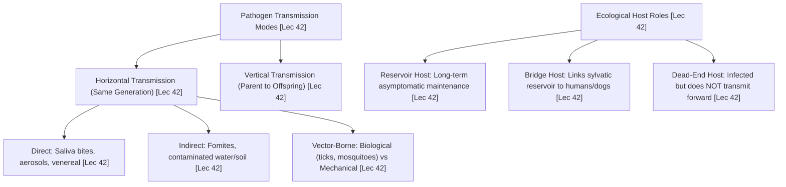
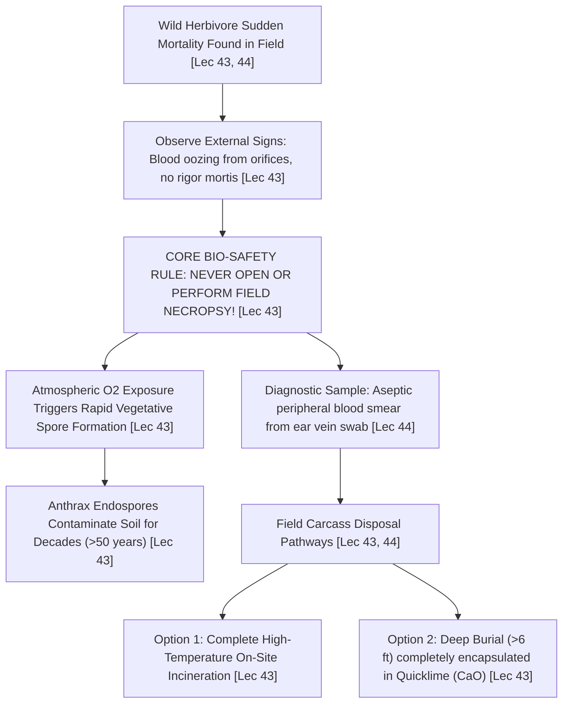

# Week 09 Cheat Sheet: Biodiversity — Health Aspects

**Course:** Biodiversity for Sustainability  
**Instructor:** Dr. Ankur Awadhiya, IFS  
**Lectures Covered:** Lecture 41 to Lecture 45  
**Quizzes Cross-Referenced:** `quiz_week_9.txt` ($N=10$) & `quiz_week_0.txt` (Practice)  

---

## 1. High-Yield Terminological & Definitional Matrix

| Citation | Term / Concept | Operational Scientific Definition | Exam Archetype | Exam Question Tag |
| :--- | :--- | :--- | :--- | :--- |
| `[Lec 41]` | **Wildlife Health in Conservation** | A dynamic state of physical and ecological equilibrium involving normal physiological, behavioral, and demographic functioning across **Individual, Population, and Ecosystem levels**. | Comprehensive Definition | `[TESTED - 30% REPEAT POOL]` (W9-Q2) |
| `[Lec 41]` | **Wildlife Disease** | Any impairment, abnormal condition, or disturbance that disrupts the normal functioning of an organism, affecting behavior, physiology, fecundity, or survival. | Forward Definition | `[TESTED - 30% REPEAT POOL]` (W9-Q4) |
| `[Lec 41]` | **Acute Disease** | Pathological condition characterized by rapid clinical onset, short temporal duration, severe physiological distress, and potential for explosive sudden mortality events. | Clinical Progression | `[TESTED - 30% REPEAT POOL]` (W9-Q6) |
| `[Lec 41]` | **Chronic Disease** | Protracted pathological condition marked by insidious, slow onset, subtle early signs, persistent debilitating course, and progressive tissue wasting over months or years. | Clinical Progression | `[UNSEEN HIGH-YIELD - 70% FINAL POOL]` |
| `[Lec 41]` | **Precipitating Factor** | An acute, immediate environmental trigger (e.g., migration exhaustion, severe cold snap, drought shock) that initiates clinical disease expression in an already susceptible host. | Causal Rationale | `[TESTED - 30% REPEAT POOL]` (W9-Q9) |
| `[Lec 41]` | **Predisposing Factor** | An underlying, pre-existing structural condition (e.g., extreme youth/old age, genetic homozygosity, poor baseline nutritional status) that lowers an animal's resistance to infection. | Background Factor | `[UNSEEN HIGH-YIELD - 70% FINAL POOL]` |
| `[Lec 42]` | **Infectivity** | The biological capability of a pathogen to successfully breach host barriers, establish an active infection, and replicate following initial exposure. | Reverse Definition | `[TESTED - 30% REPEAT POOL]` (W9-Q1) |
| `[Lec 42]` | **Virulence** | The degree of pathogenicity: the quantitative severity of disease, tissue destruction, or mortality caused by a pathogen once clinical symptoms manifest. | Reverse Definition | `[TESTED - 30% REPEAT POOL]` (W9-Q10) |
| `[Lec 42]` | **Pathogenicity** | The statistical proportion of infected animals within a cohort that go on to develop overt clinical symptoms ($\text{Clinically Diseased} / \text{Infected}$). | Epidemiological Metric | `[UNSEEN HIGH-YIELD - 70% FINAL POOL]` |
| `[Lec 42]` | **Case Fatality Rate (CFR)** | The probability that a clinically diseased animal will die from the infection ($\text{Total Deaths} / \text{Confirmed Cases}$). | Epidemiological Metric | `[UNSEEN HIGH-YIELD - 70% FINAL POOL]` |
| `[Lec 42]` | **Basic Reproduction Number ($R_0$)** | The average number of secondary infectious cases generated by a single infected individual in a completely susceptible host population. | Mathematical Model | `[UNSEEN HIGH-YIELD - 70% FINAL POOL]` |
| `[Lec 42]` | **Dead-End (Accidental) Host** | A host species that becomes infected with a pathogen but fails to develop sufficient viremia/shedding to sustain further forward transmission to new hosts. | Host Classification | `[TESTED - 30% REPEAT POOL]` (W9-Q3) |
| `[Lec 42]` | **Reservoir Host** | An ecological host species or population that sustains an infectious pathogen long-term without experiencing fatal population decline, serving as a permanent infection source. | Host Classification | `[UNSEEN HIGH-YIELD - 70% FINAL POOL]` |
| `[Lec 42]` | **Bridge Host** | A domestic or peridomestic animal species (e.g., domestic dogs) that physically bridges the spatial gap between sylvatic wildlife reservoirs and human/livestock populations. | Host Classification | `[UNSEEN HIGH-YIELD - 70% FINAL POOL]` |
| `[Lec 42]` | **Sporadic Disease Occurrence** | Irregular, infrequent, and isolated occurrence of disease cases without an established geographical cluster or predictable temporal pattern. | Spatial/Temporal | `[TESTED - 30% REPEAT POOL]` (W9-Q7) |
| `[Lec 42]` | **Endemic (Enzootic)** | The constant, regular baseline presence or expected incidence of a disease within a specific geographical locality or wildlife population. | Spatial/Temporal | `[UNSEEN HIGH-YIELD - 70% FINAL POOL]` |
| `[Lec 42]` | **Epidemic (Epizootic)** | A sudden, explosive surge in disease incidence within a wildlife population clearly exceeding the normal historical baseline expectation. | Spatial/Temporal | `[UNSEEN HIGH-YIELD - 70% FINAL POOL]` |
| `[Lec 42]` | **Horizontal Transmission** | The spread of an infectious pathogen between individual organisms belonging to the same generation through direct contact, aerosols, water, soil, or vectors. | Forward Definition | `[TESTED - 30% REPEAT POOL]` (W9-Q8) |
| `[Lec 42]` | **Vertical Transmission** | Direct transmission of a pathogen from a parent organism to its offspring via transplacental transfer in-utero, transovarial passage in eggs, or lactation. | Forward Definition | `[UNSEEN HIGH-YIELD - 70% FINAL POOL]` |
| `[Lec 43]` | **Anthrax Management Protocol** | Core field protocol requiring **meticulous, non-invasive carcass disposal without opening the body**, preventing atmospheric oxygen from triggering bacterial sporulation. | Field Protocol | `[TESTED - 30% REPEAT POOL]` (W9-Q5) |
| `[Lec 43]` | **Epidemiological Triad** | Conceptual framework analyzing disease causation through the dynamic equilibrium of three interactive pillars: **Host, Pathogen (Agent), and Environment**. | System Model | `[UNSEEN HIGH-YIELD - 70% FINAL POOL]` |

---

## 2. Sibling Epidemiological Metrics Diagnostic Matrix (Lecture 42)

```mermaid
flowchart LR
    EX["Host Exposure to Pathogen [Lec 42]"] -->|Infectivity (Establishment rate)| INF["Asymptomatic Infection [Lec 42]"]
    INF -->|Pathogenicity (Clinical illness rate)| ILL["Clinical Disease Manifestation [Lec 42]"]
    ILL -->|Virulence (Pathological severity)| SEV["Severe Morbidity / Tissue Damage [Lec 42]"]
    SEV -->|Case Fatality Rate (Lethality)| DTH["Host Death [Lec 42]"]
```

| Citation | Metric Name | Precise Scientific Definition | Operational Mathematical Formulation | Exam Distractor Alert |
| :--- | :--- | :--- | :--- | :--- |
| `[Lec 42]` | **Infectivity** | Ability of a pathogen to invade, establish, and multiply in host tissues after exposure `[TESTED - 30% REPEAT POOL]` (W9-Q1). | $\frac{\text{Number of Individuals Infected}}{\text{Number of Susceptible Individuals Exposed}}$ | *Trap:* Distractors substitute definitions of virulence (*"severity of disease"*) or CFR (*"probability that an animal dies"*). |
| `[Lec 42]` | **Pathogenicity** | Ability of an infectious agent to induce observable clinical signs and sickness in infected hosts. | $\frac{\text{Number of Clinically Diseased Individuals}}{\text{Total Number of Individuals Infected}}$ | *Trap:* High infectivity does NOT equal high pathogenicity (e.g., asymptomatic viral carriers). |
| `[Lec 42]` | **Virulence** | The quantitative severity or pathological damage produced by the pathogen during active disease `[TESTED - 30% REPEAT POOL]` (W9-Q10). | $\frac{\text{Number of Severe or Fatal Clinical Cases}}{\text{Total Number of Clinical Cases}}$ | *Trap:* Distractors define virulence as *"infectivity"*, *"number of species infected"*, or *"rainfall before an outbreak"*. |
| `[Lec 42]` | **Case Fatality Rate (CFR)** | The statistical probability that an animal with overt clinical disease will die from that specific infection. | $\frac{\text{Number of Cause-Specific Deaths}}{\text{Total Number of Confirmed Clinical Cases}}$ | *Trap:* Expresses lethality among clinically ill animals, distinct from population-wide mortality rate. |
| `[Lec 42]` | **Basic Reproduction Number ($R_0$)** | Average number of secondary cases produced by one infectious case in a naive host population. | $R_0 = \beta \cdot c \cdot D$ (Transmission rate $\times$ Contact rate $\times$ Infectious duration) | $R_0 > 1$: Exponential outbreak; $R_0 = 1$: Stable endemic/enzootic; $R_0 < 1$: Extinction of outbreak. |

---

## 3. Host Classifications & Transmission Taxonomy



* `[Lec 42]` **Dead-End Host Mechanism:** The pathogen enters and produces clinical pathology, but tissue shedding, viremia, or salivary titers are too low to transmit the agent to other individuals or vectors (e.g., humans and horses infected with West Nile Virus; humans infected with Rabies) `[TESTED - 30% REPEAT POOL]` (W9-Q3).
* `[Lec 42]` **Bridge Host Mechanism:** Domestic animals sharing grazing lands or human settlements (e.g., feral domestic dogs in buffer zones of tiger reserves) acquire sylvatic pathogens and transfer them to endangered wild carnivores or villagers `[UNSEEN HIGH-YIELD - 70% FINAL POOL]`.
* `[Lec 42]` **Mechanical vs. Biological Vectors:**
  * *Mechanical Vector:* Passive physical transport; no multiplication or cyclic development occurs within the vector (e.g., housefly transferring enteric bacteria on its tarsi) `[UNSEEN HIGH-YIELD - 70% FINAL POOL]`.
  * *Biological Vector:* Active biological intermediate; pathogen must replicate, undergo developmental transformation, or reach sexual maturity inside vector tissues before becoming infectious (e.g., *Plasmodium* in mosquitoes; ticks transmitting Kyasanur Forest Disease) `[UNSEEN HIGH-YIELD - 70% FINAL POOL]`.

---

## 4. Empirical Wildlife Diseases: Pathogens, Taxa & Management Protocols

| Citation | Disease Name | Pathogen / Etiology | Primary Wildlife & Domestic Hosts | Clinical Hallmark, Transmission Pathway & Management Protocol |
| :--- | :--- | :--- | :--- | :--- |
| `[Lec 43, 44]` | **Anthrax** | *Bacillus anthracis* (Spore-forming Gram+ bacterium) | Wild Herbivores (Ungulates, Elephants, Bison), Domestic Cattle | Peracute sudden death, dark tarry unclotted blood oozing from mouth/nostrils/anus, incomplete rigor mortis. **DO NOT OPEN CARCASS!** Oxygen triggers sporulation; deep burial ($>6\text{ ft}$) with quicklime ($CaO$) or high-temperature incineration `[TESTED - 30% REPEAT POOL]` (W9-Q5). |
| `[Lec 44]` | **Rabies** | Lyssavirus (Rhabdoviridae family) | Canids, Felids, Bats, Humans (Feral Dogs = Bridge Host) | Neurotropic encephalomyelitis, hydrophobic spasms, aggression, salivary shedding. Management: Mass domestic dog vaccination ($>70\%$ barrier coverage); aerial oral bait vaccination (ORVs) for wild mesopredators `[UNSEEN HIGH-YIELD - 70% FINAL POOL]`. |
| `[Lec 44]` | **Canine Distemper Virus (CDV)** | Morbillivirus (Paramyxoviridae family) | African Lions (*Panthera leo*), Asiatic Lions (Gir), Tigers, Wild Dogs | Multisystemic respiratory, gastrointestinal, and neurological spasms; decimated $>1,000$ Serengeti lions in 1994; outbreaks in Gir Forest (2018); domestic dog vaccination creates a disease-free buffer `[UNSEEN HIGH-YIELD - 70% FINAL POOL]`. |
| `[Lec 44]` | **Bovine Tuberculosis (bTB)** | *Mycobacterium bovis* (Acid-fast bacterium) | African Buffalo (*Syncerus caffer*), Badgers, Deer, Cattle | Chronic wasting disease, granulomatous pulmonary tubercles; aerosol and oral transmission via contaminated pasture/waterholes; interface control between wild bovids and domestic cattle `[UNSEEN HIGH-YIELD - 70% FINAL POOL]`. |
| `[Lec 44]` | **Avian Botulism** | *Clostridium botulinum* (Neurotoxin Type C/E) | Waterfowl, Shorebirds, Migratory Pelicans | Flaccid motor paralysis ("limberneck"); proliferation in warm, shallow, anaerobic alkaline wetlands with decaying organic matter; managed by carcass retrieval and water level manipulation `[UNSEEN HIGH-YIELD - 70% FINAL POOL]`. |
| `[Lec 44]` | **Leptospirosis** | *Leptospira interrogans* (Zoonotic Spirochete) | Rodents, Marine Mammals (California Sea Lions) | Renal nephritis, acute jaundice; excreted in urine; marine epidemic in California sea lions (*Zalophus californianus*) causing renal failure; demonstrates land-to-sea transmission `[UNSEEN HIGH-YIELD - 70% FINAL POOL]`. |
| `[Lec 45]` | **Chytridiomycosis** | *Batrachochytrium dendrobatidis* (Bd fungus) | Global Amphibian Fauna ($>200$ species affected) | Hyperkeratosis of skin, electrolyte transport collapse, fatal cardiac arrest; caused extinction of Costa Rican Golden Toad (*Incilius periglenes*) in 1989; biosecurity and antifungal baths for captive breeding `[UNSEEN HIGH-YIELD - 70% FINAL POOL]`. |
| `[Lec 45]` | **White-Nose Syndrome (WNS)** | *Pseudogymnoascus destructans* (Cold-loving fungus) | Cave-Hibernating Insectivorous Micro-Bats | Fungal erosion of wing membranes during winter torpor; causes premature arousal, winter flight, catastrophic fat store depletion, and death ($>90\%$ colony mortality) `[UNSEEN HIGH-YIELD - 70% FINAL POOL]`. |
| `[Lec 45]` | **Toxoplasmosis (Land-to-Sea)** | *Toxoplasma gondii* (Coccidian Protozoan) | Felids (Definitive), Southern Sea Otters (*Enhydra lutris*) | Cat feces washed via urban runoff into coastal waters; filter-feeding bivalves (clams, mussels) concentrate oocysts; otters consume bivalves, developing fatal protozoal meningoencephalitis `[UNSEEN HIGH-YIELD - 70% FINAL POOL]`. |
| `[Lec 45]` | **Sarcoptic Mange** | *Sarcoptes scabiei* (Parasitic Astigmatid Mite) | Canids (Red Fox, Dhole), Ungulates, Wombats | Intradermal tunneling mites causing severe pruritus, allergic dermatitis, hair loss (alopecia), secondary bacterial pyoderma, and death by hypothermia `[UNSEEN HIGH-YIELD - 70% FINAL POOL]`. |

---

## 5. The Anthrax Carcass Handling Bio-Safety Algorithm



* `[Lec 43]` **The Fatal Mistake (`EXAM_PATTERN.md` Gold Example 8):** In standard veterinary medicine, necropsy is mandatory to establish cause of death. In suspected Anthrax, **opening the carcass is the single most hazardous mistake possible**! Bacilli are vegetative and unstable inside the anaerobic carcass; slicing the carcass exposes infected blood to atmospheric oxygen, instantly inducing spore formation and permanently seeding the pasture `[TESTED - 30% REPEAT POOL]` (W9-Q5).
* `[Lec 43]` **Disposal Protocol:** Cordon off site; cover carcass with heavy tarpaulins to prevent avian scavenger access (vultures, crows); burn carcass on a metal rail grid or bury under 6 feet of earth saturated with quicklime ($CaO$) `[UNSEEN HIGH-YIELD - 70% FINAL POOL]`.

---

## 6. Contrastive Paradigms & Distractor Diagnostic Traps

* `[Lec 41]` **Acute vs. Chronic Progression Trap:**
  * *Acute:* **Rapid onset, short duration, sudden mortality** (e.g., Anthrax, Ebola in gorillas) `[TESTED - 30% REPEAT POOL]` (W9-Q6).
  * *Chronic:* **Slow, insidious onset, protracted wasting course** (e.g., Bovine tuberculosis, Sarcoptic mange) `[UNSEEN HIGH-YIELD - 70% FINAL POOL]`.
* `[Lec 41, 43]` **Predisposing vs. Precipitating Factors:**
  * *Predisposing:* Background susceptibility (old age, poor nutrition, genetic inbreeding) `[UNSEEN HIGH-YIELD - 70% FINAL POOL]`.
  * *Precipitating:* Immediate acute shock (**migration stress, acute drought**) triggering clinical disease `[TESTED - 30% REPEAT POOL]` (W9-Q9).
* `[Lec 42]` **Infectivity vs. Virulence Trap (`EXAM_PATTERN.md` Gold Example 7):**
  * *Infectivity:* **Ability of a pathogen to establish infection after exposure** `[TESTED - 30% REPEAT POOL]` (W9-Q1).
  * *Virulence:* **Severity of disease caused after symptoms appear** `[TESTED - 30% REPEAT POOL]` (W9-Q10).
  * *Distractor Swap:* Distractors for infectivity are verbatim the definitions of virulence and case fatality rate.
* `[Lec 42]` **Horizontal vs. Vertical Transmission Trap:**
  * *Horizontal:* **Between individuals of the same generation** `[TESTED - 30% REPEAT POOL]` (W9-Q8).
  * *Vertical:* Direct transfer from mother to fetus/offspring (transplacental, milk) `[UNSEEN HIGH-YIELD - 70% FINAL POOL]`.
* `[Lec 42]` **Dead-End Host Trap:**
  * *Correct:* **Host becomes infected but does NOT sustain further transmission** `[TESTED - 30% REPEAT POOL]` (W9-Q3).
  * *Distractors:* Claim dead-end hosts *"increase pathogen abundance"* or *"always act as biological vectors"*.
* `[Lec 42]` **Sporadic vs. Endemic vs. Epizootic Trap:**
  * *Sporadic:* **Irregular and isolated occurrence without a predictable pattern** `[TESTED - 30% REPEAT POOL]` (W9-Q7).
  * *Endemic:* Continuous, predictable baseline presence in a local area.
  * *Epizootic:* Sudden surge in disease frequency far above historical baseline.
* `[Lec 43]` **Anthrax Management Trap (`EXAM_PATTERN.md` Gold Example 8):**
  * *Correct:* **Careful carcass handling to reduce environmental contamination** `[TESTED - 30% REPEAT POOL]` (W9-Q5).
  * *Distractor:* `(A) Opening carcasses immediately for visual diagnosis` (this is the fatal field blunder!).
