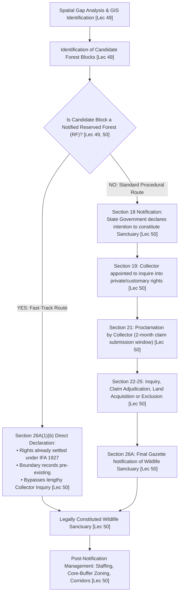

# Week 10 Cheat Sheet: Managing Biodiversity — I (In-Situ & Ex-Situ Conservation)

**Course:** Biodiversity for Sustainability  
**Instructor:** Dr. Ankur Awadhiya, IFS  
**Lectures Covered:** Lecture 46 to Lecture 50  
**Quizzes Cross-Referenced:** `quiz_week_10.txt` ($N=10$) & `quiz_week_0.txt` (Practice)  

---

## 1. High-Yield Terminological & Definitional Matrix

| Citation | Term / Concept | Operational Scientific Definition | Exam Archetype | Exam Question Tag |
| :--- | :--- | :--- | :--- | :--- |
| `[Lec 46]` | **Ecological Function** | Biotic and abiotic processes—including **pollination, seed dispersal, predation, decomposition, and nutrient cycling**—that sustain ecosystem energy flow, structure, and productivity. | Functional Classification | `[TESTED - 30% REPEAT POOL]` (W10-Q6) |
| `[Lec 46]` | **Adaptive Management** | An iterative, systematic conservation decision process treating management interventions as testable hypotheses: **Plan $\rightarrow$ Act $\rightarrow$ Monitor $\rightarrow$ Evaluate $\rightarrow$ Adjust/Revise**. | Decision Model | `[UNSEEN HIGH-YIELD - 70% FINAL POOL]` |
| `[Lec 46]` | **Problem Tree Analysis** | Diagnostic root-cause methodology where the visible conservation decline is the **trunk**, but interventions must target the underlying socioeconomic/governance **roots**. | Diagnostic Tool | `[UNSEEN HIGH-YIELD - 70% FINAL POOL]` |
| `[Lec 46]` | **Four-Step Management Chain** | Sequential causal progression guiding conservation: **Threat $\rightarrow$ Ecological Change $\rightarrow$ Strategic Response $\rightarrow$ Ecosystem Recovery**. | Sequential Logic | `[UNSEEN HIGH-YIELD - 70% FINAL POOL]` |
| `[Lec 47]` | **Ex-Situ Conservation** | The conservation of biological diversity components outside their natural habitats by moving individuals or genetic material to designated controlled facilities. | Core Definition | `[TESTED - 30% REPEAT POOL]` (W10-Q7) |
| `[Lec 47]` | **Ex-Situ Insurance Strategy** | Conservation fallback preventing immediate catastrophic extinction in high-risk taxa and safeguarding germplasm/alleles outside deteriorating wild landscapes. | Strategic Rationale | `[TESTED - 30% REPEAT POOL]` (W10-Q10) |
| `[Lec 47]` | **Habitat-Like Enclosure** | Captive enclosure replicating natural substrate, vegetation, retreat cover, and environmental complexity to support natural movement, behavior, welfare, health, and breeding. | Welfare & Housing | `[TESTED - 30% REPEAT POOL]` (W10-Q1) |
| `[Lec 47]` | **Representative Sampling** | Ex-situ sampling protocol capturing the full breadth of wild genetic variation across diverse populations, avoiding artificial selection bias and loss of rare alleles. | Sampling Methodology | `[TESTED - 30% REPEAT POOL]` (W10-Q2) |
| `[Lec 47]` | **Studbook** | An exhaustive chronological register documenting the ancestry, parentage, births, deaths, transfers, and reproductive history of every individual in a captive breeding program. | Record Management | `[TESTED - 30% REPEAT POOL]` (W10-Q9) |
| `[Lec 47]` | **Behavioral Enrichment** | Environmental manipulations (climbing structures, foraging puzzles, sensory scents, social groupings) designed to prevent abnormal stereotypic behaviors. | Captive Husbandry | `[UNSEEN HIGH-YIELD - 70% FINAL POOL]` |
| `[Lec 47]` | **Stereotypies** | Repetitive, invariant, and functionless behavioral patterns (pacing, bar-biting, over-grooming) triggered by chronic stress, confinement, or barren captive enclosures. | Pathological Indicator | `[UNSEEN HIGH-YIELD - 70% FINAL POOL]` |
| `[Lec 47]` | **Arboretum** | A specialized ex-situ botanical facility dedicated to cultivating, preserving, and scientifically studying living collections of woody tree and shrub species. | Ex-Situ Facility | `[UNSEEN HIGH-YIELD - 70% FINAL POOL]` |
| `[Lec 47]` | **Bambusetum** | A specialized ex-situ botanical collection dedicated specifically to the conservation, propagation, and taxonomic study of bamboo taxa (*Poaceae: Bambusoideae*). | Ex-Situ Facility | `[UNSEEN HIGH-YIELD - 70% FINAL POOL]` |
| `[Lec 47]` | **Cryopreservation** | Long-term preservation of living germplasm, gametes, embryos, or recalcitrant plant tissues in liquid nitrogen at ultralow temperatures ($-196^\circ\text{C}$). | Ex-Situ Technology | `[UNSEEN HIGH-YIELD - 70% FINAL POOL]` |
| `[Lec 48]` | **In-Situ Conservation** | The conservation of ecosystems and natural habitats and the maintenance and recovery of viable populations of species in their natural surroundings. | Core Definition | `[UNSEEN HIGH-YIELD - 70% FINAL POOL]` |
| `[Lec 48]` | **Indian Statutory PAs** | The four legal categories of protected areas established under India's Wildlife (Protection) Act, 1972: **National Park, Sanctuary, Conservation Reserve, Community Reserve**. | Statutory Taxonomy | `[TESTED - 30% REPEAT POOL]` (W10-Q5) |
| `[Lec 48]` | **Compact / Circular Reserve** | Reserve shape that minimizes perimeter-to-area (edge-to-area) ratio, buffering core wilderness against edge effects, invasive species encroachment, and external disturbances. | Reserve Geometry | `[TESTED - 30% REPEAT POOL]` (W10-Q3) |
| `[Lec 48]` | **Connectivity Planning** | Strategic establishment of continuous ecological corridors or stepping-stone patches linking fragmented habitats to enable gene flow, dispersal, and migration. | Spatial Planning | `[TESTED - 30% REPEAT POOL]` (W10-Q4) |
| `[Lec 48]` | **Paper Park** | A legally decreed or mapped protected area that fails to achieve conservation outcomes in reality due to lack of field staff, funding, enforcement, or ecological monitoring. | Governance Pathology | `[UNSEEN HIGH-YIELD - 70% FINAL POOL]` |
| `[Lec 48]` | **Gap Analysis** | Spatial planning method overlaying existing protected area networks on biodiversity distribution maps to identify underrepresented ecosystems and unprotected taxa. | Systematic Planning | `[UNSEEN HIGH-YIELD - 70% FINAL POOL]` |
| `[Lec 49]` | **Global 30 by 30 Target** | Target 3 of the Kunming-Montreal Global Biodiversity Framework (CBD COP-15): protect at least **30% of terrestrial, inland water, and coastal/marine areas by 2030**. | International Treaty Target | `[UNSEEN HIGH-YIELD - 70% FINAL POOL]` |
| `[Lec 49]` | **Biodiversity Intactness Index (BII)** | Quantitative metric assessing average abundance of native species relative to undisturbed baseline populations across varying degrees of land-use pressure. | Spatial Metric | `[UNSEEN HIGH-YIELD - 70% FINAL POOL]` |
| `[Lec 49]` | **Umbrella Corridor** | Movement corridors delineated for a large-ranging apex species (e.g., Tiger corridor maps) that simultaneously safeguard movement for sympatric biodiversity. | Landscape Ecology | `[UNSEEN HIGH-YIELD - 70% FINAL POOL]` |
| `[Lec 49, 50]` | **Reserved Forest Fast-Track** | Strategic sanctuary notification shortcut using forest land whose legal tenure, boundaries, records, and rights position are already settled under Indian Forest Act, 1927. | Administrative Strategy | `[TESTED - 30% REPEAT POOL]` (W10-Q8) |
| `[Lec 50]` | **Section 18 Declaration** | Initial notification by State Government under Wildlife (Protection) Act, 1972 declaring its intention to constitute an area as a Wildlife Sanctuary. | Legal Procedure | `[UNSEEN HIGH-YIELD - 70% FINAL POOL]` |
| `[Lec 50]` | **Section 26A Declaration** | Final statutory notification of a Wildlife Sanctuary in the Official Gazette following completion of rights inquiry or directly for existing Reserved Forests. | Legal Procedure | `[UNSEEN HIGH-YIELD - 70% FINAL POOL]` |

---

## 2. In-Situ vs. Ex-Situ Conservation Architectural Comparison

```mermaid
flowchart TD
    BIO["Biodiversity Conservation Management [Lec 46]"] --> INS["IN-SITU CONSERVATION [Lec 48]\n(Within Natural Habitat)"]
    BIO --> EXS["EX-SITU CONSERVATION [Lec 47]\n(Outside Natural Habitat)"]
    
    INS --> PA["Statutory PAs (WLPA 1972) [Lec 48]:\n• National Parks\n• Wildlife Sanctuaries\n• Conservation Reserves\n• Community Reserves"]
    INS --> LD["Landscape Design [Lec 48, 49]:\n• SLOSS Principles\n• Compact/Circular Shapes\n• Corridors / Stepping Stones"]
    
    EXS --> ZOO["Living Collections [Lec 47]:\n• Zoos / Rescue Centres\n• Botanical Gardens\n• Arboreta / Bambuseta"]
    EXS --> BNK["Germplasm Storage [Lec 47]:\n• Seed Banks (Orthodox seeds)\n• Cryobanks (-196°C)"]
    
    EXS -->|Studbook Breeding & Behavioral Enrichment [Lec 47]| REINTRO["Reintroduction / Translocation Bridge [Lec 46, 48]"]
    REINTRO -->|Restocking Viable Wild Populations [Lec 46]| INS
```

| Citation | Attribute / Dimension | In-Situ Conservation (Lecture 48) | Ex-Situ Conservation (Lecture 47) |
| :--- | :--- | :--- | :--- |
| `[Lec 46, 47, 48]` | **Primary Definition** | Protecting species within dynamic native ecosystems `[UNSEEN HIGH-YIELD - 70% FINAL POOL]`. | Moving species or germplasm to designated facilities outside native habitat `[TESTED - 30% REPEAT POOL]` (W10-Q7). |
| `[Lec 46, 47]` | **Strategic Function** | Sustains evolutionary processes, multi-species interactions, and ecosystem services at scale `[UNSEEN HIGH-YIELD - 70% FINAL POOL]`. | Insurance strategy against immediate wild extinction; rescue and captive breeding reservoir `[TESTED - 30% REPEAT POOL]` (W10-Q10). |
| `[Lec 47, 48]` | **Facilities / Units** | National Parks, Sanctuaries, Conservation Reserves, Community Reserves `[TESTED - 30% REPEAT POOL]` (W10-Q5). | Zoos, aquaria, botanical gardens, arboreta, bambuseta, seed banks, cryobanks `[UNSEEN HIGH-YIELD - 70% FINAL POOL]`. |
| `[Lec 47]` | **Cost Scaling vs Body Size** | Relatively constant area-based management costs across taxa `[UNSEEN HIGH-YIELD - 70% FINAL POOL]`. | Captive breeding costs escalate sharply with large animal body size (space, food, veterinary care) `[UNSEEN HIGH-YIELD - 70% FINAL POOL]`. |
| `[Lec 47]` | **Pedigree & Genetic Tool** | Natural panmixia and natural selection within connected metapopulations `[UNSEEN HIGH-YIELD - 70% FINAL POOL]`. | **Studbooks** (tracking ancestry, births, deaths, transfers, parentage to prevent inbreeding) `[TESTED - 30% REPEAT POOL]` (W10-Q9). |
| `[Lec 47]` | **Enclosure / Housing Requirement** | Not applicable (natural landscape). | **Habitat-like enclosures** supporting natural movement, welfare, foraging, and breeding `[TESTED - 30% REPEAT POOL]` (W10-Q1). |
| `[Lec 47]` | **Behavioral Husbandry** | Free-ranging natural behavioral expression. | **Behavioral enrichment** required to prevent repetitive stereotypies `[UNSEEN HIGH-YIELD - 70% FINAL POOL]`. |
| `[Lec 46, 47, 48]` | **Ultimate Synergy** | Provides the receiving habitats and ecological processes for species recovery `[UNSEEN HIGH-YIELD - 70% FINAL POOL]`. | Produces genetically sound founder stock for eventual **wild reintroduction** `[UNSEEN HIGH-YIELD - 70% FINAL POOL]`. |

---

## 3. Jared Diamond's Reserve Design Principles (Lecture 48)

| Citation | Geometric Feature | Preferred Design Principle | Ecological Scientific Rationale | Exam Distractor Alert |
| :--- | :--- | :--- | :--- | :--- |
| `[Lec 48]` | **Reserve Size (SLOSS)** | **Single Large > Several Small** (of equal total area) `[UNSEEN HIGH-YIELD - 70% FINAL POOL]`. | Minimizes extinction rates; sustains large minimum viable populations (MVP); buffers home ranges of wide-ranging apex carnivores. | *Trap:* Claiming several small reserves are always superior because they "sample more habitats". |
| `[Lec 48]` | **Reserve Shape** | **Compact / Circular > Elongated / Linear** `[TESTED - 30% REPEAT POOL]` (W10-Q3). | Minimizes perimeter-to-area (edge-to-area) ratio; drastically reduces invasive weed penetration, microclimate drying, and human poaching disturbance. | *Trap:* Stating elongated shapes are preferred to "maximize border contact with towns". |
| `[Lec 48]` | **Spatial Distribution** | **Clustered > Linear / Scattered** `[UNSEEN HIGH-YIELD - 70% FINAL POOL]`. | Shortens inter-patch dispersal distances; facilitates metapopulation "rescue effect" and recolonization following local catastrophes. | *Trap:* Claiming isolated reserves prevent all disease spread so linear isolated reserves are ideal. |
| `[Lec 48]` | **Connectivity** | **Connected (Corridors) > Disconnected / Isolated** `[TESTED - 30% REPEAT POOL]` (W10-Q4). | Facilitates continuous gene flow; prevents inbreeding depression; allows climate-induced range shifts and seasonal migrations. | *Trap:* Confusing connectivity planning with captive display planning or uniform boundary fencing. |
| `[Lec 48]` | **Zonation Structure** | **Core Zone surrounded by Buffer Zone** `[UNSEEN HIGH-YIELD - 70% FINAL POOL]`. | Strict inviolate core preserves intact ecological processes; outer multi-use buffer absorbs peripheral anthropogenic pressure and livestock grazing. | *Trap:* Suggesting human extractive activities should be centered inside the reserve core. |

---

## 4. Statutory Wildlife Sanctuary Notification Workflow under Indian WLPA 1972 (Lectures 49 & 50)



| Citation | Legal Section (WLPA 1972) | Procedural Mandate & Action Required | Strategic Governance Insight |
| :--- | :--- | :--- | :--- |
| `[Lec 50]` | **Section 18** | Declaration of intention by State Government to constitute any area as a Wildlife Sanctuary `[UNSEEN HIGH-YIELD - 70% FINAL POOL]`. | Triggered when area possesses adequate ecological, faunal, floral, geomorphological, or zoological significance. |
| `[Lec 50]` | **Section 18A** | Statutory protection of candidate sanctuary pending rights inquiry `[UNSEEN HIGH-YIELD - 70% FINAL POOL]`. | Prevents destructive land-use conversions during administrative processing. |
| `[Lec 50]` | **Section 19** | Mandatory inquiry by District Collector to determine existence, nature, and extent of rights `[UNSEEN HIGH-YIELD - 70% FINAL POOL]`. | Covers private land claims, grazing concessions, water rights, and non-timber forest produce (NTFP) access. |
| `[Lec 50]` | **Section 20** | **Bar of accrual of rights** `[UNSEEN HIGH-YIELD - 70% FINAL POOL]`. | No new civil or property rights can be acquired in the proposed land after Section 18 notification date. |
| `[Lec 50]` | **Section 21** | Proclamation by Collector in local language specifying boundaries `[UNSEEN HIGH-YIELD - 70% FINAL POOL]`. | Requires all claimants to submit written claims within **2 months** of proclamation date. |
| `[Lec 50]` | **Section 24** | Adjudication options: Admit, exclude land, acquire rights under Land Acquisition Act `[UNSEEN HIGH-YIELD - 70% FINAL POOL]`. | Collector may accept claim and acquire land/rights via compensation, or alter boundaries to exclude contested parcels. |
| `[Lec 50]` | **Section 26A(1)(a)** | Final notification of Wildlife Sanctuary following complete settlement of rights `[UNSEEN HIGH-YIELD - 70% FINAL POOL]`. | Issued only after all claims under Sections 19 to 25 have been formally disposed of. |
| `[Lec 49, 50]` | **Section 26A(1)(b)** | **Reserved Forest Fast-Track Notification** `[TESTED - 30% REPEAT POOL]` (W10-Q8). | **Bypasses Section 19–25 inquiry entirely** because Reserved Forests under Indian Forest Act, 1927 already have fully settled rights, verified land titles, and legal boundary compartment registers! |

---

## 5. Seed Banking and Germplasm Management Protocols (Lecture 47)

| Citation | Operational Stage | Detailed Scientific Protocol & Parameters | Quality Control / Failure Risk |
| :--- | :--- | :--- | :--- |
| `[Lec 47]` | **1. Field Collection** | **Representative sampling** across multiple geographic populations, microclimates, and maternal lines `[TESTED - 30% REPEAT POOL]` (W10-Q2). | *Common Error:* Collecting only from the most vigorous/healthiest individuals introduces severe **selection bias**, purging alleles adapted to marginal stress. |
| `[Lec 47]` | **2. Seed Cleaning & Sorting** | Threshing, sieving, winnowing, sorting, and grading to isolate plump, mature, undamaged seed accessions `[UNSEEN HIGH-YIELD - 70% FINAL POOL]`. | Chaff, debris, and aborted seeds harbor fungal pathogens; grading standardizes physical viability. |
| `[Lec 47]` | **3. Phytosanitary Inspection** | Meticulous inspection and fumigation to exclude insect larvae, seed borers, and seed-borne microflora `[UNSEEN HIGH-YIELD - 70% FINAL POOL]`. | Introducing contaminated germplasm into long-term storage can destroy entire accession collections. |
| `[Lec 47]` | **4. Moisture Desiccation** | Reducing seed moisture content down to **$3\text{--}7\%$** equilibrium in controlled dehumidification rooms `[UNSEEN HIGH-YIELD - 70% FINAL POOL]`. | *Seed Class Division:* **Orthodox seeds** survive desiccation and sub-zero storage; **Recalcitrant seeds** die if dried below $20\text{--}30\%$ moisture. |
| `[Lec 47]` | **5. Hermetic Packaging** | Sealing dried seeds in moisture-proof, air-tight foil laminates or glass ampoules `[UNSEEN HIGH-YIELD - 70% FINAL POOL]`. | Prevents moisture re-absorption from ambient atmosphere and excludes atmospheric oxygen. |
| `[Lec 47]` | **6. Low-Temperature Vault Storage** | Conventional seed banking at **$-18^\circ\text{C}\text{ to } -20^\circ\text{C}$** in darkness; recalcitrant tissues in liquid nitrogen at **$-196^\circ\text{C}$** `[UNSEEN HIGH-YIELD - 70% FINAL POOL]`. | Inhibits cellular respiration, free radical generation, and enzymatic degradation; preserves viability for decades or centuries. |
| `[Lec 47]` | **7. Viability Monitoring** | Periodic germination trials and tetrazolium chloride testing on seed subsamples `[UNSEEN HIGH-YIELD - 70% FINAL POOL]`. | Regeneration/grow-out required when accession viability falls below $85\%$ of baseline. |

---

## 6. Systematic Multi-Criteria GIS Sanctuary Identification Workflow (Lecture 49)

| Citation | Spatial Planning Layer | Data Source / Ecological Significance | Operational Design Consideration |
| :--- | :--- | :--- | :--- |
| `[Lec 49]` | **Existing PA Network Layer** | Geo-referenced polygons of all National Parks, Wildlife Sanctuaries, Conservation Reserves `[UNSEEN HIGH-YIELD - 70% FINAL POOL]`. | Base map for identifying spatial voids, unrepresented biogeographic zones, and critical corridor disconnects. |
| `[Lec 49]` | **Species Distribution & IUCN Records** | Occurrence records, camera-trap databases, herbarium records, IUCN Red List categories `[UNSEEN HIGH-YIELD - 70% FINAL POOL]`. | Avoid single-flagship bias: cross-check with amphibians, endemic flora, and non-iconic threatened taxa. |
| `[Lec 49]` | **Biodiversity Intactness Index (BII)** | Satellite-derived intactness indices and habitat condition layers `[UNSEEN HIGH-YIELD - 70% FINAL POOL]`. | Prioritize medium-threat areas with high intactness where timely legal protection yields maximum conservation return. |
| `[Lec 49]` | **Landscape Connectivity / Corridor Layer** | National Tiger Conservation Authority (NTCA) tiger corridor maps, river networks `[UNSEEN HIGH-YIELD - 70% FINAL POOL]`. | Locate candidate sanctuaries in bottleneck zones or stepping-stone patches to maintain functional metapopulation flow. |
| `[Lec 49]` | **Anthropogenic Threat Layer** | Linear infrastructure (roads, railways, power lines), active mining leases, agricultural encroachments `[UNSEEN HIGH-YIELD - 70% FINAL POOL]`. | Identifies fracture zones requiring mitigation or realignment during boundary drawing. |
| `[Lec 49, 50]` | **Cadastral & Legal Tenure Layer** | Forest compartment maps classified by legal tenure: Reserved Forest (RF) vs. Protected Forest (PF) vs. Revenue Land `[TESTED - 30% REPEAT POOL]` (W10-Q8). | Filter candidate polygons to prioritize RF blocks to eliminate lengthy Section 19–25 civil land acquisition disputes. |
| `[Lec 49, 50]` | **Natural Feature Boundary Drawing** | Topographic contour lines, ridge lines, river channels, natural watershed divides `[UNSEEN HIGH-YIELD - 70% FINAL POOL]`. | Boundaries aligned to identifiable natural landscape features are easily defended in court and enforceable on patrol. |

---

## 7. Question Bank: Tested vs. High-Yield Unseen Extraction

### Tested Repeat Pool (Assignment 10 Direct Hits)
- `[Lec 47] [TESTED - 30% REPEAT POOL]` **Why should captive enclosures be habitat-like?** To support natural movement, behaviour, welfare, health, and breeding (W10-Q1).
- `[Lec 47] [TESTED - 30% REPEAT POOL]` **Why is representative sampling important in ex-situ conservation?** It captures wild genetic variation and avoids the loss of rare alleles (W10-Q2).
- `[Lec 48] [TESTED - 30% REPEAT POOL]` **Why are compact or circular reserves generally preferred where feasible?** They reduce edge-to-area ratios, edge effects, and outside disturbance (W10-Q3).
- `[Lec 48] [TESTED - 30% REPEAT POOL]` **A fragmented landscape with isolated wildlife populations mainly requires which management focus?** Connectivity planning (wildlife corridors and stepping stones) (W10-Q4).
- `[Lec 48] [TESTED - 30% REPEAT POOL]` **Which group correctly represents protected-area categories used for in-situ conservation in India?** National Park, Sanctuary, Conservation Reserve, and Community Reserve (under Wildlife Protection Act, 1972) (W10-Q5).
- `[Lec 46] [TESTED - 30% REPEAT POOL]` **Pollination, seed dispersal, predation, decomposition, and nutrient cycling represent which aspect of biodiversity management?** Ecological function (W10-Q6).
- `[Lec 47] [TESTED - 30% REPEAT POOL]` **What does ex-situ conservation involve?** Moving species or genetic material to designated facilities outside natural habitats (W10-Q7).
- `[Lec 49, 50] [TESTED - 30% REPEAT POOL]` **Why can reserved forests be strategically useful for faster sanctuary notification?** Their land status, boundaries, records, and rights position are often already well structured or documented (W10-Q8).
- `[Lec 47] [TESTED - 30% REPEAT POOL]` **What is the main function of studbooks in conservation breeding?** They record ancestry, parentage, births, deaths, transfers, and breeding history to guide genetic management and prevent inbreeding (W10-Q9).
- `[Lec 47] [TESTED - 30% REPEAT POOL]` **Why is ex-situ conservation described as an insurance strategy?** It prevents immediate extinction in high-risk cases and preserves individuals or genetic material outside threatened habitats (W10-Q10).

### Unseen High-Yield Question Bank (70% Final Pool)
- `[Lec 46] [UNSEEN HIGH-YIELD - 70% FINAL POOL]` **What are the five steps of the adaptive management cycle?** Plan $\rightarrow$ Act $\rightarrow$ Monitor $\rightarrow$ Evaluate $\rightarrow$ Adjust/Revise.
- `[Lec 46] [UNSEEN HIGH-YIELD - 70% FINAL POOL]` **In problem tree analysis, what do the visible tree trunk and tree roots represent?** Trunk = Visible ecological decline (e.g. population drop); Roots = Underlying root drivers (e.g. governance failure, poverty, lack of enforcement).
- `[Lec 47] [UNSEEN HIGH-YIELD - 70% FINAL POOL]` **What is the fundamental difference between orthodox and recalcitrant seeds?** Orthodox seeds tolerate drying ($3\text{--}7\%$ moisture) and cold storage ($-20^\circ\text{C}$); Recalcitrant seeds lose viability if dried and must be preserved via cryopreservation ($-196^\circ\text{C}$ in liquid nitrogen).
- `[Lec 47] [UNSEEN HIGH-YIELD - 70% FINAL POOL]` **What is an arboretum vs. a bambusetum?** An arboretum is a botanical collection specialized for trees; a bambusetum is a botanical collection specialized for bamboo taxa.
- `[Lec 47] [UNSEEN HIGH-YIELD - 70% FINAL POOL]` **What are stereotypies in captive wildlife?** Repetitive, invariant, functionless abnormal motor behaviors (e.g., pacing, head-weaving) indicating chronic welfare compromise and lack of environmental stimulation.
- `[Lec 48] [UNSEEN HIGH-YIELD - 70% FINAL POOL]` **What is a "Paper Park"?** A protected area that exists in legal decree or on a map but lacks real field staffing, equipment, boundary enforcement, and monitoring.
- `[Lec 48] [UNSEEN HIGH-YIELD - 70% FINAL POOL]` **What is Gap Analysis in reserve network planning?** An analytical GIS overlay comparing existing protected area networks with species distributions to find unrepresented ecosystems and missing habitats.
- `[Lec 49] [UNSEEN HIGH-YIELD - 70% FINAL POOL]` **What is the global "30 by 30" target adopted at CBD COP-15 (Kunming-Montreal GBF)?** Conserving at least $30\%$ of terrestrial, inland water, and marine areas by the year $2030$.
- `[Lec 50] [UNSEEN HIGH-YIELD - 70% FINAL POOL]` **Under what section of India's Wildlife (Protection) Act, 1972 is the initial intention to declare a Sanctuary issued?** Section 18.
- `[Lec 50] [UNSEEN HIGH-YIELD - 70% FINAL POOL]` **Under what section of WLPA 1972 does the Collector conduct an inquiry into private rights?** Section 19 (claims submitted within 2 months under Section 21).
- `[Lec 50] [UNSEEN HIGH-YIELD - 70% FINAL POOL]` **Under what section of WLPA 1972 can a sanctuary be notified directly if the area is already a Reserved Forest?** Section 26A(1)(b), which completely bypasses the Section 19–25 inquiry.
