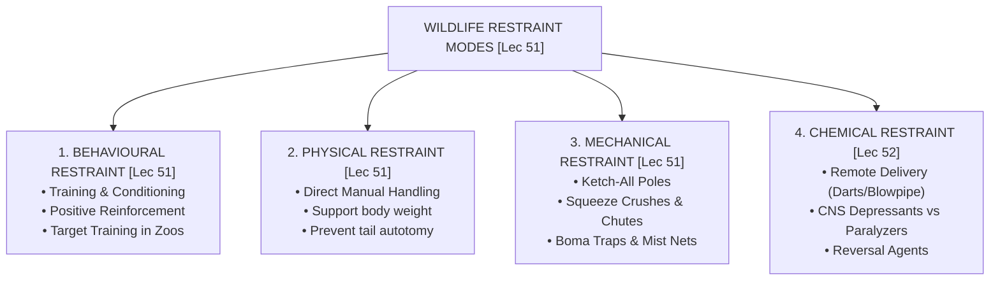
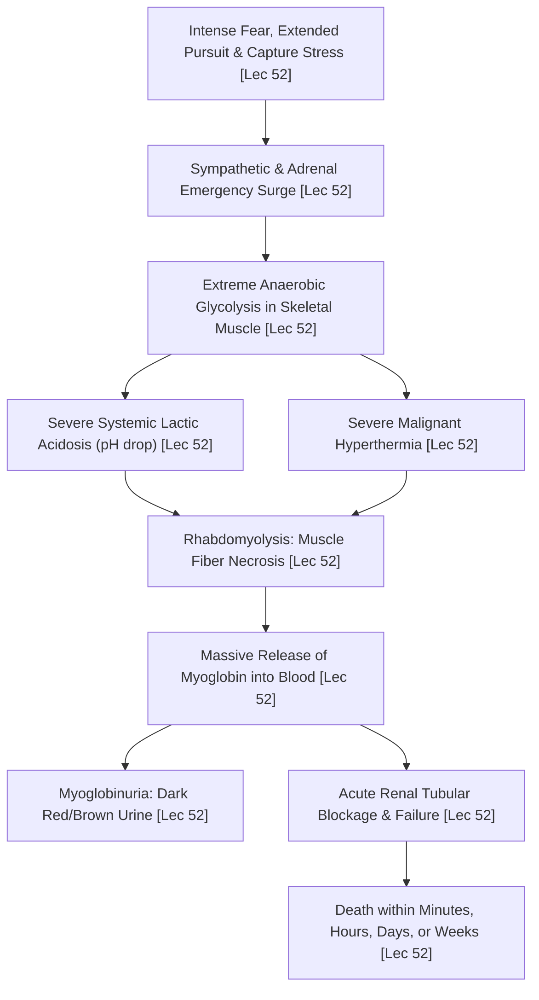

# Week 11 Cheat Sheet: Managing Biodiversity — II (Capture, Restraint, Habitat & Wildfire Management)

**Course:** Biodiversity for Sustainability  
**Instructor:** Dr. Ankur Awadhiya, IFS  
**Lectures Covered:** Lecture 51 to Lecture 55  
**Quizzes Cross-Referenced:** `quiz_week_11.txt` ($N=10$) & `quiz_week_0.txt` (Practice)  

---

## 1. High-Yield Terminological & Definitional Matrix

| Citation | Term / Concept | Operational Scientific Definition | Exam Archetype | Exam Question Tag |
| :--- | :--- | :--- | :--- | :--- |
| `[Lec 51]` | **PIT Tag (Passive Integrated Transponder)** | An unpowered microchip tag implanted subcutaneously in wildlife that emits a unique numeric identifier when scanned by an external radiofrequency reader, providing **permanent individual identification**. | Marking Technology | `[TESTED - 30% REPEAT POOL]` (W11-Q1) |
| `[Lec 51]` | **Physical Restraint** | Manual capture and physical immobilization of an animal using human hands and body mechanics (e.g., supporting reptile body weight, gripping raptor tarsi) without mechanical aids or drugs. | Restraint Mode | `[TESTED - 30% REPEAT POOL]` (W11-Q2) |
| `[Lec 51]` | **Mechanical Restraint** | Immobilization using specialized equipment and structural barriers—including **cages, traps, poles, nets, crushes, and chutes**—to physically restrict animal movement. | Restraint Mode | `[TESTED - 30% REPEAT POOL]` (W11-Q7) |
| `[Lec 51]` | **Behavioural Restraint** | Non-invasive handling strategy relying on **training, conditioning, habituation, and positive desensitisation** to elicit voluntary animal cooperation in captive or semi-captive settings. | Restraint Mode | `[TESTED - 30% REPEAT POOL]` (W11-Q6) |
| `[Lec 51]` | **Ketch-All Pole** | A rigid pole equipped with an adjustable, release-assisted cable loop that provides **short-distance animal control while keeping handlers at a safe physical distance**. | Capture Equipment | `[TESTED - 30% REPEAT POOL]` (W11-Q8) |
| `[Lec 51]` | **Caudal Autotomy Risk** | The reflexive shedding of the tail by lizards and reptiles under stress; triggered when handlers inappropriately grasp only the tail rather than supporting the full body. | Handling Pitfall | `[TESTED - 30% REPEAT POOL]` (W11-Q2) |
| `[Lec 52]` | **Jab Stick** | A pole-mounted hypodermic syringe suitable for intramuscular drug administration when an animal is **approachable, confined, or partially restrained** (e.g., in crates, traps, or squeeze cages). | Drug Delivery | `[TESTED - 30% REPEAT POOL]` (W11-Q4) |
| `[Lec 52]` | **Neuromuscular Blockers** | Immobilizing drugs (e.g., succinylcholine, gallamine) that cause flaccid paralysis of voluntary skeletal muscles **without providing sedation, analgesia, or loss of consciousness**. | Pharmacology Class | `[TESTED - 30% REPEAT POOL]` (W11-Q9) |
| `[Lec 52]` | **CNS Depressants** | Psychoactive agents (dissociatives, sedatives, tranquilizers, opioids) acting on the brain and spinal cord to induce sedation, tranquilization, analgesia, and chemical immobilization. | Pharmacology Class | `[UNSEEN HIGH-YIELD - 70% FINAL POOL]` |
| `[Lec 52]` | **Capture Myopathy** | A fatal, non-infectious metabolic syndrome in wild animals triggered by severe fear, exertion, and capture stress, culminating in lactic acidosis, hyperthermia, rhabdomyolysis, and death. | Capture Pathology | `[UNSEEN HIGH-YIELD - 70% FINAL POOL]` |
| `[Lec 52]` | **Myoglobinuria** | The excretion of muscle-breakdown protein (myoglobin) in urine, turning it dark brown/red; clinical hallmark of capture myopathy signaling acute renal tubule necrosis. | Clinical Pathology | `[UNSEEN HIGH-YIELD - 70% FINAL POOL]` |
| `[Lec 52]` | **Boma Capture Technique** | Mass capture system utilizing long, funnel-shaped cloth/canvas barriers to gently drive herds into narrowing holding bomas, drastically reducing chase duration and capture myopathy. | Mass Capture System | `[UNSEEN HIGH-YIELD - 70% FINAL POOL]` |
| `[Lec 53]` | **Habitat Management Caution** | The governing ecological principle that **management tools (fire, grazing, water provisioning, clearing) can help or harm depending on timing, intensity, location, and monitoring**. | Governance Rule | `[TESTED - 30% REPEAT POOL]` (W11-Q3) |
| `[Lec 54]` | **Crown Fire** | High-intensity wildfire that spreads through the upper **treetops and canopy layer**, spreading rapidly across forest landscapes driven by high winds. | Fire Classification | `[TESTED - 30% REPEAT POOL]` (W11-Q5) |
| `[Lec 54]` | **Surface Fire** | Wildfire that consumes ground litter, dry grasses, and low fallen debris on the forest floor at moderate flame heights and intensities. | Fire Classification | `[UNSEEN HIGH-YIELD - 70% FINAL POOL]` |
| `[Lec 54]` | **Ground Fire** | Subsurface, smoldering wildfire burning deep in peat, humus, and organic soil layers without visible surface flames; difficult to detect and suppress. | Fire Classification | `[UNSEEN HIGH-YIELD - 70% FINAL POOL]` |
| `[Lec 54]` | **Ladder Fuels** | Vertical fuels (shrubs, lianas, small understory trees, low branches) that allow low-intensity surface fires to climb into the tree canopy, igniting crown fires. | Fire Dynamics | `[UNSEEN HIGH-YIELD - 70% FINAL POOL]` |
| `[Lec 54]` | **Hydrophobic Soil** | Water-repellent soil condition created when intense wildfire volatilizes waxy plant organics, which re-condense onto cooler mineral soil particles, drastically reducing infiltration. | Physical Impact | `[TESTED - 30% REPEAT POOL]` (W11-Q10) |
| `[Lec 54]` | **Fire Line (Fire Break)** | A continuous strip of cleared ground devoid of combustible fuels constructed by hand or machinery to halt or check the spread of wildfires. | Fire Control | `[UNSEEN HIGH-YIELD - 70% FINAL POOL]` |
| `[Lec 54]` | **Backfiring / Counter Burning** | Deliberately igniting a fire along the inner edge of a control line that burns back toward the main wildfire front, consuming fuel ahead of it. | Suppression Tactic | `[UNSEEN HIGH-YIELD - 70% FINAL POOL]` |
| `[Lec 55]` | **Microplastics** | Synthetic solid polymer particles measuring **$< 5\text{ mm}$** in diameter, arising as primary manufactured microbeads or secondary fragments from weathering of macroplastics. | Pollutant Size | `[UNSEEN HIGH-YIELD - 70% FINAL POOL]` |
| `[Lec 55]` | **Photolysis (UV Degradation)** | The solar photochemical cleavage of polymer backbones by ultraviolet radiation, causing plastics to embrittle, crack, and fragment into micro- and nanoplastics. | Degradation Pathway | `[UNSEEN HIGH-YIELD - 70% FINAL POOL]` |
| `[Lec 55]` | **Ghost Fishing** | Passive, continuous killing of marine fauna by abandoned, lost, or discarded fishing gear (ALDFG / ghost nets) that perpetually drifts, sinks with carcasses, and refloats. | Ecological Hazard | `[UNSEEN HIGH-YIELD - 70% FINAL POOL]` |
| `[Lec 55]` | **Plastic Chemical Sponge Effect** | Phenomenon where hydrophobic microplastic particles, possessing high surface-area-to-volume ratios, concentrate ambient hydrophobic toxins (POPs, PAHs, PCBs, DDT) from water. | Toxicological Mechanism | `[UNSEEN HIGH-YIELD - 70% FINAL POOL]` |
| `[Lec 55]` | **Endocrine Disrupting Chemicals (EDCs)** | Plastic additives (e.g., **Bisphenol A / BPA, Phthalates**) that mimic or block endogenous hormones, impairing development, fertility, and thyroid function. | Toxicological Class | `[UNSEEN HIGH-YIELD - 70% FINAL POOL]` |

---

## 2. Four Modes of Wildlife Restraint Comparison Matrix (Lecture 51)

| Citation | Restraint Category | Primary Mechanism / Equipment | Key Target Taxa / Settings | Major Risk & Welfare Precaution | Exam Tag |
| :--- | :--- | :--- | :--- | :--- | :--- |
| `[Lec 51]` | **Behavioural Restraint** | Conditioning, operant training, positive food reinforcement, target desensitization. | Captive/semi-captive zoo megafauna (elephants, primates, marine mammals). | Requires weeks/months of prior training; useless in acute wild emergency capture. | `[TESTED - 30% REPEAT POOL]` (W11-Q6) |
| `[Lec 51]` | **Physical Restraint** | Manual handling using gloved hands, towels, blankets, padded boards. | Small reptiles, small rodents, passerine birds, juvenile mammals. | Supporting body and avoiding squeezing; **never hold by tail alone** (avoids caudal autotomy). | `[TESTED - 30% REPEAT POOL]` (W11-Q2) |
| `[Lec 51]` | **Mechanical Restraint** | Ketch-All poles, squeeze cages, drop nets, box traps, funnel bomas, crushes. | Mid-sized carnivores, ungulates, feral animals, feral dogs. | Ketch-All pole provides short-range standoff control; must prevent strangulation or limb fractures. | `[TESTED - 30% REPEAT POOL]` (W11-Q7, Q8) |
| `[Lec 52]` | **Chemical Restraint** | Intramuscular injection via jab sticks, blowpipes, CO2 dart rifles, powder projectors. | Dangerous large carnivores (tigers, leopards), free-ranging megaherbivores. | Respiratory arrest, hypothermia/hyperthermia, capture myopathy; requires immediate monitoring. | `[UNSEEN HIGH-YIELD - 70% FINAL POOL]` |

---

## 3. Remote Chemical Delivery Gear Spectrum (Lecture 52)

| Citation | Delivery Apparatus | Working Range | Propulsion Mechanism | Best Operational Context | Limitations & Technical Traps |
| :--- | :--- | :--- | :--- | :--- | :--- |
| `[Lec 52]` | **Direct Hand Syringe** | $0\text{ m}$ (Contact) | Manual thumb plunger pressure. | Sedated, comatose, or completely restrained animals in squeeze cages. | High physical risk if animal wakes or thrashes. |
| `[Lec 52]` | **Jab Stick** | $1\text{--}2\text{ m}$ | Pole-mounted manual thrust. | **Confined, approachable, or partially restrained animals** (crates, cage bars, traps) `[TESTED - 30% REPEAT POOL]` (W11-Q4). | Short reach; requires physical proximity and clear dart line. |
| `[Lec 52]` | **Blowpipe (Blowgun)** | $< 5\text{ m}$ (Short) | Human lung expiration pressure. | Quiet, indoor enclosures, zoo cages, close arboreal primates `[UNSEEN HIGH-YIELD - 70% FINAL POOL]`. | Ineffective in wind or long distances; requires operator lung capacity. |
| `[Lec 52]` | **Compressed Air / CO2 Rifle (e.g., Dan-Inject)** | $10\text{--}30\text{ m}$ (Medium) | Compressed gas/air with **adjustable pressure manometer**. | Free-ranging ungulates, medium carnivores, terrain with moderate standoff `[UNSEEN HIGH-YIELD - 70% FINAL POOL]`. | Pressure must be calibrated to avoid deep tissue trauma or bounce-off; double-barrel models require barrel verification! |
| `[Lec 52]` | **Gunpowder-Charge Projector Gun** | $30\text{--}60+\text{ m}$ (Long) | Exploding powder charge (.22 blank cartridges). | High standoff distances, thick-skinned large megafauna (elephants, rhinos) `[UNSEEN HIGH-YIELD - 70% FINAL POOL]`. | **Highest discharge force**; lightweight plastic darts will shatter/fragment under powder pressure! |

---

## 4. Chemical Immobilization Pharmacology & Capture Myopathy Triad (Lecture 52)

| Citation | Subject / Class | Scientific Classification / Compound | Clinical Mechanism of Action | Critical Safety / Field Reversal Precaution |
| :--- | :--- | :--- | :--- | :--- |
| `[Lec 52]` | **Neuromuscular Blockers (NMBs)** | Succinylcholine (depolarizing), Gallamine, d-Tubocurarine `[TESTED - 30% REPEAT POOL]` (W11-Q9). | Acetylcholine receptor blockade at motor end-plate $\rightarrow$ **flaccid voluntary muscle paralysis**. | **NO analgesia, NO sedation, NO amnesia!** Animal experiences severe distress and suffocates if diaphragm is paralyzed. Narrow safety index. |
| `[Lec 52]` | **Dissociative Anesthetics** | Ketamine hydrochloride, Tiletamine `[UNSEEN HIGH-YIELD - 70% FINAL POOL]`. | NMDA receptor antagonism; disrupts sensory perception with cataleptic state. | Swallowing and corneal reflexes maintained; pair with sedatives to prevent muscle rigidity. |
| `[Lec 52]` | **Alpha-2 Adrenergic Agonists** | Xylazine, Medetomidine, Detomidine `[UNSEEN HIGH-YIELD - 70% FINAL POOL]`. | Central alpha-2 receptor stimulation $\rightarrow$ profound sedation, analgesia, muscle relaxation. | Causes bradycardia and peripheral vasoconstriction; reversed quickly with **Atipamezole** or Yohimbine. |
| `[Lec 52]` | **Potent Opioids** | Etorphine (M99), Carfentanil `[UNSEEN HIGH-YIELD - 70% FINAL POOL]`. | Pure mu-opioid receptor agonists ($1,000\text{--}10,000\times$ more potent than morphine). | Severe respiratory depression; lethal to human handlers on accidental needle-prick; reversed with **Naloxone / Naltrexone**. |
| `[Lec 52]` | **Vital Monitoring Protocol** | **ABC Checklist**: **A**irway, **B**reathing, **C**irculation `[UNSEEN HIGH-YIELD - 70% FINAL POOL]`. | Continuous monitoring of body temp, respiration rate, CRT ($<2\text{ sec}$), eye reflexes. | Rectal thermometer mandatory: hyperthermia ($>40^\circ\text{C}$) triggers irreversible brain and muscle damage. |
| `[Lec 52]` | **Capture Myopathy Timeline** | Non-infectious metabolic capture syndrome `[UNSEEN HIGH-YIELD - 70% FINAL POOL]`. | Muscle lysis $\rightarrow$ dark urine (**myoglobinuria**) $\rightarrow$ acute renal failure. | Prevention is only cure: minimize chase ($<2\text{--}5\text{ min}$), use **Boma capture**, avoid darting in hot midday hours. Post-release monitoring for **3 to 10 days**. |

---

## 5. Wildfire Dynamics, Behavior & Control Lines Matrix (Lecture 54)

| Citation | Wildfire Layer / Phase | Burning Fuel Matrix | Fire Behavior & Rate of Spread | Suppression Technique & Ecological Consequence |
| :--- | :--- | :--- | :--- | :--- |
| `[Lec 54]` | **Surface Fire** | Dry grasses, fallen leaf litter, dead twigs on the forest floor `[UNSEEN HIGH-YIELD - 70% FINAL POOL]`. | Low-to-moderate intensity; flame lengths usually $< 1\text{--}2\text{ m}$; moves along floor. | Direct attack with water, beaters, and rake hoes; often controlled by basic cut fire lines. |
| `[Lec 54]` | **Crown Fire** | Living foliage, branches, and upper tree canopies `[TESTED - 30% REPEAT POOL]` (W11-Q5). | **Highest intensity and fastest spread**; generates firestorms and spot fires miles ahead. | Indirect attack only: requires wide rivers, highways, backfiring, and slurry bomber drops. Standard fire lines easily breached! |
| `[Lec 54]` | **Ground Fire** | Peat, muck, buried roots, deep organic soil layers `[UNSEEN HIGH-YIELD - 70% FINAL POOL]`. | Smoldering combustion without open flames; extremely slow spread; produces dense smoke. | Difficult to detect; requires deep trenching down to mineral bedrock and prolonged flooding. |
| `[Lec 54]` | **Combustion Scale Triangle** | **Fuel + Heat + Oxygen** `[UNSEEN HIGH-YIELD - 70% FINAL POOL]`. | Removing any single component extinguishes the chemical combustion reaction. | Fire line removes fuel; water removes heat; dirt/foam smothers oxygen. |
| `[Lec 54]` | **Soil Hydrophobicity** | Post-fire mineral soil alteration `[TESTED - 30% REPEAT POOL]` (W11-Q10). | Volatilized organic wax condenses onto soil particles $\rightarrow$ **soil repels water**. | **Drastically reduces infiltration and escalates surface runoff, flash flooding, and severe mudslides**. |
| `[Lec 54]` | **Direct Attack vs Indirect Attack** | Fireline construction strategy `[UNSEEN HIGH-YIELD - 70% FINAL POOL]`. | Direct = fighting directly at flaming edge (low intensity); Indirect = constructing containment line far ahead of advancing front. | Counter burning (backfiring) burns fuel between indirect control line and main fire front. |

---

## 6. Plastic Pollution Size Hierarchy & Toxicological Pathways (Lecture 55)

| Citation | Particle Size Class | Dimensional Range | Environmental Origin & Primary Source | Wildlife Hazard & Physiological Mechanism |
| :--- | :--- | :--- | :--- | :--- |
| `[Lec 55]` | **Macroplastics** | $> 25\text{ mm}$ ($> 2.5\text{ cm}$) `[UNSEEN HIGH-YIELD - 70% FINAL POOL]`. | Intact plastic bags, water bottles, food packaging, abandoned fishing gear (ALDFG). | Gastrointestinal impaction, false satiation, starvation, external strangulation and entanglement. |
| `[Lec 55]` | **Mesoplastics** | $5\text{ mm to } 25\text{ mm}$ `[UNSEEN HIGH-YIELD - 70% FINAL POOL]`. | Bottle caps, fragmented packaging, frayed industrial ropes. | Ingestion by seabirds (albatrosses, petrels), mistaken for cuttlefish or crustaceans. |
| `[Lec 55]` | **Microplastics** | $< 5\text{ mm}$ `[UNSEEN HIGH-YIELD - 70% FINAL POOL]`. | Primary: industrial microbeads, resin pellets; Secondary: weathered fragments via **photolysis**. | Trophic bioaccumulation; blocks microvilli in gut; adsorbed hydrophobic POPs leach into tissues. |
| `[Lec 55]` | **Nanoplastics** | $< 1\text{ }\mu\text{m}$ ($< 1000\text{ nm}$) `[UNSEEN HIGH-YIELD - 70% FINAL POOL]`. | Extreme mechanical abrasion and nano-fragmentation. | Crosses biological membranes: enters bloodstream, passes blood-brain barrier and placental barrier. |
| `[Lec 55]` | **Endocrine Disruptors** | Molecular additives: **Bisphenol A (BPA), Phthalates** `[UNSEEN HIGH-YIELD - 70% FINAL POOL]`. | Leached plasticizers and resin stabilizers. | Binds estrogen/androgen receptors; causes reproductive failure, feminization, disrupted metamorphosis. |
| `[Lec 55]` | **Case Study: Mukurthi NP** | Terrestrial herbivore ingestion `[UNSEEN HIGH-YIELD - 70% FINAL POOL]`. | Nilgiri Tahr (*Nilgiritragus hylocrius*) grazing near campsites/roads in Mukurthi National Park, Tamil Nadu. | Accidental ingestion of plastic waste discarded along trekking trails and scenic viewpoints. |

---

## 7. Question Bank: Tested vs. High-Yield Unseen Extraction

### Tested Repeat Pool (Assignment 11 Direct Hits)
- `[Lec 51] [TESTED - 30% REPEAT POOL]` **What is the main purpose of PIT tags?** To allow long-term, permanent individual identification (W11-Q1).
- `[Lec 51] [TESTED - 30% REPEAT POOL]` **Which practice is appropriate while physically handling small reptiles?** Supporting the body and avoiding squeezing (never grasp by tail alone) (W11-Q2).
- `[Lec 53] [TESTED - 30% REPEAT POOL]` **Which statement reflects the central caution in habitat management?** Management tools can help or harm depending on timing, intensity, location, and monitoring (W11-Q3).
- `[Lec 52] [TESTED - 30% REPEAT POOL]` **When is a jab stick most suitable?** When the animal is approachable, confined, or partially restrained (W11-Q4).
- `[Lec 54] [TESTED - 30% REPEAT POOL]` **Which type of wildfire burns treetops and can spread rapidly?** Crown fire (W11-Q5).
- `[Lec 51] [TESTED - 30% REPEAT POOL]` **Which form of restraint is based on training, conditioning, or desensitisation?** Behavioural restraint (W11-Q6).
- `[Lec 51] [TESTED - 30% REPEAT POOL]` **Which form of restraint uses cages, traps, poles, nets, or chutes?** Mechanical restraint (W11-Q7).
- `[Lec 51] [TESTED - 30% REPEAT POOL]` **Which statement best describes a Ketch-All pole?** It provides short-distance control while keeping handlers away at a safe distance (W11-Q8).
- `[Lec 52] [TESTED - 30% REPEAT POOL]` **Which drug group immobilises animals through paralysis of voluntary muscles without providing sedation or analgesia?** Neuromuscular blockers (W11-Q9).
- `[Lec 54] [TESTED - 30% REPEAT POOL]` **Which is a physical effect of wildfire?** Hydrophobic soil reducing infiltration and increasing runoff (W11-Q10).

### Unseen High-Yield Question Bank (70% Final Pool)
- `[Lec 51] [UNSEEN HIGH-YIELD - 70% FINAL POOL]` **What physiological risk occurs if an animal is pursued for a prolonged duration before capture?** Capture myopathy (severe lactic acidosis, hyperthermia, and rhabdomyolysis).
- `[Lec 52] [UNSEEN HIGH-YIELD - 70% FINAL POOL]` **Why should plastic darts never be fired using gunpowder-based projector guns?** The extreme discharge force of gunpowder systems will shatter or fragment lightweight plastic darts.
- `[Lec 52] [UNSEEN HIGH-YIELD - 70% FINAL POOL]` **What is myoglobinuria in captured wildlife?** Dark red/brown urine containing myoglobin from muscle breakdown, indicating acute kidney failure from capture myopathy.
- `[Lec 52] [UNSEEN HIGH-YIELD - 70% FINAL POOL]` **What is the Boma capture method?** Funnel-shaped cloth/canvas capture corrals used to capture herds without prolonged vehicle pursuit, preventing capture myopathy.
- `[Lec 52] [UNSEEN HIGH-YIELD - 70% FINAL POOL]` **For how long should post-release monitoring continue after a wildlife capture event?** For 3 to 10 days, as capture myopathy can cause delayed mortality days or weeks later.
- `[Lec 54] [UNSEEN HIGH-YIELD - 70% FINAL POOL]` **What are ladder fuels in forest fire science?** Low-hanging branches, tall shrubs, and lianas that bridge ground/surface fuels to tree crowns.
- `[Lec 54] [UNSEEN HIGH-YIELD - 70% FINAL POOL]` **What is counter burning (backfiring)?** Setting a controlled fire along the inner edge of a fire break to burn towards the advancing wildfire front, starving it of fuel.
- `[Lec 55] [UNSEEN HIGH-YIELD - 70% FINAL POOL]` **What is the size cutoff for microplastics?** Particles smaller than $5\text{ mm}$ ($< 5\text{ mm}$).
- `[Lec 55] [UNSEEN HIGH-YIELD - 70% FINAL POOL]` **What process converts macroplastics into microplastics in the ocean?** Photolysis (solar UV radiation breaking polymer chains) combined with mechanical wave abrasion.
- `[Lec 55] [UNSEEN HIGH-YIELD - 70% FINAL POOL]` **What endocrine disruptor is commonly found in polycarbonate plastics and epoxy resins?** Bisphenol A (BPA).
- `[Lec 55] [UNSEEN HIGH-YIELD - 70% FINAL POOL]` **Which endemic ungulate was documented ingesting plastic litter in Mukurthi National Park?** The Nilgiri Tahr (*Nilgiritragus hylocrius*).
