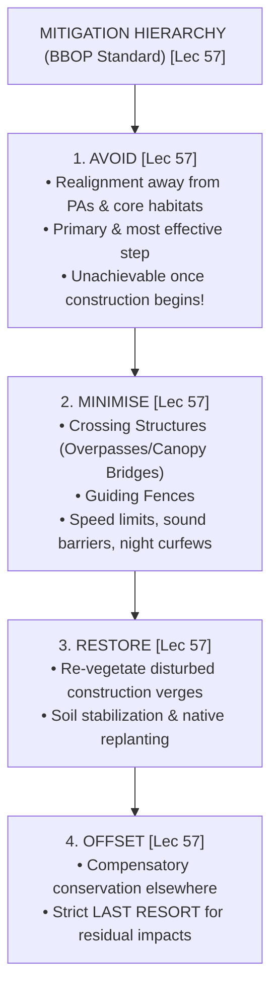
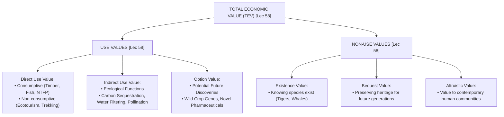

# Week 12 Cheat Sheet: Biodiversity Synthesis — Oil Spills, Linear Infrastructure & Economic Valuation

**Course:** Biodiversity for Sustainability  
**Instructor:** Dr. Ankur Awadhiya, IFS  
**Lectures Covered:** Lecture 56 to Lecture 60  
**Quizzes Cross-Referenced:** `quiz_week_12.txt` ($N=10$) & `quiz_week_0.txt` (Practice)  

---

## 1. High-Yield Terminological & Definitional Matrix

| Citation | Term / Concept | Operational Scientific Definition | Exam Archetype | Exam Question Tag |
| :--- | :--- | :--- | :--- | :--- |
| `[Lec 56]` | **Oil Spill** | The accidental or operational release of liquid petroleum hydrocarbons into the marine, freshwater, or terrestrial environment. | Core Definition | `[TESTED - 30% REPEAT POOL]` (W12-Q7) |
| `[Lec 56]` | **Polycyclic Aromatic Hydrocarbons (PAHs)** | Fused aromatic ring compounds in petroleum oil exhibiting the highest biological toxicity, carcinogenicity, mutagenicity, and persistence. | Toxicological Class | `[TESTED - 30% REPEAT POOL]` (W12-Q10) |
| `[Lec 56]` | **Feather/Fur Maceration & Hypothermia** | Physical coating of plumage or pelt by oil destroying trapped insulating air layers, breaking waterproofing and causing fatal **hypothermia**. | Physiological Pathology | `[UNSEEN HIGH-YIELD - 70% FINAL POOL]` |
| `[Lec 56]` | **Containment Booms** | Temporary floating mechanical barriers deployed on the water surface to corral, concentrate, and prevent oil slicks from spreading into sensitive estuaries or mangroves. | Spill Response Gear | `[UNSEEN HIGH-YIELD - 70% FINAL POOL]` |
| `[Lec 56]` | **Oil Skimmers** | Mechanical devices that physically recover and skim oil directly from the water surface into recovery tanks in calm water conditions. | Spill Response Gear | `[UNSEEN HIGH-YIELD - 70% FINAL POOL]` |
| `[Lec 56]` | **Chemical Dispersants** | Surfactant mixtures sprayed onto oil slicks to disperse surface oil into minute sub-surface droplets; **trade-off: reduces surface hazard but escalates toxicity to benthic/pelagic life**. | Chemical Response | `[UNSEEN HIGH-YIELD - 70% FINAL POOL]` |
| `[Lec 57]` | **Linear Infrastructure** | Anthropogenic facilities that extend as narrow, continuous lines across landscapes—including **highways, railways, power lines, pipelines, and irrigation canals**. | Infrastructure Type | `[TESTED - 30% REPEAT POOL]` (W12-Q2, Q6) |
| `[Lec 57]` | **Barrier Effect** | Behavioral avoidance of linear corridors by wildlife where animals cease attempting to cross due to traffic noise, headlights, or disturbance, causing population isolation. | Ecological Impact | `[TESTED - 30% REPEAT POOL]` (W12-Q3) |
| `[Lec 57]` | **Canopy Bridge** | An artificial arboreal aerial crossing structure suspended across road gaps specifically engineered for **arboreal mammals and reptiles** that travel in the upper forest canopy. | Wildlife Crossing | `[TESTED - 30% REPEAT POOL]` (W12-Q8) |
| `[Lec 57]` | **Mitigation Hierarchy: Avoid** | The primary and most critical stage of the mitigation hierarchy mandating that **infrastructure routes be placed completely away from critical natural habitats**. | Hierarchy Phase | `[TESTED - 30% REPEAT POOL]` (W12-Q9) |
| `[Lec 57]` | **Guide Fences** | Structural fencing flanking highways and railways designed to **prevent random animal road entry and guide animals safely toward engineered wildlife crossing structures**. | Mitigation Engineering | `[TESTED - 30% REPEAT POOL]` (W12-Q1) |
| `[Lec 57]` | **Roadkill Hotspots** | Spatially concentrated clusters of repeated wildlife-vehicle collisions identified through GPS carcass surveys, defining priority crossing structure placement. | Spatial Metric | `[UNSEEN HIGH-YIELD - 70% FINAL POOL]` |
| `[Lec 57]` | **Ecoduct (Green Bridge / Overpass)** | Broad vegetated bridge constructed over highways or rail lines mimicking native ground cover, designed for wide-ranging ungulates and carnivores. | Wildlife Crossing | `[UNSEEN HIGH-YIELD - 70% FINAL POOL]` |
| `[Lec 58]` | **Total Economic Value (TEV)** | Comprehensive valuation framework integrating **both Use Values (Direct, Indirect, Option) and Non-Use Values (Existence, Bequest, Altruistic)** of biological resources. | Valuation Framework | `[TESTED - 30% REPEAT POOL]` (W12-Q4) |
| `[Lec 58]` | **Direct Use Value** | Economic value derived from direct human interaction with biodiversity, spanning consumptive uses (timber, fish, medicinal herbs) and non-consumptive uses (ecotourism, recreation). | Economic Value Class | `[UNSEEN HIGH-YIELD - 70% FINAL POOL]` |
| `[Lec 58]` | **Indirect Use Value** | Economic value provided by background ecosystem life-support functions (pollination, watershed purification, carbon sequestration, flood control) without direct physical extraction. | Economic Value Class | `[UNSEEN HIGH-YIELD - 70% FINAL POOL]` |
| `[Lec 58]` | **Option Value** | Premium placed on preserving biological resources for unforeseen future uses, discoveries (e.g., novel pharmaceuticals), or future technological applications. | Economic Value Class | `[UNSEEN HIGH-YIELD - 70% FINAL POOL]` |
| `[Lec 58]` | **Existence Value** | Benefit and satisfaction humans derive from simply knowing that a species, ecosystem, or wild landscape continues to exist, independent of any present or future use. | Non-Use Value Class | `[UNSEEN HIGH-YIELD - 70% FINAL POOL]` |
| `[Lec 58]` | **Bequest Value** | The economic and moral value individuals assign to passing down intact natural heritage and functioning ecosystems to future generations. | Non-Use Value Class | `[UNSEEN HIGH-YIELD - 70% FINAL POOL]` |
| `[Lec 58]` | **Contingent Valuation Method (CVM)** | Stated-preference valuation methodology using structured surveys to determine public **Willingness to Pay (WTP)** for conservation of non-market goods (non-use values). | Valuation Technique | `[TESTED - 30% REPEAT POOL]` (W12-Q5) |
| `[Lec 58]` | **Travel Cost Method (TCM)** | Revealed-preference valuation technique estimating recreational value of protected areas based on travel expenditures, lodging, entrance fees, and opportunity cost of travel time. | Valuation Technique | `[UNSEEN HIGH-YIELD - 70% FINAL POOL]` |
| `[Lec 58]` | **Hedonic Pricing Method (HPM)** | Valuation method isolating the environmental attribute premium reflected in market prices of related private goods (e.g., higher real estate values adjacent to urban green parks). | Valuation Technique | `[UNSEEN HIGH-YIELD - 70% FINAL POOL]` |
| `[Lec 58]` | **Benefits Transfer Method** | Economic procedure transferring existing valuation figures from a previously studied primary site to a target policy site where time or resources prevent primary surveys. | Valuation Technique | `[UNSEEN HIGH-YIELD - 70% FINAL POOL]` |
| `[Lec 59]` | **Precautionary Principle** | Environmental decision tenet stating that where there are threats of serious or irreversible damage, lack of full scientific certainty shall not postpone cost-effective mitigation. | Decision Philosophy | `[UNSEEN HIGH-YIELD - 70% FINAL POOL]` |
| `[Lec 59]` | **Conservation Triage** | Systematic prioritization protocol for allocating scarce conservation funding, personnel, and time to taxa or habitats where intervention maximizes long-term survival probability. | Resource Allocation | `[UNSEEN HIGH-YIELD - 70% FINAL POOL]` |
| `[Lec 60]` | **Course Keystone Doctrine** | Scientific realization that **variation at every hierarchical scale (genetic, species, ecosystem) is the true foundation of ecological resilience and human sustainability**. | Course Synthesis | `[UNSEEN HIGH-YIELD - 70% FINAL POOL]` |

---

## 2. Linear Infrastructure Mitigation Hierarchy & Crossing Matrix (Lecture 57)

| Citation | Infrastructure Mitigation Structure | Target Taxa / Ecological Function | Engineering Design Specifications | Critical Operational Safeguard / Trap |
| :--- | :--- | :--- | :--- | :--- |
| `[Lec 57]` | **Canopy Bridge** | Arboreal mammals (gibbons, langurs, squirrels) and climbing reptiles `[TESTED - 30% REPEAT POOL]` (W12-Q8). | Suspended rope/mesh bridges spanning highway canopy gaps; anchored into sturdy roadside trees. | Must align exactly with established natural canopy runways on both road margins. |
| `[Lec 57]` | **Guide Fences (Drift Fences)** | Ungulates, large carnivores, small vertebrates `[TESTED - 30% REPEAT POOL]` (W12-Q1). | Continuous chain-link or mesh fencing lining road verges leading toward crossing structures. | **Fence ends must flare away from the roadway** into the forest interior to prevent trapping animals between road and fence! |
| `[Lec 57]` | **Wildlife Overpass (Ecoduct)** | Large mammals (elephants, tigers, bears, ungulates) `[UNSEEN HIGH-YIELD - 70% FINAL POOL]`. | Hourglass-shaped wide bridge ($>50\text{ m}$ width) planted with native soil, grass, shrubs, and sound-dampening berms. | Barren concrete bridges will be rejected by wildlife; requires natural soil substrate and lateral visual screens. |
| `[Lec 57]` | **Wildlife Underpass / Box Culverts** | Deer, wild boar, carnivores, semi-aquatic mammals `[UNSEEN HIGH-YIELD - 70% FINAL POOL]`. | Concrete box culverts beneath raised roadway with high Openness Index ($\text{Height} \times \text{Width} / \text{Length}$). | Animals avoid long, dark, tunnel-like tubes; maintain natural light penetration and natural dirt floors. |
| `[Lec 57]` | **Small Fauna Culverts & Drift Fencing** | Amphibians (frogs, toads), reptiles, small rodents `[UNSEEN HIGH-YIELD - 70% FINAL POOL]`. | Small circular or square pipe culverts paired with low ($0.5\text{ m}$) solid drift walls along the curb. | Must maintain moisture and unblocked drainage grates; drift walls prevent amphibians from climbing onto hot asphalt. |

---

## 3. Total Economic Value (TEV) Framework Matrix (Lecture 58)

| Citation | Value Category | Economic Meaning | Concrete Field Examples | Appropriate Valuation Methodologies |
| :--- | :--- | :--- | :--- | :--- |
| `[Lec 58]` | **Direct Consumptive Use** | Commercial/subsistence extraction of physical biological resources `[UNSEEN HIGH-YIELD - 70% FINAL POOL]`. | Timber harvests, firewood, fish stocks, medicinal plants, fodder grass. | Market Price Method; Alternative Cost Method. |
| `[Lec 58]` | **Direct Non-Consumptive Use** | Experiential enjoyment without removing biological materials `[UNSEEN HIGH-YIELD - 70% FINAL POOL]`. | Safari tourism in Tiger Reserves, bird watching, recreational scuba diving. | **Travel Cost Method (TCM)**; Hedonic Pricing Method. |
| `[Lec 58]` | **Indirect Use Value** | Background regulatory and supporting ecological functions `[UNSEEN HIGH-YIELD - 70% FINAL POOL]`. | Mangrove coastal storm buffering, forest watershed filtration, wild bee crop pollination. | Damage Cost Avoided; Replacement Cost Method; Production Function. |
| `[Lec 58]` | **Option Value** | Premium for preserving future potential use options `[UNSEEN HIGH-YIELD - 70% FINAL POOL]`. | Wild rice germplasm (*Oryza nivara*) for future disease resistance genes; unstudied toxins. | Contingent Valuation Method (CVM); Option Pricing Models. |
| `[Lec 58]` | **Existence Value** | Satisfaction from knowing biodiversity exists in perpetuity `[UNSEEN HIGH-YIELD - 70% FINAL POOL]`. | Moral satisfaction that Snow Leopards or Blue Whales thrive, even if never seen. | **Contingent Valuation Method (CVM)** (Willingness to Pay - WTP). |
| `[Lec 58]` | **Bequest Value** | Value assigned to endowing future human generations with intact nature `[UNSEEN HIGH-YIELD - 70% FINAL POOL]`. | Leaving pristine Western Ghats shola-grassland mosaics intact for grandchildren. | **Contingent Valuation Method (CVM)**; Stated Choice Experiments. |

---

## 4. Ecosystem Valuation Methodologies Comparison (Lecture 58)

| Citation | Economic Valuation Method | Preference Approach | Core Input Data & Scientific Basis | Primary Exam Application & Critical Limitations |
| :--- | :--- | :--- | :--- | :--- |
| `[Lec 58]` | **Market Price Method** | Revealed Market Price `[UNSEEN HIGH-YIELD - 70% FINAL POOL]`. | Quantities of harvested biological goods multiplied by prevailing market prices ($P \times Q$). | Restricted to directly traded commodities; heavily distorted by subsidies and market failures. |
| `[Lec 58]` | **Travel Cost Method (TCM)** | Revealed Stated Travel `[UNSEEN HIGH-YIELD - 70% FINAL POOL]`. | Total expenditures on travel fuel, tickets, food, lodging, and opportunity cost of time spent traveling. | **Gold standard for recreational value of National Parks, lakes, and ecotourism sites**; ignores non-users. |
| `[Lec 58]` | **Hedonic Pricing Method (HPM)** | Revealed Property Market `[UNSEEN HIGH-YIELD - 70% FINAL POOL]`. | Statistical regression isolating price differential of real estate attributable to green views or clean air. | Urban wetland/park valuation; assumes frictionless property markets and complete buyer awareness. |
| `[Lec 58]` | **Damage Cost Avoided / Replacement Cost** | Cost-Based Imputation `[UNSEEN HIGH-YIELD - 70% FINAL POOL]`. | Cost of building artificial concrete seawalls vs mangrove storm defense; artificial chemical fertilizer vs bat guano. | Useful for regulatory functions; danger of overestimating if replacement facility would never actually be built. |
| `[Lec 58]` | **Contingent Valuation Method (CVM)** | **Stated Preference (Surveys)** `[TESTED - 30% REPEAT POOL]` (W12-Q5). | Structured willingness-to-pay (**WTP**) or willingness-to-accept (**WTA**) survey questionnaires. | **The ONLY method capable of estimating non-use values (Existence, Bequest)**; vulnerable to hypothetical bias. |
| `[Lec 58]` | **Benefits Transfer Method** | Secondary Extrapolation `[UNSEEN HIGH-YIELD - 70% FINAL POOL]`. | Unit values (e.g., \$/ha/year) adjusted from existing primary study sites to a data-deficient policy site. | Rapid and inexpensive; errors multiply if ecological context, socioeconomic baseline, or scale differ. |

---

## 5. Oil Spill Chemistry, Wildlife Pathology & Response Gear Matrix (Lecture 56)

| Citation | Petroleum Spill Aspect | Chemical / Mechanical Agent | Ecological Mechanism & Action | Environmental Trade-Off / Failure Mode |
| :--- | :--- | :--- | :--- | :--- |
| `[Lec 56]` | **Biological Toxicity Driver** | **Polycyclic Aromatic Hydrocarbons (PAHs)** `[TESTED - 30% REPEAT POOL]` (W12-Q10). | Hydrophobic aromatic hydrocarbons intercalate into cell membranes, mutagenize DNA, and cause tissue necrosis. | High molecular weight PAHs persist in sediments for decades; biomagnify in benthic food chains. |
| `[Lec 56]` | **Acute Wildlife Mechanism** | **Feather/Fur Maceration** `[UNSEEN HIGH-YIELD - 70% FINAL POOL]`. | Oil dissolves feather barbules and pelt lipids, displacing insulating air $\rightarrow$ **fatal hypothermia**. | Ingestion occurs during frantic grooming/preening; oil vapors cause acute respiratory inhalation injury. |
| `[Lec 56]` | **Containment Booms** | Floating curtain booms with subsurface skirts `[UNSEEN HIGH-YIELD - 70% FINAL POOL]`. | Encircle surface slick, preventing movement toward sensitive mangroves, mudflats, and coral reefs. | Useless in choppy seas ($>1\text{--}2\text{ m}$ waves) where waves splash oil over booms or underflow occurs. |
| `[Lec 56]` | **Mechanical Skimmers** | Drum, weir, disc, or oleophilic brush skimmers `[UNSEEN HIGH-YIELD - 70% FINAL POOL]`. | Mechanically lift separated surface oil into storage tanks without using chemical agents. | Requires calm waters; skimmer intake can easily be clogged by marine debris, seaweed, and garbage. |
| `[Lec 56]` | **Chemical Dispersants** | Surfactant cocktails (e.g., Corexit) `[UNSEEN HIGH-YIELD - 70% FINAL POOL]`. | Lowers surface tension, breaking surface slicks into microscopic droplets ($1\text{--}70\text{ }\mu\text{m}$) dispersed in water. | **Critical Ecological Trade-off:** Saves surface seabirds/otters, but drastically increases toxicity to water column fish and coral larvae! |
| `[Lec 56]` | **In-Situ Burning** | Controlled ignition of contained oil slicks `[UNSEEN HIGH-YIELD - 70% FINAL POOL]`. | Rapidly eliminates up to $95\%$ of surface oil volume if slick thickness exceeds $2\text{--}3\text{ mm}$. | Produces toxic black smoke plumes, greenhouse gases, and leaves heavy, toxic, unburned tarry residues that sink. |

---

## 6. Question Bank: Tested vs. High-Yield Unseen Extraction

### Tested Repeat Pool (Assignment 12 Direct Hits)
- `[Lec 57] [TESTED - 30% REPEAT POOL]` **What should fences do in wildlife-road mitigation?** Guide animals toward safe crossing structures (W12-Q1).
- `[Lec 57] [TESTED - 30% REPEAT POOL]` **Which of the following is an example of linear infrastructure?** Railway (or roads, power lines, pipelines) (W12-Q2).
- `[Lec 57] [TESTED - 30% REPEAT POOL]` **What is the barrier effect of a road?** Animals avoid crossing, reducing movement between habitat areas (W12-Q3).
- `[Lec 58] [TESTED - 30% REPEAT POOL]` **What is Total Economic Value designed to capture?** Both use and non-use values (W12-Q4).
- `[Lec 58] [TESTED - 30% REPEAT POOL]` **Which valuation method uses surveys to ask willingness to pay for conservation?** Contingent valuation method (CVM) (W12-Q5).
- `[Lec 57] [TESTED - 30% REPEAT POOL]` **What is linear infrastructure?** Facilities that extend as lines across landscapes (W12-Q6).
- `[Lec 56] [TESTED - 30% REPEAT POOL]` **What is an oil spill?** The release of liquid petroleum hydrocarbons into the environment (W12-Q7).
- `[Lec 57] [TESTED - 30% REPEAT POOL]` **Which structure is designed for arboreal mammals and some reptiles?** Canopy bridge (W12-Q8).
- `[Lec 57] [TESTED - 30% REPEAT POOL]` **Which mitigation hierarchy step means keeping infrastructure away from critical habitat where possible?** Avoid (W12-Q9).
- `[Lec 56] [TESTED - 30% REPEAT POOL]` **Which compounds are especially associated with toxicity in petroleum oil?** Aromatic hydrocarbons, especially PAHs (W12-Q10).

### Unseen High-Yield Question Bank (70% Final Pool)
- `[Lec 56] [UNSEEN HIGH-YIELD - 70% FINAL POOL]` **Why does oiling cause hypothermia in marine birds and sea otters?** Oil mats feathers/fur and destroys the layer of trapped air that provides insulation and waterproofing.
- `[Lec 56] [UNSEEN HIGH-YIELD - 70% FINAL POOL]` **What is the critical ecological trade-off of applying chemical dispersants to an oil spill?** Dispersants remove oil from the sea surface, protecting birds, but drive toxic dispersed droplets into the water column, poisoning fish, larvae, and coral reefs.
- `[Lec 57] [UNSEEN HIGH-YIELD - 70% FINAL POOL]` **What are the four sequential steps of the Mitigation Hierarchy?** Avoid $\rightarrow$ Minimise $\rightarrow$ Restore $\rightarrow$ Offset (Avoidance must occur prior to project construction).
- `[Lec 57] [UNSEEN HIGH-YIELD - 70% FINAL POOL]` **Why must the ends of wildlife exclusion fences flare away from the highway?** To prevent animals from bypassing the fence ends and getting trapped between the fence and the road corridor.
- `[Lec 57] [UNSEEN HIGH-YIELD - 70% FINAL POOL]` **What is the Openness Index in wildlife crossing design?** The geometric ratio $(\text{Height} \times \text{Width}) / \text{Length}$; higher index structures allow daylight through and prevent underpass avoidance.
- `[Lec 58] [UNSEEN HIGH-YIELD - 70% FINAL POOL]` **What are the two major subdivisions of Non-Use Value in the TEV framework?** Existence value (knowing it exists) and Bequest value (preserving it for future generations).
- `[Lec 58] [UNSEEN HIGH-YIELD - 70% FINAL POOL]` **Which valuation method is most appropriate for quantifying the recreational value of a Tiger Reserve?** The Travel Cost Method (TCM).
- `[Lec 58] [UNSEEN HIGH-YIELD - 70% FINAL POOL]` **What is Option Value in environmental economics?** The value placed on preserving a biological asset for possible unforeseen future applications (e.g., novel cures).
- `[Lec 59] [UNSEEN HIGH-YIELD - 70% FINAL POOL]` **What is Conservation Triage?** The structured process of deciding which species or habitats to prioritize for emergency intervention when conservation resources are limited.
- `[Lec 60] [UNSEEN HIGH-YIELD - 70% FINAL POOL]` **According to the course synthesis, what is the fundamental foundation of ecological resilience and human sustainability?** Biological variation across all scales—from genetic diversity to species richness and ecosystem complexity.
