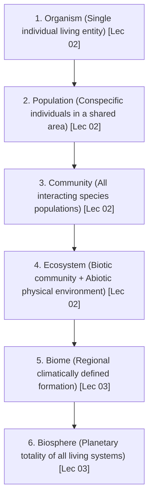
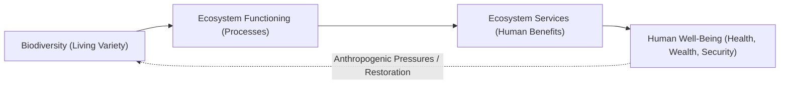
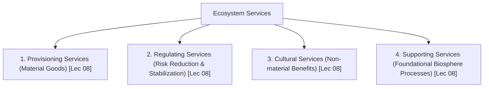
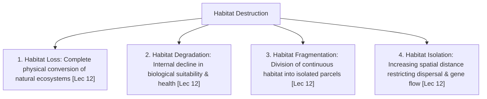

# Part 1: Foundations of Biodiversity, Sustainability & Modern Threats (Weeks 01–03)

**Course:** Biodiversity for Sustainability  
**Instructor:** Dr. Ankur Awadhiya, IFS (Indian Forest Service)  
**Curriculum Mapping:** Lectures 01 to 15 (Weeks 1, 2, and 3)  
**Target File:** `textbook/part_1_weeks_01_03.md`  

---

## Comprehensive Table of Contents

### [Week 1: Introduction (Lectures 01–05)](#week-1-introduction)
1. **Lecture-by-Lecture Deep Dive**
   - **Lecture 01:** What is Biodiversity? *(Visible vs. Invisible Biodiversity, Soil Footprint, Ecosystem Services & Resilience)*
   - **Lecture 02:** What is Ecology? *(Etymology, Krebs's Distribution & Abundance, Science vs. Concern, 3 Branches, Habitat Function)*
   - **Lecture 03:** Biodiversity: What is it, Really? *(4 Dimensions: Genetic, Species, Ecosystem, Functional; Niche Hypervolume, 6 Levels of Hierarchy)*
   - **Lecture 04:** What is Sustainability? *(Etymology of Sustinere, Brundtland Needs & Limits, Carrying Capacity, Triple Bottom Line)*
   - **Lecture 05:** What is Sustainable Development? *(Triad Integration, Severed Feedback Loops, Linear vs. Circular Economy, Greenwashing)*
2. **Week 1 Master Reference Tables** *(Unabridged High-Yield Matrices & Categorical Diagnostics)*
3. **Official Quiz Breakdown & Trap Analysis** *(Assignment 1: Q1–Q10 Detailed Rationale & Distractor Traps)*

---

### [Week 2: Sustainability and Sustainable Development (Lectures 06–10)](#week-2-sustainability-and-sustainable-development)
1. **Lecture-by-Lecture Deep Dive**
   - **Lecture 06:** Historical Evolution of Sustainable Development *(Feedback in Early Societies, Mesopotamia Salinization, Industrial Decoupling, Carson's Silent Spring, Limits to Growth World3, Stockholm 1972, Brundtland 1987, Rio 1992, MDGs to SDGs)*
   - **Lecture 07:** Pillars of Sustainability *(Environmental, Economic, Social; Trade-offs in Mega-Dams & Solar, Synergies in Urban Green Infrastructure, Weak vs. Strong Sustainability)*
   - **Lecture 08:** Ecosystem Services and Human Well-Being *(Millennium Ecosystem Assessment [MEA, 2005]; 4 Classes: Provisioning, Regulating, Cultural, Supporting; 5 Constituents of Well-Being; Mangrove Storm Attenuation; Vulture-Rabies Cascade)*
   - **Lecture 09:** Indicators of Sustainability *(Criteria for Indicators, Ecological Footprint & Biocapacity [Wackernagel & Rees], Global Hectares, Earth Overshoot Day, 9 Planetary Boundaries [Rockström et al.], Ecological Thresholds & Regime Shifts)*
   - **Lecture 10:** Case Studies in Sustainability *(Multifunctional Landscapes, Natural Capital Accounting; 5 Real-World Arenas: Forests & Livelihoods, East Kolkata Wetlands & Urban Expansion, Punjab Green Revolution & Cancer Train, Coastal Mangroves vs. Shrimp Aquaculture, Urban Heat Islands)*
2. **Week 2 Master Reference Tables** *(Unabridged MEA Classes, Historical Treaties, Case Analyses, Metrics)*
3. **Official Quiz Breakdown & Trap Analysis** *(Assignment 2: Q1–Q10 Detailed Rationale & Distractor Traps)*

---

### [Week 3: Threats in the Modern World - I (Lectures 11–15)](#week-3-threats-in-the-modern-world---i)
1. **Lecture-by-Lecture Deep Dive**
   - **Lecture 11:** Threats to Biodiversity: Population, Consumption & Ecological Pressure *(Ehrlich-Holdren IPAT Equation, E.O. Wilson's HIPPO Framework, Sixth Mass Extinction / Anthropocene vs. Background E/MSY, Specialist vs. Generalist Vulnerability, Passenger Pigeon Extinction)*
   - **Lecture 12:** Habitat Destruction: Loss, Degradation, Fragmentation & Alteration *(4 Forms of Destruction, Topsoil Erosion, 4 Stages of Fragmentation: Perforation-Dissection-Fragmentation-Shrinkage, Edge Effects & Microclimate Shifts, Lotic to Lentic River Alteration, Samosa Shop Analogy)*
   - **Lecture 13:** Overexploitation of Biological Resources *(Core Law: H <= R, Renewable Becoming Non-Renewable, Tragedy of the Commons, Historic Antarctic Blue Whaling Collapse & Sequential Depletion, Ghost Nets & Ghost Fishing [ALDFG], Bushmeat & Empty Forest Syndrome)*
   - **Lecture 14:** Invasive Alien Species *(Terminology: Native vs. Alien vs. Naturalized vs. Invasive; Enemy Release Hypothesis; Biological Traits of Invaders; Landmark Cases: Lantana camara, Prosopis juliflora, Parthenium hysterophorus, Eichhornia crassipes, Spotted Deer in Andamans, Brown Tree Snake in Guam)*
   - **Lecture 15:** Pollution as an Ecological Disruption *(5 Domains: Acid Deposition & Aluminum Toxicity, Cultural Eutrophication & Aquatic Hypoxia/Dead Zones, Soil Contamination & Heavy Metals, Acoustic Masking & Marine Sonar, Light Pollution / ALAN & Olive Ridley Hatchling Disorientation)*
2. **Week 3 Master Reference Tables** *(Unabridged Habitat Destruction Matrices, Fragmentation Stages, Whaling Baselines, Invasive Taxa)*
3. **Official Quiz Breakdown & Trap Analysis** *(Assignment 3: Q1–Q10 Detailed Rationale & Distractor Traps)*

---

# Week 1: Introduction

## 1. Lecture-by-Lecture Deep Dive

### Lecture 01: What is Biodiversity?

#### The Core Story & Mental Model
When most people hear the word "biodiversity," their minds immediately conjure images of charismatic megafauna—royal Bengal tigers prowling through the mangrove forests of the Sundarbans, majestic Asian elephants moving across the Western Ghats, or colorful hornbills nesting in rainforest canopies. In this opening lecture, Dr. Ankur Awadhiya shatters this narrow, superficial perspective. He establishes the foundational mental model for the entire course: visible animals and flowering plants constitute merely the outermost tip of the planetary biological iceberg. Beneath this visible veneer lies a vast, churning, interconnected ocean of **invisible biodiversity**—the unseen micro-world of soil bacteria, mycorrhizal fungi, protozoans, nematodes, genetic alleles, and silent biophysical processes.

The central insight to internalize is that visible life cannot exist for a single hour without the continuous, unglamorous labor of invisible biodiversity. When a dry autumn leaf drops from a sal tree to the forest floor, it does not accumulate indefinitely; billions of soil micro-arthropods, actinomycetes, and saprophytic fungi immediately begin enzymatically dismantling the cellulose and lignin, returning vital nitrogen, phosphorus, and potassium to the mineral soil. If these invisible organisms were to vanish, the physical cycling of matter on Earth would seize up, nutrients would remain permanently locked in dead organic matter, and terrestrial ecosystems would collapse into barren wastelands.

Dr. Awadhiya connects this biological tapestry directly to the concepts of **ecosystem services** and **ecological resilience**. Ecosystems are not passive scenic backdrops for human sightseeing; they are active, dynamic life-support infrastructures that generate tangible and intangible goods—from water purification to climate moderation. Resilience is the measure of an ecosystem's structural integrity—its intrinsic capacity to absorb external shocks, severe droughts, fires, or anthropogenic pressures, spring back to its original equilibrium, and continue functioning without collapsing into a degraded, desertified alternate state.

#### Spoken Case Studies & Examples Explained
- **The Living Soil Beneath a Single Footprint:** Dr. Awadhiya challenges students to examine a handful of fertile forest soil. Within that single handful reside more living individual organisms—billions of bacteria, tens of thousands of protozoa, meters of fungal hyphae, and hundreds of nematodes—than the entire human population of Earth. **Exam Takeaway:** When exam questions ask what constitutes "invisible biodiversity," the correct answer always encompasses *genes, microbes, fungi, soil life, and ecological processes*, whereas options listing only large mammals or visible physical features are deliberate distractors.
- **Natural Wetlands as Water Security Infrastructure:** Instead of spending billions of dollars constructing concrete water filtration plants and stormwater detention basins, intact natural wetlands store seasonal floodwaters in their sponge-like peat substrates, slow down peak flood runoff velocities, and trap sediment and toxic heavy metals. **Exam Takeaway:** Wetlands provide water security primarily through biological storage, buffering, and microbial purification, demonstrating how natural capital replaces expensive human engineering.
- **Insect Pollination and Agricultural Security:** The professor highlights that one out of every three bites of food consumed by humanity relies directly on wild animal pollination—carried out not merely by domesticated honeybees, but by solitary bees, hoverflies, wasps, bats, and beetles. Without wild pollinators, commercial yields of fruit, vegetable, and oilseed crops experience catastrophic failure.

#### Verbatim Definitions & Etymology Callout
> **Invisible Biodiversity:** The vast assemblage of unobserved living entities and processes—specifically genes, microbes, fungi, soil nematodes, micro-arthropods, and silent biogeochemical cycles—that sustain the biosphere's life-support machinery beneath the threshold of ordinary human perception.
>
> **Ecosystem Services:** The practical, material and non-material benefits that human societies obtain directly or indirectly from functioning ecological systems (e.g., clean water, fertile soil, flood attenuation, carbon storage).
>
> **Ecological Resilience:** The capacity of an ecosystem to tolerate disturbance, absorb external stress or environmental shocks, and recover its baseline structure, composition, and functional processes without tipping into a degraded alternate stable state.
>
> **Sustainable Development (Brundtland Formulation, 1987):** Development that meets the needs of the present generation without compromising the ability of future generations to meet their own needs; intrinsically grounded in the twin concepts of *Needs* (prioritizing the global poor) and *Limits* (ecological carrying capacity).

---

### Lecture 02: What is Ecology?

#### The Core Story & Mental Model
To understand biodiversity and manage it sustainably, one must master the scientific grammar of nature: **Ecology**. Dr. Awadhiya begins by tracing the etymology of the discipline back to the Greek root *oikos*, meaning "household" or "dwelling place," combined with *logos*, meaning "study" or "discourse." Ecology is literally the scientific study of the planetary household. Coined in 1866 by the German zoologist Ernst Haeckel, the term was originally defined as the comprehensive science of the relationships of an organism to the surrounding external world. However, Dr. Awadhiya emphasizes the modern, operational definition formulated by the eminent ecologist Charles J. Krebs in 1972: *"Ecology is the scientific study of the interactions that determine the distribution and abundance of organisms."*

Every word in Krebs's definition is an exam cornerstone. **Distribution** asks the spatial question: *Where do organisms occur across geographical space and why are they found in some regions but absent from others?* **Abundance** asks the quantitative question: *How many organisms are present in a given area and what forces regulate their population density?* Both parameters are governed by complex webs of biotic interactions (predation, competition, mutualism, disease) and abiotic filters (temperature extremes, moisture availability, soil pH, solar irradiance). To live successfully in an environment, an organism requires a **habitat**—not merely an aesthetically pleasing geographical coordinate on a tourist map, but a functionally suitable, species-specific environmental setting that supplies all necessary physical conditions and biological resources for survival and reproduction.

Dr. Awadhiya draws a sharp, non-negotiable demarcation between **Ecology** and **Environmental Concern (Environmentalism)**. Ecology is a rigorous, objective, hypothesis-driven natural science that relies on empirical field surveys, controlled laboratory experiments, and mathematical models to explain natural phenomena. Environmental concern, by contrast, is a social, moral, ethical, or political stance advocating for conservation, pollution abatement, or legislative protection. Ecology provides the factual, empirical evidence of how ecosystems operate; society uses that scientific evidence to make ethical and political choices. Confusing the two degrades scientific objectivity.

Methodologically, ecology operates through three complementary branches:
1. **Field Ecology:** Direct, non-manipulative observation and measurement of organisms in their wild, unmanaged natural habitats, providing high ecological realism.
2. **Laboratory Ecology:** Controlled, reproducible experiments where single environmental variables (e.g., ambient temperature, water salinity) are isolated and manipulated to establish precise cause-and-effect relationships.
3. **Theoretical Ecology:** Mathematical modeling and conceptual abstractions (such as the Lotka-Volterra equations or logistic population models) that strip away site-specific noise to discover universal ecological laws and forecast future trends.

#### Spoken Case Studies & Examples Explained
- **Predation Regulating Prey Density in Kanha:** Dr. Awadhiya discusses the predator-prey dynamics between the Bengal tiger (*Panthera tigris*) and the spotted deer / chital (*Axis axis*). Predation is a classic interspecific community interaction: the tiger directly influences both the abundance and spatial distribution of the chital herd, preventing overgrazing of forest palatable grasses. **Exam Takeaway:** Predation represents a community-level biotic interaction, whereas temperature shifts or rock weathering represent abiotic physical processes.
- **The Epiphytic Orchid's Microhabitat:** An orchid growing high in the canopy fork of a tropical rainforest tree occupies a very specific microhabitat. It does not draw water from the soil; instead, its specialized aerial roots absorb atmospheric humidity and rain wash, while canopy branches provide structural support. The orchid's habitat cannot be described simply as "the forest"—it is the microclimate of the tree fork.
- **Incubator Thermal Tolerance vs. Radio-Telemetry:** The professor contrasts laboratory studies where fish fingerlings are placed in temperature-controlled water baths to identify lethal thermal maximums ($LT_{50}$) with field studies where wild ungulates are fitted with GPS radio-collars to map movement corridors across human-dominated agricultural matrices.

#### Verbatim Definitions & Etymology Callout
> **Etymology of Ecology:** Derived from the Greek words *oikos* (household, home, or dwelling place) and *logos* (study, discourse, or science).
>
> **Ecology (Krebs, 1972):** The scientific study of the interactions that determine the **distribution** (where organisms occur) and **abundance** (how many occur) of organisms.
>
> **Ecology vs. Environmental Concern:** Ecology is an objective, empirical natural science providing evidence and causal explanations; Environmental Concern is a normative, ethical, social, or political movement advocating for nature preservation.
>
> **Habitat:** A functionally suitable, species-specific environmental setting possessing the requisite physical (abiotic) and biological (biotic) resources and conditions to enable an organism to survive, feed, and reproduce.
>
> **Community (Ecological):** An assemblage of interacting populations of different species co-occurring within a defined geographical space and time.

---

### Lecture 03: Biodiversity: What is it, Really?

#### The Core Story & Mental Model
In Lecture 03, Dr. Awadhiya dismantles another pervasive exam misconception: that biodiversity can be measured simply by counting the number of species in an area. While species count—scientifically termed **species richness ($S$)**—is an essential metric, it represents only one narrow slice of the biodiversity puzzle. A landscape with ten species of trees where one species accounts for $99\%$ of all stems is far less diverse and resilient than a landscape with the same ten species evenly distributed across the canopy. True biodiversity encompasses variety across all levels of biological organization, organized conceptually into four essential dimensions.

The first dimension is **Genetic Diversity**, which refers to the variation of heritable nucleotides, genes, and alleles within individuals, populations, and across different geographic races of a single species. Genetic diversity is the raw fuel of natural selection; without it, a population cannot adapt to emerging pathogens, novel climatic extremes, or habitat degradation. The second dimension is **Species Diversity**, which combines species richness with species evenness (the relative abundance of each species). The third dimension is **Ecosystem Diversity**, representing the structural variety of distinct habitats, biotic communities, and ecological landscapes across biomes.

The fourth and most functionally critical dimension is **Functional Diversity**—the variety of biological traits, trophic niches, and ecological roles performed by organisms within a system (e.g., nitrogen fixation, seed dispersal, apex predation, carcass scavenging). Dr. Awadhiya introduces the pivotal concept of **functional redundancy**: when multiple distinct species perform the same ecological role within an ecosystem, the system possesses an insurance buffer. If an epidemic disease wipes out one pollinating bee species, other solitary bees or hoverflies step in, preventing the collapse of the entire plant reproductive network.

To structure these concepts, the lecture presents the six-level hierarchy of ecological organization:
$$\text{Organism} \longrightarrow \text{Population} \longrightarrow \text{Community} \longrightarrow \text{Ecosystem} \longrightarrow \text{Biome} \longrightarrow \text{Biosphere}$$
An **organism** is an individual living being; a **population** consists of individuals of the same species capable of interbreeding in a defined area; a **community** comprises all interacting populations of different species; an **ecosystem** integrates the living community with its non-living physical environment via energy flows and nutrient cycles; a **biome** is a vast regional ecosystem governed by regional climate and dominant vegetation (e.g., tropical rainforest, tundra); and the **biosphere** is the planetary envelope of all living systems on Earth.

#### Spoken Case Studies & Examples Explained
- **Wild Rice Genetic Rescue (*Oryza nivara*):** In the 1970s, the grassy stunt virus threatened to devastate cultivated rice crops across Asia. Plant geneticists screened thousands of domestic rice strains without finding resistance. Finally, a single wild, weed-like rice population—*Oryza nivara*, collected from the wild in Uttar Pradesh, India—was found to possess a unique dominant resistance gene ($Gs$). By breeding this wild gene into commercial varieties, global rice production was saved from catastrophe. **Exam Takeaway:** Genetic diversity within wild crop relatives provides irreplaceable biological insurance for human food security.
- **Cheetah Genetic Bottleneck:** The cheetah (*Acinonyx jubatus*) suffered an extreme population bottleneck approximately 10,000 years ago, resulting in near-total genetic uniformity (homozygosity). Skin grafts between unrelated cheetahs are accepted without immune rejection. This lack of genetic variation makes them exceptionally fragile to infectious outbreaks like feline infectious peritonitis.
- **Hutchinson's Multidimensional Ecological Niche:** Dr. Awadhiya explains G. Evelyn Hutchinson's concept of the niche as an $n$-dimensional hypervolume. A tiger and a leopard may live in the same forest (shared habitat), but the tiger hunts large ungulates on the ground, while the leopard hunts smaller prey and hoists kills into trees, occupying distinct ecological niches and avoiding direct competitive exclusion.

#### Verbatim Definitions & Etymology Callout
> **Biodiversity (Full Scientific Scope):** The variety and variability of life in all its forms and at all levels of biological organization, encompassing genetic variation, species assemblages, functional traits, and ecosystem complexes.
>
> **Species Richness ($S$):** The total absolute number of distinct species present within a defined ecological sampling unit or geographic boundary.
>
> **Genetic Diversity:** Heritable nucleotide, gene, and allele variation within a single species, providing the fundamental substrate for evolutionary adaptation and survival.
>
> **Functional Diversity:** The range and variety of ecological roles, functional traits, and trophic behaviors (e.g., decomposition, pollination, nitrogen fixation) performed by organisms in an ecosystem.
>
> **Functional Redundancy:** The coexistence of multiple taxonomically distinct species that execute overlapping ecological functions, providing structural resilience against species loss.
>
> **Biosphere:** The global sum of all ecosystems; the thin, planetary-scale zone of air, soil, and water where life exists on Earth.

---

### Lecture 04: What is Sustainability?

#### The Core Story & Mental Model
In Lecture 04, Dr. Awadhiya transitions from pure ecological science to the normative discipline of **Sustainability**. He begins with linguistics: the word "sustain" originates from the Latin verb *sustinere*, formed from the prefix *sub-* (meaning "up from below") and *tenere* (meaning "to hold"). To sustain literally means to support from underneath, to bear a weight, and to endure over extended periods of time. Applied to human civilization, sustainability asks a profound operational question: *Can our current modes of economic production, resource consumption, and waste generation continue indefinitely into the deep future without exhausting the biophysical foundations of the planet?*

To anchor this inquiry, Dr. Awadhiya examines the landmark 1987 report of the UN World Commission on Environment and Development (WCED), commonly known as the **Brundtland Report** (titled *Our Common Future*, chaired by Gro Harlem Brundtland). The report produced the most universally cited definition in modern history: *"Sustainable development is development that meets the needs of the present without compromising the ability of future generations to meet their own needs."* However, Dr. Awadhiya warns that students frequently memorize this single sentence while completely overlooking the two non-negotiable operational concepts that immediately follow it in the original text:
1. **The concept of 'Needs':** Specifically the essential needs of the world's poor, to which overriding priority should be given (clean drinking water, adequate nutrition, basic shelter, primary healthcare, and human dignity).
2. **The concept of 'Limits':** The limitations imposed by the state of technology and social organization on the environment's ability to meet present and future needs (ecological carrying capacity).

Dr. Awadhiya stresses the critical ethical and economic distinction between **Essential Needs** and **Unbounded Wants**. A society that expends scarce natural resources, fossil fuels, and pristine water to manufacture luxury items while millions lack potable water is structurally unsustainable. Sustainability requires operating strictly within the **Ecological Carrying Capacity**—the maximum environmental load, harvest rate, and waste absorption threshold that an ecosystem can endure indefinitely without suffering structural collapse or productivity decline.

To evaluate institutional and societal performance, the lecture introduces John Elkington's **Triple Bottom Line (TBL)** framework. Traditional accounting measures success exclusively via a single economic bottom line: financial profit. The TBL framework mandates that corporations and governments evaluate performance across three concurrent, co-equal bottom lines: **People** (Social equity, human rights, labor welfare), **Planet** (Environmental integrity, ecological footprint, biodiversity preservation), and **Profit** (Economic viability, wealth generation). True sustainability occurs only at the exact intersection of all three pillars.

#### Spoken Case Studies & Examples Explained
- **Fossil Aquifer Overdraft in Semi-Arid Agricultural Basins:** Dr. Awadhiya details the widespread crisis of deep tubewell irrigation across semi-arid regions. Deep groundwater stored in confined aquifers over thousands of years is being pumped out in decades to irrigate water-intensive cash crops like sugarcane. Because the rate of extraction exceeds natural rainfall percolation by orders of magnitude, groundwater tables are collapsing. This violates the *Limits* condition of Brundtland, turning a theoretically renewable resource into an exhausted, non-renewable sink. **Exam Takeaway:** Sustainable water use requires that extraction rates never exceed natural aquifer recharge rates.
- **Subsistence Firewood Gathering vs. Commercial Clearcutting:** The professor contrasts a rural family gathering fallen deadwood for basic domestic cooking (satisfying an essential human *need*) with commercial logging companies clearcutting ancient rainforests to produce disposable pulp for luxury paper packaging (catering to elastic, unbounded commercial *wants*).
- **The Concept of Intergenerational Justice:** Dr. Awadhiya illustrates intergenerational equity using a simple moral analogy: inherited family property. If one generation inherits a fertile, productive agricultural estate, consumes all its topsoil, strips its timber, and leaves a barren, salt-encrusted wasteland to their children, that generation has committed intergenerational theft.

#### Verbatim Definitions & Etymology Callout
> **Etymology of Sustain:** Derived from the Latin *sustinere*, from *sub-* (up from below) + *tenere* (to hold, keep, or uphold).
>
> **The Brundtland Definition (WCED, 1987):** Development that meets the needs of the present without compromising the ability of future generations to meet their own needs.
>
> **The Two Inherent Concepts of Brundtland:**
> 1. *Needs:* The essential needs of the world's poor, to which overriding priority must be assigned.
> 2. *Limits:* The physical limitations imposed by social organization and technological capabilities on the biosphere's carrying capacity.
>
> **Essential Needs vs. Wants:** Needs represent irreducible biological and social requirements for human survival and dignity (food, clean water, shelter, health); Wants represent elastic, socially constructed desires for elevated consumption beyond biophysical necessity.
>
> **Ecological Carrying Capacity:** The maximum population density or anthropogenic pressure an ecosystem can support indefinitely without inducing permanent ecological degradation or resource exhaustion.
>
> **Triple Bottom Line (TBL):** An accounting and governance framework evaluating institutional success across three co-equal pillars: **People** (Social), **Planet** (Environmental), and **Profit** (Economic).

---

### Lecture 05: What is Sustainable Development?

#### The Core Story & Mental Model
In Lecture 05, Dr. Awadhiya unifies the introductory week by synthesizing the intellectual triad: **Ecology** (the scientific laws governing nature), **Biodiversity** (the living components that execute ecological functions), and **Sustainability** (the operational discipline required to keep human civilization within ecological boundaries). Sustainable development is not a static destination or a finished checklist; it is an ongoing, adaptive process of societal navigation. It requires continually balancing economic aspirations with social equity while preserving the biological integrity of the biosphere.

A primary reason why modern industrial economies are chronically unsustainable is the structural severance of **Ecological Feedback Loops**. In early hunter-gatherer and traditional agrarian communities, resource feedback was immediate, local, and unavoidable. If a village overhunted the surrounding forest or allowed livestock to overgraze local pasture hillsides, game vanished and topsoil washed away within the season. The community felt the immediate pain of ecological overshoot and adapted its cultural taboos, hunting seasons, and grazing rules. In the modern globalized economy, however, consumer demand in London, New York, or Tokyo is decoupled from ecological consequences across vast oceans and continents. An urban shopper purchases cheap cooking oil or chocolate bars without ever seeing the Indonesian rainforests being bulldozed or orangutans displaced for oil palm plantations. When feedback loops are severed, economic systems drive ecosystems past irreversible tipping points before consumers even notice a problem.

To overcome this structural failure, Dr. Awadhiya contrasts the traditional **Linear Economy** with the restorative **Circular Economy**. The conventional industrial model follows a destructive, unidirectional flow: **Take $\rightarrow$ Make $\rightarrow$ Dispose**. Natural capital is extracted from the Earth, transformed into short-lived consumer goods, and discarded into landfills or oceans as toxic pollution. In sharp contrast, a Circular Economy mimics natural ecological food webs, where the concept of "waste" does not exist. Biological materials are safely biodegraded to regenerate soil fertility, while technical materials (metals, polymers, electronics) are perpetually maintained, reused, refurbished, and recycled in closed loops.

Finally, the lecture issues a stern warning against **Greenwashing**—the pervasive corporate and political practice of using deceptive marketing, superficial public relations, and token gestures to project an illusion of environmental responsibility while continuing underlying destructive activities unchecked.

#### Spoken Case Studies & Examples Explained
- **Monoculture Commercial Plantations as "Green Cover":** Dr. Awadhiya dissects the common practice of forestry departments or timber corporations clearcutting biodiverse native mixed forests and replanting them with dense, uniform rows of monoculture eucalyptus or teak (*Tectona grandis*). While satellite imagery might show an increase in "green canopy cover," the monoculture functions as a "green desert"—it depletes deep groundwater, acidifies soil, supports zero native insect or bird biodiversity, and produces no non-timber forest products for local tribal communities. Calling this "reforestation" is a classic example of **greenwashing**. **Exam Takeaway:** Plantation forestry is not ecologically equivalent to native forest restoration.
- **Traditional Shifting Cultivation (Jhum) Cycles:** Dr. Awadhiya explains the historical trajectory of slash-and-burn agriculture (*jhum*) practiced by indigenous communities in Northeast India. Historically, when human population density was low, the fallow cycle lasted 15 to 20 years, allowing the forest canopy, organic topsoil, and soil microbial communities to completely regenerate before the next clearing. In modern times, population pressure and land fragmentation have compressed the fallow cycle down to 2 to 3 years. At this intense frequency, the land has zero time to regenerate, leading to severe topsoil erosion, weed invasion, and permanent watershed degradation.
- **The Disposable Plastic Straw Tokenism:** The professor critiques corporate campaigns that noisily replace plastic beverage straws with paper straws wrapped in polyethylene film, while leaving the company's multi-million-ton single-use plastic bottling and supply-chain extraction systems entirely unchanged.

#### Verbatim Definitions & Etymology Callout
> **Sustainable Development:** A dynamic, adaptive societal trajectory that harmonizes economic generation, social justice, and ecological preservation, ensuring human prosperity remains permanently within planetary biophysical boundaries.
>
> **Linear Economy:** An open-ended, unsustainable resource consumption paradigm based on the extractive sequence: **Take $\rightarrow$ Make $\rightarrow$ Dispose**, producing rapid resource depletion and unmanageable waste accumulation.
>
> **Circular Economy:** An industrial and economic framework designed to be restorative and regenerative by intention, replacing the end-of-life concept with restoration, shifting toward renewable energy, eliminating toxic chemicals, and eradicating waste through superior design of materials, products, and systems.
>
> **Severed Ecological Feedback:** The structural disconnection in space, time, and institutional governance between resource extraction/pollution and the end consumer, blinding economic decision-makers to environmental degradation.
>
> **Greenwashing:** The practice of making unsubstantiated, misleading, or superficially cosmetic environmental claims to market an organization, product, or policy as sustainable while obscuring underlying ecological harm.

---

## 2. Week 1 Master Reference Tables

## 1. High-Yield Terminological & Definitional Matrix

| Citation | Term / Concept | Operational Scientific Definition | Exam Archetype | Exam Question Tag |
| :--- | :--- | :--- | :--- | :--- |
| `[Lec 01]` | **Invisible Biodiversity** | Hidden living components: genes, microbes, fungi, soil life (nematodes, mycorrhizae), and silent ecological processes (decomposition, nutrient cycling). | Set Classification | `[TESTED - 30% REPEAT POOL]` (W1-Q1) |
| `[Lec 01]` | **Ecosystem Services** | The practical, material and non-material benefits that people obtain from ecosystems. | Forward Definition | `[TESTED - 30% REPEAT POOL]` (W1-Q9) |
| `[Lec 01]` | **Ecological Resilience** | The ability of a system to spring back, absorb disturbance, and recover function without collapsing into an alternate degraded state. | Forward Definition | `[UNSEEN HIGH-YIELD - 70% FINAL POOL]` |
| `[Lec 01]` | **Sustainable Development (Brundtland)** | Development that meets present needs without compromising the ability of future generations to meet their own needs; founded on *Needs* and *Limits*. | Forward Definition | `[UNSEEN HIGH-YIELD - 70% FINAL POOL]` |
| `[Lec 02]` | **Ecology (Scientific Definition 1)** | The scientific study of interactions among organisms and between organisms and their abiotic environment. | Forward Definition | `[UNSEEN HIGH-YIELD - 70% FINAL POOL]` |
| `[Lec 02]` | **Ecology (Scientific Definition 2 - Krebs)** | The scientific study of interactions that determine the distribution and abundance of organisms. | Forward Definition | `[UNSEEN HIGH-YIELD - 70% FINAL POOL]` |
| `[Lec 02]` | **Distribution** | Geographic and spatial occurrence: *where* organisms occur across space and time. | Forward Definition | `[TESTED - 30% REPEAT POOL]` (W1-Q2) |
| `[Lec 02]` | **Abundance** | Quantitative density or population size: *how many* organisms occur in a given area. | Forward Definition | `[UNSEEN HIGH-YIELD - 70% FINAL POOL]` |
| `[Lec 02]` | **Habitat** | A functionally suitable, species-specific setting providing required physical (temperature, water) and biotic (food, shelter, safety) conditions for an organism to live. | Reverse Definition | `[TESTED - 30% REPEAT POOL]` (W1-Q4) |
| `[Lec 02]` | **Ecology vs. Environmental Concern** | Ecology is an objective, empirical scientific discipline providing evidence and causal explanations; Environmental Concern is a normative, ethical, or political social response. | Contrastive Pair | `[TESTED - 30% REPEAT POOL]` (W1-Q5) |
| `[Lec 02]` | **Community (Ecological)** | Populations of different species living together in a defined area and actively interacting through biotic networks. | Forward Definition | `[TESTED - 30% REPEAT POOL]` (W1-Q8) |
| `[Lec 02]` | **Community Interaction** | Direct or indirect biological relationships between co-occurring species; exemplified by predation, mutualism, competition, herbivory, and parasitism. | Applied Scenario | `[TESTED - 30% REPEAT POOL]` (W1-Q6) |
| `[Lec 02]` | **Theoretical Ecology** | Ecological research branch using mathematical models, concepts, and predictive equations to simplify reality and identify generalizable patterns. | Reverse Definition | `[TESTED - 30% REPEAT POOL]` (W0-Q1) |
| `[Lec 02]` | **Laboratory Ecology** | Empirical ecological branch using controlled experiments and systematic manipulation of isolated variables to establish rigorous cause-and-effect relationships. | Reverse Definition | `[TESTED - 30% REPEAT POOL]` (W0-Q10) |
| `[Lec 02]` | **Field Ecology** | Empirical ecological branch observing and measuring wild organisms in natural, unmanipulated habitats (grounding science in ecological realism). | Forward Definition | `[UNSEEN HIGH-YIELD - 70% FINAL POOL]` |
| `[Lec 03]` | **Biodiversity (Full Scientific Scope)** | The variety of life in all its forms and at all levels of biological organization (from genes to ecosystems). | Forward Definition | `[UNSEEN HIGH-YIELD - 70% FINAL POOL]` |
| `[Lec 03]` | **Species Richness** | The absolute count of different species in a defined area ($S$); distinct from biodiversity because it omits relative abundance, genetic variation, and functional roles. | Quantitative Metric | `[UNSEEN HIGH-YIELD - 70% FINAL POOL]` |
| `[Lec 03]` | **Genetic Diversity** | Heritable nucleotide and allele variation within a single species or population, providing the raw substrate for natural selection and adaptation. | Reverse Definition | `[TESTED - 30% REPEAT POOL]` (W0-Q3) |
| `[Lec 03]` | **Ecosystem Diversity** | The structural variety of ecological communities, habitats, biophysical processes, and landscapes across geographic space. | Reverse Definition | `[TESTED - 30% REPEAT POOL]` (W0-Q4) |
| `[Lec 03]` | **Functional Diversity** | The range and variety of ecological roles, functional traits, and trophic behaviors performed by organisms within an ecosystem. | Reverse Definition | `[TESTED - 30% REPEAT POOL]` (W0-Q9) |
| `[Lec 03]` | **Ecological Niche** | The functional role and multidimensional position of an organism within its environment, including resource use, spatial habitat, and interspecific interactions. | Forward Definition | `[UNSEEN HIGH-YIELD - 70% FINAL POOL]` |
| `[Lec 03]` | **Biome** | A broad, regional ecological formation characterized by uniform climatic regimes and dominant vegetation types (e.g., temperate coniferous forest). | Forward Definition | `[UNSEEN HIGH-YIELD - 70% FINAL POOL]` |
| `[Lec 03]` | **Biosphere** | The global, planetary-scale sum of all living organisms, ecosystems, and life-supporting biophysical zones on Earth. | Forward Definition | `[TESTED - 30% REPEAT POOL]` (W1-Q7) |
| `[Lec 04]` | **Essential Needs vs. Wants** | Needs represent irreducible biophysical requirements for survival and dignity (food, clean water, shelter, basic health); Wants represent consumption desires (e.g., luxury automobiles). | Contrastive Pair | `[UNSEEN HIGH-YIELD - 70% FINAL POOL]` |
| `[Lec 04]` | **Ecological Carrying Capacity** | The maximum population size or environmental pressure an ecosystem can sustain indefinitely without degradation of its resource base. | Causal Threshold | `[UNSEEN HIGH-YIELD - 70% FINAL POOL]` |
| `[Lec 04]` | **Triple Bottom Line (TBL)** | Framework evaluating institutional and developmental performance across three concurrent dimensions: Social (People), Environmental (Planet), and Economic (Profit). | Management Tool | `[UNSEEN HIGH-YIELD - 70% FINAL POOL]` |
| `[Lec 05]` | **Greenwashing** | Presenting an activity, policy, or project as environmentally sustainable or eco-friendly through superficial rhetoric while ignoring underlying ecological degradation. | Reverse Definition | `[UNSEEN HIGH-YIELD - 70% FINAL POOL]` |

---

## 2. Six Levels of Ecological Organization Hierarchy

* `[Lec 02]` **Organism Level:** Focuses on the physiology, behavioral responses, survival, and stress tolerance of a single living individual `[TESTED - 30% REPEAT POOL]` (W1-Q10).
* `[Lec 02]` **Population Level:** Focuses on conspecifics capable of interbreeding in a defined spatial area; tracks demographic parameters: birth rate ($B$), death rate ($D$), immigration ($I$), emigration ($E$), abundance trends, and carrying capacity ($K$) `[UNSEEN HIGH-YIELD - 70% FINAL POOL]`.
* `[Lec 02]` **Community Level:** Focuses on multi-species coexistence networks, predation pressure, interspecific competition, symbiotic mutualisms, and food web architecture `[TESTED - 30% REPEAT POOL]` (W1-Q8).
* `[Lec 02]` **Ecosystem Level:** Integrates the living community with abiotic parameters (soil chemistry, hydrology, microclimate); governed by **unidirectional energy flow** and **cyclic nutrient recycling** `[UNSEEN HIGH-YIELD - 70% FINAL POOL]`.
* `[Lec 03]` **Biome Level:** Macro-scale regional complexes shaped by macroclimate (mean annual precipitation and temperature) and characteristic climax vegetation `[UNSEEN HIGH-YIELD - 70% FINAL POOL]`.
* `[Lec 03]` **Biosphere Level:** Planetary envelope of life encompassing the lower atmosphere (troposphere), hydrosphere, and upper lithosphere `[TESTED - 30% REPEAT POOL]` (W1-Q7).

---

## 3. Four Dimensions of Biodiversity

* `[Lec 03]` **Genetic Diversity:** Variation within a species across genes, chromosomes, and alleles. Enables evolutionary adaptation to pathogens, climatic extremes, and habitat shifts. High homozygosity reduces survival resilience `[TESTED - 30% REPEAT POOL]` (W0-Q3).
* `[Lec 03]` **Species Diversity:** Variety and abundance of different biological species in an area. Encompasses both species richness (count) and species evenness (equitability of abundances) `[UNSEEN HIGH-YIELD - 70% FINAL POOL]`.
* `[Lec 03]` **Ecosystem Diversity:** Structural variation among physical habitats, biophysical zones, and ecological complexes across spatial landscapes (forests, wetlands, grasslands, coral reefs) `[TESTED - 30% REPEAT POOL]` (W0-Q4).
* `[Lec 03]` **Functional Diversity:** Diversity of biological roles, trophic mechanisms, and physiological traits (pollinators, nitrogen fixers, primary decomposers, apex predators, seed dispersers). Two ecosystems with identical species counts can have vastly different functional diversity `[TESTED - 30% REPEAT POOL]` (W0-Q9).

---

## 4. Empirical Biological Entities, Field Cases & Scientific Taxa

| Citation | Common Name / Case Study | Scientific Name / Taxonomic Group | Geographic Region / Site | Tested Ecological Principle & Mechanism |
| :--- | :--- | :--- | :--- | :--- |
| `[Lec 01]` | **Andamans Intact Forest vs. Finland Monoculture** | Multi-tiered Tropical Rain Forest vs. Industrial Plantation | Andaman & Nicobar Islands (India) vs. Finland | Intact layered complexity provides multi-pathway resilience; simplified monoculture tree farms are fragile, highly vulnerable to pests, and devoid of wildlife `[UNSEEN HIGH-YIELD - 70% FINAL POOL]`. |
| `[Lec 02]` | **Chital (Spotted Deer) & Hanuman Langur Mutualism** | *Axis axis* (Chital) & *Semnopithecus entellus* (Langur) | Indian Deciduous Forests | Interspecific cooperative foraging & anti-predator vigilance: Langurs drop high-canopy leaves/fruits for deer; alert deer with arboreal alarm calls against leopards/tigers `[UNSEEN HIGH-YIELD - 70% FINAL POOL]`. |
| `[Lec 02]` | **Sea Urchin Herbivory Removal Experiment** | Class Echinoidea (Sea Urchins) & Macroalgae | Marine Intertidal Rocky Shore | Experimental manipulation in laboratory/controlled ecology: Removing grazing urchins causes dramatic explosion in algal cover, proving top-down herbivory control `[UNSEEN HIGH-YIELD - 70% FINAL POOL]`. |
| `[Lec 02]` | **Dhole (Asiatic Wild Dog) Puppies Monitoring** | *Cuon alpinus* (Canidae) | Indian Protected Areas | Field ecology protocol: Direct observation, litter counting, pack structure analysis, and behavioral monitoring in native wilderness `[UNSEEN HIGH-YIELD - 70% FINAL POOL]`. |
| `[Lec 02]` | **Penguin Artificial Nesting Structures** | Family Spheniscidae | Temperate/Sub-antarctic Breeding Colonies | Applied ecological intervention: Providing artificial burrows/boxes to protect eggs and chicks from thermal stress and surface predation `[UNSEEN HIGH-YIELD - 70% FINAL POOL]`. |
| `[Lec 03]` | **Temperate Coniferous Forest Biome** | *Cedrus deodara* (Deodar), *Pinus* spp. (Pine) | Manali, Western Himalayas (Himachal Pradesh, India) | Biome-level climatic adaptation: Cold temperature tolerance, conical canopy shedding snow loads, acidic needle leaf litter `[UNSEEN HIGH-YIELD - 70% FINAL POOL]`. |
| `[Lec 03]` | **Bengal Tiger Direct vs. Indirect Signs** | *Panthera tigris* | Indian Tiger Reserves | Wildlife survey methodology: Direct sighting (rare, nocturnal) vs. Indirect evidence (pugmarks, territorial scrape marks on bark, scat/droppings, vocalizations) `[UNSEEN HIGH-YIELD - 70% FINAL POOL]`. |
| `[Lec 03]` | **Five-Step Food Chain Pesticide Biomagnification** | Grass $\rightarrow$ Insect $\rightarrow$ Frog $\rightarrow$ Snake $\rightarrow$ Hawk | Terrestrial Agro-ecosystem | Trophic toxin accumulation: Non-biodegradable pesticides concentrate at apex level; loss of hawks unleashes snake surge, collapsing frogs, exploding insects, destroying grass cover `[UNSEEN HIGH-YIELD - 70% FINAL POOL]`. |
| `[Lec 03]` | **Lantana Alien Shrub Invasion** | *Lantana camara* (Verbenaceae) | Dehradun (Uttarakhand, India); native to Central/South America | Masked degradation: Green canopy with visiting butterflies creates illusion of health, but aggressive allelopathic thickets displace native understory flora `[UNSEEN HIGH-YIELD - 70% FINAL POOL]`. |
| `[Lec 04]` | **Mechanized Commercial Logging Machinery** | Industrial Feller-Bunchers / Forestry Harvesters | Commercial Production Forests | Technology Paradox: Advanced machinery increases resource extraction speed and spatial scale; without ecological governance, efficiency accelerates collapse `[UNSEEN HIGH-YIELD - 70% FINAL POOL]`. |

---

## 5. Interspecific Biotic Interaction Taxa Classification

| Citation | Interaction Type | Species A Effect | Species B Effect | Concrete Biological Mechanism & Transcript Example |
| :--- | :--- | :---: | :---: | :--- |
| `[Lec 02]` | **Competition** | **$-$** | **$-$** | Both organisms compete for the same limiting resource (light, water, nutrients, territory); mutually reduces individual fitness. |
| `[Lec 02]` | **Predation** | **$+$** | **$-$** | One organism (predator) captures, kills, and consumes another (prey) `[TESTED - 30% REPEAT POOL]` (W1-Q6). |
| `[Lec 02]` | **Herbivory** | **$+$** | **$-$** | Primary consumer feeds on living autotrophic plant tissues without necessarily killing the entire organism immediately. |
| `[Lec 02]` | **Mutualism** | **$+$** | **$+$** | Reciprocal biological cooperation benefiting both participants (e.g., Angiosperm pollination by insects; Chital deer and Hanuman langurs). |
| `[Lec 02]` | **Parasitism** | **$+$** | **$-$** | Parasite derives nutritional/reproductive sustenance directly from a living host, reducing host fitness, vigor, or reproductive output. |
| `[Lec 02]` | **Commensalism** | **$+$** | **$0$** | One organism benefits (shelter, transport, feeding access) while the host partner experiences neither measurable benefit nor harm. |

---

## 6. The Three Pillars of Sustainability Framework

* `[Lec 01, 04]` **Environmental Pillar (Foundational):** Conserves biophysical carrying capacities, protects ecosystem service integrity, maintains air/water/soil quality, and preserves biodiversity. Without biophysical stability, socio-economic superstructures collapse `[TESTED - 30% REPEAT POOL]` (W0-Q7).
* `[Lec 04]` **Social Pillar:** Guarantees intra-generational equity, environmental justice, health protection, community self-determination, and fair democratic access to life-support resources `[UNSEEN HIGH-YIELD - 70% FINAL POOL]`.
* `[Lec 04]` **Economic Pillar:** Focuses on long-term resource productivity, natural capital accounting, life-cycle durability, and internalizing ecological degradation costs, rather than maximizing short-term GDP `[UNSEEN HIGH-YIELD - 70% FINAL POOL]`.
* `[Lec 04]` **Three-Legged Stool Model:** Weakening any single pillar causes catastrophic instability of the entire societal structure, regardless of the apparent strength of the other two legs `[UNSEEN HIGH-YIELD - 70% FINAL POOL]`.

---

## 7. Causal Mechanism Chains & Ecological Feedbacks

### 7.1 The Four-Stage Core Linkage Chain

* `[Lec 01, 04, 05]` **The Forward Sequence:** Living variation ($\text{Biodiversity}$) underpins functional processes ($\text{Functioning}$), which deliver life-support benefits ($\text{Services}$), sustaining livelihoods, food security, and public health ($\text{Human Well-Being}$).
* `[Lec 05]` **The Anthropogenic Feedback Loop:** Human activities (land conversion, pollution, chemical runoff, overexploitation) exert reverse destructive feedback on biodiversity; conversely, ecological restoration, sustainable design, and protected-area governance close the loop constructively `[UNSEEN HIGH-YIELD - 70% FINAL POOL]`.

### 7.2 Food Security Ecological Dependency Chain
* `[Lec 01, 05]` Crop yield depends on **animal pollination** (bees, wasps, butterflies) + **soil microbial nutrient cycling** (nitrogen fixation, mineralization) + **crop genetic diversity** (pest/drought resistance). High-tech inputs cannot substitute for degraded ecological foundations `[TESTED - 30% REPEAT POOL]` (W0-Q5).

### 7.3 Hydrological Stability & Wetland Mechanics
* `[Lec 01, 04, 05]` Wetlands serve as **natural hydrological buffers**: store excess storm runoff, attenuate peak flood velocities, filter suspended particulate matter and chemical contaminants, and recharge depleted aquifers. Degradation turns minor rainfall into severe municipal flood disasters `[TESTED - 30% REPEAT POOL]` (W1-Q3).

### 7.4 Forest Climate Regulation
* `[Lec 01]` Forests regulate local and macro-climate by serving as massive **terrestrial carbon sinks**, driving evapotranspiration to elevate local humidity, and moderating extreme surface temperature fluctuations `[TESTED - 30% REPEAT POOL]` (W0-Q2).

---

## 8. Contrasting Models & Diagnostic Trap Summary

* `[Lec 02]` **Etymological Trap:** Ecology derived from Greek *oikos* (household / dwelling environment) + *logos* (systematic study) $\rightarrow$ "Study of life at home" `[UNSEEN HIGH-YIELD - 70% FINAL POOL]`.
* `[Lec 02]` **Distribution vs. Abundance:** Distribution = spatial coordinates (*Where*); Abundance = population count/density (*How many*). Questions invert these two dimensions `[TESTED - 30% REPEAT POOL]` (W1-Q2).
* `[Lec 02]` **Habitat vs. Geographic Location:** A location is a dot on a map; a habitat is functionally suitable, resource-equipped, and species-specific. An area may exist geographically but be completely uninhabitable for a species `[TESTED - 30% REPEAT POOL]` (W1-Q4).
* `[Lec 02]` **Energy Flow vs. Nutrient Cycling:** Energy enters as solar radiation, flows in a **strict unidirectional (one-way) trajectory**, and dissipates as metabolic heat; Nutrients (C, N, P) move through **cyclic pathways and are reused indefinitely** `[UNSEEN HIGH-YIELD - 70% FINAL POOL]`.
* `[Lec 03]` **Species Richness vs. Biodiversity Integrity:** 
  * *Forest 1:* 50 species, but 1 tree represents $90\%$ of individuals, 49 species represent $10\%$.
  * *Forest 2:* 50 species, evenly distributed abundances, diverse functional guilds.
  * *Exam Trap:* Species richness is identical ($S = 50$), but Forest 2 has far greater evenness, functional buffering, and genetic resilience `[UNSEEN HIGH-YIELD - 70% FINAL POOL]`.
* `[Lec 04]` **Growth vs. Sustainable Development:** Economic growth tracks quantitative expansion of output (GDP); Sustainable development tracks qualitative durability, equity, and permanence within biophysical thresholds `[UNSEEN HIGH-YIELD - 70% FINAL POOL]`.
* `[Lec 04]` **Absolute Distractor Warning (`EXAM_PATTERN.md`):** Options asserting that sustainability *"rejects all economic development"*, *"eliminates all technology"*, or relies *"only on environmental protection"* are engineered false distractors. Correct answers always emphasize *needs guided by limits and long-term durability*.

---

## 3. Official Quiz Breakdown & Trap Analysis

### Question 1
> **Q1. Which of the following is included in invisible biodiversity?**  
> (A) Mountains and rivers  
> **(B) Genes, microbes, fungi, soil life, and ecological processes**  
> (C) Only large animals hidden in forests  
> (D) Only plants growing below tree cover  
> **Correct Answer:** `(B)`

- **Why it is right & Rationale:** Invisible biodiversity refers specifically to living biological elements and biochemical processes operating below macroscopic observation, which includes genetic allele variations, bacteria, mycorrhizal fungi, soil nematodes, and nutrient cycles (`[Lec 01]`).
- **Trap Analysis:** Option `(A)` is a physical geography distractor testing whether students confuse abiotic landforms with biological entities, while options `(C)` and `(D)` use the absolute qualifiers *"Only large animals"* and *"Only plants"*, playing on the misconception that "invisible" simply means hidden from immediate view behind trees.

---

### Question 2
> **Q2. What does the term “distribution” refer to in ecology?**  
> (A) How organisms reproduce  
> (B) How organisms compete  
> **(C) Where organisms occur**  
> (D) How organisms obtain food  
> **Correct Answer:** `(C)`

- **Why it is right & Rationale:** In Charles Krebs's foundational definition of ecology, distribution specifically refers to the spatial and geographical occurrence of organisms across landscapes—answering *where* they occur (`[Lec 02]`).
- **Trap Analysis:** Options `(A)`, `(B)`, and `(D)` describe life-history and physiological processes (reproduction, interspecific competition, and foraging ecology), designed to trap students who fail to distinguish the spatial meaning of *distribution* from biological functions.

---

### Question 3
> **Q3. How do wetlands contribute to water security?**  
> (A) By increasing fossil fuel availability  
> **(B) By storing and filtering water**  
> (C) By eliminating the need for forests  
> (D) By replacing all human water management  
> **Correct Answer:** `(B)`

- **Why it is right & Rationale:** Natural wetlands function as living ecological infrastructure, capturing seasonal floodwaters, buffering runoff velocities, recharging local aquifers, and bio-filtering particulate contaminants and excess nutrients (`[Lec 01]`).
- **Trap Analysis:** Option `(A)` is an absurd cross-topic distractor, while `(C)` and `(D)` use hyperbolic absolute assertions (*"eliminating the need for forests"*, *"replacing all human water management"*) that classic Dr. Awadhiya questions use to flag false choices.

---

### Question 4
> **Q4. Which statement best describes a habitat?**  
> (A) A visually attractive natural location  
> (B) A fixed geographical point where a species was once recorded  
> (C) A place containing only physical conditions  
> **(D) A functionally suitable setting in which an organism can live**  
> **Correct Answer:** `(D)`

- **Why it is right & Rationale:** In ecological science, a habitat is species-specific and defined functionally by whether it provides the necessary abiotic conditions (temperature, moisture) and biotic resources (food, cover, mates) required for survival and reproduction (`[Lec 02]`).
- **Trap Analysis:** Option `(A)` is an anthropocentric aesthetic distractor, `(B)` confuses a historical GPS sighting record with living ecological habitat, and `(C)` ignores the indispensable biotic component (vegetation, prey, symbionts) required by any organism.

---

### Question 5
> **Q5. Why is ecology not identical to environmental concern?**  
> (A) Ecology rejects ethical thinking completely  
> (B) Environmental concern is based only on laboratory experiments  
> (C) Ecology deals only with non-living matter  
> **(D) Ecology provides scientific evidence and explanation, while concern is a social or ethical response**  
> **Correct Answer:** `(D)`

- **Why it is right & Rationale:** Ecology is an objective, empirical natural science dedicated to discovering factual mechanisms and causal relationships, whereas environmental concern (environmentalism) is a normative, moral, and political stance regarding how society should value and protect nature (`[Lec 02]`).
- **Trap Analysis:** Option `(A)` incorrectly attributes a hostile anti-ethical dogma to science, `(B)` reverses reality by claiming concern relies on laboratory experiments, and `(C)` falsely asserts that ecology studies only abiotic matter.

---

### Question 6
> **Q6. Which of the following is an example of a community interaction?**  
> (A) Rainfall entering the soil  
> (B) Temperature changing across seasons  
> **(C) Predation between two species**  
> (D) A rock weathering over time  
> **Correct Answer:** `(C)`

- **Why it is right & Rationale:** A community consists of populations of different species co-occurring in the same area, and predation represents a direct interspecific biotic interaction between two living species (`[Lec 02]`).
- **Trap Analysis:** Options `(A)`, `(B)`, and `(D)` all describe abiotic physical or meteorological processes (percolation, seasonal temperature oscillation, physical weathering) that involve non-living environmental elements rather than multi-species biological interactions.

---

### Question 7
> **Q7. What is the biosphere?**  
> (A) A single habitat suitable for one species  
> **(B) The global sum of life and living systems**  
> (C) A local group of interacting populations  
> (D) A laboratory model of ecological processes  
> **Correct Answer:** `(B)`

- **Why it is right & Rationale:** The biosphere represents the highest hierarchical tier of ecological organization, encompassing the global, planetary-scale zone of air, soil, and water where all living organisms and ecosystems exist (`[Lec 03]`).
- **Trap Analysis:** Option `(A)` describes an individual microhabitat, `(C)` is the exact textbook definition of an ecological *community*, and `(D)` describes a laboratory microcosm, testing whether students can navigate the hierarchical scale.

---

### Question 8
> **Q8. A community in ecology means:**  
> **(A) Populations of different species living together and interacting**  
> (B) Individuals of one species competing in one location  
> (C) Physical conditions without living organisms  
> (D) A single organism responding to environmental stress  
> **Correct Answer:** `(A)`

- **Why it is right & Rationale:** In the ecological hierarchy, a community is strictly defined as an assemblage of multiple populations representing different taxonomic species co-existing and interacting within a shared geographical space (`[Lec 02]`).
- **Trap Analysis:** Option `(B)` defines a single *population*, `(C)` describes an abiotic environment, and `(D)` describes an individual *organism*, directly testing the student's mastery of the six hierarchical levels of ecological organization.

---

### Question 9
> **Q9. What are ecosystem services?**  
> **(A) The benefits people obtain from ecosystems**  
> (B) The laws created to protect forests  
> (C) The instruments used for field surveys  
> (D) The number of species in an area  
> **Correct Answer:** `(A)`

- **Why it is right & Rationale:** Ecosystem services is the standard term formulated by ecological economics and the Millennium Ecosystem Assessment to describe the tangible and intangible benefits human beings derive from functioning nature (`[Lec 01]`).
- **Trap Analysis:** Option `(B)` describes statutory environmental legislation, `(C)` refers to field sampling equipment (like quadrat frames or refractometers), and `(D)` describes *species richness*, exploiting students who confuse ecological concepts with administrative or measurement tools.

---

### Question 10
> **Q10. At the organism level, ecology focuses on:**  
> **(A) A single individual living being**  
> (B) All ecosystems on Earth  
> (C) Only non-living environmental conditions  
> (D) The total number of species in a biome  
> **Correct Answer:** `(A)`

- **Why it is right & Rationale:** The organismal level is the fundamental, base level of the ecological hierarchy, focusing on the individual organism's physiological tolerances, morphological adaptations, and individual behavioral responses to its environment (`[Lec 02]`).
- **Trap Analysis:** Option `(B)` describes the *biosphere*, `(C)` describes purely abiotic physical parameters, and `(D)` refers to regional species richness at the *biome* level, testing precision at the lowest organizational boundary.

---

# Week 2: Sustainability and Sustainable Development

## 1. Lecture-by-Lecture Deep Dive

### Lecture 06: Historical Evolution of Sustainable Development

#### The Core Story & Mental Model
Humanity did not suddenly invent the concept of sustainability in the late twentieth century out of benevolent foresight; modern sustainability was forged through a painful historical sequence of ecological collapses, toxic disasters, and scientific awakenings. In this lecture, Dr. Ankur Awadhiya traces the deep historical arc of human-nature interactions across four evolutionary epochs: the Hunter-Gatherer phase, the Agrarian Revolution, the Industrial Revolution, and the Post-WWII Global Environmental Awakening.

In the earliest hunter-gatherer era, human survival was governed by **direct, immediate ecological feedback**. Bands of humans moved across landscapes tracking animal migrations and seasonal fruiting cycles. If a tribe overharvested local tubers or hunted game beyond local replenishment thresholds, hunger followed within weeks. Resource limits were visceral and local. The Agricultural Revolution, beginning approximately 10,000 years ago, transformed humans from passive gatherers into active landscape manipulators. Agriculture allowed food surpluses and dense urban settlements, but it introduced the first large-scale structural collapses. In Mesopotamia, ancient Sumerian city-states built elaborate networks of earthen canals to divert water from the Tigris and Euphrates rivers onto arid alluvial plains. Over centuries, continuous flood irrigation in a hot climate dissolved mineral salts and drew water tables upward through capillary action. Water evaporated, leaving behind thick white crusts of sodium chloride. The soil became toxic to wheat, forcing farmers to switch to more salt-tolerant barley, until even barley failed. The agricultural heartland collapsed, and magnificent civilizations crumbled into desert sands.

The true planetary turning point, however, occurred with the **Industrial Revolution** in the mid-eighteenth century. The transition from biological energy (human muscle, draft oxen, firewood) to concentrated fossil energy (coal, petroleum) fundamentally shattered the historical boundaries of development. Industrialization did three things simultaneously: it radically increased the **speed** of resource extraction, expanded the **scale** of planetary manipulation by orders of magnitude, and dramatically lengthened the **geographic distance** between where resources are torn from the earth, where products are consumed, and where toxic effluents are dumped. By decoupling production from local ecosystems, industrialization made environmental damage almost invisible to the consumer. A factory owner in Manchester or a consumer in New York could enjoy cheap manufactured goods without ever smelling the coal smoke or witnessing the deforested watersheds that supplied the raw materials.

It was not until the post-World War II industrial expansion that the global scientific community realized human activity was beginning to shake the biophysical foundations of the entire planet. Dr. Awadhiya details the key milestones that sparked the modern environmental movement:
1. **1962 — Rachel Carson's *Silent Spring*:** Carson documented how synthetic chemical pesticides—specifically dichlorodiphenyltrichloroethane (DDT)—bioaccumulated and biomagnified through ecological food webs, causing extreme eggshell thinning, reproductive failure, and population crashes in apex raptors like the bald eagle (*Haliaeetus leucocephalus*) and peregrine falcon (*Falco peregrinus*). *Silent Spring* shattered the post-war myth of "better living through chemistry" and gave birth to grassroots environmentalism.
2. **1972 — The Club of Rome's *The Limits to Growth*:** Commissioned by an international think-tank, a team of MIT systems dynamics researchers led by Donella Meadows, Dennis Meadows, Jørgen Randers, and William Behrens utilized the pioneering **World3** computer simulation model. They modeled five interacting global variables: accelerating industrialization, rapid population growth, widespread malnutrition, depletion of non-renewable resources, and deteriorating environment. The model produced a terrifying baseline conclusion: under business-as-usual scenarios, exponential economic and population growth would overshoot the Earth's carrying capacity, culminating in uncontrolled economic and demographic collapse during the mid-twenty-first century.
3. **1972 — UN Stockholm Conference on the Human Environment:** The first global intergovernmental conference focusing specifically on environmental degradation. It resulted in the Stockholm Declaration and led directly to the creation of the United Nations Environment Programme (UNEP).
4. **1987 — The Brundtland Commission Report (*Our Common Future*):** Formally codified the universal definition of sustainable development, integrating environment and development as inseparable objectives.
5. **1992 — UN Conference on Environment and Development (UNCED / Rio Earth Summit):** The landmark gathering in Rio de Janeiro, Brazil, producing Agenda 21, the Rio Declaration on Environment and Development, and the three historic Rio Conventions: the Convention on Biological Diversity (CBD), the UN Framework Convention on Climate Change (UNFCCC), and the UN Convention to Combat Desertification (UNCCD).
6. **2000–2015 — Millennium Development Goals (MDGs):** Eight international anti-poverty targets adopted by the UN, predominantly focused on social and economic indicators in developing nations.
7. **2015–2030 — Sustainable Development Goals (SDGs):** Seventeen integrated goals containing 169 specific targets, universally applicable to all nations (developed and developing), placing ecological boundaries at the heart of economic prosperity.

#### Spoken Case Studies & Examples Explained
- **The Mesopotamian Salinization Catastrophe:** Dr. Awadhiya recounts how the cradle of civilization in the Tigris-Euphrates basin became a barren salt plain. Ancient farmers lacked drainage systems; continuous irrigation water evaporated under the intense desert sun, depositing dissolved salts in the topsoil. Archaeological records show a dramatic shift in agricultural grain yields: wheat comprised 16% of the harvest in 2400 BC, but dropped to zero by 1700 BC as salinization progressed, causing political collapse. **Exam Takeaway:** Illustrates how human technology without understanding soil chemistry and drainage limits can permanently destroy fertile ecosystems.
- **Biomagnification of DDT in Apex Birds of Prey:** In *Silent Spring*, Rachel Carson demonstrated that DDT applied at microscopic concentrations (a few parts per billion) in marsh waters to kill mosquitoes did not stay diluted. It was absorbed by plankton, concentrated in small fish, further concentrated in predatory fish, and ultimately accumulated at lethal concentrations (hundreds of parts per million) in the fatty tissues of bald eagles and ospreys. The chemical disrupted calcium metabolism, resulting in eggshells so fragile they were crushed under the mother's weight during incubation.
- **The Limits to Growth World3 Simulation:** The MIT model demonstrated that even if one assumes that non-renewable resources are doubled or technological efficiency improves by 100%, exponential growth still drives the planetary system into an **overshoot and collapse** trajectory because pollution or agricultural limits eventually crash the industrial base.

#### Verbatim Definitions & Etymology Callout
> **Decoupling via Industrialization:** The historical process whereby fossil fuels and global transportation severed local production from local biophysical carrying capacity, increasing the speed, scale, and geographic distance of environmental degradation, thereby masking ecological harm from consumers.
>
> **The Brundtland Commission (WCED, 1987):** The World Commission on Environment and Development, chaired by Gro Harlem Brundtland, which published *Our Common Future*, defining sustainable development and establishing the twin principles of *Needs* and *Limits*.
>
> **The Rio Conventions (1992):** The three legally binding environmental treaties opened for signature at the Rio Earth Summit:
> 1. *CBD:* Convention on Biological Diversity
> 2. *UNFCCC:* United Nations Framework Convention on Climate Change
> 3. *UNCCD:* United Nations Convention to Combat Desertification
>
> **MDGs vs. SDGs:** MDGs (2000–2015) comprised 8 narrow anti-poverty goals targeted primarily at developing nations; SDGs (2015–2030) encompass 17 comprehensive, indivisible goals with 169 targets universally applicable to all nations, integrating environmental boundaries with social and economic progress.

---

### Lecture 07: Pillars of Sustainability

#### The Core Story & Mental Model
In Lecture 07, Dr. Awadhiya moves from historical narrative to structural analysis by dissecting the **Three Pillars of Sustainability**: Environmental, Economic, and Social. In political speeches and corporate brochures, these three pillars are frequently depicted as neat, harmonious interlocking circles where development effortlessly benefits everyone and protects nature. Dr. Awadhiya rejects this simplistic fantasy. In real-world conservation practice, managing the three pillars is dominated by difficult **trade-offs**, rare **synergies**, and profound philosophical debates between **weak** and **strong** sustainability.

A **trade-off** occurs when a development decision generates real, tangible economic or social benefits while simultaneously inflicting severe, unavoidable ecological damage (or vice versa). You cannot simply optimize all three pillars simultaneously; maximizing one frequently compromises another. Consider the construction of a massive hydroelectric dam: the project generates gigawatts of clean, carbon-free electricity to power industrial growth (economic pillar) and supplies reliable piped drinking water to urban populations (social pillar). However, the reservoir submerges hundreds of square kilometers of virgin tropical rainforest, severs upstream-downstream river connectivity, destroys spawning runs of migratory fish, and forcibly displaces indigenous riverine communities from their ancestral lands (environmental and social collapse). A biodiversity professional must possess the intellectual honesty to identify, measure, and transparently communicate these trade-offs rather than pretending they do not exist.

Conversely, a **synergy** represents a rare "win-win-win" alignment where an investment in one pillar actively reinforces and elevates the other two. When a city restores a degraded urban wetland or develops a network of urban forest corridors, it achieves multiple concurrent benefits: the wetland naturally bio-filters urban stormwater runoff and mitigates deadly monsoon flash floods (environmental protection), lowers surrounding ambient air temperatures by several degrees Celsius to reduce air-conditioning electricity demand (economic saving), and creates accessible green public parkland that enhances physical fitness, social interaction, and psychological health (social well-being).

Finally, Dr. Awadhiya contrasts the two fundamentally opposing economic worldviews:
- **Weak Sustainability:** Rooted in neoclassical economics, this paradigm assumes that **natural capital** (fertile soil, clean water, biodiversity, mineral deposits) and **manufactured/human capital** (machinery, highways, factories, financial assets, scientific patents) are essentially interchangeable and substitutable. Under weak sustainability, it is acceptable to clearcut a pristine old-growth forest as long as the financial revenues generated are invested in schools, hospitals, or high-tech factories. As long as the aggregate total capital stock ($\text{Natural} + \text{Manufactured}$) does not decline, development is labeled "sustainable."
- **Strong Sustainability:** Rooted in ecological economics, this paradigm recognizes that natural capital is uniquely irreplaceable. You cannot substitute a functioning ozone layer, a stable global climate, or a pollinating bee with asphalt or banking reserves. Critical natural capital has irreversible biophysical thresholds; once extinct, a species cannot be recreated by spending money. Strong sustainability demands that critical natural capital must be preserved intact in its own physical right, independent of the growth of manufactured assets.

#### Spoken Case Studies & Examples Explained
- **The Mega-Hydroelectric Dam Dilemma:** Dr. Awadhiya uses the example of large river valley projects (such as the Sardar Sarovar Dam on the Narmada River in India). The dam provides irrigation to parched drought-prone districts of Gujarat and generates peak hydropower without burning coal. Yet, it flooded thousands of hectares of biodiversity-rich deciduous forest and displaced tribal populations whose entire cultural identity was anchored to the riverbank. This is the classic archetype of a sustainability **trade-off**. **Exam Takeaway:** A trade-off is defined precisely as a situation where real benefits and real harms occur together.
- **Utility-Scale Solar Farms vs. Desert Grasslands:** The professor presents a modern renewable energy conundrum: building vast multi-gigawatt photovoltaic solar installations in the arid grasslands of Rajasthan. While producing clean solar energy to displace fossil fuels, the massive physical footprint requires fencing off thousands of acres of open scrub, fragmenting wildlife corridors and threatening the critically endangered Great Indian Bustard (*Ardeotis nigriceps*), which collides with associated high-voltage transmission power lines.
- **Urban Wetlands as Natural Infrastructure:** Dr. Awadhiya explains how restoring city lakes (such as the historical *kalyanis* and lake cascades in Bangalore) acts as a powerful sustainability **synergy**: it restores bird habitat, cools the urban microclimate, mitigates urban street flooding, and saves municipal corporations millions of rupees in artificial concrete storm-drainage construction.

#### Verbatim Definitions & Etymology Callout
> **Trade-Off (in Sustainability Analysis):** An unavoidable decision-making situation wherein real, tangible benefits in one domain (e.g., economic income or power generation) are inextricably coupled with real, tangible harms or losses in another domain (e.g., ecological destruction or social displacement).
>
> **Synergy (in Sustainability):** An intervention or management strategy where progress in one pillar directly stimulates, enhances, and reinforces positive outcomes across the remaining pillars simultaneously.
>
> **Weak Sustainability:** The neoclassical economic assumption that natural capital and human-manufactured capital are fungible, perfect substitutes, allowing the depletion of environmental resources provided an equivalent value of physical or human capital is created.
>
> **Strong Sustainability:** The ecological economic doctrine that critical natural capital provides non-substitutable, life-supporting ecological functions with finite physical thresholds, requiring its physical preservation intact regardless of manufactured capital accumulation.

---

### Lecture 08: Ecosystem Services and Human Well-Being

#### The Core Story & Mental Model
In Lecture 08, Dr. Awadhiya delivers one of the most high-yield conceptual frameworks in the entire curriculum: the **Millennium Ecosystem Assessment (MEA, 2005)**. Initiated in 2001 by UN Secretary-General Kofi Annan, the MEA involved over 1,360 international experts assessing how changes in global ecosystem services impact the multi-dimensional facets of human well-being. The central premise is revolutionary: nature is not merely a collection of scenic landscapes or raw commodities; nature is a giant, living biophysical engine that produces a continuous stream of life-sustaining services that underpin all human economies, public health, and social stability.

The MEA establishes a rigorous four-fold taxonomy of **Ecosystem Services**:
1. **Provisioning Services:** The tangible, material goods directly extracted or harvested from nature. This includes the food we eat (cereals, fruits, fish, livestock), fresh drinking water, timber for construction, fuelwood for thermal energy, natural fibers (cotton, jute, wool), medicinal biochemical compounds extracted from wild plants, and wild genetic resources used to breed disease resistance into domestic crops.
2. **Regulating Services:** The invisible, stabilizing benefits obtained from the regulation of ecosystem processes. Regulating services do not yield a physical bag of grain; instead, they **reduce risks, buffer variability, and stabilize ambient environmental conditions**. They include climate regulation through biophysical cooling and atmospheric carbon sequestration; flood attenuation and hydrological flow buffering by forested catchments; water purification and waste treatment by wetlands; biological pollination of agricultural crops by wild insects; natural regulation of pests by predatory birds and wasps; and disease buffering by intact predator-prey webs.
3. **Cultural Services:** The non-material, psychological, cognitive, and spiritual enrichment that humans derive from engagement with nature. This encompasses spiritual inspiration, sacred natural sites and sacred groves, aesthetic appreciation of wild landscapes, recreational ecotourism, sense of place and local identity, and scientific discovery.
4. **Supporting Services:** The foundational, subterranean biophysical processes that are strictly necessary for the production and delivery of all other three ecosystem services. Supporting services differ fundamentally from provisioning, regulating, and cultural services because their impacts on humans are either indirect or operate over immense temporal timescales. They include **primary production (photosynthesis creating plant biomass), soil formation, nutrient cycling (nitrogen, phosphorus, carbon cycles), and water cycling**. Without soil formation and photosynthesis, there is no food (provisioning), no carbon storage (regulating), and no scenic forest (cultural).

The MEA systematically connects these four ecosystem service streams to the five core **Constituents of Human Well-Being**:
- **Security:** Personal safety, secure resource access, resilience against natural and environmental disasters.
- **Basic Material for a Good Life:** Adequate livelihoods, sufficient nutritious food, clean drinking water, shelter, access to goods.
- **Health:** Physical strength, feeling well, clean air and water, protection from infectious disease vectors.
- **Good Social Relations:** Social cohesion, mutual respect, ability to help others, community harmony.
- **Freedom of Choice and Action:** The overarching capability of an individual to achieve what they value doing and being, which is entirely predicated on having a secure, healthy ecological baseline.

#### Spoken Case Studies & Examples Explained
- **Mangrove Forests as Coastal Shock Absorbers:** Dr. Awadhiya discusses the monumental regulating service of coastal mangrove forests (*Rhizophora mucronata*, *Avicennia marina*) in the Sundarbans and along the Bay of Bengal. Field measurements show that a 100-meter-wide belt of mature mangrove trees can reduce the devastating hydrodynamic wave energy of cyclone storm surges and tsunamis by up to $66\%$. When mangroves are cleared for commercial shrimp farms or luxury beach hotels, coastal villages behind them are completely pulverized by storm surges. **Exam Takeaway:** Mangroves provide flood and storm protection, which is classified strictly as a **regulating service**.
- **The Indian Vulture Collapse and Disease Buffering:** In the 1990s and early 2000s, millions of white-rumped vultures (*Gyps bengalensis*) across India died within weeks due to acute visceral gout and kidney failure. The cause was traced to veterinary **diclofenac**, a non-steroidal anti-inflammatory drug administered to aging cattle. When cows died, vultures fed on carcasses containing diclofenac residues. Vultures, whose highly acidic digestive tracts destroy pathogens like anthrax and rabies, were virtually wiped out ($>99\%$ decline). With vultures gone, millions of cattle carcasses lay rotting in the open. The uneaten meat fueled an explosive population boom of feral dogs (*Canis familiaris*). Feral dogs became the primary reservoir for the rabies virus, leading to an estimated 38,000 additional human rabies deaths in India and billions of dollars in healthcare costs. **Exam Takeaway:** Vulture scavenging is a critical regulating service that buffers human populations against lethal infectious diseases.
- **Sacred Groves (*Deorais* / *Kavu*):** In Maharashtra, Kerala, and Meghalaya, rural and tribal communities have preserved pristine forest patches for centuries as sacred abodes of ancestral deities. While classified primarily as a **cultural service** (spiritual and religious value), these groves act as micro-watershed catchments and vital refugia for rare medicinal plants and endemic amphibians that have disappeared from the surrounding landscape.

#### Verbatim Definitions & Etymology Callout
> **Ecosystem Services (MEA, 2005):** The benefits human populations obtain directly or indirectly from functioning ecological systems, divided into four distinct classes: Provisioning, Regulating, Cultural, and Supporting.
>
> **Provisioning Services:** Material, tangible products obtained directly from ecosystems (food, fresh water, timber, fiber, genetic resources, pharmaceuticals).
>
> **Regulating Services:** The benefits obtained from the regulation and stabilization of ecosystem processes, specifically aimed at **reducing environmental risks and stabilizing ambient conditions** (climate regulation, flood control, water purification, pollination, disease buffering).
>
> **Cultural Services:** Non-material benefits obtained from ecosystems through spiritual enrichment, cognitive development, aesthetic experience, recreation, and cultural heritage.
>
> **Supporting Services:** Foundational ecosystem processes—specifically soil formation, photosynthesis (primary production), nutrient cycling, and water cycling—that are indispensable for the production of all other ecosystem service categories.
>
> **Constituents of Human Well-Being:** The five multi-dimensional pillars identified by the MEA: Security, Basic Material for Good Life, Health, Good Social Relations, and Freedom of Choice and Action.

---

### Lecture 09: Indicators of Sustainability

#### The Core Story & Mental Model
A foundational maxim in conservation governance is: *"You cannot manage what you do not measure."* However, natural ecosystems are staggeringly complex, nonlinear, and chaotic. A forest department or national planning commission cannot track every single beetle, fungal spore, and groundwater droplet simultaneously. Decision-makers require **Sustainability Indicators**—empirical, scientifically grounded metrics that aggregate, simplify, and condense complex ecological and social data into clear, understandable, and actionable signals.

Dr. Awadhiya establishes the criteria for what constitutes a high-quality sustainability indicator:
1. It must **represent important real-world realities** (it must measure what actually matters ecologically, rather than simply measuring whatever is easiest to count).
2. It must be **methodologically and scientifically credible**.
3. It must be **easily understandable and communicable** to policymakers and the non-scientific public.
4. It must **support concrete decision-making and policy action** (an indicator that cannot inform an actionable choice is useless bureaucratic clutter).

The lecture delves into two of the most influential global indicator frameworks in modern sustainability science:
First is the **Ecological Footprint (EF)**, developed in the early 1990s by Mathis Wackernagel and William Rees at the University of British Columbia. The Ecological Footprint answers a specific physical accounting question: *How much biologically productive land and water area does a human individual, city, or nation require to produce all the renewable resources it consumes and to absorb and assimilate the carbon dioxide and wastes it generates?* It is expressed in a standardized physical unit: the **Global Hectare (gha)**, which represents a biologically productive hectare with world-average bioproductivity. The Ecological Footprint is directly contrasted with **Biocapacity**—the actual bioproductive area available within a region to regenerate resources and sequester carbon. When a nation's Ecological Footprint exceeds its domestic biocapacity, it runs an **ecological deficit**, liquidating its natural capital or importing biocapacity from other nations. This dynamic is popularized annually through **Earth Overshoot Day**—the calendar date on which humanity's aggregate ecological demand exceeds the Earth's total biocapacity for that entire calendar year.

Second is the **Planetary Boundaries Framework**, formulated in 2009 by Johan Rockström and Will Steffen of the Stockholm Resilience Centre along with an international consortium of 28 leading Earth system scientists. The framework identifies **nine critical Earth system processes** that regulate the stability and resilience of the entire planetary biosphere. For each process, the scientists defined a quantified **safe operating space** bounded by an **ecological threshold** or tipping point. An **ecological threshold** is a critical non-linear limit beyond which an ecosystem shifts rapidly, abruptly, and often irreversibly into a completely different, degraded structural regime.

The Nine Planetary Boundaries are:
1. **Climate Change** (atmospheric $CO_2$ concentration and radiative forcing).
2. **Biosphere Integrity** (extinction rate in E/MSY and functional biodiversity loss).
3. **Biogeochemical Flows** (human disruption of global nitrogen and phosphorus cycles through synthetic fertilizers).
4. **Land System Change** (percentage of original forest cover converted to agriculture).
5. **Freshwater Use** (consumptive blue and green water depletion).
6. **Ocean Acidification** (surface ocean aragonite saturation state).
7. **Stratospheric Ozone Depletion** (stratospheric $O_3$ concentration).
8. **Atmospheric Aerosol Loading** (particulate air pollution altering regional weather patterns).
9. **Novel Entities / Chemical Pollution** (synthetic chemicals, microplastics, radioactive materials, and genetically modified organisms released into nature).

Dr. Awadhiya emphasizes that humanity has already breached multiple planetary boundaries—most severely for Biosphere Integrity, Biogeochemical Flows, Climate Change, and Land System Change—pushing the planet into a high-risk zone of catastrophic regime shifts.

#### Spoken Case Studies & Examples Explained
- **Earth Overshoot Day Advancing Across Decades:** In 1970, humanity's ecological footprint was roughly equal to the planet's biocapacity, and Earth Overshoot Day occurred on December 29. By 2000, it had advanced to October; and in contemporary years, Earth Overshoot Day lands in late July or early August. Humanity currently consumes the ecological resources of approximately $1.75\text{ Earths}$ annually. **Exam Takeaway:** The Ecological Footprint translates abstract global consumption into an intuitive, time-based accounting metric.
- **The Coral Reef Phase Shift (Threshold Collapse):** In the Caribbean and Great Barrier Reef, coral ecosystems rely on herbivorous fish (like parrotfish, *Scarus* spp.) to graze down fleshy macroalgae, keeping rock surfaces clean for coral larval settlement. When overfishing removes herbivorous fish and rising sea temperatures cause coral bleaching, the system crosses an **ecological threshold**. Macroalgae rapidly smother the dead coral skeletons, trapping sediment and releasing toxic secondary metabolites that permanently prevent new corals from settling. The vibrant, multi-layered coral reef collapses into a flat, slimy algae-dominated wasteland. Even if fishing stops and water cools, the reef cannot return to its original state.
- **Biogeochemical Flow Breach in the Baltic Sea:** Decades of intensive chemical farming across northern Europe have overloaded the Baltic Sea with synthetic nitrogen and phosphorus. This has triggered explosive cyanobacterial blooms that consume all dissolved oxygen upon dying, transforming over $60,000\text{ km}^2$ of the Baltic seabed into an anoxic, lifeless desert.

#### Verbatim Definitions & Etymology Callout
> **Sustainability Indicator:** A quantitative or qualitative empirical metric that condenses complex environmental, economic, or social data into actionable information, designed to represent important realities, be understandable, and guide policy decisions.
>
> **Ecological Footprint (Wackernagel & Rees):** The measure of the total biologically productive land and water area required to produce all the biological resources consumed and to assimilate all the wastes (especially carbon dioxide) generated by a human population, expressed in **Global Hectares (gha)**.
>
> **Biocapacity:** The capacity of ecosystems in a given area to regenerate biological resources and absorb waste generated by humans under current management schemes.
>
> **Earth Overshoot Day:** The calculated calendar date on which humanity's total resource consumption and carbon emissions for the year exceed the Earth's biological regeneration capacity for that year.
>
> **Ecological Threshold (Tipping Point):** A critical biophysical boundary or non-linear limit beyond which an incremental environmental change triggers rapid, disproportionate, and often irreversible shifts in ecosystem structure and function.
>
> **Planetary Boundaries (Rockström et al., 2009):** A scientific framework defining a **safe operating space for humanity** based on nine critical Earth system processes that regulate the stability of the planetary biosphere.

---

### Lecture 10: Case Studies in Sustainability

#### The Core Story & Mental Model
In Lecture 10, Dr. Awadhiya bridges ecological theory and field reality by analyzing **Five Real-World Case Studies in Sustainability**. Theory often seduces students into believing that conservation is a straightforward matter of applying scientific formulas. In the field, an Indian Forest Service (IFS) officer or natural resource administrator discovers that every landscape is contested terrain where multiple human stakeholders with conflicting economic, cultural, and political claims collide.

To analyze these complex landscapes, Dr. Awadhiya establishes a four-question analytical diagnostic toolkit:
1. *What is the human development activity and economic driver?*
2. *What ecological system, biodiversity component, and biophysical process is being disrupted?*
3. *Who captures the economic benefits, and who bears the uncompensated social and ecological costs?*
4. *What governance mechanisms, institutional tools, or design innovations can transition the system toward sustainability?*

The overarching mental model introduced in this lecture is the **Multifunctional Landscape**. For centuries, colonial and industrial resource extraction treated landscapes as single-purpose commodity factories—a forest was viewed purely as a timber plantation; a wetland was viewed purely as unproductive wasteland to be drained for real estate; an agricultural plain was viewed purely as a monoculture grain factory. A multifunctional landscape, by contrast, is planned and managed spatially to deliver **multiple simultaneous ecosystem services**: producing food and fiber while concurrently preserving native biodiversity, maintaining clean groundwater aquifers, sequestering atmospheric carbon, and supporting local community livelihoods.

The five case studies analyzed in detail are:
1. **Forests and Livelihoods:** The tension between industrial timber extraction, hydrological watershed protection, and the customary resource rights of indigenous forest-dwelling communities under the Forest Rights Act (FRA, 2006). Clearcutting virgin sal (*Shorea robusta*) forests for quick timber revenue destroys the water catchment functions that sustain downstream agriculture and eliminates wild non-timber forest produce (NTFPs like mahua flowers, tendu leaves, and wild honey) that provide 60% of tribal subsistence income.
2. **Wetlands and Urban Expansion:** The aggressive reclamation, infilling, and paving over of natural urban floodplains, marshes, and lake networks for commercial real estate developments and transportation corridors.
3. **Agriculture and Biodiversity:** The ecological hangover of chemical-intensive Green Revolution farming—monoculture cropping dependent on heavy doses of synthetic pesticides, chemical nitrogen fertilizers, and deep tubewell groundwater extraction—contrasted with regenerative agroecological methods.
4. **Mangroves, Coasts, and Development:** The short-sighted conversion of coastal mangrove buffers into commercial brackish shrimp aquaculture ponds and luxury tourism resorts, leaving coastal populations utterly defenseless against marine disasters.
5. **Urban Green Spaces and Livability:** The profound psychological, epidemiological, and physical heat-island crises generated by dense, paved urban centers devoid of nature, and the restorative power of planned urban biophilic infrastructure.

#### Spoken Case Studies & Examples Explained
- **The Catastrophic Infilling of the East Kolkata Wetlands (EKW):** Dr. Awadhiya examines the Ramsar-designated East Kolkata Wetlands in West Bengal. Spanning over 12,500 hectares, this astonishing socio-ecological wetland system treats approximately 750 million liters of untreated municipal sewage daily for the city of Kolkata *for free* through natural microbial decomposition, algal photosynthesis, and water hyacinth absorption. The nutrient-rich treated water simultaneously feeds hundreds of interconnected fishponds (*bheris*) producing tons of fresh fish, while the sediment-rich effluent irrigates vegetable farms that supply the city's food markets. Yet, aggressive real estate developers continually attempt to drain and pave these wetlands for high-rise apartment complexes. If lost, Kolkata would have to spend hundreds of millions of dollars building mechanical sewage plants, while losing its natural flood-spill basin. **Exam Takeaway:** Natural capital accounting reveals that the sewage treatment and flood defense values of the wetlands far exceed the speculative real estate value of the reclaimed land.
- **Urban Heat Island (UHI) and Flash Floods in Chennai:** The 2015 catastrophic Chennai floods were not merely caused by excessive rainfall; they were an engineered disaster. Over previous decades, the city had filled in more than 300 historical lakes, water retention tanks, and the vast Pallikaranai marshland to construct an "IT Corridor," residential complexes, and a mass rapid transit system. When intense monsoon rains struck, water could neither infiltrate into paved asphalt nor flow through blocked natural drainage channels, submerging the city and causing over 500 deaths and billions of dollars in losses.
- **The Cancer Train of Punjab:** Dr. Awadhiya explains the dark ecological legacy of the Green Revolution in the Malwa region of Punjab. Excessive, unregulated spraying of chemical organophosphate and synthetic pyrethroid pesticides has heavily contaminated shallow and deep groundwater aquifers. The incidence of cancer in farming villages surged to such horrific levels that the daily passenger train running from Bathinda to the cancer hospital in Bikaner, Rajasthan, is colloquially known throughout northern India as the *"Cancer Train"*.

#### Verbatim Definitions & Etymology Callout
> **Multifunctional Landscape:** A spatial planning and land-management approach that consciously integrates multiple ecological, economic, and social functions—including biodiversity conservation, agricultural production, water regulation, and cultural heritage—across the same geographical territory, avoiding single-use commodity maximization.
>
> **Natural Capital Accounting:** An economic framework that assigns explicit economic value to the stock of natural ecosystems (forests, soils, wetlands, oceans) and the continuous flow of ecosystem services they provide, ensuring these values are integrated into national GDP and balance sheets.
>
> **Urban Heat Island (UHI) Effect:** The localized atmospheric phenomenon where dense urban areas experience significantly higher ambient temperatures ($2\text{--}8^\circ\text{C}$ warmer) than surrounding rural areas due to the absorption and re-radiation of solar heat by asphalt, concrete, and building surfaces, exacerbated by waste heat from air-conditioners and vehicles.
>
> **Agroecological Transition:** Shifting agricultural production away from chemically intensive, monoculture external inputs toward ecologically based farming systems that utilize biological nitrogen fixation, polycultures, natural pest predators, and organic soil regeneration.

---

## 2. Week 2 Master Reference Tables

## 1. High-Yield Terminological & Definitional Matrix

| Citation | Term / Concept | Operational Scientific Definition | Exam Archetype | Exam Question Tag |
| :--- | :--- | :--- | :--- | :--- |
| `[Lec 06]` | **Direct Ecological Feedback** | Immediate, localized ecological signals (soil yield drops, seasonal shifts, water scarcity) experienced by early societies due to spatial proximity to natural resources. | Causal Rationale | `[TESTED - 30% REPEAT POOL]` (W2-Q6) |
| `[Lec 06]` | **Industrial Disconnect (Triad)** | The transformation in **Speed** (faster than natural renewal), **Scale** (landscape-wide transformation), and **Distance** (decoupling extraction from consumption), allowing ecological damage to be masked. | Mechanistic Contrast | `[TESTED - 30% REPEAT POOL]` (W2-Q8) |
| `[Lec 06]` | **Brundtland Formula (1987)** | Sustainable development meets the needs of the present without compromising the ability of future generations to meet their own needs; integrates *Priority Needs* and *Biophysical Limits*. | Legal / Institutional | `[UNSEEN HIGH-YIELD - 70% FINAL POOL]` |
| `[Lec 06]` | **Environmental Injustice** | A condition where marginalized and vulnerable communities disproportionately bear environmental hazards, pollution, and resource extraction, while benefits flow to affluent elites. | Social Framework | `[TESTED - 30% REPEAT POOL]` (W0-Q8) |
| `[Lec 07]` | **Environmental Sustainability** | Protecting ecological processes, biodiversity, natural resource integrity, and system resilience so that life-support systems persist indefinitely. | Forward Definition | `[TESTED - 30% REPEAT POOL]` (W2-Q4) |
| `[Lec 07]` | **Social Sustainability** | Securing equity, public health, community resilience, democratic participation, and fair distribution of environmental benefits and burdens across human populations. | Forward Definition | `[UNSEEN HIGH-YIELD - 70% FINAL POOL]` |
| `[Lec 07]` | **Economic Sustainability** | Maintaining long-term resource productivity, internalizing ecological costs, and investing in durable capital, rather than maximizing short-term financial turnover. | Forward Definition | `[UNSEEN HIGH-YIELD - 70% FINAL POOL]` |
| `[Lec 07]` | **Sustainability Trade-Off** | An unavoidable decision-making conflict where real, tangible benefits and real, severe ecological or social harms occur simultaneously. | Forward Definition | `[TESTED - 30% REPEAT POOL]` (W2-Q2) |
| `[Lec 07]` | **Sustainability Synergy** | A win-win management intervention where action on one pillar simultaneously generates mutually reinforcing benefits across the other two pillars. | Forward Definition | `[UNSEEN HIGH-YIELD - 70% FINAL POOL]` |
| `[Lec 07]` | **Ecological Threshold (Tipping Point)** | A critical non-linear biophysical boundary beyond which a small additional perturbation causes abrupt, catastrophic, and potentially irreversible system change. | Causal Threshold | `[TESTED - 30% REPEAT POOL]` (W2-Q9) |
| `[Lec 07]` | **Natural Capital Accounting** | Quantitative economic framework recognizing that ecosystems (soils, forests, water systems, wetlands, and biodiversity) constitute foundational productive capital with real economic value. | Economic Metric | `[TESTED - 30% REPEAT POOL]` (W2-Q10) |
| `[Lec 08]` | **Regulating Services** | Ecological processes that buffer risks, stabilize environmental conditions, and moderate extremes (flood control, water filtration, climate moderation, disease suppression). | Forward Definition | `[TESTED - 30% REPEAT POOL]` (W2-Q3) |
| `[Lec 08]` | **Provisioning Services** | Tangible, material products directly extracted by humans from biological systems (food, fresh water, timber, fiber, medicinal plants, fuelwood). | Forward Definition | `[UNSEEN HIGH-YIELD - 70% FINAL POOL]` |
| `[Lec 08]` | **Cultural Services** | Non-material benefits derived from ecosystem contact (recreational ecotourism, spiritual inspiration, aesthetic appreciation, cognitive development, cultural identity). | Forward Definition | `[UNSEEN HIGH-YIELD - 70% FINAL POOL]` |
| `[Lec 08]` | **Supporting Services** | Fundamental, underlying ecological processes necessary for the production of all other ecosystem services (photosynthesis/primary production, soil formation, nutrient cycling). | Forward Definition | `[UNSEEN HIGH-YIELD - 70% FINAL POOL]` |
| `[Lec 08]` | **Natural Infrastructure** | Living, self-sustaining ecosystems (especially wetlands and coastal mangroves) performing continuous municipal functions (storm storage, filtration, coastal buffering) without engineered construction costs. | Applied Concept | `[TESTED - 30% REPEAT POOL]` (W2-Q5) |
| `[Lec 08]` | **Functional Diversity** | The variety of biological traits and ecological roles performed by different coexisting species in maintaining ecosystem stability and service generation. | Forward Definition | `[TESTED - 30% REPEAT POOL]` (W2-Q1) |
| `[Lec 09]` | **Good Sustainability Indicator** | A measurable metric that accurately represents important realities, is scientifically credible, easily understandable to decision-makers, and directly supports policy action. | Criteria Set | `[TESTED - 30% REPEAT POOL]` (W2-Q7) |
| `[Lec 09]` | **Composite Indicator** | A single aggregated numerical index combining multiple distinct indicators; provides high-level communication but risks obscuring serious underlying trade-offs and component declines. | Metric Diagnostic | `[UNSEEN HIGH-YIELD - 70% FINAL POOL]` |
| `[Lec 09]` | **Shifting Baseline Syndrome** | Gradual generational amnesia where each generation of scientists or managers accepts the degraded condition of an ecosystem at the start of their career as the "natural" baseline. | Cognitive Bias | `[UNSEEN HIGH-YIELD - 70% FINAL POOL]` |
| `[Lec 10]` | **Multifunctional Landscape** | A spatial territory concurrently delivering multiple ecological, productive, and social functions (timber, water conservation, biodiversity habitat, and local tribal livelihoods). | Applied Management | `[UNSEEN HIGH-YIELD - 70% FINAL POOL]` |

---

## 2. Four Millennium Ecosystem Assessment (MEA) Service Classes

| Citation | Service Category | Core Functional Role | Specific Concrete Examples Extracted from Transcripts | Exam Trap Alert |
| :--- | :--- | :--- | :--- | :--- |
| `[Lec 08]` | **Provisioning Services** | Direct material yield extracted for human consumption and economic trade. | Timber, food crops, forage for livestock, fresh drinking water, fuelwood, fiber, and medicinal plants. | *Warehouse Fallacy:* Treating nature only as a warehouse of harvestable products causes severe degradation of regulating processes `[UNSEEN HIGH-YIELD - 70% FINAL POOL]`. |
| `[Lec 08]` | **Regulating Services** | Dampening biophysical fluctuations, buffering hazards, and purifying flows `[TESTED - 30% REPEAT POOL]` (W2-Q3). | Flood control by wetlands, water filtration by riparian strips, microclimate cooling by canopy cover, carbon storage by forests, biological pest suppression, disease buffering. | *Invisible Value:* Operates continuously without an invoice; typically recognized by municipal authorities only after catastrophic loss occurs. |
| `[Lec 08]` | **Cultural Services** | Intellectual, spiritual, and psychological enrichment without physical extraction. | Ecotourism revenue in mangrove reserves, aesthetic appreciation of landscapes, spiritual reverence for sacred groves, recreational birdwatching, and mental well-being in urban parks. | *Market Exclusion:* Difficult to price in traditional accounting, leading developers to dismiss them as zero-value land. |
| `[Lec 08]` | **Supporting Services** | Biophysical engines enabling the existence of provisioning, regulating, and cultural services. | Primary production (photosynthetic biomass accumulation), pedogenesis (soil formation), biochemical nutrient cycling (N, P, C), and provision of physical habitat structures. | *Intermediacy:* Does not interface with humans directly; never buy/sell supporting services in markets; foundation of all life. |

---

## 3. Historical Evolution & Landmark Treaties Matrix

| Citation | Historical Event / Milestone | Year / Era | Key Trigger, Document or Catalyst | Tested Core Finding & Conceptual Impact |
| :--- | :--- | :---: | :--- | :--- |
| `[Lec 06]` | **Pre-Industrial Agrarian Societies** | Pre-$18^{\text{th}}$ Century | Resource proximity & localized living | Direct ecological feedback: Overuse immediately caused localized famine, soil erosion, or drought, enforcing operational awareness of limits `[TESTED - 30% REPEAT POOL]` (W2-Q6). |
| `[Lec 06]` | **Industrial Revolution & Decoupling** | $18^{\text{th}}$–$20^{\text{th}}$ Century | Fossil energy, mechanized harvesting & global trade | Increased **Speed, Scale, and Distance**: Resource extraction detached from consumption centers; enabled spatial export and masking of ecological damage `[TESTED - 30% REPEAT POOL]` (W2-Q8). |
| `[Lec 06]` | **Chemical Pollution Wake-Up Call** | **1962** | Publication of *Silent Spring* by Rachel Carson | DDT insecticide bioaccumulated through food chains, causing eggshell thinning and avian raptor crashes; proved persistent synthetic toxins travel far from application points `[UNSEEN HIGH-YIELD - 70% FINAL POOL]`. |
| `[Lec 06]` | **Brundtland Commission Report** | **1987** | UN World Commission on Environment and Development (WCED) | Published *Our Common Future*; coined official definition of Sustainable Development; reconciled human needs with biophysical planetary limits `[UNSEEN HIGH-YIELD - 70% FINAL POOL]`. |
| `[Lec 06]` | **Environmental Justice Movement** | Late $20^{\text{th}}$ Century | Industrial toxic dumping & waste siting | Demonstrated systemic inequality: Toxic facilities, polluting industries, and landfills are disproportionately sited in socio-economically marginalized areas `[TESTED - 30% REPEAT POOL]` (W0-Q8). |

---

## 4. Five Real-World Case Studies Analysis (Lecture 10)

| Citation | Case Study Name | Dominant Ecological Tension | Conflicting Stakeholder Interests | Sustainable Redesign & Management Pathways |
| :--- | :--- | :--- | :--- | :--- |
| `[Lec 10]` | **1. Forests and Livelihoods** | Monoculture timber logging vs. Hydrological integrity, non-timber forest products (NTFPs), and carbon sequestration. | Commercial timber concessionaires vs. Indigenous forest-dwelling communities dependent on NTFPs, grazing, and local water pathways. | Shift from clear-felling to **limit-based harvesting** pegged strictly to biological regeneration rates; co-management with local forest rights holders. |
| `[Lec 10]` | **2. Wetlands and Urban Expansion** | Real estate reclamation of wetlands vs. Natural municipal stormwater retention and groundwater recharge. | Property developers seeking low-cost building land vs. Downstream urban citizens bearing catastrophic monsoon flood risks. | Recognize wetlands as **natural infrastructure**; redirect municipal expansion to low-functioning upland areas; design cities around natural drainage basins. |
| `[Lec 10]` | **3. Agriculture and Biodiversity** | Chemical intensification (pesticides, synthetic fertilizers) vs. Soil biodiversity, pollinator survival, and aquatic runoff. | Agrochemical agribusiness maximizing short-term seasonal yields vs. Long-term farm viability threatened by soil sterility and pollinator crashes. | Integrated pest management (IPM); maintaining hedge-rows and pollinator corridors; relying on microbial bioremediation and natural soil nutrient cycling. |
| `[Lec 10]` | **4. Mangroves, Coasts, and Development** | Clearing coastal mangroves for tourism resorts and aquaculture ponds vs. Invaluable storm surge buffering and fishery nursery grounds. | Resort developers and construction contractors profiting from engineered **gabion rock check dams** vs. Artisanal fishers, coastal taxpayers, and cyclone victims. | Retain intact mangrove belts as free, self-repairing biophysical defenses; develop non-destructive ecotourism; eliminate contractor-incentivized seawalls. |
| `[Lec 10]` | **5. Urban Green Spaces and Livability** | Commercial real estate expansion vs. Urban heat island mitigation, stormwater infiltration, and psychological public health. | Commercial developers maximizing rentable floor space vs. Low-income urban residents trapped in high-temperature concrete heat sinks. | Mandate minimum per-capita urban green cover; equitably distribute parks to lower-income neighborhoods; plant multi-species indigenous shade trees. |

---

## 5. Sustainability Metrics, Indicators & Diagnostic Limits

### 5.1 Criteria of High-Quality Sustainability Indicators
* `[Lec 09]` **Core Diagnostic Criteria `[TESTED - 30% REPEAT POOL]` (W2-Q7):**
  1. **Representative:** Accurately reflects critical ecological and social processes, not merely what is easiest to count.
  2. **Scientifically Credible:** Methodologically sound, repeatable, and resistant to administrative manipulation.
  3. **Understandable:** Communicable to policymakers, public stakeholders, and civil society without misleading jargon.
  4. **Cost-Effective & Feasible:** Logistically realistic for continuous long-term monitoring.
  5. **Sensitive:** Detects early warning changes before an ecological threshold is crossed.
  6. **Action-Oriented:** Directly informs management interventions, policy adjustments, and zoning decisions.

### 5.2 Single vs. Composite Indicators vs. Dashboard Approach
* `[Lec 09]` **Single Indicator:** Focuses on one specific variable (e.g., coliform count, dissolved oxygen in ppm, canopy density percentage). High precision, but lacks systemic scope `[UNSEEN HIGH-YIELD - 70% FINAL POOL]`.
* `[Lec 09]` **Composite Indicator:** Aggregates multi-dimensional variables into a single combined numerical score (e.g., 0 to 100). Useful for political communication, but **dangerously masks critical component collapses** (e.g., an economic gain can numerically mask an ecological collapse in the same index) `[UNSEEN HIGH-YIELD - 70% FINAL POOL]`.
* `[Lec 09]` **Dashboard Approach:** Displays diverse ecological, social, and economic indicators side-by-side without mathematical conflation, preventing hidden trade-offs `[UNSEEN HIGH-YIELD - 70% FINAL POOL]`.

### 5.3 Shifting Baseline Syndrome Mechanics
* `[Lec 09]` **The Numerical Illusion:**
  * Year $-100$: Population $= 10,000,000$ individuals.
  * Year $-1$: Population $= 1,000$ individuals.
  * Year $0$ (Current Year): Population $= 1,001$ individuals.
  * *The Trap:* An analyst comparing only Year $0$ to Year $-1$ reports a $+0.1\%$ increase and claims "successful population stability." A long-term baseline reveals that the population has suffered a catastrophic $99.99\%$ collapse! `[UNSEEN HIGH-YIELD - 70% FINAL POOL]`.

---

## 6. Contrastive Pairs & Diagnostic Trap Summary

* `[Lec 06]` **Direct vs. Decoupled Feedback Trap:** Early societies were bound by local feedback; modern industrial systems export environmental externalities across oceans and continents, making damage invisible to end consumers `[TESTED - 30% REPEAT POOL]` (W2-Q8).
* `[Lec 07]` **Trade-Off vs. Synergy:** 
  * *Trade-Off:* Dam construction generates hydro-power (+Economic) but drowns riparian biodiversity (-Environmental) and displaces communities (-Social) `[TESTED - 30% REPEAT POOL]` (W2-Q2).
  * *Synergy:* Urban tree planting lowers ambient heat (+Environmental), reduces respiratory stress (+Social), and cuts municipal cooling costs (+Economic) `[UNSEEN HIGH-YIELD - 70% FINAL POOL]`.
* `[Lec 07]` **Linear vs. Threshold Dynamics:** Environmental degradation does not always proceed along a smooth, predictable linear slope. Systems often appear resilient until an **ecological threshold** is breached, triggering abrupt, irreversible regime shift `[TESTED - 30% REPEAT POOL]` (W2-Q9).
* `[Lec 08]` **Natural Infrastructure vs. Engineered Infrastructure:** 
  * *Engineered:* Expensive concrete seawalls, gabion rock check dams, artificial drainage channels; require continuous capital maintenance, decay over time, and offer zero biodiversity value `[UNSEEN HIGH-YIELD - 70% FINAL POOL]`.
  * *Natural:* Mangrove forests, salt marshes, floodplain wetlands; free, self-repairing, self-regenerating, store carbon, and serve as commercial fish nurseries `[TESTED - 30% REPEAT POOL]` (W2-Q5).
* `[Lec 08]` **Natural Capital Accounting vs. Pure Market Pricing:** Market prices record only the exchange value of harvested commodities (e.g., market value of logged timber). Natural capital accounting includes unpriced regulating services (e.g., watershed water filtration and soil retention worth millions) `[TESTED - 30% REPEAT POOL]` (W2-Q10).
* `[Lec 09]` **Distractor Traps (`EXAM_PATTERN.md`):** Options claiming that indicators should *"count whatever is easiest to measure"*, that natural capital values nature *"only when it produces market goods"*, or that trade-offs *"can always be eliminated by modern technology"* are standard false distractors.

---

## 3. Official Quiz Breakdown & Trap Analysis

### Question 1
> **Q1. What does functional diversity refer to?**  
> (A) The total market value of ecosystem products  
> **(B) Different species performing different ecological roles**  
> (C) The number of development projects in a region  
> (D) The use of one indicator for multiple systems  
> **Correct Answer:** `(B)`

- **Why it is right & Rationale:** Functional diversity is strictly defined as the range, variety, and equitability of ecological roles, trophic niches, and functional traits (e.g., nitrogen fixers, apex carnivores, seed dispersers) performed by different organisms within an ecosystem (`[Lec 07]`).
- **Trap Analysis:** Option `(A)` is an economic valuation distractor, `(C)` refers to regional industrial development, and `(D)` describes indicator methodology, exploiting students who confuse the ecological meaning of *function* with administrative or commercial operations.

---

### Question 2
> **Q2. What is a trade-off in sustainability analysis?**  
> **(A) A situation where real benefits and real harms occur together**  
> (B) A decision that supports all three pillars equally  
> (C) A case where ecological damage has no social effect  
> (D) A method for avoiding evidence-based assessment  
> **Correct Answer:** `(A)`

- **Why it is right & Rationale:** In sustainability analysis, a trade-off is an operational reality where an intervention generates positive outcomes in one dimension (e.g., economic profit) but unavoidable negative consequences in another (e.g., environmental degradation or social displacement) (`[Lec 07]`).
- **Trap Analysis:** Option `(B)` describes an idealized *synergy*, `(C)` falsely claims that ecological harm can be isolated from social consequences, and `(D)` suggests an unscientific motive, trapping students who fail to grasp that trade-offs are intrinsic to complex decision-making.

---

### Question 3
> **Q3. What is the main role of regulating services?**  
> **(A) Reducing risks and stabilising conditions through ecological processes**  
> (B) Supplying only direct material goods  
> (C) Replacing social indicators in development planning  
> (D) Measuring ecosystem value through one composite score  
> **Correct Answer:** `(A)`

- **Why it is right & Rationale:** In the Millennium Ecosystem Assessment framework, regulating services function primarily to buffer variability, reduce environmental risks, and stabilize ambient conditions (e.g., climate regulation, flood attenuation, water filtration, disease buffering) (`[Lec 08]`).
- **Trap Analysis:** Option `(B)` is the exact definition of *provisioning services*, while options `(C)` and `(D)` describe indicator and measurement methodologies, testing whether students can distinguish service classes from measurement tools.

---

### Question 4
> **Q4. What does environmental sustainability primarily involve?**  
> **(A) Protecting ecological processes, biodiversity, resources, and resilience**  
> (B) Increasing production without measuring ecological effects  
> (C) Ensuring compensation after environmental damage  
> (D) Treating nature only as a source of market products  
> **Correct Answer:** `(A)`

- **Why it is right & Rationale:** Environmental sustainability requires maintaining the integrity of fundamental biophysical life-support systems, protecting biodiversity, managing renewable resource extraction within regenerative limits, and safeguarding ecosystem resilience (`[Lec 06, 07]`).
- **Trap Analysis:** Option `(B)` advocates unmonitored production, `(C)` adopts a purely reactive post-damage compensation stance, and `(D)` reflects extreme anthropocentric commodification, all of which directly violate ecological sustainability principles.

---

### Question 5
> **Q5. Why can wetlands be understood as natural infrastructure?**  
> **(A) They store water, slow flows, filter contaminants, and support habitat**  
> (B) They are empty spaces suitable for quick conversion  
> (C) They only provide scenic value to nearby residents  
> (D) Their services can always be fully replaced by drainage systems  
> **Correct Answer:** `(A)`

- **Why it is right & Rationale:** Natural wetlands function as living ecological infrastructure because they provide physical and biological engineering services: absorbing seasonal floodwaters, buffering peak flow velocities, filtering toxic pollutants through microbial action, and sustaining critical aquatic biodiversity (`[Lec 08, 10]`).
- **Trap Analysis:** Option `(B)` is the destructive colonial view that wetlands are "wastelands" awaiting drainage, `(C)` reduces wetlands solely to aesthetic cultural services, and `(D)` makes the false neoclassical assumption of complete technological substitutability.

---

### Question 6
> **Q6. What helped many early societies understand environmental limits?**  
> **(A) Direct ecological feedback from land, water, seasons, and resource use**  
> (B) International environmental agreements  
> (C) Industrial monitoring systems  
> (D) Modern composite indicators  
> **Correct Answer:** `(A)`

- **Why it is right & Rationale:** Prior to modern globalization and industrialization, early human societies lived in close physical proximity to their resource base, receiving direct, immediate, and unavoidable feedback from soil exhaustion, localized droughts, and wildlife population fluctuations (`[Lec 06]`).
- **Trap Analysis:** Options `(B)`, `(C)`, and `(D)` are modern technological and institutional inventions (multilateral treaties, remote sensors, composite indices) that did not exist in pre-industrial eras, testing historical comprehension.

---

### Question 7
> **Q7. What should a good sustainability indicator do?**  
> (A) Count whatever is easiest to measure  
> (B) Replace interpretation with numerical certainty  
> (C) Ignore context to allow simple comparison  
> **(D) Represent important realities, be understandable, and support action**  
> **Correct Answer:** `(D)`

- **Why it is right & Rationale:** A high-quality indicator must capture ecologically meaningful realities (relevance), be scientifically credible yet transparent to decision-makers (understandability), and directly inform policy interventions (actionability) (`[Lec 09]`).
- **Trap Analysis:** Option `(A)` reflects the classic bureaucratic trap of measuring convenience over substance, `(B)` creates a false illusion of numerical infallibility, and `(C)` recklessly eliminates local ecological context.

---

### Question 8
> **Q8. What made industrialization different from earlier forms of development?**  
> (A) It removed the need for natural resources  
> (B) It made ecological damage immediately visible everywhere  
> (C) It reduced the distance between consumption and resource sources  
> **(D) It increased speed, scale, and distance, making damage easier to hide**  
> **Correct Answer:** `(D)`

- **Why it is right & Rationale:** Industrialization powered by fossil fuels dramatically accelerated the temporal velocity of extraction, magnified the spatial scale of manipulation, and created vast geographic distances between extraction and consumption, severing ecological feedback and hiding environmental destruction (`[Lec 06]`).
- **Trap Analysis:** Option `(A)` is physically impossible (industrialization expanded resource appetite), `(B)` reverses reality (it obscured damage), and `(C)` asserts the exact opposite of reality (it dramatically lengthened supply chains).

---

### Question 9
> **Q9. What does an ecological threshold indicate?**  
> (A) A point where social benefits become impossible to measure  
> (B) A market price at which ecosystem services become profitable  
> **(C) A limit beyond which ecological change may become unsafe or difficult to reverse**  
> (D) A planning method that removes uncertainty from sustainability decisions  
> **Correct Answer:** `(C)`

- **Why it is right & Rationale:** An ecological threshold (or tipping point) represents a non-linear biophysical boundary where an incremental change in pressure pushes an ecosystem into an abrupt, rapid, and often irreversible regime shift (`[Lec 09]`).
- **Trap Analysis:** Option `(A)` confuses ecological tipping points with sociological metrics, `(B)` is a market commodification distractor, and `(D)` falsely presents an intrinsic natural boundary as an administrative planning methodology.

---

### Question 10
> **Q10. What does natural capital accounting emphasise?**  
> (A) Nature should be valued only when it produces goods for markets  
> **(B) Forests, soils, water systems, wetlands, and biodiversity have real value**  
> (C) Economic decisions should ignore ecological functions  
> (D) Market price always captures the full value of ecosystems  
> **Correct Answer:** `(B)`

- **Why it is right & Rationale:** Natural capital accounting insists that ecosystems and biodiversity constitute productive assets that generate indispensable real wealth and life-support services, which must be explicitly recognized on economic balance sheets (`[Lec 10]`).
- **Trap Analysis:** Options `(A)` and `(D)` represent the narrow market-price fallacy that nature only has value when liquidated into commercial commodities, while `(C)` advocates total economic blindness to ecological realities.

---

# Week 3: Threats in the Modern World - I

## 1. Lecture-by-Lecture Deep Dive

### Lecture 11: Threats to Biodiversity: Population, Consumption & Ecological Pressure

#### The Core Story & Mental Model
In Week 3, the curriculum pivots from foundational concepts and sustainable development frameworks to a rigorous, forensic examination of the primary drivers accelerating global biodiversity loss. In Lecture 11, Dr. Ankur Awadhiya introduces the overarching diagnostic model that governs anthropogenic environmental pressure: the **IPAT Equation**, formulated in the early 1970s by Paul R. Ehrlich and John Holdren:
$$I = P \times A \times T$$
In this mathematical formulation, total environmental **Impact ($I$)** is the multiplicative product of three interacting drivers:
1. **Population ($P$):** The absolute number of human beings demanding food, water, land, fiber, and living space.
2. **Affluence ($A$):** The per capita consumption of resources and energy, representing the material standard of living.
3. **Technology ($T$):** The environmental impact per unit of consumption, representing how resource-intensive or polluting the technologies used to extract, process, transport, and dispose of materials are.

The critical insight Dr. Awadhiya imparts is that population growth alone does not explain ecological destruction. A single citizen living an ultra-affluent consumer lifestyle in North America or Western Europe (consuming vast quantities of meat, driving high-emission vehicles, replacing electronics annually, and living in temperature-controlled mansions) exerts an ecological impact ($I$) tens or hundreds of times larger than a rural subsistence farmer in sub-Saharan Africa or rural India. However, when rapid population growth coincides with surging per capita affluence and dirty, extractive technologies, total environmental impact explodes exponentially.

To categorize the direct threats resulting from this pressure, the lecture introduces the legendary **HIPPO Framework** formulated by the renowned Harvard biologist Edward O. Wilson:
- **H — Habitat Destruction:** The outright conversion, fragmentation, and degradation of natural forests, wetlands, and grasslands (the single greatest driver of terrestrial extinction).
- **I — Invasive Alien Species:** The human translocation of non-native species across biogeographic barriers, causing competitive displacement and predation of native flora and fauna.
- **P — Pollution:** The chemical, thermal, acoustic, and luminous contamination of air, water, and soil environments.
- **P — Population Growth (Human):** The continuous demographic expansion of *Homo sapiens*, driving the expansion of agricultural frontiers and urban infrastructure.
- **O — Overexploitation:** The unsustainable harvesting, hunting, logging, and fishing of biological populations beyond their natural reproductive replacement rates.

Dr. Awadhiya places these contemporary threats within geological history, introducing the reality of the **Sixth Mass Extinction** (the Anthropocene Extinction). The Earth has witnessed five previous mass extinction events over the past 500 million years (the Ordovician, Late Devonian, Permian, Triassic-Jurassic, and Cretaceous-Paleogene extinctions), all triggered by catastrophic physical phenomena such as massive volcanism, asteroid impacts, or abrupt oceanic anoxia. The current Sixth Mass Extinction is uniquely anthropogenic—driven entirely by the activities of a single biological species. To quantify this crisis, conservation biologists compare the contemporary extinction rate against the natural **Background Extinction Rate** (estimated from the fossil record at approximately $0.1\text{ to }1\text{ extinction per million species-years}$, or E/MSY). Modern extinction rates are currently running **$100\text{ to }1,000\text{ times higher}$** than the background rate, with thousands of species disappearing before they are even described by taxonomists.

Finally, the lecture establishes the profound behavioral and evolutionary distinction between **Ecological Specialist Species** and **Ecological Generalist Species**. Specialist species evolved to exploit extremely narrow ecological niches—they require specific microclimates, depend on a single food plant, or nest only in specialized tree cavities. Generalist species, by contrast, possess broad physiological tolerance limits, thrive on opportunistic, varied omnivorous diets, and exhibit high behavioral adaptability. When humans fragment forests, introduce chemical pollution, and alter local climates, specialist species are invariably the **first to decline and vanish**, whereas disturbance-tolerant generalists (such as crows, common mynas, rats, and feral dogs) proliferate, homogenizing the biosphere into an impoverished landscape.

#### Spoken Case Studies & Examples Explained
- **The Tragic Extinction of the Passenger Pigeon (*Ectopistes migratorius*):** In the early nineteenth century, the passenger pigeon was the most abundant bird species on Earth, numbering an estimated 3 to 5 billion individuals in North America. Huge migratory flocks miles wide darkened the sky for days at a time. Yet, the expansion of the American railway network and telegraph allowed commercial hunters to pinpoint nesting colonies and slaughter millions of birds annually for cheap urban meat markets. Combined with the clearcutting of eastern hardwood beech and oak forests, the species experienced a breathtaking population collapse. The last surviving individual, a captive female named Martha, died in the Cincinnati Zoo in September 1914. **Exam Takeaway:** Extreme abundance is no absolute shield against extinction when overexploitation and habitat destruction act simultaneously.
- **Specialist Vulnerability: The Giant Panda (*Ailuropoda melanoleuca*):** Dr. Awadhiya highlights the extreme dietary specialization of the giant panda, whose digestive system is that of a carnivore, but which feeds almost exclusively on bamboo shoots and leaves. Because bamboo species undergo synchronous mass flowering and die-off cycles every few decades, pandas historically migrated across mountain ranges to find unflowered bamboo valleys. Modern highway networks, railway lines, and human settlements fragmented these migration corridors, trapping isolated panda populations in starving fragments and driving the species to the brink of extinction.
- **Urban Generalist Proliferation:** The professor contrasts the collapse of sensitive forest birds (such as deep-forest hornbills and understory babblers) with the explosion of the House Crow (*Corvus splendens*) and Black Rat (*Rattus rattus*) across Indian cities, illustrating how human disruption systematically purges specialists while subsidizing generalists.

#### Verbatim Definitions & Etymology Callout
> **The IPAT Equation (Ehrlich & Holdren, 1971):** A conceptual mathematical identity stating that total environmental **Impact ($I$)** equals the product of **Population ($P$)**, **Affluence ($A$)** (consumption per capita), and **Technology ($T$)** (environmental damage per unit of consumption):
> $$I = P \times A \times T$$
>
> **The HIPPO Framework (E.O. Wilson):** An acronym categorizing the five primary direct drivers of global biodiversity decline: **H**abitat Destruction, **I**nvasive Alien Species, **P**ollution, **P**opulation Growth (Human), and **O**verexploitation.
>
> **Background Extinction Rate:** The natural, baseline rate of species extinction operating during normal geological periods in the absence of catastrophic mass extinction events, quantitatively measured from the fossil record as roughly **$0.1\text{ to }1\text{ extinction per million species-years (E/MSY)}$**.
>
> **Sixth Mass Extinction (Anthropocene Extinction):** The ongoing global extinction crisis characterized by extinction rates accelerating $100\text{ to }1,000\text{ times}$ above natural background rates, driven exclusively by human technological expansion and biosphere disruption.
>
> **Ecological Specialist:** A species with narrow habitat tolerances, specialized dietary requirements, or highly specific mutualistic dependencies, rendering it exceptionally vulnerable to environmental change.
>
> **Ecological Generalist:** A species capable of thriving in a wide variety of environmental conditions, utilizing diverse food resources, and exhibiting high phenotypic and behavioral plasticity in human-modified landscapes.

---

### Lecture 12: Habitat Destruction: Loss, Degradation, Fragmentation & Alteration

#### The Core Story & Mental Model
Habitat destruction is the undisputed titan among threats to terrestrial biodiversity, directly implicated in the decline of over $85\%$ of all threatened species on the IUCN Red List. However, Dr. Awadhiya cautions against treating habitat destruction as a single, blunt mechanism. In field reality, human landscape disturbance manifests across **Four Distinct Ecological Forms**:
1. **Habitat Loss:** The absolute, complete physical conversion of a native ecosystem into an entirely different, artificial land use. Examples include clearcutting an ancient tropical rainforest to establish an oil palm plantation, bulldozing a native grassland to construct an industrial manufacturing park, or paving over a coastal marsh for an airport runway. The original ecological community is $100\%$ obliterated.
2. **Habitat Degradation:** A chronic decline in the ecological quality, structural complexity, and biological carrying capacity of a habitat without complete removal of the vegetation canopy. The forest or grassland appears visually green and intact on coarse satellite imagery, but its interior life is withering. Degradation is driven by chronic stressors: topsoil erosion stripping the fertile, biologically active organic topsoil layer; selective logging removing large emergent seed trees; chronic sub-canopy livestock grazing devouring tree saplings and trampling soil into hardpans; and ground fires drying out the forest understory.
3. **Habitat Fragmentation:** The geometric process whereby a continuous, vast natural landscape is broken into smaller, isolated parcels or fragments embedded within an inhospitable, human-dominated matrix (such as a checkerboard of roads, agricultural fields, monoculture tree plantations, and fenced settlements).
4. **Habitat Alteration:** A fundamental structural or hydrological transformation of an ecosystem that permanently alters its ecological parameters without necessarily clearing vegetation. The classic example is constructing a massive dam across a free-flowing, well-oxygenated, fast-moving **lotic** river, converting it into a deep, stagnant, thermally stratified **lentic** reservoir, exterminating native riverine fish that require moving currents to spawn. Another marine example is bottom trawling, where heavy steel-weighted nets scrape ancient, slow-growing cold-water coral reefs and sponge gardens into featureless muddy plains.

Dr. Awadhiya explains the geometric progression of landscape fragmentation through its **Four Sequential Structural Stages**:
$$\text{Perforation} \longrightarrow \text{Dissection} \longrightarrow \text{Fragmentation} \longrightarrow \text{Shrinkage / Attrition}$$
- **Stage 1: Perforation:** Small, localized holes or clearings are punched into an expansive, unbroken forest matrix (e.g., pioneer subsistence farms, single well pads, small forest camps). The matrix remains completely continuous and dominant.
- **Stage 2: Dissection:** Linear corridors cut completely across the landscape (e.g., highways, railway lines, high-voltage power lines, canals). The forest is divided into distinct halves, creating physical movement barriers for ground animals.
- **Stage 3: Fragmentation (sensu stricto):** Intersecting linear corridors, agricultural expansion, and settlement expansion multiply, breaking the contiguous forest into isolated patches. The human-dominated matrix replaces the forest as the dominant continuous landscape element.
- **Stage 4: Shrinkage and Attrition:** The remaining isolated forest patches are progressively whittled away from the outside edges inward, their area shrinks, and the smallest patches disappear entirely from the landscape.

The catastrophic ecological consequence of fragmentation is the creation of **Edge Effects**. When a forest is chopped into small fragments, the ratio of perimeter edge to interior core area explodes. The abrupt microclimatic transition along the cleared border alters physical conditions for hundreds of meters inward: intense solar irradiance dries out the forest floor, ambient temperatures surge, relative humidity plummets, and high wind shear topples tall emergent trees. Furthermore, edges serve as open gateways for invasive weeds (*Lantana*, *Chromolaena*) and subsidized edge predators (feral dogs, cats, crows) that penetrate deep into the fragment, preying upon ground-nesting forest birds. For deep-forest interior specialist species, a fragmented forest is essentially all hostile edge and zero safe interior core.

#### Spoken Case Studies & Examples Explained
- **The Samosa Shop Analogy of Unseen Landscape Chains:** Dr. Awadhiya uses a brilliant, relatable teaching analogy: a person purchasing a hot samosa at a roadside tea stall. To produce that single fried samosa, farmers cleared grasslands in central India to grow wheat; agribusinesses leveled tropical rainforests in Sumatra to produce cheap palm oil for deep-frying; a coal-fired power plant in central India burned coal stripped from a deforested tiger corridor to generate electricity; and the shopkeeper burned local forest fuelwood to boil the oil. A consumer standing at a tea stall is directly connected to thousands of hectares of distant **habitat loss, degradation, and fragmentation**. **Exam Takeaway:** Consumer demand drives invisible, distant chains of ecological destruction through global supply networks.
- **Topsoil Erosion as Silent Habitat Degradation:** The professor explains the physical catastrophe of sheet erosion following deforestation on sloping terrains. A single centimeter of fertile, biologically active topsoil takes 200 to 1,000 years to form through rock weathering and organic humification. When cattle graze away the ground cover, heavy monsoon raindrops shatter soil aggregates. Within a few seasons, tons of topsoil wash into streams, leaving behind barren bedrock where native trees can never germinate, while choking downstream river beds and suffocating fish spawning gravels with sediment. **Exam Takeaway:** Soil erosion is a severe habitat degradation problem because it strips the biologically active topsoil and causes devastating sedimentation in aquatic ecosystems.
- **Understory Birds Trapped by Road Dissection:** In tropical rainforests, many insectivorous understory birds (such as antbirds, pittas, and scimitar babblers) possess eyes adapted to dim, green understory light and feathers unsuited for strong crosswinds. Field experiments in the Amazon and Western Ghats prove that even a 30-meter-wide unpaved logging road acts as an impenetrable psychological and physiological barrier—the birds refuse to cross the brightly lit, windy open gap, isolating populations into genetically doomed micro-fragments.

#### Verbatim Definitions & Etymology Callout
> **Habitat Loss:** The complete, permanent physical conversion of a natural ecosystem into an artificial, human-dominated land use, resulting in the total displacement and mortality of original biotic communities.
>
> **Habitat Degradation:** The chronic reduction in the ecological quality, structural complexity, species carrying capacity, and biophysical functioning of a habitat without complete removal of the vegetation cover.
>
> **Habitat Fragmentation:** The breaking up of a large, continuous natural landscape into smaller, isolated habitat patches embedded within an inhospitable, human-dominated matrix.
>
> **The Four Sequential Stages of Fragmentation:**
> 1. *Perforation:* Creating isolated small clearings in a continuous matrix.
> 2. *Dissection:* Cutting linear transport or energy corridors across the matrix.
> 3. *Fragmentation:* Subdividing the landscape into discrete, isolated patches.
> 4. *Shrinkage / Attrition:* Progressive loss of patch area and total extinction of small patches.
>
> **Edge Effects:** The profound microclimatic, physical, and ecological alterations occurring along the boundary between two adjacent ecosystems (e.g., increased sunlight, desiccation, elevated wind shear, higher predator penetration, and weed invasion).
>
> **Habitat Alteration:** Fundamental structural or hydrological modification of an ecosystem (e.g., impounding a lotic river into a lentic reservoir; deep-sea bottom trawling) that transforms baseline ecological dynamics.

---

### Lecture 13: Overexploitation of Biological Resources

#### The Core Story & Mental Model
In Lecture 13, Dr. Awadhiya examines the direct extraction of wild species: **Overexploitation**. The governing ecological law of sustainable harvesting is deceptively simple:
$$\text{Harvest Rate } (H) \le \text{Regeneration Rate } (R)$$
Living biological populations are fundamentally different from mineral ores. A copper mine or coal seam is an exhaustible, non-renewable stock—every ton removed permanently depletes the reserve. A wild biological population (fish stocks, timber trees, deer herds) is a **renewable biological resource**—it reproduces, grows, and naturally replaces harvested individuals through biological recruitment. As long as human harvesting remains strictly equal to or below the population's net biological regeneration capacity ($H \le R$), harvesting can theoretically continue indefinitely across centuries.

However, modern industrial technology has shattered this equilibrium. When the human extraction rate exceeds the biological replacement rate ($H > R$), the population is forced into an unsustainable deficit. The population stock shrinks, adult breeding age structures are warped, reproductive output collapses, and what was once a theoretically renewable resource becomes **functionally non-renewable**. The population enters an **extinction vortex** from which natural recovery is impossible without total harvest moratoria.

The tragedy of overexploitation is driven by the classic economic pathology known as the **Tragedy of the Commons** (formulated by Garrett Hardin in 1968). In open-access marine fisheries and unpoliced common forests, no individual harvester owns the resource. Every individual fisher or hunter captures $100\%$ of the private profit from harvesting an additional fish or deer, while the ecological cost of resource depletion is shared diffusely among all harvesters. In an open-access system, the rational economic incentive for every participant is to harvest as rapidly and aggressively as possible before their competitor does, leading inexorably to the total biological exhaustion of the resource.

Dr. Awadhiya details the horrifying ecological fallout of modern industrial fishing gear, focusing heavily on **Ghost Nets (Ghost Fishing)**. Industrial commercial trawlers and drift-netters deploy fishing nets constructed from indestructible, non-biodegradable synthetic polymers (nylon, polypropylene). When these nets are lost, abandoned, or discarded at sea (termed **ALDFG — Abandoned, Lost, or Discarded Fishing Gear**), they do not rot. They drift silently through oceanic currents for decades or centuries, acting as autonomous killing machines. Fish, sea turtles, dolphins, seals, and diving seabirds become entangled in the invisible mesh and drown. As the carcasses accumulate, their weight pulls the net to the seafloor. In the benthic zone, marine scavengers decompose the bodies, gas is released, the net sheds weight, floats back up into the water column, and begins the lethal cycle of **ghost fishing** all over again.

On land, overexploitation is epitomized by the **Bushmeat Crisis** and the illegal international wildlife trade, producing the eerie phenomenon of the **Empty Forest Syndrome**. Across tropical rainforests in central Africa, Southeast Asia, and parts of the Amazon, commercial wire snares and shotgun hunting have slaughtered every large mammal and bird to supply urban wild-meat markets. When an ecologist walks through these forests, the towering trees and green canopy look completely undisturbed from above. Yet beneath the canopy, there is deafening silence: no monkeys calling, no duikers rustling, no hornbills flying. The forest is functionally dead. Because large frugivores and herbivores are the primary seed dispersers for over $80\%$ of tropical canopy trees, their loss prevents tree reproduction, ensuring that the forest will permanently collapse when the current generation of ancient trees dies.

#### Spoken Case Studies & Examples Explained
- **The Great Commercial Whaling Collapse:** Dr. Awadhiya presents the devastating history of twentieth-century industrial whaling in the Southern Ocean. Equipped with steam-powered catcher boats, explosive harpoon cannons, and massive floating factory ships capable of butchering and rendering a 100-ton whale in 30 minutes, whalers targeted the largest animal to ever live on Earth: the Blue Whale (*Balaenoptera musculus*). In the early 1900s, over 200,000 blue whales swam the southern seas. Whalers killed up to 30,000 blue whales in a single year, far exceeding their slow biological reproductive rate (females produce only one calf every 2 to 3 years). By the 1960s, the blue whale population had plummeted by **$>99\%$**, down to fewer than 1,000 individuals, pushing the species to the absolute brink of biological extinction. The industry then practiced **Sequential Depletion**—once blue whales were commercially extinct, fleets turned their harpoons on Fin whales, then Sei whales, and finally small Minke whales. **Exam Takeaway:** Illustrates how technological escalation drives sequential commercial depletion when harvest exceeds regeneration capacity.
- **The Pangolin Extinction Crisis:** Pangolins (*Manis* spp.) are currently the most heavily trafficked wild mammals on Earth. All eight species across Asia and Africa are threatened with extinction because hundreds of thousands are poached annually for their keratin scales, which are fraudulently marketed in traditional Asian medicine as cures for various ailments (despite being made of identical keratin to human fingernails), and their meat, consumed as a luxury status symbol.
- **Marine Bycatch in Shrimp Trawling:** Dr. Awadhiya highlights the catastrophic waste of bottom shrimp trawling. For every single kilogram of commercial shrimp caught, up to 5 to 10 kilograms of non-target marine life—juvenile commercial fish, rays, sea snakes, and endangered Olive Ridley sea turtles (*Lepidochelys olivacea*)—are swept up in the fine mesh nets and shoveled overboard dead as commercial **bycatch**.

#### Verbatim Definitions & Etymology Callout
> **Overexploitation:** The harvesting, hunting, fishing, or logging of renewable biological resources at a rate exceeding the population's natural reproductive and regenerative capacity ($H > R$), driving population depletion and risk of biological extinction.
>
> **Regeneration Capacity:** The maximum net biological rate at which a population replaces harvested individuals through birth, growth, and recruitment under specific environmental conditions.
>
> **Ghost Nets / Ghost Fishing (ALDFG):** Abandoned, lost, or discarded synthetic fishing nets that drift autonomously in marine environments, continually capturing, entangling, and killing fish, sea turtles, marine mammals, and seabirds indefinitely without human control.
>
> **Sequential Depletion:** The economic and ecological phenomenon in overexploited fisheries where harvesters systematically exhaust the largest, most valuable species first, before progressively downshifting to smaller, less valuable species down the trophic food web.
>
> **Empty Forest Syndrome:** A structurally intact forest that has been stripped of its medium and large vertebrate fauna through intensive hunting, severing seed dispersal, pollination, and grazing dynamics, leaving behind a "living dead" ecosystem.
>
> **Marine Bycatch:** The incidental capture and subsequent discarding of non-target marine organisms (including juvenile fish, dolphins, turtles, and seabirds) caught during commercial fishing operations targeting specific commercial species.

---

### Lecture 14: Invasive Alien Species

#### The Core Story & Mental Model
In Lecture 14, Dr. Awadhiya examines one of the most insidious, irreversible, and economically devastating threats to global biodiversity: **Invasive Alien Species (IAS)**. For millions of years, the geographic distribution of life on Earth was bounded by formidable physical and climatic barriers—vast oceans, towering mountain ranges, sprawling deserts, and differing climatic belts. These barriers isolated biogeographic realms, allowing unique regional evolutionary lineages to evolve in isolation (such as the marsupials of Australia or the lemurs of Madagascar). In the modern era of globalization, high-speed aviation, trans-oceanic container shipping, and global canal networks, humans have dismantled these historical barriers, translocating thousands of species across the planet at speeds that overwhelm natural evolutionary adaptation.

Dr. Awadhiya introduces the precise terminology continuum that defines the invasion process:
1. **Native (Indigenous) Species:** A species that occurs naturally in a specific geographic region, having evolved there in situ or arrived through natural biological dispersal without human mediation, fully integrated into the local evolutionary food web and regulated by co-evolved competitors, predators, and parasites.
2. **Alien / Exotic / Introduced Species:** A species that has been translocated by human agency (intentionally for agriculture, forestry, horticulture, or sport; or accidentally as contaminants in grain shipments or cargo ballast water) across historical biogeographic barriers into an area outside its natural past or present range.
3. **Naturalized Species:** An alien species that successfully survives, establishes viable reproductive populations, and sustains itself in the wild over multiple generations without requiring ongoing human cultivation or assistance.
4. **Invasive Alien Species (IAS):** A subset of naturalized alien species that spread aggressively across landscapes, rapidly increasing in abundance and geographic range, and causing documented ecological displacement of native biodiversity, severe economic damage to agriculture and infrastructure, or threats to human health.

Why do some introduced species become catastrophic invaders while others fail to survive? Dr. Awadhiya highlights two foundational ecological mechanisms:
First is the **Enemy Release Hypothesis (ERH)**. In its native homeland, a plant or animal is kept in check by an elaborate co-evolved suite of specialized predators, herbivores, parasitic fungi, and viral pathogens. When humans transport that species across the ocean, it leaves its co-evolved enemies behind. Free from the metabolic cost of defending against natural enemies, the alien species can channel $100\%$ of its energy into explosive vegetative growth, rapid reproduction, and aggressive landscape expansion, easily outcompeting native species that remain heavily suppressed by local herbivores and pathogens.

Second are the distinct **Life-History Traits of Successful Invaders**:
- High reproductive output ($r$-selected strategy, producing thousands of lightweight, easily dispersed seeds or eggs).
- Rapid individual growth rates and early sexual maturity.
- Broad physiological tolerance limits (tolerant to varying soil pH, moisture stress, and temperature extremes).
- Phenotypic plasticity and generalist dietary preferences.
- Efficient mechanisms of vegetative propagation (rhizomes, stolons, tuber fragmentation).
- Production of **allelopathic biochemical compounds**—secondary toxic metabolites exuded through roots or decomposing leaves that poison the soil and inhibit the germination and root growth of neighboring native plant seedlings.

#### Spoken Case Studies & Examples Explained
- ***Lantana camara* Choking Indian Tiger Reserves:** Introduced from tropical Central and South America to India in 1807 by the British East India Company as an ornamental garden hedge for the Royal Botanic Garden in Kolkata. *Lantana* escaped cultivation and has invaded over $40\%$ of India's tiger reserves, including Corbett, Bandipur, and Kaziranga. It forms dense, impenetrable thorny thickets that completely block sunlight from reaching the forest floor, extinguishing native palatable grasses (*Themeda*, *Saccharum*). Its leaves contain toxic triterpenoids (**lantadene A and B**) that cause acute liver damage, photosensitization, and death in native herbivores (chital, sambar, gaur). As palatable forage collapses, herbivore populations decline, starving apex carnivores (tigers and leopards) and escalating human-wildlife conflict at forest edges. Furthermore, *Lantana* is highly flammable, transforming low-intensity surface fires into catastrophic crown fires. **Exam Takeaway:** *Lantana camara* is an invasive shrub that alters forage availability, poisons native ungulates, suppresses tree regeneration via allelopathy, and alters forest fire regimes.
- ***Prosopis juliflora* (Mesquite) Invading the Banni Grasslands:** Introduced to India in 1877 from the Americas to "green" arid and semi-arid wastelands and supply fuelwood. In the unique hypersaline Banni grasslands of Kachchh, Gujarat, *Prosopis* escaped control and smothered thousands of hectares of native perennial pasture grasses (*Desmostachya bipinnata*, *Cenchrus ciliaris*). It possesses an astonishing taproot system extending up to 50 meters deep into the earth, allowing it to aggressively suck up scarce groundwater tables, outcompeting native drought-adapted trees like the sacred Kandi (*Senegalia / Acacia senegal*).
- ***Parthenium hysterophorus* (Congress Grass / Carrot Weed):** Accidentally introduced into India in 1955 as a grain contaminant in wheat imported from the United States under the PL-480 "Food for Peace" program. *Parthenium* spreads via millions of tiny seeds carried by wind, vehicle tires, and livestock. It secretes the toxic sesquiterpene lactone **parthenin**, which causes severe contact allergic dermatitis, eczema, asthma, and rhinitis in agricultural laborers, while sickening cattle and aggressively invading disturbed roadside pastures.
- ***Eichhornia crassipes* (Water Hyacinth / "The Terror of Bengal"):** Introduced from the Amazon basin to Bengal in the late nineteenth century because of its attractive violet-blue flowers. It exhibits explosive vegetative reproduction, capable of doubling its total biomass every 5 to 10 days. It forms impenetrable floating mats across rivers, canals, and wetlands, blocking sunlight from penetrating the water column. Submerged phytoplankton die, stopping underwater photosynthesis, while the massive decomposing mat consumes all dissolved oxygen, creating catastrophic anoxia that exterminates native fish, turtles, and aquatic life.
- **Spotted Deer (*Axis axis*) Stripping the Andaman Rainforests:** Introduced by British colonial administrators in the early twentieth century to the oceanic Andaman Islands to provide game meat for colonial officers. In mainland India, spotted deer populations are tightly regulated by apex predators (tigers, leopards, dholes). In the Andaman Islands, **there are zero native large carnivores**. Free from predation, the spotted deer population exploded, colonizing multiple islands. The deer have completely browsed out the rainforest understory, devouring saplings of endemic timber trees (like Andaman Padauk, *Pterocarpus dalbergioides*) and destroying the native seedling regeneration layer, permanently altering island forest architecture.
- **The Brown Tree Snake (*Boiga irregularis*) in Guam:** Accidentally transported from its native range in Papua New Guinea and the Solomon Islands to the remote Pacific island of Guam shortly after World War II inside military cargo transports. As a nocturnal, arboreal, mildly venomous colubrid predator, it encountered native forest birds, lizards, and bats that had evolved in complete isolation for millions of years **with zero evolutionary defenses against climbing snakes**. The brown tree snake population exploded to densities exceeding 5,000 snakes per square kilometer, driving **10 of Guam's 12 native forest bird species (including the Guam Rail and Micronesian Kingfisher) to complete biological extinction**, altering the island's entire ecological food web.

#### Verbatim Definitions & Etymology Callout
> **Native (Indigenous) Species:** A species that naturally occurs in a specific geographic region, having evolved there in situ or arrived through natural dispersal processes without direct or indirect human assistance.
>
> **Alien / Exotic / Introduced Species:** A species translocated by human agency across geographic barriers to an area outside its natural past or present evolutionary distribution.
>
> **Invasive Alien Species (IAS):** A naturalized alien species whose introduction and spread threatens native biological diversity, causes ecological displacement, imposes severe economic damages, or disrupts human welfare.
>
> **Enemy Release Hypothesis (ERH):** The ecological concept proposing that an introduced species experiences explosive population growth and competitive superiority in a new environment because it has escaped the specialized herbivores, predators, and pathogens that regulate its abundance in its native range.
>
> **Allelopathy:** The biological phenomenon where an organism (typically an invasive plant) produces and releases biochemical secondary metabolites into the surrounding soil that inhibit the germination, growth, and survival of neighboring native plant species.
>
> **The "Tens Rule" of Biological Invasions (Williamson & Fitter):** An empirical statistical rule of thumb in invasion ecology stating that approximately $10\%$ of imported species escape into the wild; $10\%$ of escaped species establish self-sustaining naturalized populations; and $10\%$ of naturalized species become aggressive, destructive invaders.

---

### Lecture 15: Pollution as an Ecological Disruption

#### The Core Story & Mental Model
In Lecture 15, Dr. Awadhiya explores the pervasive, ubiquitous chemical and physical disruption of the biosphere: **Pollution**. In common parlance, people view pollution simply as unsightly litter or dirty smoke. In conservation science, pollution is rigorously defined as the anthropogenic introduction of contaminants, toxic substances, or excessive energy forms into natural environments that disrupt normal physiological processes, alter biogeochemical cycles, and degrade the living conditions of biological organisms.

Dr. Awadhiya examines pollution across **Five Interconnected Ecological Domains**:
1. **Air Pollution & Acid Deposition:** Industrial combustion of coal, heavy fuel oils, and automotive fuels releases vast quantities of sulfur dioxide ($SO_2$), nitrogen oxides ($NO_x$), and carbon monoxide. In the upper troposphere, $SO_2$ and $NO_x$ react with atmospheric hydroxyl radicals and water vapor, oxidizing into sulfuric acid ($H_2SO_4$) and nitric acid ($HNO_3$). When this acidic moisture condenses, it falls as **acid rain / acid precipitation** with a $pH$ dropping below $4.0\text{ to }4.5$ (normal rainwater has a naturally mildly acidic $pH$ of around $5.6$ due to dissolved $CO_2$). Acid precipitation inflicts catastrophic ecological damage on terrestrial and freshwater ecosystems: it directly strips the protective waxy cuticles from tree needles and leaves; leaches essential nutrient base cations (calcium $Ca^{2+}$, magnesium $Mg^{2+}$, potassium $K^+$) deep out of forest soils; and mobilizes toxic ionic **aluminum ($Al^{3+}$)** from insoluble soil minerals into soil water. Dissolved aluminum kills the fine feeder roots of trees, preventing water uptake, and washes into mountain streams, where it precipitates onto the delicate gill membranes of freshwater fish, coagulating gill mucus and suffocating them. Furthermore, photochemical reactions between $NO_x$ and volatile organic compounds (VOCs) under intense sunlight generate toxic ground-level **tropospheric ozone ($O_3$)**. Ozone enters leaf stomata, oxidizes cellular membranes, and suppresses agricultural and forest photosynthetic efficiency by $10\text{ to }30\%$.
2. **Water Pollution & Cultural Eutrophication:** Water pollution spans both point sources (industrial chemical pipes, municipal sewage outfalls) and diffuse, non-point sources (agricultural fertilizer runoff, pesticide wash-off). The most catastrophic widespread freshwater and coastal crisis is **Cultural Eutrophication**. When excessive synthetic nitrogen ($N$) and phosphorus ($P$) fertilizers wash off agricultural fields into lakes, reservoirs, and estuaries, they stimulate explosive blooms of opportunistic green algae and toxic cyanobacteria (blue-green algae). The algal bloom forms thick, soupy surface scums that block sunlight, killing submerged aquatic macrophytes. When the short-lived algal cells die, millions of tons of dead biomass sink to the bottom. Aerobic heterotrophic bacteria proliferate explosively to decompose this organic matter, consuming all dissolved oxygen (DO) in the water column. Dissolved oxygen plummets from healthy levels ($8\text{--}10\text{ mg/L}$) down to severe **hypoxia ($DO < 2\text{ mg/L}$)** or total **anoxia ($DO = 0\text{ mg/L}$)**. Fish, crustaceans, and mollusks suffocate in mass mortality events, transforming vibrant aquatic ecosystems into biological "dead zones".
3. **Soil Pollution & Heavy Metal Contamination:** The chronic application of persistent synthetic pesticides (organochlorines like endosulfan, organophosphates) and the contamination of soils by industrial heavy metals (lead $Pb$, cadmium $Cd$, arsenic $As$, mercury $Hg$, chromium $Cr$). Toxic metals do not biodegrade. They bind to clay-humus complexes, exterminate earthworms and soil micro-arthropods, suppress the total soil microbial biomass, and specifically inhibit symbiotic nitrogen-fixing bacteria (*Rhizobium*) and mycorrhizal fungi, permanently degrading soil fertility.
4. **Noise Pollution (Anthropogenic Acoustic Disruption):** Anthropogenic mechanical noise from highways, railways, urban construction, industrial mining, and aircraft engines permeates wild habitats. In nature, animals rely on acoustic signaling for mate attraction, territorial defense, predator warnings, and foraging. Chronic anthropogenic noise causes **acoustic masking**—drowning out bird songs and frog mating calls, forcing animals to expend immense energy vocalizing louder or at higher pitches, or abandoning prime breeding habitats near roads. In the marine environment, high-intensity naval low-frequency active sonar and offshore oil-and-gas seismic airgun blasts travel thousands of kilometers through water, damaging the delicate auditory systems of cetaceans (whales, dolphins), disrupting echolocation, causing panic dives, and triggering mass stranding events on beaches.
5. **Light Pollution & Artificial Light at Night (ALAN):** The expansion of electric lighting has abolished natural darkness across large swathes of the planet. For billions of years, life on Earth evolved under predictable, uninterrupted evolutionary photoperiods—bright days governed by the sun and dark nights governed by celestial moonlight and stars. ALAN fundamentally disrupts biological **circadian rhythms**, melatonin synthesis, and photoperiodic reproductive triggers across plants, insects, birds, and mammals. Nocturnal birds migrate into brightly illuminated skyscrapers and die in massive collision events; billions of nocturnal insects circle streetlamps until they drop dead of physical exhaustion, collapsing urban food chains; and nocturnal predators lose the cover of darkness.

#### Spoken Case Studies & Examples Explained
- **Disorientation of Olive Ridley Turtle Hatchlings (*Lepidochelys olivacea*):** Dr. Awadhiya explains the heartbreak of mass nesting (*arribada*) beaches in Gahirmatha and Rushikulya in Odisha, India. After incubating in the sand for 50 days, hundreds of thousands of tiny Olive Ridley hatchlings emerge at night. For millions of years, an innate evolutionary instinct guided them toward the sea: the open ocean horizon, reflecting natural celestial starlight and moonlight, is naturally brighter than the dark dunes behind them. Today, coastal highways, luxury resorts, streetlights, and industrial ports illuminate the landward side. Disoriented by artificial light at night (ALAN), millions of hatchlings turn $180^\circ$ away from the ocean, crawling toward highway traffic, hotel swimming pools, and feral predators, perishing in horrific numbers. **Exam Takeaway:** Light pollution is an acute ecological threat that alters orientation, timing, and survival behavior in nocturnal and migratory fauna.
- **The Dead Zone in the Gulf of Mexico:** Agricultural runoff from thousands of corn and soybean farms across the vast Mississippi River basin carries massive quantities of synthetic nitrogen and phosphorus down to the Gulf of Mexico every summer. The resulting cultural eutrophication generates a hypoxic "dead zone" spanning over $15,000\text{ to }20,000\text{ square kilometers}$—an area larger than the state of Connecticut—where dissolved oxygen drops below $2\text{ mg/L}$, driving away all mobile shrimp and fish and suffocating all benthic invertebrates.
- **The Black Forest Acid Rain Dieback (*Waldsterben*):** During the 1970s and 1980s, heavy industrial sulfur emissions from coal-fired power plants across Western and Central Europe caused widespread forest dieback (*Waldsterben*) in Germany's legendary Black Forest. Acid rain leached soil calcium and mobilized toxic aluminum, destroying tree root systems. Needles turned yellow and dropped, tree crowns thinned, and hundreds of thousands of hectares of Norway spruce and silver fir stands collapsed.

#### Verbatim Definitions & Etymology Callout
> **Pollution (Ecological Definition):** The direct or indirect anthropogenic introduction of substances, contaminants, or energy forms (heat, noise, light) into the environment that causes deleterious changes to living organisms, degrades ecological functioning, or compromises ecosystem services.
>
> **Acid Deposition / Acid Rain:** Precipitation (rain, snow, fog, dew) exhibiting a $pH$ significantly below normal ($pH < 5.0$, often falling to $3.0\text{--}4.5$), resulting from atmospheric reactions between industrial emissions of sulfur dioxide ($SO_2$) and nitrogen oxides ($NO_x$) with water vapor to form sulfuric and nitric acids.
>
> **Cultural Eutrophication:** The anthropogenic acceleration of nutrient enrichment (primarily nitrogen and phosphorus) in aquatic ecosystems through agricultural runoff and sewage discharge, triggering explosive algal blooms, light deprivation, microbial decomposition, and severe bottom-water **hypoxia ($DO < 2\text{ mg/L}$)**.
>
> **Hypoxia vs. Anoxia:** Hypoxia refers to low dissolved oxygen concentrations in water (typically $< 2\text{ mg/L}$) that cause severe physiological stress and suffocation in aquatic fauna; Anoxia refers to the complete absence of dissolved oxygen ($DO = 0\text{ mg/L}$).
>
> **Acoustic Masking:** The phenomenon wherein chronic anthropogenic noise drowns out, degrades, or obliterates the biological acoustic signals used by animals for communication, territorial defense, mating calls, and predator detection.
>
> **Artificial Light at Night (ALAN):** Anthropogenic luminous pollution that eliminates natural nocturnal darkness, disrupting biological circadian rhythms, melatonin synthesis, nocturnal foraging, and celestial navigation cues in wildlife.

---

## 2. Week 3 Master Reference Tables

## 1. High-Yield Terminological & Definitional Matrix

| Citation | Term / Concept | Operational Scientific Definition | Exam Archetype | Exam Question Tag |
| :--- | :--- | :--- | :--- | :--- |
| `[Lec 11]` | **Specialist Species** | Organisms adapted to a very narrow, specific set of environmental conditions, food sources, or breeding microhabitats; highly vulnerable to early decline under disturbance. | Mechanistic Rationale | `[TESTED - 30% REPEAT POOL]` (W3-Q1) |
| `[Lec 11]` | **Generalist Species** | Disturbance-tolerant organisms possessing broad ecological niches, capable of shifting diet, behavior, or habitat use under changing environmental conditions. | Reverse Definition | `[UNSEEN HIGH-YIELD - 70% FINAL POOL]` |
| `[Lec 11]` | **Ecological Footprint of Energy** | The total spatial, material, and hydrological demand required by energy infrastructure (land conversion, mining, access roads, cooling water, dams, transmission corridors). | Causal Rationale | `[TESTED - 30% REPEAT POOL]` (W3-Q9) |
| `[Lec 11]` | **Per Capita Consumption** | The average quantity of energy, biological resources, water, and materials consumed per person within a given population or economic system. | Forward Definition | `[UNSEEN HIGH-YIELD - 70% FINAL POOL]` |
| `[Lec 12]` | **Habitat Loss** | The complete physical clearing, destruction, or conversion of natural ecosystems into anthropic landscapes (urban, agriculture, open-cast mines). | Forward Definition | `[UNSEEN HIGH-YIELD - 70% FINAL POOL]` |
| `[Lec 12]` | **Habitat Degradation** | A decline in the structural quality, biological suitability, or ecological integrity of a habitat while its physical volume or canopy remains standing. | Forward Definition | `[TESTED - 30% REPEAT POOL]` (W3-Q3) |
| `[Lec 12]` | **Habitat Fragmentation** | The breaking up of continuous, intact natural habitat into smaller, isolated patches separated by a human-dominated matrix. | Forward Definition | `[TESTED - 30% REPEAT POOL]` (W3-Q2) |
| `[Lec 12]` | **Human-Dominated Matrix** | The surrounding transformed landscape (croplands, highways, urban settlements) enclosing and ecologically isolating fragmented natural habitat parcels. | Spatial Definition | `[UNSEEN HIGH-YIELD - 70% FINAL POOL]` |
| `[Lec 12]` | **Dissection** | The initial stage of landscape fragmentation where linear infrastructure (roads, railways, powerlines) cuts through continuous forest, causing negligible area loss but major ecological cleavage. | Stage Classification | `[UNSEEN HIGH-YIELD - 70% FINAL POOL]` |
| `[Lec 12]` | **Perforation** | The second stage of fragmentation where localized clearings and openings (roadside shops, grazing clearings, cattle sheds) are punched into the interior forest matrix. | Stage Classification | `[UNSEEN HIGH-YIELD - 70% FINAL POOL]` |
| `[Lec 12]` | **Attrition** | The final, terminal stage of habitat fragmentation marked by the progressive shrinkage, erosion, and complete disappearance of remnant habitat patches. | Stage Classification | `[UNSEEN HIGH-YIELD - 70% FINAL POOL]` |
| `[Lec 13]` | **Overexploitation** | The harvesting or extraction of biological resources from natural populations at a rate exceeding their natural reproductive capacity to regenerate. | Forward Definition | `[TESTED - 30% REPEAT POOL]` (W3-Q10) |
| `[Lec 13]` | **Renewable Resource Collapse** | The state where an otherwise naturally regenerating biological stock becomes functionally non-renewable because harvesting continuously outpaces recruitment. | Mechanistic Rationale | `[TESTED - 30% REPEAT POOL]` (W3-Q5) |
| `[Lec 13]` | **Sustainable Use Principle** | The mandatory ecological baseline dictating that harvest removal rates must strictly remain below the population's biological regeneration capacity. | Management Rule | `[TESTED - 30% REPEAT POOL]` (W3-Q7) |
| `[Lec 13]` | **Tragedy of the Commons** | Economic scenario where unregulated, open-access resources incentivize rational individuals to maximize extraction, inevitably leading to collective resource collapse. | Socio-Ecological Law | `[UNSEEN HIGH-YIELD - 70% FINAL POOL]` |
| `[Lec 13]` | **Scarcity-Price Spiral** | Economic feedback loop where resource depletion increases market rarity, driving up commodity prices and creating intense economic incentives to poach the last remaining individuals. | Economic Dynamic | `[UNSEEN HIGH-YIELD - 70% FINAL POOL]` |
| `[Lec 14]` | **Native Species** | A species that occurs naturally within a specific geographic region without human intervention, having evolved as part of its long-term ecological community. | Forward Definition | `[TESTED - 30% REPEAT POOL]` (W3-Q6) |
| `[Lec 14]` | **Alien / Exotic Species** | A species intentionally or accidentally introduced by human agency outside its native, historical biogeographic distribution range. | Forward Definition | `[UNSEEN HIGH-YIELD - 70% FINAL POOL]` |
| `[Lec 14]` | **Invasive Alien Species (IAS)** | A non-native species that establishes self-sustaining populations, spreads aggressively beyond its introduction point, and causes ecological or economic harm. | Criteria Set | `[UNSEEN HIGH-YIELD - 70% FINAL POOL]` |
| `[Lec 14]` | **Enemy Release Hypothesis** | Theory explaining invasive dominance: introduced species flourish because they escape specialized predators, herbivores, parasites, and pathogens from their native range. | Mechanistic Hypothesis | `[UNSEEN HIGH-YIELD - 70% FINAL POOL]` |
| `[Lec 15]` | **Ghost Nets** | Commercial synthetic fishing nets that are lost, abandoned, or discarded at sea, continuing to trap, entangle, and drown marine wildlife indefinitely. | Reverse Definition | `[TESTED - 30% REPEAT POOL]` (W3-Q4) |
| `[Lec 15]` | **Light Pollution** | Excessive, misdirected, or obtrusive artificial lighting at night (ALAN) that alters natural day-night rhythms, disorientation, foraging, and reproductive phenology. | Causal Rationale | `[TESTED - 30% REPEAT POOL]` (W3-Q8) |
| `[Lec 15]` | **Eutrophication** | Accelerated biological productivity and algal blooms triggered by excess nitrogen ($N$) and phosphorus ($P$) runoff, culminating in severe aquatic hypoxia. | Causal Mechanism | `[UNSEEN HIGH-YIELD - 70% FINAL POOL]` |
| `[Lec 15]` | **Biomagnification** | The progressive increase in chemical concentration of persistent, non-biodegradable toxins (e.g., DDT, methylmercury) at successively higher trophic levels. | Reverse Definition | `[UNSEEN HIGH-YIELD - 70% FINAL POOL]` |

---

## 2. Four Distinct Forms of Habitat Destruction (Lecture 12)

* `[Lec 12]` **1. Habitat Loss:** Complete physical transformation (e.g., tropical rainforest cleared for oil palm or open-cast coal mining). Area drops to zero for native forest taxa `[UNSEEN HIGH-YIELD - 70% FINAL POOL]`.
* `[Lec 12]` **2. Habitat Degradation:** Forest stands remain physically upright, but soil topsoil is eroded, understory is invaded by alien weeds, or industrial air/chemical contaminants poison food chains `[TESTED - 30% REPEAT POOL]` (W3-Q3).
* `[Lec 12]` **3. Habitat Fragmentation:** Landscape broken into discrete fragments enclosed in an inhospitable human matrix; creates dangerous perimeter-to-area **edge effects** `[TESTED - 30% REPEAT POOL]` (W3-Q2).
* `[Lec 12]` **4. Habitat Isolation:** Physical distance exceeds the maximum natal dispersal distance or behavioral crossing threshold of native species, causing genetic drift and local inbreeding depression `[UNSEEN HIGH-YIELD - 70% FINAL POOL]`.

---

## 3. Four Sequential Stages of Landscape Fragmentation

| Citation | Fragmentation Stage | Physical Transformation Mechanics | Accompanying Ecological Degradation Pressures | Real-World Narrative Example |
| :--- | :--- | :--- | :--- | :--- |
| `[Lec 12]` | **1. Dissection** | Linear infrastructure (paved highways, railways, canals, transmission lines) carves through continuous interior forest. | Negligible canopy loss ($<1\%$), but bisects animal movement, introduces traffic mortality, vehicle noise, and poacher access. | Highway construction proposals citing "minimal forest diversion" while masking landscape cleavage. |
| `[Lec 12]` | **2. Perforation** | Small holes and clearings are punched into the interior forest matrix. | Creates artificial internal microclimatic edges; increases sunlight, raises temperature, lowers humidity, and invites invasive weeds. | Roadside tea/samosa shop opens, followed by cow grazing, woodcutting, shed construction, and family settlement. |
| `[Lec 12]` | **3. Fragmentation** | Expanding perforations coalesce; continuous canopy is severed into discrete, disjunct forest patches. | Interior core habitat collapses; wide-ranging mammals cannot cross hostile agricultural matrix; edge predators proliferate. | Agricultural expansion separating elephant herds into small, isolated forest pockets. |
| `[Lec 12]` | **4. Attrition** | Progressive physical shrinkage and piecemeal erosion of the remnant forest fragments until they disappear entirely. | Displaced wildlife is crowded into marginal, barren hilltops lacking forage; species face starvation, human-wildlife conflict, and extirpation. | Industrial plants and commercial monoculture tree plantations devouring the last green hilltop patches. |

---

## 4. Quantitative Baselines, Statistics & Historic Whaling Collapse

Whaling logbook records provide concrete empirical proof of overexploitation crashing long-lived marine megafauna to tiny fractions of their pre-industrial baselines:

| Citation | Marine Taxa / Common Name | Scientific Binomial | Historic Baseline Year | Current Residual Population Level (%) |
| :--- | :--- | :--- | :---: | :---: |
| `[Lec 12]` | **Blue Whale** *(Largest animal on Earth)* | *Balaenoptera musculus* | 1890 | **$\approx 1\%$** of historic baseline `[UNSEEN HIGH-YIELD - 70% FINAL POOL]` |
| `[Lec 12]` | **Bowhead Whale & Right Whale** | *Balaena mysticetus* & *Eubalaena* spp. | Pre-whaling | **$\approx 11\%$** of historic baseline `[UNSEEN HIGH-YIELD - 70% FINAL POOL]` |
| `[Lec 12]` | **Fin Whale** | *Balaenoptera physalus* | Pre-whaling | **$\approx 14\%$** of historic baseline `[UNSEEN HIGH-YIELD - 70% FINAL POOL]` |
| `[Lec 12]` | **Humpback Whale** | *Megaptera novaeangliae* | Pre-whaling | **$\approx 18\%$** of historic baseline `[UNSEEN HIGH-YIELD - 70% FINAL POOL]` |

---

## 5. Comprehensive Taxa, Case Studies & Invasive Taxonomies

| Citation | Organism / Scenario | Scientific Name / Taxon | Geographic Locale | Tested Ecological Mechanism & Vulnerability |
| :--- | :--- | :--- | :--- | :--- |
| `[Lec 11]` | **Giant Panda** *(Specialist archetype)* | *Ailuropoda melanoleuca* | Bamboo forests of Southwest China | Dietary extreme specialist: Diet consists almost entirely ($>99\%$) of bamboo; cannot switch food sources; declines first when habitat fragments `[TESTED - 30% REPEAT POOL]` (W3-Q1). |
| `[Lec 11]` | **Palash Tree** *(Generalist archetype)* | *Butea monosperma* (Fabaceae) | Degraded Indian Dry Deciduous Forests | Disturbance-tolerant generalist: Persists and flowers aggressively in degraded, overgrazed, and fragmented rural landscapes `[UNSEEN HIGH-YIELD - 70% FINAL POOL]`. |
| `[Lec 12]` | **Overgrazing on Arid Slopes** | Domestic Cattle / Small Ruminants | Arid and Semi-Arid Drylands | Vegetation loss destroys protective root binding; unanchored topsoil blows away, accelerating active desertification `[UNSEEN HIGH-YIELD - 70% FINAL POOL]`. |
| `[Lec 12]` | **Faulty Sloping Cultivation** | Flood Irrigation on Steep Hill Slopes | Agricultural Highlands | Rill and gully erosion strips biologically active topsoil; downstream siltation chokes riverbeds and smothers benthic aquatic life `[TESTED - 30% REPEAT POOL]` (W3-Q3). |
| `[Lec 13]` | **Commercial Shark Overharvesting** | Superorder Selachimorpha (Apex Predators) | Global Marine Fisheries | Non-selective harvest across all age cohorts (juveniles + mature adults); crashes recruitment; triggers marine trophic cascades `[UNSEEN HIGH-YIELD - 70% FINAL POOL]`. |
| `[Lec 14]` | **Andaman Bulletwood** *(Native archetype)* | *Mimusops andamanensis* / *Manilkara littoralis* | Andaman Islands (India) | Native baseline: Species evolved naturally within insular insular community networks without anthropogenic introduction `[TESTED - 30% REPEAT POOL]` (W3-Q6). |
| `[Lec 14]` | **Eucalyptus Plantation Tree** | *Eucalyptus* spp. (Myrtaceae) | Introduced across India from Australia | Deliberate introduction for fast timber/fuelwood; can lower local water tables and alters native understory composition `[UNSEEN HIGH-YIELD - 70% FINAL POOL]`. |
| `[Lec 14]` | **Lantana Weed & Parakeet Dispersal** | *Lantana camara* (Verbenaceae) | Introduced as ornamental from Central America to India | Profuse seeder; seeds dispersed by birds (parakeets); forms dense allelopathic thickets; actively uprooted in Mudumalai Tiger Reserve `[UNSEEN HIGH-YIELD - 70% FINAL POOL]`. |
| `[Lec 14]` | **Brown Tree Snake Insular Devastation** | *Boiga irregularis* | Island of Guam (Western Pacific) | Accidental transport via military cargo; drove Guam flycatcher to total extinction; extirpated 10 of 12 native forest bird species on Guam `[UNSEEN HIGH-YIELD - 70% FINAL POOL]`. |
| `[Lec 14]` | **Ross Island Feral Rabbits** | *Oryctolagus cuniculus* | Ross Island, Andamans (India) | Pet/domestic escape on predator-free island; explosive population boom causing severe ground vegetation denudation `[UNSEEN HIGH-YIELD - 70% FINAL POOL]`. |
| `[Lec 14]` | **Ballast Water Marine Invasions** | Aquatic Plankton / Zebra Mussels (*Dreissena*) | International Commercial Shipping Lanes | Ships intake ballast water with larvae, eggs, cysts in one port and discharge into distant ports, driving global aquatic bio-invasions `[UNSEEN HIGH-YIELD - 70% FINAL POOL]`. |
| `[Lec 14]` | **African Catfish Invasion** | *Clarias gariepinus* | Keoladeo Ghana National Park (Bharatpur, Rajasthan) | Aquaculture escape; aggressive predatory invader in wetlands, outcompeting native fish and altering food availability for Sarus Cranes `[UNSEEN HIGH-YIELD - 70% FINAL POOL]`. |
| `[Lec 14]` | **American Bullfrog Disease Vector** | *Lithobates catesbeianus* | Global Amphibian Habitats | Asymptomatic carrier/reservoir of lethal chytrid fungus (*Batrachochytrium dendrobatidis*), decimating native frog populations `[UNSEEN HIGH-YIELD - 70% FINAL POOL]`. |
| `[Lec 14]` | **Scottish Wildcat Genetic Swamping** | *Felis silvestris silvestris* | Scottish Highlands (UK) | Interspecific hybridization with feral domestic cats (*Felis catus*); pure genetic lineage pushed to functional extinction `[UNSEEN HIGH-YIELD - 70% FINAL POOL]`. |
| `[Lec 14]` | **Feral Cats in Tiger Reserves** | *Felis catus* | Manas Tiger Reserve (Assam, India) | Formidable invasive mesopredator; heavy predatory pressure decimating native avifauna, small reptiles, and rodents `[UNSEEN HIGH-YIELD - 70% FINAL POOL]`. |
| `[Lec 15]` | **Sea Turtle Hatchling Disorientation** | Superfamily Chelonioidea | Tropical Nesting Beaches | Light pollution (ALAN): Hatchlings misorient away from dark coastal dunes and toward bright hotel lighting, dying of exhaustion or traffic `[TESTED - 30% REPEAT POOL]` (W3-Q8). |
| `[Lec 15]` | **Ghost Nets Entanglement** | Abandoned Nylon Monofilament Nets | Global Ocean & Coral Reefs | Non-selective, continuous passive killing of cetaceans, pinnipeds, sea turtles, diving seabirds, and physical tearing of coral reefs `[TESTED - 30% REPEAT POOL]` (W3-Q4). |
| `[Lec 15]` | **Nilgiri Tahr Plastic Ingestion** | *Nilgiritragus hylocrius* | Mukurthi National Park (Nilgiris, Tamil Nadu) | Microplastic and plastic bag contamination inside strict wilderness zones; causes lethal gastrointestinal tract blockage `[UNSEEN HIGH-YIELD - 70% FINAL POOL]`. |
| `[Lec 15]` | **Raptor Eggshell Thinning from DDT** | Apex Birds of Prey (Hawks, Eagles) | Agricultural Watersheds | Bioaccumulation & biomagnification of organochlorine pesticide DDT; impairs calcium metabolism; thin shells crush under parent's body `[UNSEEN HIGH-YIELD - 70% FINAL POOL]`. |
| `[Lec 15]` | **Persistent Heavy Metal Toxicity** | Lead (Pb), Mercury (Hg), Cadmium (Cd), Arsenic (As) | Industrial Waterways & Estuaries | Non-biodegradable; persistent in sediments for decades; biomagnifies through aquatic food webs, causing multi-trophic neurological failure `[UNSEEN HIGH-YIELD - 70% FINAL POOL]`. |

---

## 6. Contrastive Paradigms & Distractor Diagnostic Traps

* `[Lec 11]` **Specialist vs. Generalist Extinction Risk:** Specialists possess narrow resource tolerances (e.g., Giant Panda $\rightarrow$ bamboo); Generalists shift diets easily (e.g., Palash tree). Distractor options claiming specialists *"reproduce faster"* or are *"disturbance-tolerant"* invert ecological reality `[TESTED - 30% REPEAT POOL]` (W3-Q1).
* `[Lec 12]` **Loss vs. Degradation vs. Fragmentation:** 
  * *Loss:* Area $= 0$.
  * *Degradation:* Area $> 0$, but ecological suitability collapses from within `[TESTED - 30% REPEAT POOL]` (W3-Q3).
  * *Fragmentation:* Area $> 0$, but severed into isolated parcels within a human matrix `[TESTED - 30% REPEAT POOL]` (W3-Q2).
* `[Lec 13]` **Renewable vs. Effectively Non-Renewable:** A biological resource is theoretically renewable via birth and growth; however, when harvest extraction exceeds natural recruitment, the biological capital is consumed, rendering it effectively non-renewable `[TESTED - 30% REPEAT POOL]` (W3-Q5).
* `[Lec 13]` **Legal vs. Sustainable Extraction Trap:** Distractors claiming *"Any legal extraction is automatically sustainable"* are false. Legal harvesting quotas frequently exceed ecological carrying capacity or lack enforcement against illegal poaching `[TESTED - 30% REPEAT POOL]` (W3-Q7).
* `[Lec 14]` **Introduced vs. Invasive Trap:** Not all non-native species are invasive! 
  * *Introduced/Alien:* Any organism transported across geographic boundaries.
  * *Invasive:* Must fulfill three rigorous criteria: **(1) Establishes, (2) Spreads, and (3) Causes ecological/economic harm**. Only a small percentage of aliens become invasive `[UNSEEN HIGH-YIELD - 70% FINAL POOL]`.
* `[Lec 14]` **Invasive Management Cascade:** Prevention (border biosecurity/quarantine; $>90\%$ cost-effective) $\gg$ Early Detection & Rapid Response (EDRR) $\gg$ Containment $\gg$ Control $\gg$ Eradication (virtually impossible once widespread) `[UNSEEN HIGH-YIELD - 70% FINAL POOL]`.
* `[Lec 15]` **Appearance vs. Ecological Health Trap:** The absence of a visible die-off crisis is NOT evidence of ecological health. Chemical residues, sub-lethal endocrine disruption, behavioral paralysis, and reproductive collapse operate invisibly long before adult mortality is detected `[UNSEEN HIGH-YIELD - 70% FINAL POOL]`.

---

## 3. Official Quiz Breakdown & Trap Analysis

### Question 1
> **Q1. Why do specialist species often decline earlier under ecological pressure?**  
> (A) They can easily shift food and habitat use  
> **(B) They depend on narrow habitat, food, or breeding conditions**  
> (C) They reproduce faster than generalist species  
> (D) They are always disturbance-tolerant  
> **Correct Answer:** `(B)`

- **Why it is right & Rationale:** Ecological specialists have evolved narrow fundamental niches with highly specific microclimatic tolerances, specialized diets, or precise breeding requirements; any human alteration immediately pushes conditions outside their physiological coping range (`[Lec 11]`).
- **Trap Analysis:** Option `(A)` is the definition of a *generalist*, `(C)` asserts a false life-history claim (specialists often have slower $K$-selected reproduction), and `(D)` is the exact opposite of reality (they are disturbance-intolerant).

---

### Question 2
> **Q2. What does habitat fragmentation involve?**  
> (A) Only pollution of a single water body  
> **(B) Breaking a natural landscape into smaller isolated parcels within a human-dominated matrix**  
> (C) Complete removal of all species from a region  
> (D) Natural growth of continuous forest corridors  
> **Correct Answer:** `(B)`

- **Why it is right & Rationale:** Habitat fragmentation is explicitly the spatial subdivision of a large, continuous natural landscape into smaller, isolated habitat patches separated by an inhospitable, human-dominated matrix (e.g., roads, agriculture) (`[Lec 12]`).
- **Trap Analysis:** Option `(A)` describes localized water pollution, `(C)` describes total biological annihilation, and `(D)` describes natural ecological connectivity, which is the exact opposite of fragmentation.

---

### Question 3
> **Q3. Why is soil erosion a habitat degradation problem?**  
> (A) It adds nutrients to all rivers  
> (B) It increases topsoil depth  
> **(C) It removes biologically active topsoil and can cause sedimentation in aquatic habitats**  
> (D) It prevents all landslides permanently  
> **Correct Answer:** `(C)`

- **Why it is right & Rationale:** Soil erosion physically strips away the topsoil containing concentrated organic matter, beneficial soil microbes, and seed banks, while the washed sediment clogs downstream streams, smothering fish eggs and benthic macroinvertebrates (`[Lec 12]`).
- **Trap Analysis:** Option `(A)` falsely portrays destructive sediment loading as positive nutrient fertilization, `(B)` contradicts physical reality (it depletes topsoil), and `(D)` makes an absurd claim (erosion increases landslide hazards).

---

### Question 4
> **Q4. What are ghost nets?**  
> (A) Nets used to protect wildlife from predators  
> **(B) Lost, abandoned, or discarded fishing nets that continue trapping marine life**  
> (C) Nets used only in freshwater farming  
> (D) Natural coral structures that trap plastic  
> **Correct Answer:** `(B)`

- **Why it is right & Rationale:** Ghost nets are synthetic fishing nets abandoned, lost, or discarded at sea (ALDFG) that drift autonomously in marine currents, continuously catching and drowning fish, turtles, and marine mammals indefinitely (`[Lec 13]`).
- **Trap Analysis:** Option `(A)` describes wildlife exclusion netting, `(C)` restricts the definition to freshwater aquaculture, and `(D)` confuses living biogenic coral formations with artificial synthetic gear.

---

### Question 5
> **Q5. Why can a renewable biological resource become effectively non-renewable?**  
> (A) Because all renewable resources stop reproducing naturally  
> (B) Because legal use automatically destroys all species  
> **(C) Because removal may exceed the resource’s capacity to regenerate**  
> (D) Because only non-living resources can be harvested  
> **Correct Answer:** `(C)`

- **Why it is right & Rationale:** When the harvest rate exceeds the biological regeneration capacity ($H > R$), the breeding population collapses into an extinction vortex, liquidating the reproductive stock and turning a living renewable resource into an exhaustible sink (`[Lec 13]`).
- **Trap Analysis:** Option `(A)` falsely claims renewable resources stop natural reproduction, `(B)` claims legal use is inherently lethal, and `(D)` asserts that only abiotic resources can be harvested.

---

### Question 6
> **Q6. What is a native species?**  
> (A) A species introduced for human use  
> (B) A species that survives only in captivity  
> **(C) A species that occurs naturally in a region and is part of its long-term ecological community**  
> (D) Any species that spreads aggressively  
> **Correct Answer:** `(C)`

- **Why it is right & Rationale:** A native (indigenous) species occurs naturally within a specific geographic range, having evolved there or dispersed naturally without human intervention, and is integrated into the local ecological community (`[Lec 14]`).
- **Trap Analysis:** Option `(A)` describes an *alien / introduced species*, `(B)` describes an *extinct in the wild* captive population, and `(D)` describes an *invasive species*, directly testing the fundamental terminology continuum.

---

### Question 7
> **Q7. What is the key ecological principle behind sustainable use?**  
> (A) Removal may exceed regeneration if demand is high  
> **(B) Removal must remain below regeneration capacity**  
> (C) Any legal extraction is sustainable  
> (D) Biological renewal is unaffected by habitat quality  
> **Correct Answer:** `(B)`

- **Why it is right & Rationale:** The core law of sustainable harvesting dictates that the rate of removal/harvesting must never exceed the biological replacement/regeneration capacity of the population ($H \le R$) (`[Lec 13]`).
- **Trap Analysis:** Option `(A)` allows market demand to dictate extraction limits, `(C)` equates legal authorization with biological sustainability, and `(D)` falsely asserts that regeneration is independent of habitat condition.

---

### Question 8
> **Q8. Why is light pollution ecologically significant?**  
> (A) It affects only electricity consumption  
> (B) It improves all nocturnal behaviour  
> **(C) It alters natural day-night conditions, orientation, timing, and activity patterns**  
> (D) It prevents all insect movement  
> **Correct Answer:** `(C)`

- **Why it is right & Rationale:** Artificial Light at Night (ALAN) disrupts evolutionary day-night photoperiods, disorients celestial navigation in nocturnal species (e.g., sea turtle hatchlings), and disrupts circadian clocks and melatonin production (`[Lec 15]`).
- **Trap Analysis:** Option `(A)` reduces light pollution to an energy billing issue, `(B)` claims artificial light benefits all nocturnal life, and `(D)` uses the absolute qualifier *"prevents all insect movement"* (insects actually circle lamps obsessively).

---

### Question 9
> **Q9. Why are energy systems described as having ecological footprints?**  
> (A) They require only sunlight and wind  
> **(B) They require land, water, materials, mines, dams, roads, drilling, or transmission infrastructure**  
> (C) They never cause habitat change  
> (D) They affect only urban areas  
> **Correct Answer:** `(B)`

- **Why it is right & Rationale:** Every energy system—whether fossil, nuclear, or renewable (solar, wind, hydro)—requires physical land, critical minerals, water for cooling, roads, and linear transmission corridors that disrupt natural ecosystems (`[Lec 11, 12]`).
- **Trap Analysis:** Option `(A)` ignores the massive material, mining, and spatial footprints of renewable hardware, `(C)` falsely asserts that energy causes no habitat change, and `(D)` falsely limits impacts to cities.

---

### Question 10
> **Q10. What is overexploitation?**  
> (A) Any use of biological resources  
> **(B) Use of biological resources beyond their capacity to regenerate**  
> (C) Complete protection of all species from use  
> (D) Natural increase in wildlife populations  
> **Correct Answer:** `(B)`

- **Why it is right & Rationale:** Overexploitation is specifically defined as the harvesting or utilization of living biological organisms at a rate that exceeds their natural biological capacity for reproductive replacement ($H > R$) (`[Lec 13]`).
- **Trap Analysis:** Option `(A)` claims any extraction is automatically overexploitation (denying sustainable harvest), `(C)` describes total strict preservation, and `(D)` describes natural population growth.
