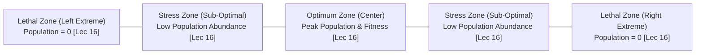
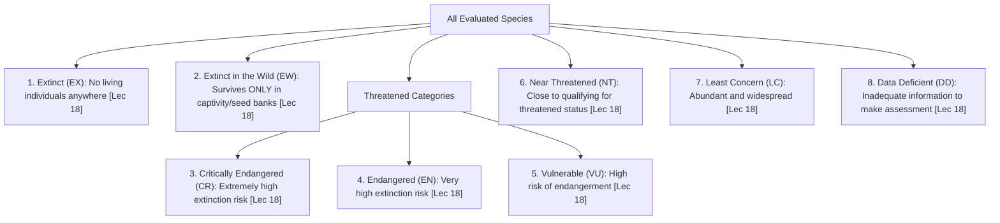
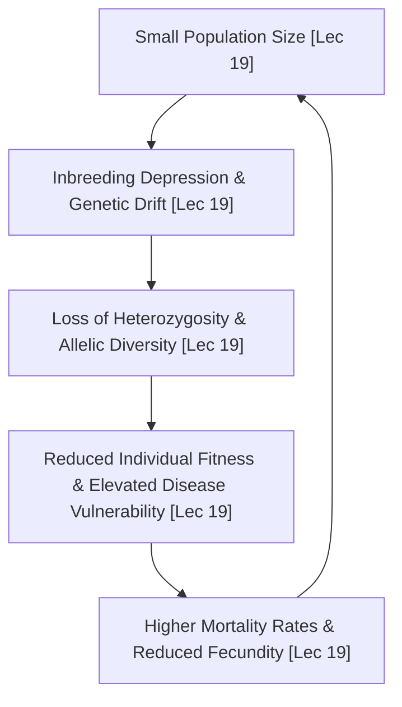
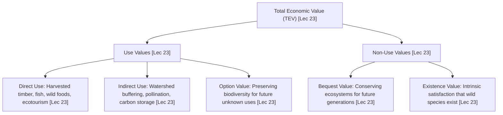
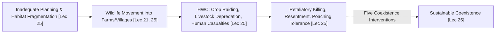
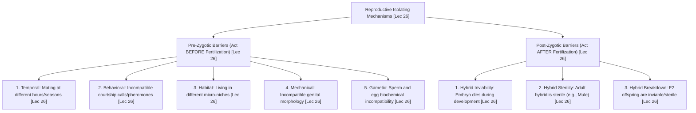
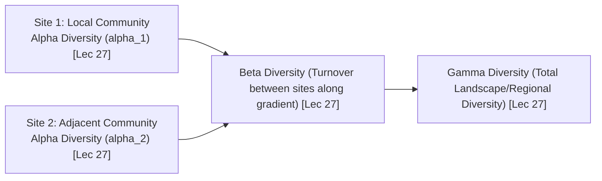

# Part 2: Modern Threats, Coexistence & Understanding Biodiversity (Weeks 04–06)

**Course:** Biodiversity for Sustainability  
**Instructor:** Dr. Ankur Awadhiya, IFS (Indian Forest Service)  
**Curriculum Mapping:** Lectures 16 to 30 (Weeks 4, 5, and 6)  
**Target File:** `textbook/part_2_weeks_04_06.md`  

---

## Comprehensive Table of Contents

### [Week 4: Threats in the Modern World - II (Lectures 16–20)](#week-4-threats-in-the-modern-world---ii)
1. **Lecture-by-Lecture Deep Dive**
   - **Lecture 16:** Climate Change and Biodiversity *(Weather vs. 30-Year Climate Normals, Shelford's Law of Tolerance & 3 Functional Zones, Specialist Vulnerability, Bramble Cay Melomys Extinction, Phenological Mismatch in Pied Flycatcher, Montane Escalator to Extinction)*
   - **Lecture 17:** Vulnerability of Species to Climate Change, Ocean Acidification & Desertification *(Carbonic Acid Chemistry, Carbonate Depletion & Aragonite Saturation, Coral Bleaching Zooxanthellae Expulsion, Pelagic Pteropod Dissolution, Sahelian Desertification)*
   - **Lecture 18:** Extinction and Extinction Risks *(IUCN Red List Architecture, 9 Formal Categories, Extinct in the Wild [EW] Roster, Threatened Taxa Criteria [CR, EN, VU], Great Indian Bustard Powerline Crisis, Dodo Extinction Forensic Analysis)*
   - **Lecture 19:** Small Populations and Extinction Vortex *(Caughley's Declining vs. Small Population Paradigms, The Extinction Vortex Feedback Loop, Inbreeding Depression & Deleterious Alleles, Genetic Drift, Demographic Stochasticity, The Allee Effect & Fitness Breakdown, Florida Panther Genetic Rescue)*
   - **Lecture 20:** Nutrient Cycles and Ecosystem Functioning *(Matter Cycles vs. Energy Flows, Crucial Role of Decomposers, Nitrogen Cycle Microbiology [Rhizobium, Nitrosomonas, Nitrobacter, Denitrification], Phosphorus Sedimentary Cycle, Cultural Eutrophication & Aquatic Hypoxia, Overexploitation [H > R], Hubbard Brook Deforestation Experiment)*
2. **Week 4 Master Reference Tables** *(Unabridged Shelford Zones, Biogeochemical Metabolic Matrix, IUCN Criteria, Extinction Vortex Feedbacks)*
3. **Official Quiz Breakdown & Trap Analysis** *(Assignment 4: Q1–Q10 Detailed Rationale & Distractor Traps)*

---

### [Week 5: Benefits of Coexistence (Lectures 21–25)](#week-5-benefits-of-coexistence)
1. **Lecture-by-Lecture Deep Dive**
   - **Lecture 21:** Coexistence: Meaning and Importance *(Failure of Fortress Conservation / Yellowstone Model, Spatial Limitations of Protected Areas, 80% Wildlife Outside Reserves, Asian Elephants in Working Matrices, The Extinction Island Trap, Land-Sparing vs. Land-Sharing)*
   - **Lecture 22:** Ecosystem Services from Shared Landscapes *(Microclimate Regulation via Canopy Shade & Evapotranspiration Cooling, Hydrological Water Regulation via Root Infiltration & Soil Sponges, Agricultural Shelterbelts, Riparian Buffers, Nocturnal Bat Pest Control)*
   - **Lecture 23:** Economic Benefits and Livelihoods *(Non-Timber Forest Products [NTFPs: Fruits, Resins, Gums, Bamboo, Fibers], The Mahua Economy, Option Value in the Total Economic Value Framework, Pacific Yew & Taxol Chemotherapy, Ecotourism Incentive Realignment)*
   - **Lecture 24:** Social, Cultural, Educational, and Health Benefits *(Cultural Services Taxonomy, Human Health & Environmental Bio-filtering, Japanese Shinrin-yoku Forest Bathing & Phytoncides, Bishnoi Sacred Khejri Tree Sacrifice, E.O. Wilson's Biophilia Hypothesis, Lyme Disease Dilution Effect)*
   - **Lecture 25:** Case Discussions in Coexistence (Human-Wildlife Conflict) *(HWC Formal Definition & Symmetrical Harms, Root Drivers in Infrastructure Fragmentation, Non-Lethal Electric & Beehive Fences, Rapid Transparent Ex-Gratia Compensation, Livestock Predator Insurance, Satellite Geo-Fencing & Rapid Response Teams)*
2. **Week 5 Master Reference Tables** *(Unabridged Total Economic Value Hierarchy, HWC to Coexistence Cascade, Shared Landscape Services)*
3. **Official Quiz Breakdown & Trap Analysis** *(Assignment 5: Q1–Q10 Detailed Rationale & Distractor Traps)*

---

### [Week 6: Understanding Biodiversity (Lectures 26–30)](#week-6-understanding-biodiversity)
1. **Lecture-by-Lecture Deep Dive**
   - **Lecture 26:** What is a Species? *(The Species Problem, Biological Species Concept [Mayr], Morphological Concept & Cryptic African Elephants, Ecological Species Concept [Van Valen], Pre-Zygotic Barriers [Temporal, Behavioral, Habitat, Mechanical, Gametic], Post-Zygotic Barriers [Inviability, Hybrid Sterility in Mules, Breakdown])*
   - **Lecture 27:** Speciation and Reproductive Isolation *(Allopatric Speciation & Darwin's Galápagos Finches, Sympatric Speciation in African Rift Lake Cichlids, Parapatric Gradients, Multi-Scalar Biodiversity Definition, Genetic Diversity Bedrock, Whittaker's Alpha, Beta, and Gamma Spatial Diversity Metrics)*
   - **Lecture 28:** Species Concepts in Practice *(Determinants of Distribution & Abundance, Endemism Vulnerability, Norman Myers's Biodiversity Hotspot Framework: 3 Simultaneous Criteria, The 36 Global Hotspots, The 4 Indian Biodiversity Hotspots, Western Ghats Purple Frog)*
   - **Lecture 29:** Habitat and Niche *(Habitat Quality Equation: Food, Water, Shelter, Breeding Sites, Low Disturbance; Habitat Address vs. Niche Profession; Hutchinson's n-Dimensional Hypervolume; Fundamental vs. Realized Niche; Connell's Intertidal Barnacle Competition; MacArthur's Warbler Partitioning)*
   - **Lecture 30:** Biodiversity Hotspots and Global Patterns (Animal Behavior & Chemical Ecology) *(Chemical Ecology & Secondary Metabolites, Allelopathy Definition & Greek Etymology, 4 Exudation Pathways, Black Walnut Juglone Toxicity, Lantana camara Allelopathic Monocultures, Meerkat Sentinel Behavior & Optimal Foraging Theory)*
2. **Week 6 Master Reference Tables** *(Unabridged Reproductive Isolation Matrix, Whittaker Spatial Metrics, Norman Myers Hotspot Thresholds, Mathematical Models)*
3. **Official Quiz Breakdown & Trap Analysis** *(Assignment 6: Q1–Q10 Detailed Rationale & Distractor Traps)*

---

# Week 4: Threats in the Modern World - II

## 1. Lecture-by-Lecture Deep Dive

### Lecture 16: Climate Change and Biodiversity

#### The Core Story & Mental Model
In Lecture 16, Dr. Ankur Awadhiya shifts focus from immediate, localized anthropogenic pressures (such as direct logging or snaring) to the pervasive, planetary-scale disruption of **Anthropogenic Climate Change**. He begins by establishing the fundamental scientific distinction between **weather** and **climate**. Weather represents the transient, chaotic state of the atmosphere at a specific location over short temporal windows of hours, days, or weeks (e.g., a rainy afternoon in Delhi). Climate, by contrast, is the long-term statistical aggregation of weather conditions—including means, variances, seasonal cycles, and extreme event frequencies—calculated over a standardized, classical baseline period. By international scientific consensus established by the World Meteorological Organization (WMO), this classical baseline period is rigorously defined as **30 years**.

Global climate change is not merely a uniform, gentle warming of the atmosphere; it is an energetic disruption of the entire biosphere that impacts biodiversity across four interconnected dimensions:
1. **Rising Mean Temperatures:** Shifting thermal baselines across terrestrial, freshwater, and marine biomes, pushing organisms toward their upper physiological limits.
2. **Altered Precipitation Patterns:** Disrupting historical monsoon dynamics, causing severe prolonged droughts in arid zones and hyper-concentrated, erosive rainfall events in others.
3. **Escalating Frequency and Intensity of Extreme Events:** Super-cyclones, marine heatwaves, prolonged heatwaves, and catastrophic flash floods that deliver severe mortality shocks to wildlife populations.
4. **Shifting Seasons and Phenological Mismatches:** Warming springs causing seasonal biological events (tree bud-burst, insect emergence, flower blooming) to advance earlier in the calendar year, uncoupling them from the fixed photoperiodic arrival times of migratory birds and pollinators.

To explain how organisms physiologically respond to shifting climatic gradients, Dr. Awadhiya introduces the foundational ecological framework of **Shelford's Law of Tolerance**, formulated in 1911 by the American ecologist Victor Ernest Shelford. The law states that the distribution, abundance, and survival of an organism are governed not by a single limiting nutrient (as in Liebig's Law of the Minimum), but by a suite of environmental factors (temperature, moisture, salinity, light) for which the organism exhibits a bell-shaped tolerance curve.

The Shelford Tolerance Curve is divided into three distinct functional zones:
- **The Optimum Zone:** The central physiological range where environmental conditions maximize metabolic efficiency. Here, the organism experiences minimal stress, allocates maximum energy toward growth, active foraging, and reproduction, and the **population reaches its peak abundance and density**.
- **Zones of Physiological Stress:** The peripheral zones immediately above and below the optimum. Organisms can survive in these conditions, but they must divert metabolic energy away from growth and reproduction toward physiological homeostasis (e.g., active panting, thermal shock protein synthesis). Consequently, fertility drops, juvenile survival declines, and population density thins out.
- **Zones of Intolerance:** The extreme ecological limits beyond the critical thermal or moisture limits. When an environmental condition falls outside an organism's physiological coping capacity, cellular proteins denature, metabolic failure occurs, survival becomes impossible, and the **population drops to zero**.

Finally, Dr. Awadhiya contrasts the vulnerability of **Ecological Specialist Species** versus **Ecological Generalist Species** under rapid climate change. Specialist species have evolved narrow tolerance ranges (steno-thermal and steno-hydric adaptations), depend on specialized food sources, or inhabit unique, restricted microclimates. When climate change alters their environment, specialists have virtually zero behavioral flexibility and cannot switch food sources or tolerate heatwaves; hence, they decline first. Generalists, with broad tolerance curves (eury-thermal adaptations) and opportunistic diets, can shift ranges, alter foraging schedules, and persist in disturbed landscapes.

#### Spoken Case Studies & Examples Explained
- **The Extinction of the Bramble Cay Melomys (*Melomys rubicola*):** Dr. Awadhiya highlights the tragic case of the Bramble Cay Melomys, a small endemic rodent that lived exclusively on a tiny, low-lying coral cay (measuring just 340 meters by 150 meters) in Torres Strait, Australia. Human-induced climate change caused sea levels to rise and intensified storm surges. Repeated marine inundation washed over the island, destroying $97\%$ of the herbaceous vegetation and seeds the rodents relied on for food and shelter, while seawater drowned individuals directly. By 2016, exhaustive surveys confirmed that the species was completely extinct—making it the **first documented mammalian extinction in human history caused directly by anthropogenic climate change**. **Exam Takeaway:** Small island endemics with low elevation and narrow ranges face zero escape routes when sea levels and extreme storm surges rise.
- **Phenological Mismatch in the European Pied Flycatcher (*Ficedula hypoleuca*):** The European Pied Flycatcher winters in tropical West Africa and migrates thousands of kilometers to breed in European oak forests. The flycatchers rely on astronomical day length (photoperiod) to time their spring departure. However, warmer European spring temperatures have caused oak leaves to flush earlier, which in turn causes the caterpillars of the Winter Moth (*Operophtera brumata*)—the essential food source for flycatcher chicks—to peak two to three weeks earlier. When the flycatchers arrive at their historical breeding dates, the caterpillar peak has already passed. Parent birds find scarce food, resulting in mass chick starvation and population declines of over $90\%$ in areas with the strongest thermal shifts.
- **The Montane "Escalator to Extinction":** In mountain ranges like the Himalayas and the Alps, alpine plants and high-altitude specialists (such as the Himalayan Pika, *Ochotona* spp.) are shifting their geographic distributions upward toward higher elevations to stay within their cool physiological tolerance zones. However, mountains are conical—as species move upward, total available surface area contracts sharply. Eventually, species reach the physical mountain peaks and have nowhere higher to go. This terminal barrier is known as the **"escalator to extinction"**.

#### Verbatim Definitions & Etymology Callout
> **Climate vs. Weather:** Weather represents short-term (hours to weeks) atmospheric states; Climate is the long-term statistical pattern of weather calculated over a standardized baseline period of **30 years**.
>
> **Shelford's Law of Tolerance (Shelford, 1911):** An ecological principle stating that an organism's abundance and distribution along an environmental gradient are determined by its physiological tolerance limits, exhibiting a bell-shaped response curve spanning an **Optimum Zone**, flanking **Zones of Physiological Stress**, and terminal **Zones of Intolerance** where the **population drops to zero**.
>
> **Phenological Mismatch:** The ecological disruption that occurs when interacting species (e.g., plants and pollinators; birds and prey insects) alter the timing of their seasonal life-cycle events at different rates in response to climate change, severing mutualistic or trophic synchrony.
>
> **Escalator to Extinction:** The progressive upward elevational range contraction of high-altitude and alpine species tracking warming temperatures on mountain peaks until no higher habitat exists, leading to total extinction.

---

### Lecture 17: Vulnerability of Species to Climate Change, Ocean Acidification & Desertification

#### The Core Story & Mental Model
In Lecture 17, Dr. Awadhiya explores how rising atmospheric greenhouse gases drive two massive planetary-scale biogeochemical crises: **Ocean Acidification** and **Desertification**. While warming temperatures alter atmospheric thermodynamics, excess carbon dioxide ($CO_2$) directly alters the chemical composition of the oceans, while persistent droughts and land mismanagement transform terrestrial biomes into expanding deserts.

**Ocean Acidification** is frequently described as the "evil twin" of climate change. The world's oceans act as a colossal carbon sink, absorbing approximately $25\text{ to }30\%$ of all anthropogenic $CO_2$ emitted into the atmosphere since the Industrial Revolution. When gaseous $CO_2$ dissolves in surface seawater, it reacts with water molecules ($H_2O$) to form weak **carbonic acid ($H_2CO_3$)**:
$$CO_2 + H_2O \rightleftharpoons H_2CO_3$$
Carbonic acid rapidly dissociates into hydrogen ions ($H^+$) and bicarbonate ions ($HCO_3^-$):
$$H_2CO_3 \rightleftharpoons H^+ + HCO_3^-$$
The accumulation of free hydrogen ions ($H^+$) lowers the ocean's $pH$ (surface ocean $pH$ has already dropped from a pre-industrial baseline of $8.25$ to $8.14$, representing a roughly $30\%$ increase in ocean acidity on a logarithmic scale). Crucially, these excess $H^+$ ions possess a strong chemical affinity for free **carbonate ions ($CO_3^{2-}$)** present in seawater, binding with them to form additional bicarbonate:
$$H^+ + CO_3^{2-} \rightleftharpoons HCO_3^-$$
This reaction actively depletes the available pool of dissolved carbonate ions. Marine calcifying organisms—including reef-building corals, pteropods (pelagic sea butterflies), foraminifera, echinoderms, oysters, and mollusks—rely on dissolved carbonate ions to precipitate **calcium carbonate ($CaCO_3$)**, specifically in the mineral forms of calcite and aragonite, to construct their protective shells and structural skeletons:
$$Ca^{2+} + CO_3^{2-} \rightleftharpoons CaCO_3$$
As carbonate ion concentrations plummet and the seawater saturation state of aragonite ($\Omega_{arag}$) drops below critical thresholds, calcification rates stall. In undersaturated waters, seawater becomes corrosive, physically dissolving the calcium carbonate shells of living marine organisms. Because calcifying plankton and corals form the structural and trophic foundation of marine ecosystems, ocean acidification threatens the collapse of oceanic food chains.

On land, the counterpart crisis is **Desertification**—the progressive land degradation in arid, semi-arid, and dry sub-humid regions resulting from various factors, including climatic variations and unsustainable human activities. When chronic drought couples with overgrazing by domestic livestock, deforestation for fuelwood, and improper irrigation, the protective vegetative canopy vanishes. Bare soil is exposed to blistering solar heat and wind erosion. Organic matter oxidizes, soil aggregates disintegrate into dust, moisture-holding capacity collapses, and fertile drylands transition into sterile, barren deserts.

#### Spoken Case Studies & Examples Explained
- **Mass Coral Bleaching Across the Great Barrier Reef:** Dr. Awadhiya explains the catastrophic physiology of coral bleaching. Reef-building stony corals (*Scleractinia*) live in an obligatory, delicate mutualistic symbiosis with microscopic photosynthetic dinoflagellate algae known as **zooxanthellae** (*Symbiodinium* spp.) residing inside their gastrodermal tissues. The algae provide up to $90\%$ of the coral's daily energy requirements via photosynthetic sugars, while the coral provides shelter and metabolic nitrogen. When sea surface temperatures rise just $1\text{--}2^\circ\text{C}$ above the normal summer maximum for several weeks, the photosynthetic machinery of the zooxanthellae becomes damaged, producing toxic reactive oxygen species (ROS). To survive oxidative stress, the coral polyp violently expels the zooxanthellae. Without their pigmented symbionts, the coral tissue becomes transparent, exposing the brilliant white calcium carbonate skeleton underneath—a state known as **coral bleaching**. If the water cools quickly, corals can slowly regain symbionts; but if marine heatwaves persist, the bleached corals starve, become overgrown by suffocating turf algae, and suffer catastrophic mass mortality.
- **Pteropods (Sea Butterflies) Dissolving in Polar Oceans:** Pteropods are tiny pelagic swimming sea snails that construct delicate shells out of aragonite, a highly soluble form of calcium carbonate. In the Southern Ocean and North Pacific, cold polar waters naturally absorb more $CO_2$, making them the first waters to become undersaturated with respect to aragonite. Controlled laboratory and field studies show that when live pteropods are placed in seawater mimicking projected mid-century ocean chemistry, their shells develop deep pitted fractures, become paper-thin, and begin dissolving within 48 hours. Because pteropods constitute up to $45\%$ of the diet of wild pink salmon, herring, and cod, their chemical dissolution threatens multi-billion-dollar global fisheries.
- **The Sahelian Desertification Frontier:** In the Sahel belt of sub-Saharan Africa, spanning the southern margin of the Sahara Desert from Senegal to Djibouti, decades of prolonged climatic droughts coupled with rapid human population growth and intensive cattle overgrazing have stripped fragile acacia scrub vegetation. Topsoils have eroded away, groundwater tables have plunged, and the Sahara Desert has encroached southward, triggering severe agricultural collapses, famine, and mass human environmental migration.

#### Verbatim Definitions & Etymology Callout
> **Ocean Acidification:** The ongoing decrease in the $pH$ of the Earth's oceans, caused primarily by the uptake of anthropogenic carbon dioxide ($CO_2$) from the atmosphere, which increases hydrogen ion ($H^+$) concentration and depletes dissolved carbonate ions ($CO_3^{2-}$).
>
> **Aragonite Saturation State ($\Omega_{arag}$):** A chemical metric of the thermodynamic propensity for the calcium carbonate mineral aragonite to precipitate or dissolve in seawater; values of $\Omega < 1.0$ indicate undersaturated, corrosive conditions where shells dissolve.
>
> **Coral Bleaching:** The stress response of stony corals to elevated sea surface temperatures or UV radiation, characterized by the expulsion or loss of their intracellular symbiotic photosynthetic dinoflagellates (zooxanthellae), exposing the white calcium carbonate skeleton.
>
> **Desertification:** Land degradation in arid, semi-arid, and dry sub-humid areas resulting from climatic variations and unsustainable anthropogenic pressures (deforestation, overgrazing, poor drainage).

---

### Lecture 18: Extinction and Extinction Risks

#### The Core Story & Mental Model
In Lecture 18, Dr. Awadhiya delivers an exhaustive analysis of **Extinction**—the ultimate, irreversible cessation of an evolutionary lineage. While extinction is a natural component of evolutionary history (over $99\%$ of all species that ever existed on Earth are now extinct), the modern crisis is distinguished by its unnatural velocity and anthropogenic origin. When a species goes extinct, millions of years of unique evolutionary experimentation, complex ecological interactions, and genetic information are erased forever.

To establish global consistency in diagnosing extinction risks, the International Union for Conservation of Nature (IUCN) established the **IUCN Red List of Threatened Species** in 1964. Dr. Awadhiya explains that the Red List is not a subjective "wish-list" compiled by activists; it is a rigorous, quantitative, criteria-driven scientific diagnostic system.

The IUCN Red List classifies every assessed species into one of **Nine Mutually Exclusive Categories**:
1. **Extinct (EX):** There is no reasonable doubt that the last individual of the species has died. An exhaustive survey across known and suspected historical habitats, at appropriate seasonal times, has failed to record a single living individual.
2. **Extinct in the Wild (EW):** The species is known to survive **only in captivity, zoos, botanical gardens, cryobanks, seed banks, or other human-managed artificial settings**, with zero surviving populations in its natural, free-ranging historical habitat.
3. **Critically Endangered (CR):** The taxon is facing an **extremely high risk of extinction in the wild** in the immediate future, meeting any one of five rigorous quantitative criteria:
   - Population size reduction $\ge 90\%$ over 10 years or 3 generations (where causes are reversible/understood) or $\ge 80\%$ (where causes are ongoing).
   - Geographic range: Extent of Occurrence (EOO) $< 100\text{ km}^2$ or Area of Occupancy (AOO) $< 10\text{ km}^2$, accompanied by severe fragmentation.
   - Small population: Fewer than 50 mature breeding individuals.
   - Quantitative PVA: Probability of wild extinction $\ge 50\%$ within 10 years or 3 generations.
4. **Endangered (EN):** The taxon is facing a **very high risk of extinction in the wild** (e.g., population reduction $\ge 70\%$; EOO $< 5,000\text{ km}^2$; mature individuals $< 250$; or probability of extinction $\ge 20\%$ within 20 years).
5. **Vulnerable (VU):** The taxon is facing a **high risk of extinction in the wild** (e.g., population reduction $\ge 50\%$; EOO $< 20,000\text{ km}^2$; mature individuals $< 1,000$; or probability of extinction $\ge 10\%$ within 100 years).
   *(Note: The three categories **CR, EN, and VU** collectively define the statutory grouping of **"Threatened"** species).*
6. **Near Threatened (NT):** The taxon has been evaluated against the criteria and does not currently qualify for CR, EN, or VU, but is close to qualifying or is likely to qualify for a threatened category in the near future.
7. **Least Concern (LC):** The taxon has been evaluated and does not qualify for any threatened or near threatened category; typically widespread, abundant taxa.
8. **Data Deficient (DD):** There is inadequate empirical information to make a direct or indirect assessment of its risk of extinction based on its distribution, abundance, or threats.
9. **Not Evaluated (NE):** The taxon has not yet been evaluated against the quantitative IUCN criteria.

#### Spoken Case Studies & Examples Explained
- **Surviving Only in Captivity: The Extinct in the Wild (*EW*) Roster:** Dr. Awadhiya explains what it means to be **Extinct in the Wild** using famous examples. The **Hawaiian Crow or ‘Alalā (*Corvus hawaiiensis*)** vanished completely from its native Hawaiian forests due to introduced avian malaria, predation by non-native mongooses, and habitat clearing; it survives today only through intensive captive breeding facilities. Another celebrated example is **Spix's Macaw (*Cyanopsitta spixii*)**, a striking blue Brazilian parrot that went extinct in its native caatinga dry forest due to deforestation and illegal trapping for the pet trade, persisting solely in private avicultural collections until recent reintroduction attempts. **Exam Takeaway:** *Extinct in the Wild* means the species survives strictly in zoos, seed banks, or human-managed facilities, but has zero wild populations.
- **India's Critically Endangered Species: The Great Indian Bustard (*Ardeotis nigriceps*):** Dr. Awadhiya details the plight of the Great Indian Bustard, a majestic grassland bird whose population has crashed to fewer than 150 individuals in the Thar Desert of Rajasthan. The bird has narrow frontal vision and heavy flight mechanics, making it prone to fatal collisions with overhead high-voltage transmission power lines erected across its habitat for solar and wind power projects.
- **The Dodo (*Raphus cucullatus*): A Forensic Extinction Analysis:** The dodo was a large, flightless ground-nesting pigeon endemic to the isolated volcanic island of Mauritius in the Indian Ocean. Because Mauritius had zero native terrestrial mammalian predators for millions of years, the dodo evolved without fear of land mammals (island tameness) and laid a single egg in vulnerable nests on the ground. When Dutch sailors colonized the island in 1598, they hunted the birds for fresh ship meat and introduced non-native pigs, dogs, cats, and crab-eating macaques (*Macaca fascicularis*). The introduced mammals devoured dodo eggs and chicks. Within just 64 years of human arrival, the dodo was completely wiped out, with the last confirmed sighting in 1662.

#### Verbatim Definitions & Etymology Callout
> **Extinct (EX):** An IUCN Red List category assigned when exhaustive surveys across the species' historic range have produced no reasonable doubt that the last individual has died.
>
> **Extinct in the Wild (EW):** An IUCN Red List category assigned when a species survives **only in captivity, zoos, botanical gardens, seed banks, or other human-managed artificial settings**, with no living individuals remaining in natural wild habitats.
>
> **The Threatened Categories:** The formal grouping comprising **Critically Endangered (CR)**, **Endangered (EN)**, and **Vulnerable (VU)**, each defined by standardized quantitative demographic and spatial thresholds.
>
> **Island Tameness:** The evolutionary loss of anti-predator behavioral vigilance and defense mechanisms in island-dwelling species that evolved in the historical absence of terrestrial mammalian predators, rendering them exceptionally vulnerable to introduced alien predators.

---

### Lecture 19: Small Populations and Extinction Vortex

#### The Core Story & Mental Model
In Lecture 19, Dr. Awadhiya introduces the most critical theoretical dichotomy in modern conservation biology: Graeme Caughley's (1994) distinction between the **Declining Population Paradigm** and the **Small Population Paradigm**.
- The **Declining Population Paradigm** asks the external, diagnostic question: *What external agents of decline (habitat loss, overexploitation, pollution, invasive predators) caused a once-abundant population to drop in numbers, and how can those external threats be neutralized?*
- The **Small Population Paradigm** asks the internal, genetic and demographic question: *Once a population is already small, what intrinsic, stochastic vulnerabilities threaten its persistence, and how do we prevent it from collapsing into extinction?*

When a population shrinks below a critical threshold, it is dragged into a self-reinforcing, multi-variable downward spiral known as the **Extinction Vortex**. In an extinction vortex, demographic, genetic, and environmental processes feed into one another in a positive feedback loop:
$$\text{Small Population} \longrightarrow \text{Inbreeding \& Genetic Drift} \longrightarrow \text{Loss of Genetic Diversity} \longrightarrow \text{Reduced Individual Fitness} \longrightarrow \text{Lower Reproduction \& Higher Mortality} \longrightarrow \text{Even Smaller Population}$$

Dr. Awadhiya dissects the four primary internal mechanisms that drive the vortex:
1. **Inbreeding Depression:** In a tiny population, mating between close genetic relatives becomes unavoidable. Inbreeding dramatically increases genetic homozygosity across the genome, unmasking deleterious, lethal recessive mutations that were previously hidden in heterozygous states. This manifests phenotypically as reduced sperm motility, lower clutch sizes, congenital deformities, developmental instability, and compromised immune responsiveness.
2. **Genetic Drift:** The random, stochastic fluctuation of allele frequencies from one generation to the next due to finite sampling of gametes. In small populations, genetic drift overpowers natural selection. Rare, beneficial adaptive alleles are randomly lost forever, while mildly deleterious alleles can become fixed ($100\%$ frequency) by pure chance, stripping the population of its evolutionary capacity to adapt to future environmental changes.
3. **Demographic Stochasticity:** Random, chance fluctuations in individual birth and death events or sex ratios. In a population of 10,000 birds, an equal sex ratio of offspring is statistically guaranteed. In a population of four individuals, however, there is a $6.25\%$ chance that all four chicks will be born male, causing immediate reproductive extinction without any external disturbance.
4. **The Allee Effect:** Formulated in 1931 by the American ecologist Warder Clyde Allee, the **Allee effect** describes a positive density-dependent phenomenon where individual biological fitness, survival, or per-capita reproductive success **declines when population size or density drops below a critical threshold**. While standard density-dependent models assume that individuals thrive at low densities (due to reduced resource competition), the Allee effect reveals that below a critical density, essential social and cooperative mechanisms fail:
   - Animals cannot locate mates across fragmented landscapes.
   - Cooperative hunting packs (e.g., African wild dogs, *Lycaon pictus*) fail to capture prey.
   - Communal antipredator vigilance systems (e.g., sentinels in meerkats or ground squirrels) collapse.
   - Group environmental conditioning (e.g., communal roosting for thermal regulation) breaks down.

To reverse this vortex, conservationists utilize **Genetic Rescue**—the intentional translocation and introduction of individuals from an outbred, genetically diverse external population into an inbred, declining population to infuse novel alleles, restore genome-wide heterozygosity, and reverse inbreeding depression.

#### Spoken Case Studies & Examples Explained
- **The Genetic Rescue of the Florida Panther (*Puma concolor coryi*):** Dr. Awadhiya details the gold-standard field case of genetic rescue. By the early 1990s, habitat fragmentation and hunting had isolated the Florida panther in the swamplands of south Florida, reducing the wild population to roughly 20 to 30 individuals. The population suffered catastrophic inbreeding depression: over $90\%$ of males exhibited cryptorchidism (undescended testicles), sperm motility plunged to $<10\%$, individuals developed kinked tails and cowlicks, and congenital atrial septal heart defects became prevalent. In 1995, wildlife managers made a bold decision: they translocated eight female Texas cougars (*Puma concolor stanleyana*, an adjacent historical subspecies) into southern Florida. The Texas females bred successfully with male Florida panthers. The genetic infusion produced outbred $F_1$ and backcrossed offspring with restored heterozygosity. Cryptorchidism dropped sharply, survival rates doubled, and the wild panther population surged fourfold, exceeding 120 to 200 individuals. **Exam Takeaway:** Genetic rescue is specifically defined as introducing individuals from another population to increase genetic diversity and reduce inbreeding depression.
- **The Allee Effect in the Passenger Pigeon:** The passenger pigeon was highly colonial, nesting in dense communal super-colonies of millions of birds. Communal nesting was essential to saturate predators and stimulate synchronous mating behavior. When commercial market hunting reduced colony sizes below a critical threshold density, the Allee effect took hold: birds could no longer stimulate one another to breed, predator satiation failed, and the species plummeted to extinction even when thousands of individual birds were still alive.
- **The Heath Hen (*Tympanuchus cupido cupido*) Collapse:** Once abundant across coastal New England, the heath hen was reduced to a single relict population of 50 birds on Martha's Vineyard island by 1908. A local reserve was created, and through strict protection, the population successfully rebounded to 2,000 birds. However, in 1916, a string of unpredictable stochastic events struck: a severe forest fire during the nesting season wiped out ground clutches; a harsh winter followed; an unprecedented winter irruption of predatory goshawks killed hundreds of adults; and domestic poultry introduced blackhead disease (*Histomoniasis*). Reduced back to a tiny inbred population where sex ratios warped heavily toward males, the population entered an inescapable extinction vortex and died out in 1932.

#### Verbatim Definitions & Etymology Callout
> **Declining vs. Small Population Paradigm (Caughley, 1994):** The Declining Population Paradigm diagnoses and treats the external environmental causes of population drop; the Small Population Paradigm analyzes the intrinsic, stochastic, and genetic risks that threaten a population once it is already small.
>
> **Extinction Vortex:** The self-reinforcing, synergistic positive feedback loop wherein small population size, inbreeding, genetic drift, and demographic stochasticity drive an isolated population toward extinction.
>
> **The Allee Effect (Allee, 1931):** The ecological phenomenon characterized by a correlation between low population size/density and decreased individual fitness, survival, or per-capita reproductive rate.
>
> **Genetic Rescue:** The intentional introduction of outbred genetic stock from an external population to augment genetic diversity, restore heterozygosity, and reverse inbreeding depression in an isolated, imperiled population.
>
> **Demographic Stochasticity:** Chance fluctuations in population birth rates, death rates, and sex ratios arising from the random nature of individual biological events in small cohorts.

---

### Lecture 20: Nutrient Cycles and Ecosystem Functioning

#### The Core Story & Mental Model
In Lecture 20, Dr. Awadhiya explores how biodiversity executes the fundamental chemical life-support processes of the biosphere: **Biogeochemical Nutrient Cycles**. A foundational law of ecology is that **energy flows, but matter cycles**. Sunlight flows into the biosphere, is converted into chemical bond energy by photosynthetic autotrophs (primary producers), moves through trophic food webs, and is permanently dissipated into outer space as low-grade metabolic heat. Energy cannot be recycled. Chemical nutrients, by contrast—the atoms of carbon, nitrogen, phosphorus, sulfur, and trace minerals that build DNA, proteins, and cellular membranes—exist in a finite, closed planetary reservoir. Every atom of nitrogen or carbon in your body was once part of an ancient dinosaur, an ocean floor sediment, or an ancient volcanic gas. Life persists only because biodiversity continually recycles these elements.

Dr. Awadhiya emphasizes the indispensable, irreplaceable role of **Decomposers** (saprophytic bacteria, mycorrhizal and bracket fungi, actinomycetes) and detritivores (earthworms, millipedes, woodlice). When living producers, herbivores, and carnivores die, they leave behind dead biomass, shedding, and metabolic wastes containing locked nutrients. If these remained unmineralized, the Earth would be buried under miles of dead carcasses, and the pool of available mineral nutrients in soil and water would drop to zero, terminating all primary production. Decomposers secrete extracellular digestive enzymes that break down complex organic polymers (proteins into amino acids, cellulose and lignin into simple carbohydrates, nucleic acids into phosphates), converting organic matter into simple inorganic mineral ions ($NH_4^+, NO_3^-, H_2PO_4^-$). These mineralized nutrients are returned directly to the **abiotic nutrient pool** in soil, sediments, and water, where they are re-absorbed by green plants, restarting the cycle.

The lecture conducts a comparative analysis of the primary nutrient cycles:
1. **The Carbon Cycle:** Characterized by a massive gaseous atmospheric reservoir of carbon dioxide ($CO_2$). Fixed by terrestrial plants and marine phytoplankton via photosynthesis into organic glucose; returned to the atmosphere via cellular respiration of organisms and combustion of organic matter and fossil fuels.
2. **The Nitrogen Cycle:** Governed by an enormous gaseous reservoir ($N_2$ comprises $78\%$ of the atmosphere). However, atmospheric $N_2$ is chemically inert due to an extraordinarily strong triple covalent bond ($N \equiv N$) that plants cannot break. Nitrogen must be "fixed" into biologically reactive forms through three distinct pathways: biological nitrogen fixation by specialized prokaryotes (symbiotic *Rhizobium* in legume root nodules, free-living *Azotobacter*, and aquatic cyanobacteria); lightning fixation; and industrial Haber-Bosch chemical fixation. Once fixed, **nitrification** occurs in two microbial steps: *Nitrosomonas* bacteria oxidize ammonia ($NH_3 / NH_4^+$) into nitrite ($NO_2^-$), and *Nitrobacter* bacteria oxidize nitrite into nitrate ($NO_3^-$), which plants readily absorb. Finally, **denitrification** by anaerobic bacteria (e.g., *Pseudomonas*) converts nitrates back into gaseous $N_2$, completing the cycle.
3. **The Phosphorus Cycle:** Fundamentally different from carbon and nitrogen because it is a **sedimentary cycle with no significant atmospheric gaseous reservoir**. The ultimate geological reservoir of phosphorus is continental phosphate-bearing rocks (e.g., apatite). Physical weathering slowly releases soluble orthophosphate ($PO_4^{3-}$) into soil and freshwater. Plants absorb phosphate, incorporating it into ATP, phospholipids, and nucleic acids. When organisms die, decomposers release phosphate back to the soil. Runoff carries phosphate into rivers and marine sediments, where it is locked into deep oceanic rocks for millions of years until tectonic uplift exposes them again.

Dr. Awadhiya explains how human activities violently disrupt these cycles:
First, **Cultural Eutrophication**: Excessive agricultural runoff of synthetic nitrogen and mined phosphorus fertilizers into lakes, rivers, and coastal estuaries triggers massive blooms of toxic algae. When the algae die, aerobic microbial decomposers consume all dissolved oxygen in the water to break down the dead organic matter, creating severe **hypoxia ($DO < 2\text{ mg/L}$)** that suffocates fish and crabs.
Second, **Overexploitation**: Taking living biological resources from ecosystems faster than natural reproductive and biogeochemical processes can replace them ($H > R$).

#### Spoken Case Studies & Examples Explained
- **The Hubbard Brook Experimental Deforestation Study:** Dr. Awadhiya details the famous whole-ecosystem experiment conducted by Gene Likens and F. Herbert Bormann in the Hubbard Brook Experimental Forest, New Hampshire. Researchers clearcut an entire forested watershed, left the felled trees in place, and sprayed herbicides for three years to prevent any vegetation regrowth, while carefully measuring streamwater chemistry. Without living tree roots and mycorrhizae to absorb nutrients, stream runoff increased by $40\%$, and soil nutrient leaching surged catastrophically: nitrate ($NO_3^-$) concentrations in the stream surged by **$60\text{-fold}$**, exceeding safe drinking water limits, while vital calcium, potassium, and magnesium washed away into the sea. **Exam Takeaway:** Intact forest vegetation and soil microbial networks are essential living filters that prevent the catastrophic loss of nutrients from terrestrial ecosystems.
- **The Haber-Bosch Disruption of the Global Nitrogen Budget:** In the early twentieth century, Fritz Haber and Carl Bosch invented an industrial process using high pressure ($200\text{ atm}$) and temperature ($450^\circ\text{C}$) over an iron catalyst to fix atmospheric $N_2$ with hydrogen into ammonia for synthetic fertilizer. Today, human industrial fertilizer production and fossil fuel combustion fix more reactive nitrogen annually ($>150\text{ million metric tons/year}$) than all natural terrestrial ecosystems combined, shattering the Earth's planetary boundary for biogeochemical nitrogen flows.
- **Dead Zones in the Baltic Sea and Lake Erie:** Runoff of manure and chemical phosphorus from surrounding agricultural catchments into Lake Erie and the semi-enclosed Baltic Sea has triggered massive summer blooms of the cyanobacterium *Microcystis*. The blooms release hepatotoxic microcystin, poisoning municipal drinking water supplies and creating vast bottom-water hypoxic dead zones where commercial fish populations collapse.

#### Verbatim Definitions & Etymology Callout
> **Biogeochemical Cycle:** The pathway by which a chemical element or molecule moves through both biotic (living organisms, biosphere) and abiotic (lithosphere, atmosphere, hydrosphere) compartments of the Earth.
>
> **Decomposer:** An organism (primarily saprophytic bacteria and fungi) that breaks down dead organic matter and metabolic wastes, releasing simple inorganic nutrients back into the abiotic nutrient pool.
>
> **Sedimentary vs. Gaseous Cycles:** Gaseous cycles (carbon, nitrogen) possess large, rapid atmospheric or oceanic reservoirs; Sedimentary cycles (phosphorus) have mineral rock reservoirs with no significant atmospheric phase and operate over slow geological timescales.
>
> **Cultural Eutrophication:** The anthropogenic acceleration of nutrient enrichment (nitrogen and phosphorus) in aquatic bodies via agricultural fertilizer runoff and municipal sewage, triggering explosive algal blooms, light deprivation, microbial decomposition, and bottom-water hypoxia.
>
> **Overexploitation:** The extraction or harvesting of renewable biological resources at rates exceeding the natural regenerative and reproductive capacity of the population ($H > R$).

---

## 2. Week 4 Master Reference Tables

## 1. High-Yield Terminological & Definitional Matrix

| Citation | Term / Concept | Operational Scientific Definition | Exam Archetype | Exam Question Tag |
| :--- | :--- | :--- | :--- | :--- |
| `[Lec 16]` | **Classical Climate Period (WMO)** | The standard baseline period of **30 consecutive years** used by the World Meteorological Organization (WMO) to calculate statistical climatic normals and averages. | Numerical Baseline | `[TESTED - 30% REPEAT POOL]` (W4-Q2) |
| `[Lec 16]` | **Shelford’s Law of Tolerance** | Ecological principle stating that organism abundance and distribution are determined by a bell-shaped tolerance curve across environmental factors; population reaches zero at lethal extremes. | Graphic / Law | `[TESTED - 30% REPEAT POOL]` (W4-Q4) |
| `[Lec 16]` | **Major Climatic Changes Set** | The four primary interconnected global climatic alterations: (1) Rising temperatures, (2) Changing rainfall patterns, (3) More frequent extreme weather events, and (4) Shifting biological seasons. | Criteria Set | `[TESTED - 30% REPEAT POOL]` (W4-Q6) |
| `[Lec 16]` | **Specialist Climate Vulnerability** | Specialist species decline earliest because they possess narrow physiological and ecological tolerances and lack alternative diet, habitat, or thermal options. | Mechanistic Rationale | `[TESTED - 30% REPEAT POOL]` (W4-Q3) |
| `[Lec 16]` | **Phenological Mismatch** | Asynchrony caused when climate warming shifts the seasonal timing of interacting species at unequal rates (e.g., insect emergence desynchronizing from migratory bird chick hatching). | Temporal Disruption | `[UNSEEN HIGH-YIELD - 70% FINAL POOL]` |
| `[Lec 17]` | **Ocean Acidification** | The reduction in oceanic pH driven by the absorption of excess atmospheric anthropogenic carbon dioxide ($CO_2$), depleting seawater carbonate ions ($CO_3^{2-}$). | Chemical Process | `[UNSEEN HIGH-YIELD - 70% FINAL POOL]` |
| `[Lec 17]` | **Eutrophication** | Rapid, excessive algal and phytoplankton proliferation triggered by agricultural and domestic nutrient runoff (Nitrogen and Phosphorus), causing oxygen depletion and aquatic dead zones. | Causal Mechanism | `[TESTED - 30% REPEAT POOL]` (W4-Q8) |
| `[Lec 17]` | **Desertification** | Biological and physical degradation of dryland ecosystems resulting from human exploitation (overgrazing, deforestation, poor irrigation) compounded by climatic variations. | Land Degradation | `[UNSEEN HIGH-YIELD - 70% FINAL POOL]` |
| `[Lec 17]` | **Phosphorus Cycle Anomaly** | The fundamental biogeochemical distinction: unlike the carbon, nitrogen, and hydrological cycles, the phosphorus cycle has **no major atmospheric gaseous reservoir**. | Chemical Comparison | `[UNSEEN HIGH-YIELD - 70% FINAL POOL]` |
| `[Lec 17]` | **Decomposers' Ecological Role** | Heterotrophic organisms (bacteria, fungi, detritivores) that break down dead organic biomass and metabolic wastes, recycling locked elements back into the abiotic nutrient pool. | Functional Role | `[TESTED - 30% REPEAT POOL]` (W4-Q10) |
| `[Lec 18]` | **Overexploitation (Awadhiya Formulation)** | Harvesting or extracting biological organisms and forest resources faster than natural reproduction and recruitment can replace them. | Forward Definition | `[TESTED - 30% REPEAT POOL]` (W4-Q1) |
| `[Lec 18]` | **IUCN Extinct in the Wild (EW)** | Red List status assigned to a species that no longer possesses wild free-ranging populations and survives exclusively in captivity, zoos, botanical gardens, or seed banks. | Framework Category | `[TESTED - 30% REPEAT POOL]` (W4-Q5) |
| `[Lec 18]` | **Functional Extinction** | A state where a tiny population remains alive (e.g., only two post-reproductive females), but can no longer reproduce, sustain genetic diversity, or perform its ecological role. | Reverse Definition | `[UNSEEN HIGH-YIELD - 70% FINAL POOL]` |
| `[Lec 18]` | **Chytridiomycosis** | Epidemic fungal infection caused by *Batrachochytrium dendrobatidis* (Bd); disrupts amphibian cutaneous respiration and electrolyte transport, causing $>90$ species extinctions globally. | Infectious Disease | `[UNSEEN HIGH-YIELD - 70% FINAL POOL]` |
| `[Lec 19]` | **Allee Effect** | A positive density-dependent phenomenon where individual biological fitness, group foraging efficiency, or per-capita reproductive success fails when population density falls below a critical threshold. | Population Dynamic | `[TESTED - 30% REPEAT POOL]` (W4-Q9) |
| `[Lec 19]` | **Genetic Rescue** | Deliberate introduction of unrelated, genetically diverse individuals from an outside population into an inbred, declining population to restore heterozygosity and reduce deleterious defects. | Applied Genetics | `[TESTED - 30% REPEAT POOL]` (W4-Q7) |
| `[Lec 19]` | **Extinction Vortex** | A self-reinforcing downward spiral where small population size triggers inbreeding and genetic drift, causing lower fitness, higher mortality, and even smaller population size. | System Feedback | `[UNSEEN HIGH-YIELD - 70% FINAL POOL]` |
| `[Lec 19]` | **Demographic Stochasticity** | Random chance fluctuations in births, deaths, litter sizes, or sex ratios that disproportionately threaten small, isolated populations with sudden extinction. | Statistical Risk | `[UNSEEN HIGH-YIELD - 70% FINAL POOL]` |
| `[Lec 19]` | **Genetic Swamping (Pollution)** | Deleterious hybridization where rare wild populations interbreed with abundant domestic, feral, or exotic relatives, erasing locally adapted genotypes. | Genetic Threat | `[UNSEEN HIGH-YIELD - 70% FINAL POOL]` |
| `[Lec 20]` | **Sixth Mass Extinction (Anthropocene)** | The ongoing global extinction crisis driven by human overexploitation, habitat destruction, pollution, and climate change; distinguished by occurring orders of magnitude faster than historical background rates. | Macro-Evolutionary | `[UNSEEN HIGH-YIELD - 70% FINAL POOL]` |

---

## 2. Shelford's Law of Tolerance & Ecological Zones

* `[Lec 16]` **Optimum Center (Green):** Optimal thermal/moisture conditions where metabolic efficiency is maximized; supports high reproductive output, competitive dominance, and peak population density `[UNSEEN HIGH-YIELD - 70% FINAL POOL]`.
* `[Lec 16]` **Zones of Physiological Stress (Yellow):** Flanking sub-optimal conditions; organism survives with elevated metabolic expenditure, but exhibits stunted growth, suppressed reproduction, and declining abundance `[UNSEEN HIGH-YIELD - 70% FINAL POOL]`.
* `[Lec 16]` **Lethal Limits of Intolerance (Red):** Environmental conditions exceed physiological coping mechanisms entirely; **the population drops to zero** `[TESTED - 30% REPEAT POOL]` (W4-Q4).
* `[Lec 16]` **Simultaneous Constraint Rule:** Organisms do not face single isolated variables; survival requires fitting within the optimum/tolerable zones across multiple physical gradients simultaneously (temperature, moisture, salinity, pH) `[UNSEEN HIGH-YIELD - 70% FINAL POOL]`.

---

## 3. Biogeochemical Cycles: Comparative Metabolic Matrix

| Citation | Biogeochemical Cycle | Primary Natural Reservoirs | Key Biological / Geochemical Processes | Anthropogenic Perturbation & Ecological Consequence |
| :--- | :--- | :--- | :--- | :--- |
| `[Lec 17]` | **Carbon Cycle ($C$)** | Ocean waters, sedimentary rocks, fossil fuels, terrestrial vegetation, atmosphere. | Photosynthesis captures atmospheric $CO_2$; respiration, microbial decomposition, and combustion return $CO_2$ to air; ocean-atmosphere gas exchange. | Fossil fuel burning and deforestation accelerate active cycling $\rightarrow$ Greenhouse warming and severe ocean acidification `[UNSEEN HIGH-YIELD - 70% FINAL POOL]`. |
| `[Lec 17]` | **Nitrogen Cycle ($N$)** | Atmosphere ($78\%$ as inert $N_2$ gas), soil organic matter, living biomass. | Biological nitrogen fixation (Rhizobium, cyanobacteria), ammonification, nitrification ($NO_2^-, NO_3^-$), and bacterial denitrification. | Haber-Bosch industrial synthesis and massive synthetic fertilizer runoff $\rightarrow$ Atmospheric emissions and severe aquatic eutrophication `[UNSEEN HIGH-YIELD - 70% FINAL POOL]`. |
| `[Lec 17]` | **Phosphorus Cycle ($P$)** | Sedimentary rocks, marine sediments, soils (NO atmospheric gas phase!). | Weathering of phosphate minerals, plant uptake from soil water, trophic transfer, bacterial decomposition, long-term oceanic sedimentation. | Phosphate mining, detergent release, and agricultural runoff $\rightarrow$ Massive freshwater eutrophication and algal blooms `[UNSEEN HIGH-YIELD - 70% FINAL POOL]`. |
| `[Lec 17]` | **Hydrological Cycle ($H_2O$)** | Oceans ($97\%$), cryosphere glaciers/ice caps, groundwater, surface water, atmosphere. | Evaporation, evapotranspiration, atmospheric condensation, precipitation, surface runoff, soil infiltration, and groundwater percolation. | Deforestation reduces transpiration, increasing surface flash runoff; land clearing and climate change accelerate dryland desertification `[UNSEEN HIGH-YIELD - 70% FINAL POOL]`. |

---

## 4. Empirical Biological Entities, Scientific Binomials & Regional Taxa

| Citation | Common Name / Case Study | Scientific Name / Taxonomic Group | Geographic Region / Site | Tested Ecological Mechanism, Vulnerability & Conservation Status |
| :--- | :--- | :--- | :--- | :--- |
| `[Lec 16]` | **Coral Reef Ecosystems** | Class Anthozoa (Scleractinian Corals) | Tropical Shallow Oceans | Ocean Acidification Vulnerability: Lower seawater pH reduces available carbonate ions ($CO_3^{2-}$); inhibits calcium carbonate ($CaCO_3$) aragonite skeleton deposition `[UNSEEN HIGH-YIELD - 70% FINAL POOL]`. |
| `[Lec 18]` | **Northern White Rhinoceros** | *Ceratotherium simum cottoni* | Ol Pejeta Conservancy, Kenya | Functional Extinction archetype: Only 2 living individuals remain on Earth, both females (Najin and Fatu); natural breeding is biologically impossible `[UNSEEN HIGH-YIELD - 70% FINAL POOL]`. |
| `[Lec 18]` | **Great Indian Bustard (GIB)** | *Ardeotis nigriceps* (Otididae) | Desert National Park, Thar Desert, Rajasthan (India) | Critically Endangered (CR) heavy-bodied bird; poor frontal vision prevents avoiding overhead high-voltage power lines; low fecundity (1 egg/year) prevents population recovery `[UNSEEN HIGH-YIELD - 70% FINAL POOL]`. |
| `[Lec 18]` | **Javan & Sumatran Rhinoceros** | *Rhinoceros sondaicus* & *Dicerorhinus sumatrensis* | Southeast Asian Rain Forests (Java & Sumatra) | Critically Endangered (CR): Extreme population crashes; fewer than 80 wild individuals survive in fragmented jungle reserves `[UNSEEN HIGH-YIELD - 70% FINAL POOL]`. |
| `[Lec 18]` | **Laysan Albatross Chicks** | *Phoebastria immutabilis* | Midway Atoll, Pacific Ocean | Marine Plastic Pollution: Pelagic parents mistake floating surface plastic debris for squid/fish; chicks starve to death with stomachs impacted with plastic `[UNSEEN HIGH-YIELD - 70% FINAL POOL]`. |
| `[Lec 19]` | **Dodo** *(Flightless insular bird)* | *Raphus cucullatus* (Columbidae) | Mauritius (Indian Ocean, east of Madagascar) | Extinct (EX) archetype: Giant flightless dove (~1 m tall); lacked evolutionary fear of predators; ground nests destroyed by sailors and introduced pigs, monkeys, rats within $<100$ years `[UNSEEN HIGH-YIELD - 70% FINAL POOL]`. |
| `[Lec 19]` | **Asiatic Wild Dog / Dhole** | *Cuon alpinus* (Canidae) | Indian Forest Landscapes | Allee Effect archetype: Obligate cooperative pack hunters; hunting success relies on coordinated packs exhausting ungulate prey; pack decline below threshold causes hunting failure and starvation `[TESTED - 30% REPEAT POOL]` (W4-Q9). |
| `[Lec 19]` | **Florida Panther Genetic Rescue** | *Puma concolor coryi* | South Florida Swamps (USA) | Genetic Rescue archetype: Population crashed to ~30 in 1990s; inbreeding caused kinked tails, atrial septal heart defects, and cryptorchidism; 8 Texas cougars (*P. c. stanleyana*) introduced in 1995 rebounded population to $>200$ `[TESTED - 30% REPEAT POOL]` (W4-Q7). |

---

## 5. IUCN Red List Categories Hierarchy (Lecture 18)

* `[Lec 18]` **Extinct (EX):** Comprehensive field surveys fail to locate a single living individual anywhere on Earth (e.g., Dodo *Raphus cucullatus*, Passenger Pigeon *Ectopistes migratorius*) `[UNSEEN HIGH-YIELD - 70% FINAL POOL]`.
* `[Lec 18]` **Extinct in the Wild (EW):** Survives **only** in zoos, botanical gardens, captive breeding facilities, or seed banks; free-ranging populations completely vanished from historic geographic range `[TESTED - 30% REPEAT POOL]` (W4-Q5).
* `[Lec 18]` **Critically Endangered (CR):** Facing an extremely high risk of extinction in the wild in the immediate future; evaluated by severe population reduction, tiny geographic range, or adult count $<50$ (e.g., Great Indian Bustard) `[UNSEEN HIGH-YIELD - 70% FINAL POOL]`.

---

## 6. The Extinction Vortex Feedback Loop (Lecture 19)

* `[Lec 19]` **Vortex Mechanics:** Small populations do not decline linearly; they enter an accelerating, positive-feedback extinction spiral where internal genetic decay multiplies external ecological vulnerabilities `[UNSEEN HIGH-YIELD - 70% FINAL POOL]`.
* `[Lec 19]` **Tripartite Stochastic Threats:**
  1. *Demographic Stochasticity:* Random fluctuations in sex ratio (e.g., all remaining offspring born male) `[UNSEEN HIGH-YIELD - 70% FINAL POOL]`.
  2. *Environmental Stochasticity:* Unpredictable annual fluctuations in rainfall, temperature, or food availability.
  3. *Natural Catastrophes:* Singular severe events (cyclones, wildfires, epizootic outbreaks) wiping out remaining clusters.

---

## 7. Contrastive Pairs & Diagnostic Trap Summary

* `[Lec 16]` **Climate vs. Weather Trap:** Weather is short-term atmospheric variation; Climate is the statistical distribution of weather over the **30-year classical baseline** `[TESTED - 30% REPEAT POOL]` (W4-Q2).
* `[Lec 16]` **Shelford Curve Boundary Trap:** Distractors claiming that outside tolerance limits *"species immediately adapt genetically"* or *"shift to optimum range"* are false. Beyond tolerance limits, **the population drops to zero** `[TESTED - 30% REPEAT POOL]` (W4-Q4).
* `[Lec 17]` **Eutrophication Nutrient Trap:** Eutrophication is driven primarily by **Nitrogen and Phosphorus**; distractors substitute carbon or heavy metals. Oxygen is NOT released; it is severely depleted by bacterial decomposition of dead algae `[TESTED - 30% REPEAT POOL]` (W4-Q8).
* `[Lec 17]` **Decomposer Role Trap:** Distractors claiming decomposers *"remove producers"* or *"convert nutrients into fossil fuels"* are absurd; their role is to return elements to the abiotic nutrient pool `[TESTED - 30% REPEAT POOL]` (W4-Q10).
* `[Lec 18]` **Extinct vs. Extinct in the Wild:** Extinct = zero individuals on Earth; Extinct in the Wild = survives in captive, human-managed settings `[TESTED - 30% REPEAT POOL]` (W4-Q5).
* `[Lec 19]` **Allee Effect Trap:** Distractors define Allee effect as *"increased survival at high nutrients"* or *"faster adaptation"*; correct answer is strictly **fitness/reproductive failure at low density/size** `[TESTED - 30% REPEAT POOL]` (W4-Q9).
* `[Lec 19]` **Genetic Rescue vs. Genetic Swamping:** 
  * *Rescue:* Positive, scientifically guided introduction of diverse conspecifics to relieve inbreeding depression `[TESTED - 30% REPEAT POOL]` (W4-Q7).
  * *Swamping:* Harmful dilution of rare wild gene pools by fertile domestic or invasive relatives `[UNSEEN HIGH-YIELD - 70% FINAL POOL]`.

---

## 3. Official Quiz Breakdown & Trap Analysis

### Question 1
> **Q1. What does overexploitation mean?**  
> (A) The movement of species into new habitats  
> **(B) Taking biological resources faster than nature can replace them**  
> (C) The recycling of nutrients by decomposers  
> (D) The restoration of extinct species through cloning  
> **Correct Answer:** `(B)`

- **Why it is right & Rationale:** Overexploitation is specifically defined as the harvesting, extraction, or hunting of renewable biological populations at rates exceeding their natural biological replacement or regeneration capacity ($H > R$) (`[Lec 20]`).
- **Trap Analysis:** Option `(A)` defines biological *dispersal or invasion*, `(C)` describes natural *decomposition and nutrient cycling*, and `(D)` refers to speculative *de-extinction or biotechnology*, testing precise conceptual identification.

---

### Question 2
> **Q2. What is the classical period used for calculating climate averages?**  
> (A) 5 years  
> (B) 10 years  
> (C) 20 years  
> **(D) 30 years**  
> **Correct Answer:** `(D)`

- **Why it is right & Rationale:** In climatology and environmental science, the World Meteorological Organization (WMO) formally establishes the standard baseline period for calculating climate normal averages as exactly **30 years** (`[Lec 16]`).
- **Trap Analysis:** Options `(A)`, `(B)`, and `(C)` represent shorter decadal or multi-year windows that capture short-term weather fluctuations or cyclical oscillations (such as ENSO) rather than true climatological averages.

---

### Question 3
> **Q3. Why are specialist species especially vulnerable to climate change?**  
> (A) They always have large home ranges  
> (B) They reproduce faster than generalists  
> **(C) They have narrow ecological requirements and few alternatives when conditions change**  
> (D) They are unaffected by changes in food quality  
> **Correct Answer:** `(C)`

- **Why it is right & Rationale:** Ecological specialists have evolved narrow physiological tolerances, specific dietary requirements, and unique microclimatic dependencies, leaving them with no alternatives when shifting climatic baselines alter their habitats (`[Lec 16]`).
- **Trap Analysis:** Option `(A)` is factually untrue (specialists often have localized, tiny ranges), `(B)` reverses life-history reality (generalists usually reproduce faster), and `(D)` is absurd because specialists are highly sensitive to food composition.

---

### Question 4
> **Q4. Under Shelford’s Law of Tolerance, what happens when an ecological condition falls outside an organism’s coping capacity?**  
> (A) The population reaches its optimum level  
> (B) The species immediately adapts genetically  
> (C) The species shifts into its most suitable range  
> **(D) The population drops to zero**  
> **Correct Answer:** `(D)`

- **Why it is right & Rationale:** In Shelford's bell-shaped tolerance curve, conditions falling beyond the critical upper or lower physiological limits enter the Zone of Intolerance, where metabolic failure occurs and the population drops to zero (`[Lec 16]`).
- **Trap Analysis:** Option `(A)` describes the central *Optimum Zone*, `(B)` tests the common student misconception that individual organisms can "immediately adapt genetically" to lethal extremes, and `(C)` describes favorable habitat selection.

---

### Question 5
> **Q5. What does the IUCN Red List category Extinct in the Wild mean?**  
> (A) The species has many stable wild populations  
> (B) The species has no known individuals anywhere  
> **(C) The species survives only in zoos, seed banks, or other human-managed settings**  
> (D) The species is common but declining slowly  
> **Correct Answer:** `(C)`

- **Why it is right & Rationale:** The IUCN category *Extinct in the Wild (EW)* is strictly reserved for taxa that no longer exist in any free-ranging natural habitat, surviving exclusively in captivity, ex-situ breeding centers, zoos, or seed banks (`[Lec 18]`).
- **Trap Analysis:** Option `(A)` describes *Least Concern*, `(B)` is the definition of total *Extinct (EX)*, and `(D)` describes a declining taxon that would qualify as *Near Threatened* or *Vulnerable*.

---

### Question 6
> **Q6. Which set correctly identifies major climatic changes affecting biodiversity?**  
> (A) Soil erosion, mining, hunting, and disease  
> **(B) Rising temperature, changing rainfall patterns, more frequent extremes, and shifting seasons**  
> (C) Urbanisation, overgrazing, logging, and fishing  
> (D) Mutation, migration, predation, and reproduction  
> **Correct Answer:** `(B)`

- **Why it is right & Rationale:** The primary climatic drivers disrupting global biodiversity are temperature rise, altered precipitation regimes, heightened frequency of extreme meteorological events, and shifting seasonal phenology (`[Lec 16]`).
- **Trap Analysis:** Option `(A)` lists direct physical land degradation and overexploitation threats, `(C)` lists direct land-use conversion drivers, and `(D)` lists fundamental evolutionary and population biology mechanisms.

---

### Question 7
> **Q7. What is genetic rescue?**  
> **(A) Introducing individuals from another population to increase genetic diversity and reduce inbreeding problems**  
> (B) Removing all predators from a protected area  
> (C) Converting a dryland into agricultural land  
> (D) Increasing pollutant concentration in predators  
> **Correct Answer:** `(A)`

- **Why it is right & Rationale:** Genetic rescue is a deliberate conservation intervention wherein outbred individuals from an external population are translocated into an inbred population to introduce fresh alleles, boost heterozygosity, and reverse inbreeding depression (`[Lec 19]`).
- **Trap Analysis:** Option `(B)` describes predator culling, `(C)` describes agricultural land reclamation, and `(D)` describes *biomagnification*, using cross-module distractors to test pharmacological and genetic precision.

---

### Question 8
> **Q8. What is eutrophication?**  
> **(A) Rapid algal growth triggered by excess nutrients, leading to oxygen decline and harm to aquatic life**  
> (B) Movement of animals toward cooler latitudes  
> (C) Recovery of forests after fire  
> (D) A process of genetic rescue in small populations  
> **Correct Answer:** `(A)`

- **Why it is right & Rationale:** Eutrophication is the ecological process whereby excessive nutrient enrichment (nitrogen and phosphorus) stimulates explosive algal blooms, whose subsequent bacterial decomposition severely depletes dissolved oxygen (hypoxia), suffocating aquatic fauna (`[Lec 20]`).
- **Trap Analysis:** Option `(B)` describes *latitudinal climate tracking*, `(C)` describes *post-fire ecological succession*, and `(D)` refers to *genetic rescue*, testing students on fundamental ecological processes.

---

### Question 9
> **Q9. What does the Allee effect describe?**  
> (A) Increased survival when nutrient runoff is high  
> (B) Reduced shell-building due to seawater chemistry  
> (C) Faster adaptation in fragmented landscapes  
> **(D) Failure of survival or reproduction when population size or density becomes too low**  
> **Correct Answer:** `(D)`

- **Why it is right & Rationale:** Formulated by Warder C. Allee, the Allee effect describes a positive density-dependent breakdown where individual fitness, survival, or per-capita reproductive success drops when population density falls below a critical threshold (`[Lec 19]`).
- **Trap Analysis:** Option `(A)` is an absurd distractor, `(B)` describes *ocean acidification*, and `(C)` is biologically false because fragmented populations experience genetic drift and inbreeding, which hinder rapid adaptation.

---

### Question 10
> **Q10. In a nutrient cycle, what role do decomposers perform?**  
> (A) They prevent nutrients from entering food webs  
> (B) They convert all nutrients into fossil fuels  
> (C) They remove producers from ecosystems  
> **(D) They break down dead material and wastes, returning nutrients to the nutrient pool**  
> **Correct Answer:** `(D)`

- **Why it is right & Rationale:** Decomposers (bacteria, saprophytic fungi) secrete digestive enzymes to break down complex organic molecules in dead biomass and metabolic wastes, mineralizing them and returning simple nutrients back to the abiotic pool for plant uptake (`[Lec 20]`).
- **Trap Analysis:** Option `(A)` is the exact opposite of reality (they enable nutrient cycling into food webs), `(B)` refers to fossil fuel formation over geological timescales, and `(C)` refers to catastrophic disturbance or intense herbivory.

---

# Week 5: Benefits of Coexistence

## 1. Lecture-by-Lecture Deep Dive

### Lecture 21: Coexistence: Meaning and Importance

#### The Core Story & Mental Model
In Lecture 21, Dr. Ankur Awadhiya introduces a major paradigm shift in conservation philosophy: the transition from historical "fortress conservation" to the science of **Human-Wildlife Coexistence**. For over a century, global conservation was dominated by the **Yellowstone Model**—the colonial belief that nature can only be preserved by creating strictly guarded, uninhabited "islands" of wilderness (national parks and sanctuaries) and evicting all human presence. In this conventional mental model, humans and wildlife are treated as fundamentally incompatible, and the solution to biodiversity decline is simply to build higher fences around protected areas.

Dr. Awadhiya explains why **fortress thinking alone fails** to secure species over ecological time:
1. **The Spatial Limitation:** Protected areas currently cover only about $15\text{ to }17\%$ of the Earth's terrestrial surface. The remaining $83\text{ to }85\%$ of the planetary landmass consists of human-dominated working landscapes—agricultural mosaics, commercial timber forests, pastoral rangelands, rural settlements, and transport corridors. If conservationists care only about what happens inside fenced reserves, they abandon the overwhelming majority of the biosphere.
2. **The Biological Reality of Wide-Ranging Species:** Free-ranging wildlife does not recognize administrative boundaries drawn on maps. Large-bodied apex carnivores (such as tigers, leopards, and wolves) and mega-herbivores (such as Asian elephants and rhinos) possess vast home ranges spanning hundreds or thousands of square kilometers. A single herd of elephants requires extensive seasonal foraging grounds and must migrate across hundreds of kilometers tracking water availability and ripening vegetation. When protected areas are small and isolated, animals are biologically forced to move beyond reserve borders into human-occupied farmlands and village commons in search of food, water, mates, and seasonal calving habitats.
3. **The Extinction Island Trap:** When protected areas become isolated ecological islands surrounded by hostile agricultural and urban barriers, wildlife populations trapped inside suffer the devastating effects of inbreeding depression, genetic drift, and local demographic catastrophe.

Therefore, true long-term biodiversity conservation requires moving beyond fortress isolation to embrace **Coexistence in Shared Landscapes**. Coexistence does not mean an idyllic, conflict-free state where humans and dangerous wild animals live in utopian harmony. Coexistence is an operational, dynamic equilibrium where human societies and wildlife populations persist side by side across shared working landscapes, supported by spatial planning, conflict mitigation technologies, mutual tolerance, and equitable sharing of costs and benefits.

#### Spoken Case Studies & Examples Explained
- **Asian Elephants (*Elephas maximus*) Outside Protected Areas in India:** Dr. Awadhiya highlights that over $60\text{ to }70\%$ of India's wild elephant population lives permanently or seasonally *outside* notified national parks and sanctuaries. In states like West Bengal, Odisha, and Assam, elephants navigate a densely populated human matrix of tea estates, paddy fields, railway tracks, and village settlements. If conservation policy attempted to confine all elephants strictly inside existing reserves, the reserves would experience catastrophic overbrowsing and habitat destruction, and the majority of the population would have to be culled. Survival of the Asian elephant is entirely dependent on achieving coexistence in the shared agricultural matrix. **Exam Takeaway:** Reserves alone cannot secure large-ranging species because animals must move beyond administrative boundaries for food, water, mates, and seasonal habitat.
- **The Limitations of Fortress Fencing:** The professor critiques the simplistic demand to "fence all forest borders." Fencing thousands of kilometers of rugged mountain or jungle terrain is physically impossible and economically ruinous. More dangerously, rigid boundary fences block ancestral migratory corridors, trap wildlife during seasonal droughts or wildfires, and sever gene flow between metapopulations, accelerating inbreeding collapse.
- **Land-Sparing vs. Land-Sharing:** Dr. Awadhiya introduces the classic debate between **Land-Sparing** (intensifying agriculture on small footprints to leave separate large blocks of untouched wild nature) and **Land-Sharing** (integrating biodiversity-friendly farming practices, such as shade-grown agroforestry, across large landscapes). In densely populated developing nations, land-sharing and coexistence are non-negotiable necessities.

#### Verbatim Definitions & Etymology Callout
> **Coexistence:** A dynamic, managed state of socio-ecological equilibrium wherein human communities and free-ranging wildlife populations co-occur across shared landscapes, characterized by mutual persistence, controlled conflict, and shared landscape benefits.
>
> **Fortress Conservation (The Yellowstone Model):** A preservationist paradigm asserting that biodiversity can only be protected by creating strictly inviolate, uninhabited protected areas and physically isolating nature from human society.
>
> **Limitations of Fortress Thinking:** The structural failure of reserve-only conservation arising because protected areas are too small to encompass the large home ranges and seasonal migratory routes of megafauna, and because over $80\%$ of global land exists outside reserves.
>
> **Shared (Working) Landscape:** A heterogeneous spatial matrix comprising agricultural farmlands, agroforests, pastoral commons, and community woodlots that concurrently supports human economic production and wildlife movement and foraging.

---

### Lecture 22: Ecosystem Services from Shared Landscapes

#### The Core Story & Mental Model
In Lecture 22, Dr. Awadhiya demonstrates that biodiversity in shared, human-dominated landscapes is not an economic liability or a luxury—it is an indispensable, active provider of vital **Ecosystem Services** that sustain agricultural yields, regulate local hydrological regimes, and moderate extreme weather events. When farmers preserve hedgerows, wetlands, agroforestry trees, and natural forest fragments within agricultural matrices, they are investing in biological life-support systems.

The lecture focuses heavily on two paramount regulating services delivered by vegetation and living soils:
1. **Microclimate Regulation by Vegetation:** Unvegetated, barren agricultural land or paved urban surfaces absorb intense solar radiation and re-radiate it as sensible heat, causing extreme surface temperatures, desiccation, and severe thermal stress for crops, livestock, and humans. Forest canopies, windbreaks, and shelterbelts moderate microclimates through two biophysical mechanisms:
   - **Direct Canopy Shade:** Foliage intercepts incoming solar radiation, dramatically lowering ground surface and soil temperatures by $2\text{ to }8^\circ\text{C}$.
   - **Evapotranspiration:** Deep tree roots pump vast quantities of groundwater up to leaves, where it is released into the atmosphere as water vapor. The phase change of water from liquid to vapor absorbs immense latent heat from the surrounding air, creating a natural evaporative cooling effect that lowers ambient air temperatures and elevates local relative humidity, buffering crops against drought stress.
2. **Hydrological Water Regulation:** How biodiversity regulates the flow, infiltration, storage, and purification of water across landscapes. In a simplified, deforested landscape with degraded soil, heavy precipitation hits bare ground, compacts surface pores, and triggers high-velocity surface runoff, causing catastrophic flash floods downstream and stripping topsoil. In a biodiverse, vegetated landscape:
   - Forest canopies intercept raindrops, reducing kinetic impact.
   - Deep root systems of native trees, shrubs, and perennial grasses act as biological conduits, loosening compacted subsoils and creating macroscopic channels that **dramatically increase water infiltration**.
   - Living soils rich in organic matter (humus) act as a massive sponge, storing millions of liters of water in the upper soil profile, slowing runoff velocities, and facilitating deep percolation to **recharge groundwater aquifers**.
   - Living root zones and soil microbial communities bio-filter agricultural agrochemicals, heavy metals, and particulate sediments, ensuring clean, perennial baseflows in streams during dry seasons.

Furthermore, shared biodiverse landscapes sustain populations of wild insectivorous birds, bats, predatory wasps, and spiders that provide continuous **biological pest control**, suppressing agricultural pests without chemical inputs, while wild solitary bees and flies nesting in field margins provide essential **crop pollination**.

#### Spoken Case Studies & Examples Explained
- **Agricultural Windbreaks and Shelterbelts in Arid Zones:** Dr. Awadhiya details the use of multi-tiered shelterbelts—rows of native trees and shrubs planted along farm boundaries perpendicular to prevailing winds. In dry agricultural plains (such as Rajasthan and the American Midwest), desiccating winds strip soil moisture and erode topsoil. Shelterbelts reduce wind velocities by up to $50\%$, decrease crop evapotranspiration, lower summer surface heat stress, and boost crop yields by $15\text{ to }25\%$ while providing critical nesting habitat for wild pollinators. **Exam Takeaway:** Microclimate regulation by vegetation reduces heat and moisture stress through shade, lower surface temperatures, and humidity moderation.
- **The Sponge Function of Riparian Forest Buffers:** The professor explains the transformative power of maintaining 50-meter-wide vegetated buffer strips along riverbanks. When monsoon rains hit agricultural slopes, riparian vegetation traps sediment and absorbs fertilizer nitrates and phosphates before they enter the river, preventing downstream eutrophication while stabilizing riverbanks against catastrophic collapse.
- **Bat Predation of Crop Pests:** Dr. Awadhiya highlights the silent, nocturnal regulating service of insectivorous bats (such as the Indian False Vampire Bat, *Megaderma lyra*). A single colony of bats can consume millions of nocturnal agricultural insect pests (including cotton bollworms and planthoppers) every night, saving farmers millions of rupees in pesticide costs and preventing chemical poisoning of local food supplies.

#### Verbatim Definitions & Etymology Callout
> **Microclimate Regulation by Vegetation:** The biophysical process whereby tree canopies, shelterbelts, and vegetative cover moderate localized atmospheric conditions by providing physical shade, lowering surface and air temperatures, elevating relative humidity through evapotranspiration, and dampening extreme thermal fluctuations.
>
> **Water Regulation by Biodiversity:** The ecological capacity of living vegetation, root architectures, and organic-rich soils to govern the hydrological cycle by enhancing precipitation infiltration, maximizing soil moisture storage, mitigating peak flood runoff, recharging groundwater aquifers, and maintaining perennial dry-season streamflows.
>
> **Shelterbelt / Windbreak:** Linear plantings of multiple rows of trees and shrubs engineered to reduce wind speeds across agricultural fields, moderate microclimates, reduce soil erosion, and provide habitat for beneficial wildlife.
>
> **Riparian Buffer Zone:** A vegetated corridor along the margins of rivers, streams, or wetlands that intercepts agricultural runoff, stabilizes riverbanks, filters pollutants, and maintains aquatic habitat integrity.

---

### Lecture 23: Economic Benefits and Livelihoods

#### The Core Story & Mental Model
In Lecture 23, Dr. Awadhiya demonstrates that biodiversity is not merely an ecological construct, but a foundational pillar of human economies, rural livelihoods, and future industrial innovation. The relationship between biodiversity and economics is analyzed through three primary dimensions: **Non-Timber Forest Products (NTFPs)**, **Ecotourism**, and the critical economic valuation concept of **Option Value**.

The lecture focuses heavily on **Non-Timber Forest Products (NTFPs)**—biological resources harvested from natural forests, woodlands, and tree savannas without felling timber trees. In traditional forestry and national GDP accounting, the economic value of forests was measured almost exclusively by timber volume (cubic meters of commercial sal, teak, or pine logs). Dr. Awadhiya rejects this timber-centric bias as economically blind. NTFPs encompass an immense diversity of high-value natural commodities: wild edible fruits (amla, bael, jamun), nuts (chironji), natural oleo-resins and gums (gum karaya, gum arabic), wild honey and beeswax, medicinal and aromatic plants (ashwagandha, sarpagandha), bamboo and rattan canes, and natural vegetable fibers (jute, sisal). Across the developing world, NTFPs provide up to $50\text{ to }70\%$ of the annual subsistence income and food security for over 350 million rural and indigenous forest-dwelling people, serving as a critical safety net during agricultural crop failures.

To evaluate nature beyond immediate market harvesting, the lecture introduces the profound concept of **Option Value** within the Total Economic Value (TEV) framework. Option value represents the economic benefit and willingness-to-pay for **keeping biodiversity available for possible, unforeseen future uses and technological applications**. Humanity's future needs, technologies, and challenges are inherently uncertain. A nondescript forest weed or an obscure deep-sea sponge may hold the biochemical secret to curing future viral pandemics, while wild crop relatives contain genetic alleles that can confer drought or salinity resistance to domestic crops facing 21st-century climate disruption. Once a species is driven to extinction, its option value is permanently annihilated; humanity loses an evolutionary biological library that can never be rewritten.

Finally, the lecture analyzes **Wildlife Ecotourism** as an economic engine for local development. Responsible ecotourism monetizes living wildlife rather than dead carcasses, generating foreign exchange and local employment in guiding, hospitality, and transportation, while creating powerful economic incentives for local communities to protect species from poachers.

#### Spoken Case Studies & Examples Explained
- **The Mahua Economy (*Madhuca longifolia*):** Dr. Awadhiya details the extraordinary socio-economic role of the Mahua tree across central India's tribal belt (Madhya Pradesh, Chhattisgarh, Jharkhand). Every summer, tribal families gather fallen mahua flowers, which are rich in natural sugars, vitamins, and minerals. Mahua flowers are consumed fresh, dried and stored as famine food, and fermented into traditional beverages. Later in the season, the seeds are pressed to extract edible cooking oil and medicinal soap fat. Because a living Mahua tree yields flowers and seeds annually for over a century, its cumulative economic value to local families vastly exceeds the one-time timber value of felling the trunk. **Exam Takeaway:** NTFPs like fruits, nuts, resins, medicinal plants, bamboo, and fibers provide sustainable, recurring livelihood support without destroying forest ecosystems.
- **The Discovery of Taxol from the Pacific Yew (*Taxus brevifolia*):** The Pacific yew was historically regarded by commercial timber loggers in the Pacific Northwest of the United States as a "trash tree" with zero market value, routinely felled and burned in slash piles. In the late 1960s, a systematic screening of plant compounds revealed that the bark of *Taxus brevifolia* contains **paclitaxel (Taxol)**, a novel chemical compound that blocks cancer cell division by stabilizing microtubules. Taxol became one of the most potent, life-saving chemotherapy drugs in modern oncology for breast, ovarian, and lung cancers. This is the classic textbook illustration of **Option Value**—a supposedly "useless" wild plant proved to possess multi-billion-dollar therapeutic value for human health.
- **Ecotourism in Corbett and Ranthambore Tiger Reserves:** The professor highlights how tiger reserves generate hundreds of millions of rupees annually in local economic activity. In villages surrounding Ranthambore, former poachers and marginal farmers now earn dignified, stable livelihoods as certified safari nature guides, drivers, and resort hospitality staff, transforming local communities from potential poachers into fierce defenders of wild tigers.

#### Verbatim Definitions & Etymology Callout
> **Non-Timber Forest Products (NTFPs):** All biological materials—other than commercial industrial timber—harvested from natural forests, woodlands, and trees for human use, including wild foods, nuts, resins, gums, medicinal plants, honey, bamboo, rattan, and fibers.
>
> **Option Value (in Biodiversity Economics):** The economic value assigned to preserving a biological resource, species, or ecosystem in existence today to retain the option of utilizing it for unforeseen, potential future benefits, discoveries, or technological applications.
>
> **Total Economic Value (TEV):** A comprehensive economic framework integrating all use values (direct consumptive, direct non-consumptive, indirect regulating) and non-use values (existence, bequest, option) generated by ecosystems.
>
> **Bioprospecting:** The systematic search for and exploration of wild biological resources, genes, biochemical compounds, and organisms for commercial exploitation in pharmaceuticals, agriculture, cosmetics, and biotechnology.

---

### Lecture 24: Social, Cultural, Educational, and Health Benefits

#### The Core Story & Mental Model
In Lecture 24, Dr. Awadhiya explores the non-material, social, and psychological foundations of human existence that depend directly on biological diversity. In an era dominated by technological screens and dense concrete urbanization, modern societies frequently overlook the profound truth that human psychological well-being, cultural identity, and epidemiological resilience are deeply rooted in living natural systems.

The lecture details the **Cultural Services** of biodiversity, which encompass the non-material benefits that enrich human minds, societies, and cultural traditions:
- **Recreation and Ecotourism:** Providing physical outdoor rejuvenation, hiking, wildlife observation, and relief from urban sensory overload.
- **Inspiration and Creative Arts:** Natural forms, patterns, colors, and animal behaviors have inspired human language, literature, poetry, painting, music, and architectural design across all civilizations.
- **Scientific and Educational Discovery:** Natural ecosystems function as living laboratories where students, researchers, and citizens study evolutionary mechanics, ecological interactions, and biophysical laws.
- **Cultural Heritage and Sense of Place:** Natural landscapes, sacred mountains, and native totem species anchor the collective memory, historical traditions, and spiritual identity of human communities.
- **Shared Public Green Spaces:** Urban parks, community forests, and botanical gardens serve as vital social commons that foster social interaction, reduce urban crime rates, and bridge socioeconomic divides.

Dr. Awadhiya then analyzes the profound connections between **Biodiversity and Human Health**:
First, **Physical Environmental Health**: Biodiverse ecosystems actively filter hazardous pollutants from the environment. Urban tree canopies trap fine particulate matter ($PM_{2.5}, PM_{10}$) on leaf surfaces and absorb gaseous pollutants ($NO_x, SO_2$). Intact wetland soils and microbial communities filter toxic heavy metals and organic pathogens from municipal drinking water sources. Intact predator-prey food webs buffer infectious zoonotic disease transmission (the **Dilution Effect**).
Second, **Human Psychological and Physiological Health**: Contact with biodiverse green spaces produces measurable physiological benefits: lowering circulating levels of the stress hormone cortisol, decreasing sympathetic nervous system arousal, lowering systolic and diastolic blood pressure, improving cardiovascular health, and boosting natural killer (NK) immune cell activity.
Third, the **Biophilia Hypothesis**, formulated by Edward O. Wilson in 1984: Wilson argued that because *Homo sapiens* evolved over millions of years within biodiverse African savannas and forests, humans possess an innate, genetically based emotional and evolutionary affinity for living organisms and natural environments. Depriving humans of contact with nature produces "nature-deficit disorder," contributing to modern urban epidemics of chronic anxiety, depression, and attention fatigue.

#### Spoken Case Studies & Examples Explained
- **Shinrin-yoku (Japanese Forest Bathing):** Dr. Awadhiya discusses the clinical science of *Shinrin-yoku* (immersing the senses in the forest atmosphere), pioneered in Japan in the 1980s. Rigorous medical studies conducted by researchers at Nippon Medical School showed that individuals walking in diverse pine and cypress forests experienced a $16\%$ drop in salivary cortisol, significant reductions in blood pressure, and a $50\%$ surge in the activity of anti-cancer Natural Killer (NK) cells. The therapeutic effect was traced partly to **phytoncides**—volatile antimicrobial organic compounds (terpenes) emitted by ancient trees to protect themselves from fungal rot and insects, which humans inhale when walking through old-growth forests. **Exam Takeaway:** Biodiversity supports human physical and mental health by filtering pollutants, improving environmental quality, and providing biophilic psychological restoration.
- **Bishnoi Community and the Khejri Tree (*Prosopis cineraria*):** In Rajasthan, India, the Bishnoi community has practiced fierce ecological conservation for over 500 years as a sacred religious duty. In 1730 AD, Amrita Devi Bishnoi and 362 other community members sacrificed their lives, hugging sacred Khejri trees to prevent them from being felled by the King of Jodhpur's soldiers. This historical sacrifice illustrates how **cultural and spiritual values** provide the most powerful, enduring motivation for biodiversity preservation.
- **The Dilution Effect in Lyme Disease:** The professor explains how high biodiversity buffers humans against vector-borne zoonotic diseases. Lyme disease is caused by the bacterium *Borrelia burgdorferi*, transmitted by black-legged ticks (*Ixodes scapularis*). In fragmented forests with low biodiversity, sensitive predators vanish, and the white-footed mouse (*Peromyscus leucopus*)—an exceptionally competent reservoir host that infects $90\%$ of feeding ticks—proliferates, causing human infection rates to soar. In large, intact, biodiverse forests, ticks feed on a wide variety of non-competent hosts (opossums, squirrels, deer) that groom away ticks or do not transmit the bacterium, "diluting" pathogen prevalence in the tick population and protecting human health.

#### Verbatim Definitions & Etymology Callout
> **Cultural Services (MEA, 2005):** The non-material benefits people obtain from ecosystems through spiritual enrichment, cognitive development, reflection, recreation, inspiration, and aesthetic experiences.
>
> **The Biophilia Hypothesis (E.O. Wilson, 1984):** The innate, evolutionary-driven emotional and psychological tendency of humans to seek connections with nature, living organisms, and natural landscapes.
>
> **The Dilution Effect:** The ecological hypothesis stating that high species diversity within a host community reduces the risk of infectious pathogen transmission to humans, because a higher proportion of blood meals are taken from incompetent reservoir hosts that fail to transmit the pathogen.
>
> **Phytoncides:** Volatile organic antimicrobial secondary metabolites (such as alpha-pinene and d-limonene) released by forest trees and plants that enhance human immune function upon inhalation.

---

### Lecture 25: Case Discussions in Coexistence (Human-Wildlife Conflict)

#### The Core Story & Mental Model
In Lecture 25, Dr. Awadhiya tackles the most urgent, high-stakes operational challenge in modern wildlife conservation: **Human-Wildlife Conflict (HWC)** and the management pathways toward coexistence. While urban environmentalists romanticize wildlife, rural communities living along forest frontiers bear an immense, terrifying, and uncompensated burden: their crops are trampled overnight by wild elephants, their livestock are killed by leopards and tigers, their homes are smashed, and their family members are injured or killed.

Dr. Awadhiya establishes the comprehensive, formal definition: **Human-Wildlife Conflict (HWC)** is an operational situation where the biological needs, spatial movements, or natural behaviors of wild animals clash directly with human economic interests, safety, or cultural expectations, resulting in severe negative outcomes for both sides:
- **Harms to Humans:** Agricultural crop raiding, catastrophic livestock predation, physical property and infrastructure destruction, loss of human life, severe physical injury, and chronic psychosocial fear and trauma.
- **Harms to Wildlife:** Retaliatory poisoning of carcasses with agricultural pesticides, retaliatory snaring, electrocution via illegal hook-ups to agricultural power lines, capture and permanent removal into captivity, and state-sanctioned lethal control.

The lecture conducts a forensic root-cause analysis of what drives conflict. The primary culprit is **inadequate, fragmented spatial planning of human infrastructure**:
- Constructing high-speed highways and railway tracks directly through historical elephant migration corridors.
- Expanding agricultural fields and orchards right up to the inviolate boundaries of national parks, effectively creating high-calorie, irrigated "crop bait" for wild herbivores.
- Siting new human settlements, industrial mines, and irrigation canals across traditional wildlife dispersal bottlenecks, fracturing contiguous populations into isolated pockets.

Dr. Awadhiya presents the multi-tiered **Coexistence Toolset** used by wildlife managers to mitigate conflict:
1. **Physical and Technological Deterrents:** Installing non-lethal, solar-powered high-voltage/low-amperage pulsating electric fences; digging deep elephant-proof trenches (EPTs); installing tripwire infrared camera alert systems; and employing acoustic deterrents (chilli-smoke briquettes, beehive fences).
2. **Rapid, Transparent Ex-Gratia Compensation:** When a farmer's crop is destroyed or a cow is killed by a tiger, government ex-gratia compensation must be assessed fairly, digitized, and disbursed into the victim's bank account within 24 to 48 hours. If compensation is delayed by bureaucratic paperwork for months or corruption, the impoverished farmer's rational economic response is to pour pesticide onto the half-eaten cow carcass, killing the tiger when it returns to feed.
3. **Livestock Predator Insurance Schemes:** Community-managed mutual insurance programs where herders pay small annual premiums matched by conservation NGOs, ensuring guaranteed immediate compensation for livestock kills.
4. **Early Warning Systems and Rapid Response Teams (RRTs):** Fitting matriarch elephants or dispersing leopards with GPS satellite radio-collars programmed with "geo-fencing" virtual boundaries. When an animal crosses an invisible digital perimeter approaching a village, automated SMS text alerts are dispatched to village leaders and forest rangers, allowing specialized, well-trained Rapid Response Teams to intercept and guide the animal back into the forest before human contact occurs.

#### Spoken Case Studies & Examples Explained
- **Elephant-Train Collisions in Northern West Bengal and Assam:** Dr. Awadhiya highlights one of the most tragic manifestations of linear infrastructure conflict: railway tracks cutting through the lush Sal forests of the Siliguri-Alipurduar corridor in northern West Bengal. Fast-moving passenger and freight trains speeding at night through designated elephant crossing zones have repeatedly struck and killed entire family herds of Asian elephants. To solve this, forest departments and railways partnered to deploy **Intrusion Detection Systems (IDS)** using distributed fiber-optic acoustic sensors buried along the tracks that detect the subterranean vibrational frequency of walking elephants and automatically signal train drivers to drop speeds to $25\text{ km/h}$, virtually eliminating collisions. **Exam Takeaway:** Inadequate planning of roads and railways across corridors is a primary driver of lethal conflict, solvable only through evidence-based engineering mitigations.
- **Beehive Fences Protecting Crops from Elephants:** Dr. Awadhiya discusses the ingenious, low-cost bio-deterrent pioneered by Dr. Lucy King in Kenya and successfully replicated across India: **Beehive Fences**. Asian elephants possess an acute physiological terror of honeybees, whose stings target the sensitive membranes around their eyes, ears, and the tip of the trunk. Farmers hang connected wooden beehives along their field perimeters linked by a continuous wire. When an elephant attempts to push through into the crop field, it hits the wire, shaking the hives. Swarming bees emerge, causing the elephants to immediately retreat while vocalizing distress rumbles to warn the herd. Simultaneously, the beehives provide farmers with sweet, high-value honey and boost crop pollination yields!
- **Retaliatory Poisoning of Tigers in Kanha-Pench Corridor:** The professor explains the tragic mechanics of retaliatory killing. When a tigress kills a domestic water buffalo grazing in the territorial forest corridor outside the reserve core, the impoverished herder loses half his annual household wealth. If compensation is absent or delayed, the herder dusts the buffalo carcass with carbofuran (an agricultural pesticide). The tigress and her cubs feed that evening and die of organophosphate poisoning within hours. **Exam Takeaway:** Rapid, fair compensation and livestock insurance are critical human-dimensions tools that transform human retaliation into tolerance.

#### Verbatim Definitions & Etymology Callout
> **Human-Wildlife Conflict (HWC):** An interaction between humans and wildlife that results in negative impacts on human social, economic, or cultural life (crop damage, livestock loss, injury, death, fear), on wildlife populations (retaliatory killing, habitat exclusion), or on the shared environment.
>
> **Ex-Gratia Compensation:** An administrative financial relief payment made by the government to victims of human-wildlife conflict for loss of life, injury, crop damage, or livestock mortality, intended to alleviate acute economic hardship and prevent retaliatory killings.
>
> **Geo-Fencing:** A location-based digital service where GPS satellite tracking collars fitted to wide-ranging animals trigger automated SMS or radio alerts to forest rangers and villagers whenever an animal crosses a pre-programmed virtual perimeter approaching human habitations.
>
> **The Coexistence Cascade:** The sequential policy progression moving from reactive crisis firefighting and retaliatory killing, through technological deterrence and fair compensation, toward proactive land-use planning and long-term socio-ecological coexistence.

---

## 2. Week 5 Master Reference Tables

## 1. High-Yield Terminological & Definitional Matrix

| Citation | Term / Concept | Operational Scientific Definition | Exam Archetype | Exam Question Tag |
| :--- | :--- | :--- | :--- | :--- |
| `[Lec 21]` | **Fortress Conservation Limits** | The flawed assumption that biodiversity can be sustained solely by strictly isolating it within fenced reserves; fails because $>80\%$ of land is outside PAs and species must move across boundaries. | Critical Concept | `[TESTED - 30% REPEAT POOL]` (W5-Q7) |
| `[Lec 21]` | **Reserve Movement Spillover** | The ecological reality that wildlife constantly traverses protected area borders into surrounding human matrices for forage, water, mates, or seasonal migration. | Spatial Dynamic | `[TESTED - 30% REPEAT POOL]` (W5-Q2) |
| `[Lec 21]` | **Shared Landscapes (Matrix)** | Working human-dominated mosaics (agroforestry, croplands, community pastures) managed to support both local livelihoods and wildlife dispersal corridors. | Applied Management | `[UNSEEN HIGH-YIELD - 70% FINAL POOL]` |
| `[Lec 21]` | **Ecosystem Engineer (Keystone)** | A species (e.g., Asian Elephant) that physically creates, modifies, and maintains habitat structures, nutrient flows, and water holes essential for multiple coexisting species. | Ecological Role | `[UNSEEN HIGH-YIELD - 70% FINAL POOL]` |
| `[Lec 22]` | **Microclimate Regulation** | Biophysical moderation of local ambient climate by vegetation through canopy shading, lowering surface temperatures ($10\text{--}15^\circ\text{C}$), and humidifying air via evapotranspiration. | Forward Definition | `[TESTED - 30% REPEAT POOL]` (W5-Q5) |
| `[Lec 22]` | **Hydrological Soil Regulation** | The regulation of water flows by root architecture and living soil communities, increasing rainwater infiltration, recharging aquifers, and attenuating surface storm runoff. | Forward Definition | `[TESTED - 30% REPEAT POOL]` (W5-Q8) |
| `[Lec 22]` | **Biological Pest Suppression** | The regulation of agricultural herbivorous pests by natural multi-species predator assemblages (insectivorous bats, birds, parasitoid wasps, spiders) without chemical inputs. | Applied Service | `[UNSEEN HIGH-YIELD - 70% FINAL POOL]` |
| `[Lec 23]` | **Non-Timber Forest Products (NTFPs)** | Wild biological resources harvested from forests without felling timber: fruits, edible nuts, resins, gums, medicinal plants, bamboo, fibers, honey, and tendu leaves. | Set Classification | `[TESTED - 30% REPEAT POOL]` (W5-Q4) |
| `[Lec 23]` | **Option Value** | The economic and societal benefit of preserving biological diversity today to keep it available for unforeseen, future utilitarian applications (e.g., novel pharmaceuticals, genes). | Economic Metric | `[TESTED - 30% REPEAT POOL]` (W5-Q3) |
| `[Lec 23]` | **Total Economic Value (TEV)** | Comprehensive valuation framework encompassing all direct use, indirect use, option, bequest, and existence values of ecosystems. | Economic Framework | `[UNSEEN HIGH-YIELD - 70% FINAL POOL]` |
| `[Lec 23]` | **Bequest Value** | Non-use value reflecting the satisfaction or moral duty derived from ensuring that biodiversity is conserved intact for future human generations. | Forward Definition | `[UNSEEN HIGH-YIELD - 70% FINAL POOL]` |
| `[Lec 23]` | **Existence Value** | Non-use value derived purely from the knowledge that wild species and wilderness areas exist, independent of any present or anticipated human utilization. | Forward Definition | `[UNSEEN HIGH-YIELD - 70% FINAL POOL]` |
| `[Lec 24]` | **Cultural Services of Biodiversity** | Non-material ecosystem benefits: recreation, aesthetic beauty, spiritual inspiration, artistic creation, educational enrichment, cultural heritage, and shared civic spaces. | Criteria Set | `[TESTED - 30% REPEAT POOL]` (W5-Q6) |
| `[Lec 24]` | **Health Support via Ecosystems** | Protection of human physical and mental health through biological filtration of air/water pollutants, suppression of infectious zoonoses, and biophilic psychological restoration. | Applied Health | `[TESTED - 30% REPEAT POOL]` (W5-Q10) |
| `[Lec 24]` | **Ethnopharmacology & TEK** | The scientific study of indigenous medical knowledge and bioactive compounds derived from wild plants (e.g., Artemisinin from *Artemisia annua*). | Ethnobotany | `[UNSEEN HIGH-YIELD - 70% FINAL POOL]` |
| `[Lec 25]` | **Human-Wildlife Conflict (HWC)** | Situations where wildlife requirements or behavior clash directly with human interests, causing crop damage, livestock predation, human injury/death, fear, and retaliation. | Forward Definition | `[TESTED - 30% REPEAT POOL]` (W5-Q1) |
| `[Lec 25]` | **Inadequate Spatial Planning** | Uncoordinated construction of linear infrastructure (roads, railways, canals), urban sprawl, and farming expansion that fragments corridors and drives HWC outbreaks. | Causal Rationale | `[TESTED - 30% REPEAT POOL]` (W5-Q9) |
| `[Lec 25]` | **Coexistence Principle: Risk Reduction** | Proactive preventive management (early warning telemetry, predator-proof corrals, bio-fencing, spatial zoning) implemented before conflict incidents happen. | Management Protocol | `[UNSEEN HIGH-YIELD - 70% FINAL POOL]` |

---

## 2. Total Economic Value (TEV) Framework for Biodiversity

* `[Lec 23]` **Direct Use Value:** Extractive goods directly harvested from ecosystems (timber, fuelwood, fish, medicinal plants) and non-extractive services (hiking, ecotourism, scientific research) `[UNSEEN HIGH-YIELD - 70% FINAL POOL]`.
* `[Lec 23]` **Indirect Use Value:** Functional ecological services that support human economic activity without direct physical extraction (e.g., wetland water filtration saving millions in municipal sewage treatment costs; forest carbon sequestration) `[UNSEEN HIGH-YIELD - 70% FINAL POOL]`.
* `[Lec 23]` **Option Value:** The willingness to pay to preserve biological diversity today as an insurance policy for potential future discoveries (e.g., uncharacterized rainforest plant compounds curing novel diseases) `[TESTED - 30% REPEAT POOL]` (W5-Q3).
* `[Lec 23]` **Bequest Value:** Non-utilitarian valuation placed on passing intact biological heritage, evolutionary lineages, and functioning landscapes to descendants `[UNSEEN HIGH-YIELD - 70% FINAL POOL]`.
* `[Lec 23]` **Existence Value:** Valuation completely divorced from human contact; people value knowing that blue whales, snow leopards, and polar bears survive in wilderness `[UNSEEN HIGH-YIELD - 70% FINAL POOL]`.

---

## 3. Human-Wildlife Conflict (HWC) to Coexistence Cascade

### 3.1 Five Core Principles of Coexistence Management (Lecture 25)
1. `[Lec 25]` **Proactive Risk Reduction:** Early warning trip-wires/SMS alerts; predator-proof chain-link corrals (kraals) for nocturnal livestock; unpalatable barrier crops (chili, ginger, tea) along forest edges; physical/solar fencing `[UNSEEN HIGH-YIELD - 70% FINAL POOL]`.
2. `[Lec 25]` **Rapid, Fair Compensation & Insurance:** Immediate, transparent financial reimbursement for verified crop raiding and livestock losses to prevent retaliatory poisoning or electrocution `[UNSEEN HIGH-YIELD - 70% FINAL POOL]`.
3. `[Lec 25]` **Community Empowerment & Participatory Governance:** Inclusion of local tribal and pastoral leaders in anti-depredation squads and reserve comanagement committees `[UNSEEN HIGH-YIELD - 70% FINAL POOL]`.
4. `[Lec 25]` **Equitable Conservation Benefit-Sharing:** Direct channeling of national park gate receipts, eco-tourism revenues, and forestry employment to frontline communities bearing the direct costs of living with dangerous wildlife `[UNSEEN HIGH-YIELD - 70% FINAL POOL]`.
5. `[Lec 25]` **Long-Term Institutional Relationship Management:** Continuous communication, approachable field staff, and sustained social trust, replacing ad-hoc post-disaster crisis intervention `[UNSEEN HIGH-YIELD - 70% FINAL POOL]`.

---

## 4. Empirical Biological Entities, Scientific Binomials & Regional Taxa

| Citation | Common Name / Case Study | Scientific Name / Taxonomic Group | Regional Landscape / Site | Ecological & Socio-Economic Coexistence Mechanism |
| :--- | :--- | :--- | :--- | :--- |
| `[Lec 21]` | **Asian Elephant Keystone Engineering** | *Elephas maximus* | Deciduous/Evergreen Forest Corridors (India) | Ecosystem Engineer archetype: Migrates through human-dominated matrix; knocks down tree canopies to create browse; excavates dry riverbed water holes used by other wildlife; disperses large seeds `[UNSEEN HIGH-YIELD - 70% FINAL POOL]`. |
| `[Lec 22]` | **Terraced Agro-ecosystems Slope Roots** | Multi-species Tree-Crop Mosaics | Himalayan and Western Ghats Highlands | Mechanical Slope Stabilization: Deep and fibrous root networks physically bind topsoil and subsoil, preventing rainfall-induced shallow landslides and mudflows `[UNSEEN HIGH-YIELD - 70% FINAL POOL]`. |
| `[Lec 22]` | **Insectivorous Bats & Raptors Pest Control** | Order Chiroptera (Bats) & Family Falconidae (Falcons) | Agricultural Production Belts | Biological Pest Regulation: Consume nocturnal moth pests (e.g., armyworms) and rodents, preventing thousands of dollars in crop destruction without chemical pesticides `[UNSEEN HIGH-YIELD - 70% FINAL POOL]`. |
| `[Lec 23]` | **Tendu Leaf & Mahua Tree NTFPs** | *Diospyros melanoxylon* (Tendu) & *Madhuca longifolia* (Mahua) | Central Indian Tribal Belts (Madhya Pradesh, Chhattisgarh) | NTFP Economic Support: Tendu leaves harvested for bidi manufacturing; Mahua flowers/seeds harvested for food, oil, and fermented beverages; forms 40–60% of rural cash income `[TESTED - 30% REPEAT POOL]` (W5-Q4). |
| `[Lec 24]` | **Sweet Wormwood & Artemisinin** | *Artemisia annua* (Asteraceae) | Traditional Chinese Medicine / Global Tropics | Ethnopharmacology archetype: Ancient herbal remedy for intermittent fevers yielded the sesquiterpene lactone **Artemisinin**, the frontline global anti-malarial drug `[UNSEEN HIGH-YIELD - 70% FINAL POOL]`. |
| `[Lec 24]` | **Sacred Groves of India** | *Ficus religiosa* (Peepal), *Ficus benghalensis* (Banyan) | *Deorais* (Maharashtra), *Kaavu* (Kerala), *Orans* (Rajasthan) | Cultural Service archetype: Community-protected climax forest patches dedicated to local folk deities; act as micro-refugia preserving rare endemic flora and medicinal herbs `[UNSEEN HIGH-YIELD - 70% FINAL POOL]`. |
| `[Lec 25]` | **Common Leopard Conflict in Agro-Pastoral Belts** | *Panthera pardus* | Sugarcane Belts of Maharashtra & Tea Gardens of Assam | HWC Manifestation: Leopards use dense tall sugarcane/tea bush cover as daytime daytime breeding/resting habitat; prey on domestic dogs and goats; trigger extreme human panic and retaliation `[UNSEEN HIGH-YIELD - 70% FINAL POOL]`. |

---

## 5. Ecosystem Services of Coexistence in Shared Landscapes

| Citation | Service Mechanism | Specific Physical / Ecological Action | Concrete Human & Economic Benefit |
| :--- | :--- | :--- | :--- |
| `[Lec 22]` | **Canopy Shading & Evapotranspiration** | Intercepts solar radiation; converts sensible heat into latent heat through water transpiration. | Mitigates urban heat island stress; lowers ground temperature by $10\text{--}15^\circ\text{C}$; slashes cooling energy demand `[TESTED - 30% REPEAT POOL]` (W5-Q5). |
| `[Lec 22]` | **Soil Infiltration & Runoff Attenuation** | Leaf litter layers absorb raindrop impact; fungal mycelia and root macropores enhance percolation. | Prevents flash flooding; reduces municipal storm drain expenditures; recharges agricultural groundwater wells `[TESTED - 30% REPEAT POOL]` (W5-Q8). |
| `[Lec 24]` | **Particulate & Contaminant Filtration** | Tree foliage traps suspended particulate matter ($PM_{2.5}, PM_{10}$); wetland root beds bio-remediate nitrates and heavy metals. | Lowers incidence of urban respiratory illnesses; purifies drinking water supplies for downstream towns `[TESTED - 30% REPEAT POOL]` (W5-Q10). |
| `[Lec 24]` | **Biophilic Mental Health Restoration** | Exposure to multi-sensory natural environments (bird calls, foliage color variation, green vistas). | Accelerates convalescence in hospitals; lowers chronic cortisol stress markers; supports cognitive development in school children `[TESTED - 30% REPEAT POOL]` (W5-Q6). |

---

## 6. Contrastive Paradigms & Distractor Diagnostic Traps

* `[Lec 21]` **Fortress Conservation vs. Coexistence Paradigm:**
  * *Fortress:* Fences, fines, strict exclusion of humans; assumes parks are self-contained islands `[TESTED - 30% REPEAT POOL]` (W5-Q7).
  * *Coexistence:* Integrates protected areas into the surrounding human matrix; builds local tolerance; manages buffer corridors `[TESTED - 30% REPEAT POOL]` (W5-Q2).
* `[Lec 23]` **Option Value vs. Existence Value:**
  * *Option Value:* Tangible future utilitarian benefit (e.g., potential future medicine or crop gene) `[TESTED - 30% REPEAT POOL]` (W5-Q3).
  * *Existence Value:* Non-utilitarian moral satisfaction that wild species simply exist in nature `[UNSEEN HIGH-YIELD - 70% FINAL POOL]`.
* `[Lec 23]` **Timber vs. NTFPs:** 
  * *Timber:* High-volume extractive logging felling standing tree trunks.
  * *NTFPs:* Non-destructive extraction of renewable plant parts (fruits, gums, resins, bamboo, fibers) `[TESTED - 30% REPEAT POOL]` (W5-Q4). Distractors listing *"coal, cement, steel, cars, buildings"* are immediate absolute exclusions.
* `[Lec 24]` **Cultural vs. Regulating vs. Conflict Items:**
  * *Cultural Services:* Recreation, inspiration, education, heritage, shared green spaces `[TESTED - 30% REPEAT POOL]` (W5-Q6).
  * *Distractors:* Distractors splice in regulating services (flood control, carbon storage) or conflict harms (crop raiding, livestock loss, fear) to trap inattentive students.
* `[Lec 25]` **Reactive Emergency vs. Proactive Coexistence:** Proactive spatial planning and early warnings prevent conflict; emergency-only armed response after someone is killed deepens community rage and political backlash `[TESTED - 30% REPEAT POOL]` (W5-Q9).

---

## 3. Official Quiz Breakdown & Trap Analysis

### Question 1
> **Q1. What is human–wildlife conflict?**  
> **(A) A situation where wildlife needs or behaviour clash with human interests and lead to damage, fear, injury, loss, or retaliation**  
> (B) Any peaceful interaction between humans and wildlife  
> (C) The presence of wildlife in a landscape without any cost  
> (D) A condition where all species remain inside protected areas  
> **Correct Answer:** `(A)`

- **Why it is right & Rationale:** Human-wildlife conflict is defined as an operational clash between the biological requirements or movements of wildlife and human social and economic interests, producing damage, injury, fear, or retaliatory killing (`[Lec 25]`).
- **Trap Analysis:** Option `(B)` defines harmonious coexistence, `(C)` describes an idealized zero-impact scenario, and `(D)` describes the artificial condition of fortress containment, testing the student's grasp of the definition.

---

### Question 2
> **Q2. Why can a protected area alone fail to secure a species over time?**  
> (A) Protected areas always reduce biodiversity  
> (B) Species cannot survive inside reserves  
> (C) Human activity is absent around all reserves  
> **(D) Many species move beyond reserves for food, water, mates, or seasonal habitat**  
> **Correct Answer:** `(D)`

- **Why it is right & Rationale:** Protected areas are finite spatial units, and large-bodied or migratory megafauna (such as elephants and carnivores) have large home ranges that biologically compel them to move beyond reserve borders into human-dominated landscapes (`[Lec 21]`).
- **Trap Analysis:** Option `(A)` makes an absurd anti-conservation claim, `(B)` contradicts the core function of reserves, and `(C)` is factually false because human populations are heavily concentrated along reserve borders.

---

### Question 3
> **Q3. What is option value in biodiversity valuation?**  
> (A) The value of replacing ecosystems with infrastructure  
> (B) The value of using only one species now  
> **(C) The benefit of keeping biodiversity available for possible future uses**  
> (D) The cost of removing biodiversity from markets  
> **Correct Answer:** `(C)`

- **Why it is right & Rationale:** In environmental economics, option value represents the willingness to pay to preserve biological diversity and ecosystems today to retain the option of utilizing them for unforeseen future benefits, cures, or applications (`[Lec 23]`).
- **Trap Analysis:** Option `(A)` describes infrastructure replacement, `(B)` describes narrow immediate consumptive use, and `(D)` is a market distortion distractor, testing the student on the TEV economic taxonomy.

---

### Question 4
> **Q4. What are examples of non-timber forest products?**  
> **(A) Fruits, nuts, resins, medicinal plants, bamboo, and fibres**  
> (B) Roads, drains, fences, and bridges  
> (C) Coal, cement, steel, and petroleum  
> (D) Cars, buildings, markets, and pipelines  
> **Correct Answer:** `(A)`

- **Why it is right & Rationale:** Non-timber forest products (NTFPs) encompass all biological resources harvested from forests without felling commercial timber, specifically including wild fruits, nuts, oleo-resins, medicinal herbs, bamboo, and natural fibers (`[Lec 23]`).
- **Trap Analysis:** Option `(B)` lists civil infrastructure, `(C)` lists mined geological minerals and industrial commodities, and `(D)` lists manufactured urban capital, testing basic categorical precision.

---

### Question 5
> **Q5. What is microclimate regulation by vegetation?**  
> **(A) Reducing heat stress by shade, lower surface temperatures, and humidity influence**  
> (B) Increasing heat stress by removing tree cover  
> (C) Preventing all seasonal variation in climate  
> (D) Replacing water regulation with pest regulation  
> **Correct Answer:** `(A)`

- **Why it is right & Rationale:** Living vegetation moderates localized microclimates through direct solar shade, lower surface ground temperatures, and evapotranspiration that elevates relative humidity and cools surrounding air (`[Lec 22]`).
- **Trap Analysis:** Option `(B)` describes the consequence of *deforestation*, `(C)` claims an impossible physical disruption of planetary orbital seasons, and `(D)` nonsensically conflates separate regulating services.

---

### Question 6
> **Q6. Which set represents cultural services of biodiversity?**  
> (A) Flood control, pollination, soil structure, and carbon storage  
> **(B) Recreation, inspiration, education, heritage, and shared public spaces**  
> (C) Crop raiding, livestock loss, property damage, and fear  
> (D) Compensation, insurance, fences, and early warnings  
> **Correct Answer:** `(B)`

- **Why it is right & Rationale:** Under the Millennium Ecosystem Assessment framework, cultural services encompass non-material psychological, educational, aesthetic, spiritual, recreational, and heritage benefits derived from nature (`[Lec 24]`).
- **Trap Analysis:** Option `(A)` lists *regulating and supporting services*, `(C)` lists the negative manifestations of *human-wildlife conflict*, and `(D)` lists administrative *conflict mitigation tools*.

---

### Question 7
> **Q7. What is a major limitation of fortress thinking in conservation?**  
> **(A) Not all biodiversity can be isolated from people**  
> (B) It gives too much importance to shared landscapes  
> (C) It ignores the need for protected areas altogether  
> (D) It assumes people and wildlife must always interact directly  
> **Correct Answer:** `(A)`

- **Why it is right & Rationale:** Fortress conservation fails as a standalone global strategy because over $80\%$ of terrestrial habitat and the majority of wide-ranging wildlife populations exist outside formal reserves and cannot be physically isolated from human society (`[Lec 21]`).
- **Trap Analysis:** Option `(B)` asserts the exact opposite (fortress models completely ignore shared landscapes), `(C)` falsely claims it rejects reserves, and `(D)` reverses reality (fortress models strive to prevent all human-wildlife contact).

---

### Question 8
> **Q8. How does biodiversity help regulate water in a landscape?**  
> (A) By stopping rainfall from entering the soil  
> (B) By increasing surface runoff in simplified landscapes  
> **(C) By influencing infiltration, storage, and runoff through vegetation, roots, and living soils**  
> (D) By eliminating wetlands from human-used areas  
> **Correct Answer:** `(C)`

- **Why it is right & Rationale:** Vegetation canopies, deep root systems, and organic-rich living soils govern landscape hydrology by facilitating rainwater infiltration, maximizing subterranean soil moisture storage, and dampening erosive surface runoff (`[Lec 22]`).
- **Trap Analysis:** Option `(A)` contradicts physical reality (vegetation enhances infiltration), `(B)` describes the catastrophic hydrological failure of deforested lands, and `(D)` describes wetland reclamation destruction.

---

### Question 9
> **Q9. Which factor can make coexistence difficult?**  
> (A) Perfectly equal sharing of all conservation costs  
> **(B) Inadequate planning of roads, settlements, farms, or infrastructure**  
> (C) Complete absence of ecological uncertainty  
> (D) Guaranteed support from all institutions  
> **Correct Answer:** `(B)`

- **Why it is right & Rationale:** Poorly planned linear infrastructure (highways, rail lines), expanding agricultural frontiers, and haphazard settlements fragment wildlife corridors, forcing wild animals into dangerous contact with humans and igniting intense conflict (`[Lec 25]`).
- **Trap Analysis:** Options `(A)`, `(C)`, and `(D)` all describe idealized, optimal governance conditions that actively facilitate and stabilize coexistence, contrasting sharply with the destructive reality of poor physical planning.

---

### Question 10
> **Q10. How can biodiversity support physical health?**  
> (A) By increasing polluted water flow  
> (B) By removing all disease risk permanently  
> (C) By replacing all healthcare systems  
> **(D) By filtering pollutants, improving air and water quality, and supporting stable ecological regulation**  
> **Correct Answer:** `(D)`

- **Why it is right & Rationale:** Biodiverse ecosystems directly enhance human physical health by bio-filtering airborne particulates and waterborne contaminants, stabilizing biogeochemical cycles, and buffering zoonotic disease transmission through the dilution effect (`[Lec 24]`).
- **Trap Analysis:** Option `(A)` is the opposite of reality, while options `(B)` and `(C)` use hyperbolic absolute qualifiers (*"removing all disease risk permanently"*, *"replacing all healthcare systems"*) characteristic of false distractor choices.

---

# Week 6: Understanding Biodiversity

## 1. Lecture-by-Lecture Deep Dive

### Lecture 26: What is a Species?

#### The Core Story & Mental Model
In Lecture 26, Dr. Ankur Awadhiya tackles one of the deepest, most deceptively challenging foundational questions in biological science: **What is a species?** To a layperson, identifying a species seems intuitively obvious: a tiger is obviously different from a lion, and a crow is different from a sparrow. However, in evolutionary biology, the "species problem" has sparked fierce debate for centuries. Dr. Awadhiya imparts a crucial mental model: **a species is not a rigid, static, permanent label carved into stone; it is an evolving biological lineage and a flexible scientific tool that may emphasize interbreeding, anatomical form, common ancestry, or ecological niche depending on the scientific question being asked**.

To navigate this complexity, evolutionary biologists developed several competing **Species Concepts**:
1. **The Biological Species Concept (BSC):** Formulated in 1942 by the legendary evolutionary biologist Ernst Mayr. Mayr defined a species as: *"Groups of actually or potentially interbreeding natural populations that are reproductively isolated from other such groups."* Under the BSC, the defining gold standard of a species is **reproductive isolation**—if two organisms can mate in the wild and produce viable, fertile offspring, they belong to the same species; if genetic, behavioral, or physiological barriers prevent interbreeding, they are distinct species. While the BSC is the gold standard for living, sexually reproducing animals, it fails completely when applied to asexually reproducing bacteria, self-fertilizing plants, or extinct fossil lineages.
2. **The Morphological (Typological) Species Concept:** The oldest concept, tracing back to Carl Linnaeus. Species are defined based on shared, measurable anatomical, structural, and phenotypic characteristics (body shape, skeletal morphology, plumage patterns). While invaluable for field identification and paleontology, it breaks down when dealing with **cryptic species** (species that look visually identical to human eyes but cannot interbreed due to pheromonal or genetic barriers) or polymorphic species (where males, females, or morphs look completely different).
3. **The Ecological Species Concept:** Formulated by Leigh Van Valen in 1976. This concept defines a species as: *"A lineage that occupies an adaptive zone minimally different from that of any other lineage in its range and which evolves separately from all lineages outside its range."* In simple terms, a species is defined **mainly by its ecological niche—the unique suite of resources, environmental tolerances, and functional roles it exploits in the ecosystem**. Two bird populations that appear morphologically identical but feed on entirely different seeds, nest in different canopy strata, and tolerate different humidity levels are classified as distinct ecological species.
4. **The Evolutionary / Phylogenetic Species Concept (PSC):** Formulated by George Gaylord Simpson and Joel Cracraft. Defines a species as the smallest diagnosable monophyletic group of organisms sharing a common ancestor and possessing a unique combination of shared derived characteristics (synapomorphies).

Dr. Awadhiya then explores the evolutionary process of **Speciation**—the splitting of a single ancestral evolutionary lineage into two or more independently evolving descendant species. Speciation requires the evolution of **Reproductive Isolation Barriers**, which prevent gene flow between diverging populations. These barriers are strictly divided into two temporal classes:
- **Pre-Zygotic Barriers (acting BEFORE fertilization / zygote formation):**
  - **Temporal Isolation:** Populations breed at different times of day, different seasons, or different years (e.g., two sympatric frog species breeding in different months).
  - **Behavioral Isolation:** Unique courtship rituals, specific mating calls, or visual displays that are recognized only by conspecifics (e.g., distinct flash patterns in fireflies).
  - **Habitat (Ecological) Isolation:** Populations occupy different microhabitats in the same general region (e.g., one garter snake living in water, another living on dry terrestrial bluffs).
  - **Mechanical Isolation:** Structural, morphological incompatibility of reproductive genitalia ("lock-and-key" failure in insects).
  - **Gametic Isolation:** Sperm and egg meet, but biochemical molecular recognition markers fail, preventing fertilization.
- **Post-Zygotic Barriers (acting AFTER fertilization / zygote formation):**
  - **Hybrid Inviability:** The hybrid zygote forms, but genetic incompatibility disrupts embryonic development, causing spontaneous abortion or early death.
  - **Hybrid Sterility:** The hybrid develops into a vigorous, robust adult, but is completely sterile because chromosomes fail to pair properly during meiosis (e.g., a **Mule**, the sterile hybrid of a male donkey and a female horse).
  - **Hybrid Breakdown:** First-generation ($F_1$) hybrids are viable and fertile, but when they mate with one another or backcross with the parent species, second-generation ($F_2$) offspring are feeble, deformed, or sterile.

#### Spoken Case Studies & Examples Explained
- **Temporal Isolation in Eastern and Western Spotted Skunks:** Dr. Awadhiya highlights the classic textbook case of pre-zygotic temporal isolation. The Eastern Spotted Skunk (*Spilogale putorius*) and the Western Spotted Skunk (*Spilogale gracilis*) overlap geographically across the central United States. They are morphologically very similar and occupy overlapping habitats. However, interbreeding is completely prevented because *S. putorius* breeds in late winter (March–April), whereas *S. gracilis* breeds in late summer (September–October). **Exam Takeaway:** Temporal isolation is a pre-zygotic barrier operating before fertilization.
- **Cryptic Species in African Elephants:** For over a century, taxonomists classified all African elephants as a single species (*Loxodonta africana*). However, extensive molecular genetic sequencing and ecological niche analysis revealed that the African Savanna Elephant (*Loxodonta africana*) and the African Forest Elephant (*Loxodonta cyclotis*) are deeply divergent evolutionary lineages that separated over 2 to 3 million years ago, possessing different skull shapes, different social herd structures, distinct dietary niches, and virtually zero gene flow between them.
- **The Sterile Mule as Post-Zygotic Hybrid Sterility:** The crossing of a male donkey (*Equus asinus*, $2n = 62$) with a female horse (*Equus caballus*, $2n = 64$) produces a mule ($2n = 63$). The mule is an exceptionally robust, disease-resistant working animal, but because it has an odd number of chromosomes, homologous pairing during meiosis is impossible, resulting in complete sterility—a classic post-zygotic barrier.

#### Verbatim Definitions & Etymology Callout
> **Species (Scientific Concept):** A fundamental biological unit of classification representing an independently evolving lineage; operationalized through flexible scientific concepts emphasizing interbreeding (Biological), ecological niche (Ecological), morphology (Morphological), or common ancestry (Phylogenetic).
>
> **The Ecological Species Concept (Van Valen, 1976):** A species concept defining a species primarily by its ecological niche—the specific set of resources, physical environmental conditions, and functional roles it utilizes in nature.
>
> **Speciation:** The evolutionary process whereby an ancestral lineage splits into two or more distinct, independently evolving descendant species through the accumulation of reproductive isolation barriers.
>
> **Pre-Zygotic Reproductive Barriers:** Mechanisms that prevent mating or fertilization between different species, specifically including **Temporal, Behavioral, Habitat, Mechanical, and Gametic Isolation**.
>
> **Post-Zygotic Reproductive Barriers:** Mechanisms that operate after fertilization, reducing the viability, fertility, or evolutionary fitness of hybrid offspring, specifically including **Hybrid Inviability, Hybrid Sterility, and Hybrid Breakdown**.

---

### Lecture 27: Speciation and Reproductive Isolation

#### The Core Story & Mental Model
In Lecture 27, Dr. Awadhiya examines the geographic and spatial modes of speciation, and builds the quantitative foundation of **Biological Diversity across Multiple Scales**. Speciation is the engine that generates Earth's biodiversity. For a single population to split into two distinct species, gene flow between the diverging groups must be permanently interrupted, allowing independent evolutionary trajectories driven by natural selection, sexual selection, and genetic drift.

Dr. Awadhiya details the three primary geographical modes of speciation:
1. **Allopatric Speciation (from Greek *allos* = other, *patra* = fatherland):** Speciation that occurs when a continuous ancestral population is physically divided into geographically isolated subpopulations by an external physical barrier—such as the uplift of a mountain range, the formation of a canyon, the advance of a glacier, or the desiccation of a lake into isolated ponds. Isolated in different environments with different selective pressures and mutations, the populations diverge genetically. When the physical barrier disappears millions of years later (secondary contact), pre-zygotic or post-zygotic reproductive isolation has evolved, preventing interbreeding.
2. **Sympatric Speciation (from Greek *sym* = together):** Speciation occurring within the same geographical territory without any physical barrier. Driven by strong disruptive natural selection, microhabitat specialization, sexual selection, or polyploidy (chromosome duplication, common in flowering plants).
3. **Parapatric Speciation (from Greek *para* = beside):** Speciation occurring across a continuous geographic area along a steep environmental gradient (e.g., an elevation gradient up a mountain slope), where divergence occurs despite limited gene flow along the contact zone.

Dr. Awadhiya then transitions to the multi-scalar definition of **Biological Diversity**: *"The variety of life in all its forms, encompassing variation within species (genetic diversity), among species (species diversity), and among ecosystems (ecosystem diversity)."*
- **Genetic Diversity:** The foundational bedrock of all biodiversity, defined as the total variation in hereditary nucleotide sequences, genes, and alleles among individuals and populations of a species. Genetic diversity determines whether a species can adapt to emerging diseases, climate change, or environmental contaminants.

To quantify biodiversity across geographic landscapes, Dr. Awadhiya introduces the celebrated spatial framework formulated by Robert H. Whittaker in 1960:
$$\alpha \text{ (Alpha) Diversity} \quad\longleftrightarrow\quad \beta \text{ (Beta) Diversity} \quad\longleftrightarrow\quad \gamma \text{ (Gamma) Diversity}$$
- **Alpha ($\alpha$) Diversity:** The local species richness within a single, homogeneous habitat or sampling site (e.g., the number of bird species recorded inside a 10-hectare plot of Sal forest).
- **Beta ($\beta$) Diversity:** The degree of species turnover or compositional change between different habitats across an environmental gradient across a landscape. Mathematically, $\beta = \gamma / \bar{\alpha}$. High beta diversity means each habitat harbors a completely unique set of species.
- **Gamma ($\gamma$) Diversity:** The total, landscape-scale species diversity across a large geographic region containing multiple distinct ecosystems (e.g., the total bird species richness of the entire Western Ghats mountain range).

#### Spoken Case Studies & Examples Explained
- **Allopatric Speciation in Darwin's Finches of the Galápagos:** Dr. Awadhiya recounts the classic evolutionary radiation studied by Charles Darwin. An ancestral flock of South American seed-eating ground finches colonized the volcanic Galápagos archipelago. As small founding flocks dispersed to isolated islands separated by open ocean water, they encountered different food niches (large hard seeds, small soft seeds, cactus flowers, wood-boring insect larvae). Natural selection shaped their beak morphology over hundreds of thousands of years, producing 18 distinct allopatric finch species with specialized beaks (from the heavy crushing beak of *Geospiza magnirostris* to the probe beak of the Woodpecker Finch *Camarhynchus pallidus*).
- **Sympatric Speciation in African Cichlid Fishes:** In Lake Victoria, Lake Malawi, and Lake Tanganyika in East Africa, hundreds of endemic cichlid fish species evolved rapidly within the same continuous water bodies without physical geographic barriers. Sympatric divergence was driven by intense female sexual selection for distinct male coloration patterns coupled with microhabitat food specialization (algae scrapers, snail crushers, fish predators).
- **High Beta Diversity in the Western Ghats Shola-Grassland Mosaic:** The professor highlights the breathtaking beta diversity of the Nilgiri and Anamalai hills in southern India. Over a horizontal distance of just 200 meters, one walks from an ancient, stunted montane evergreen rainforest (Shola) into an open, frost-hardy high-altitude grassland. The two habitats share virtually zero plant or amphibian species—the Shola harbors endemic tree ferns and laughingthrushes, while the grassland harbors endemic Nilgiri Tahr (*Nilgiritragus hylocrius*). This extreme compositional turnover represents **high Beta ($\beta$) diversity**.

#### Verbatim Definitions & Etymology Callout
> **Allopatric Speciation:** Speciation that occurs when populations become geographically isolated from one another by an extrinsic physical barrier, preventing gene flow and allowing independent evolutionary divergence.
>
> **Sympatric Speciation:** Speciation that occurs without geographic isolation, wherein reproductive isolation evolves within a single, continuous population sharing the same geographic range.
>
> **Genetic Diversity:** The total variety and variation of heritable genetic information (nucleotides, alleles, chromosomes) stored within individuals and populations of a species.
>
> **Whittaker's Spatial Diversity Partitioning (Whittaker, 1960):**
> - **Alpha ($\alpha$) Diversity:** Local species richness within a single, uniform habitat.
> - **Beta ($\beta$) Diversity:** The rate of species compositional turnover between distinct habitats across an environmental gradient ($\beta = \gamma / \bar{\alpha}$).
> - **Gamma ($\gamma$) Diversity:** The total, regional species richness across an expansive geographic landscape encompassing multiple distinct ecosystems.

---

### Lecture 28: Species Concepts in Practice

#### The Core Story & Mental Model
In Lecture 28, Dr. Awadhiya explores how ecologists determine **which place has what and how many**—the science of species distribution, spatial abundance, and the identification of global biodiversity priorities. The distribution of species across the globe is neither uniform nor random; it is structured by historical continental drift, climatic gradients (such as the latitudinal diversity gradient, where species richness peaks at the equator and declines toward the poles), topographic complexity, and ecological evolutionary history.

A central conservation concept introduced in this lecture is **Endemism**. An **endemic species** is a biological taxon that is naturally native and strictly confined to a defined, restricted geographic region (such as a specific mountain range, island, valley, or river basin) and found nowhere else on the entire planet. Endemic species are the crown jewels of biodiversity, but they are exceptionally fragile—because their entire global population is concentrated in a small area, any localized deforestation, wildfire, or mining project can instantly drive them to complete extinction.

To prioritize global conservation investments where extinction risks are highest, the lecture examines the landmark **Biodiversity Hotspots Framework**, originally formulated in 1988 by the British ecologist Norman Myers and updated in 2000 in *Nature*. Myers recognized that conservation funding and personnel are critically limited, while the extinction crisis is accelerating. Rather than scattering resources uniformly across the globe, humanity must identify and protect the specific global areas where the highest concentrations of endemic species are facing the most acute threats.

To qualify as a **Norman Myers Biodiversity Hotspot**, a terrestrial region must strictly meet **Three Essential Criteria Simultaneously**:
1. **High Species Richness:** The area must harbor an exceptionally high total number of taxonomic species.
2. **High Endemism (Quantitative Threshold):** The region must contain **at least 1,500 endemic vascular plant species** ($>0.5\%$ of the world's total vascular flora) found nowhere else on Earth. Myers chose vascular plants as the diagnostic taxonomic benchmark because plants determine primary productivity and terrestrial ecosystem architecture.
3. **Significant Anthropogenic Threat (Quantitative Threshold):** The region must have **lost at least $70\%$ of its original primary native vegetation** (meaning it retains $\le 30\%$ of its pristine natural habitat).

Currently, conservation organizations recognize **36 global biodiversity hotspots**. Together, these 36 hotspots once covered $15.7\%$ of the Earth's land surface, but their remaining intact habitats now cover just **$2.4\%$ of the global land area**. Yet, within this tiny $2.4\%$ footprint survive over **$50\%$ of the world's endemic plant species and $43\%$ of all endemic terrestrial vertebrate species**. Four of these global hotspots are present in India: the **Western Ghats (and Sri Lanka)**, the **Eastern Himalayas**, **Indo-Burma**, and **Sundaland** (which includes India's Nicobar Islands).

#### Spoken Case Studies & Examples Explained
- **The Western Ghats as a Global Biodiversity Hotspot:** Dr. Awadhiya analyzes the Western Ghats mountain chain of southern India. Spanning over 1,600 kilometers parallel to the Arabian Sea, the Ghats harbor over 5,000 vascular plant species, of which roughly $30\text{ to }40\%$ (over 1,700 species) are strictly endemic. Among amphibians, endemism exceeds **$75\%$**—including the astonishing **Purple Frog (*Nasikabatrachus sahyadrensis*)**, a living fossil belonging to a prehistoric lineage that diverged from Seychelles frogs over 120 million years ago, spending 360 days of the year burrowed deep underground and emerging for only two days during the monsoon to breed in torrential mountain streams. Yet, vast swathes of the Western Ghats have been cleared for tea, coffee, rubber plantations, and iron-ore mining, easily qualifying it under Myers's criteria. **Exam Takeaway:** A biodiversity hotspot combines high species richness, high endemism, and significant threat.
- **The Extinction Vulnerability of Island Endemics in Madagascar:** Madagascar separated from the African continent over 160 million years ago and from India 88 million years ago. As a result, over $90\%$ of its mammals (including all 100+ species of lemurs), $90\%$ of its reptiles, and $80\%$ of its flowering plants are endemic to the island. However, extensive slash-and-burn agriculture (*tavy*) has leveled over $90\%$ of Madagascar's original forests, driving dozens of endemic lemur species into the Critically Endangered category.
- **The Indo-Burma Hotspot:** Spanning northeastern India, Myanmar, Thailand, Vietnam, Laos, Cambodia, and southern China. This hotspot is celebrated for the recent discovery of extraordinary large mammals previously unknown to Western science, such as the Saola (*Pseudoryx nghetinhensis*, the Asian unicorn) and the Large-antlered Muntjac, yet faces severe threats from industrial wildlife snaring and rubber plantations.

#### Verbatim Definitions & Etymology Callout
> **Endemic Species:** A biological species that is native, ecologically restricted, and strictly confined to a specific, defined geographical territory (an island, a mountain range, a lake, or a political state) and found naturally nowhere else on Earth.
>
> **Biodiversity Hotspot (Myers, 1988, 2000):** A biogeographic region characterized by exceptional concentrations of endemic species that is experiencing catastrophic habitat loss, quantitatively defined as possessing **$\ge 1,500$ endemic vascular plant species** and having **lost $\ge 70\%$ of its primary native vegetation**.
>
> **The 4 Biodiversity Hotspots of India:**
> 1. *Western Ghats (and Sri Lanka)*
> 2. *Eastern Himalayas*
> 3. *Indo-Burma* (covering Northeast India south of the Brahmaputra)
> 4. *Sundaland* (encompassing the Nicobar Islands group)

---

### Lecture 29: Habitat and Niche

#### The Core Story & Mental Model
In Lecture 29, Dr. Awadhiya explores the spatial and functional architecture of nature: **Wildlife Habitats and Ecological Niches**. He begins by dispelling the common misconception that an animal's habitat can be defined by legal decree, administrative lines on a map, or human aesthetic beauty. Nature does not care about gazette notifications or pretty scenery. A habitat is a living, functional biophysical system.

Dr. Awadhiya defines **Habitat Quality** through its operational components:
$$\text{Habitat Quality} = f(\text{Food Availability}, \text{Water Security}, \text{Physical Cover/Shelter}, \text{Breeding/Nesting Sites}, \text{Low Anthropogenic Disturbance})$$
- **Food Availability:** The presence, phenological timing, and nutritional quality of palatable forage, prey species, or mast crops across all seasons.
- **Water Security:** Access to reliable, uncontaminated perennial water bodies, streams, or springs that do not dry up during the critical pinch period of the dry summer season.
- **Cover and Shelter:** Physical structural vegetation (dense understory thickets, rocky crevices, tree hollows) that provides thermal insulation against blistering heat or freezing winds, and visual concealment from predators.
- **Breeding and Nesting Sites:** Highly specific micro-environmental features required for reproduction (e.g., old-growth hollow snags for hornbills, sandbanks for gharials, clear gravel shallows for spawning mahseer fish).
- **Low Disturbance:** Freedom from chronic human disruptions, such as livestock grazing competition, fuelwood cutting, off-road vehicle traffic, hunting, artificial lighting, and mechanical noise.

Dr. Awadhiya then draws the classic ecological distinction between **Habitat** and **Niche**:
- **Habitat is an organism's "Address":** The specific physical location, vegetation community, and environmental setting where an organism lives (e.g., the alpine meadows of Ladakh).
- **Niche is an organism's "Profession":** The multidimensional functional role of an organism within the ecosystem—how it acquires energy, what it eats, when it forages, its trophic interactions, its physiological tolerance ranges, and its impact on other species (e.g., a nocturnal apex carnivore hunting wild ungulates on steep scree slopes).

To formalize the niche mathematically, the lecture revisits G. Evelyn Hutchinson's (1957) concept of the **$n$-Dimensional Hypervolume**:
Every abiotic and biotic factor (temperature, prey size, humidity, foraging height) can be visualized as an axis in multidimensional space. An organism's tolerance ranges across all $n$ axes define a multi-dimensional volume where it can survive indefinitely. Hutchinson partitioned this volume into:
1. **The Fundamental Niche:** The total theoretical, physiological range of environmental conditions under which a species could survive and reproduce in the complete absence of negative interspecific interactions (no competitors, no predators, no parasites).
2. **The Realized Niche:** The actual, restricted portion of the fundamental niche that the species occupies in real-world nature, constrained by the presence of competitors, predators, and pathogens.

#### Spoken Case Studies & Examples Explained
- **Joseph Connell's Classical Barnacle Competition Experiment (1961):** Dr. Awadhiya details Joseph Connell's famous intertidal field experiment on the rocky coast of Scotland involving two barnacle species: the small *Chthamalus stellatus* and the large *Balanus crenatus*. In nature, *Chthamalus* is found exclusively in the upper intertidal zone, while *Balanus* occupies the lower intertidal zone. Connell removed *Balanus* from the lower rocks and observed that *Chthamalus* successfully colonized the entire lower zone, proving that its **fundamental niche** spans the entire intertidal gradient. However, when *Balanus* is present, its rapid growth physically pries *Chthamalus* off the rock, competitively excluding it. *Chthamalus*'s **realized niche** is restricted exclusively to the harsh upper intertidal zone because it possesses a superior physiological tolerance to desiccation during low tide. **Exam Takeaway:** The realized niche is smaller than the fundamental niche due to interspecific competition.
- **Microhabitat Specificity of the Great Hornbill (*Buceros bicornis*):** The Great Hornbill requires dense, unlogged old-growth rainforest canopies containing giant, emergent hardwood trees (like *Tetrameles nudiflora*). Female hornbills seal themselves inside natural tree cavities with a plaster of mud and feces for three to four months to lay eggs and rear chicks, relying entirely on the male to deliver food through a narrow slit. A commercially logged secondary forest with plenty of fruit trees may appear visually green, but its **habitat quality** for hornbills is zero because all ancient hollow cavity trees have been felled.
- **MacArthur's Warbler Niche Partitioning (1958):** Robert MacArthur studied five closely related species of insectivorous warblers (*Dendroica* spp.) coexisting in the same spruce forests of New England. Rather than competitively excluding one another, the five species subdivided the spruce tree into distinct micro-zones: the Cape May warbler fed exclusively on outer canopy tips, the Blackburnian warbler fed in the upper interior, the Black-throated green warbler fed in the middle branches, the Bay-breasted warbler fed in the dense interior needles, and the Yellow-rumped warbler fed in the bottom dead branches. By partitioning the spatial niche, all five species coexisted without violating the Competitive Exclusion Principle.

#### Verbatim Definitions & Etymology Callout
> **Habitat Quality:** The capacity of an environment to provide the physical, trophic, and social conditions (food, water, shelter, breeding sites, low disturbance) necessary for individual organism fitness and long-term population persistence.
>
> **Habitat vs. Ecological Niche:** Habitat is the physical spatial setting ("address") where an organism resides; Ecological Niche is the multidimensional functional role ("profession") and resource-utilization strategy of the organism within its community.
>
> **Fundamental Niche (Hutchinson, 1957):** The full theoretical range of environmental conditions, resources, and ecological space that a species could occupy and utilize in the complete absence of interspecific competition, predation, and disease.
>
> **Realized Niche:** The actual, restricted ecological space, conditions, and resources that a species utilizes in nature as constrained by biological interactions (competition, predation, parasitism).
>
> **Competitive Exclusion Principle (Gause's Law):** The ecological tenet stating that two species competing for the exact same limiting resources cannot coexist indefinitely at constant population values; the competitively superior species will inevitably displace or exclude the other.

---

### Lecture 30: Biodiversity Hotspots and Global Patterns (Animal Behavior & Chemical Ecology)

#### The Core Story & Mental Model
In Lecture 30, Dr. Awadhiya explores how biodiversity functions dynamically through **Animal Behavior and Chemical Ecology**. Nature is not a static museum display of plants and animals sitting quietly in habitats; ecosystems are dynamic networks of behavioral decisions, communication signals, evolutionary games, and biochemical warfare.

The lecture delves into the fascinating discipline of **Chemical Ecology**—the study of chemical compounds that mediate biological interactions across all domains of life. Unlike humans, who rely predominantly on vision and sound, the vast majority of organisms—plants, fungi, bacteria, insects, and mammals—navigate their world primarily through chemical perception. Plants cannot run away from caterpillars or physically fight encroaching weeds; they synthesize an astonishing array of secondary metabolites (alkaloids, terpenoids, phenolics, glucosinolates) for defense, communication, and competitive dominance.

Dr. Awadhiya focuses intensely on **Allelopathy**—a biochemical phenomenon where an organism (typically a plant, fungus, or microbe) synthesizes and releases chemical compounds into the surrounding soil, water, or atmosphere that **inhibit the germination, growth, survival, or reproduction of another neighboring organism**. Derived from the Greek roots *allelon* (meaning "of one another") and *pathos* (meaning "suffering" or "disease"), allelopathy is literally chemical warfare between plants. Allelopathic chemicals (allelopathics) are released through four primary environmental pathways:
1. Root exudation into surrounding rhizosphere soil.
2. Leaching from living foliage and bark during rain wash.
3. Volatilization of volatile organic compounds from leaves into surrounding air.
4. Release through decomposition of fallen leaf litter and dead roots by soil microbes.

Allelopathy is a dominant evolutionary weapon deployed by many of the world's most destructive **invasive alien plants**. When an invasive weed releases novel biochemicals into soil, native plant species—having zero co-evolved biochemical defenses against the novel toxin—suffer metabolic inhibition, root stunting, and germination failure, allowing the invader to rapidly form monotypic, alien-dominated stands.

The lecture then connects chemical and behavioral ecology to broader global patterns of biodiversity, summarizing how animal foraging optimization (Optimal Foraging Theory), antipredator vigilance, territorial territoriality, and social cooperation structure the distribution and abundance of life across biomes.

#### Spoken Case Studies & Examples Explained
- **Allelopathy in the Black Walnut Tree (*Juglans nigra*):** Dr. Awadhiya explains the historical classic case of allelopathy documented since ancient Roman times. Gardeners noticed that apple trees, tomatoes, and alfalfa died whenever planted near a black walnut tree. The tree produces a non-toxic glycoside in its leaves, nuts, and roots called hydrojuglone. When washed into the soil or released during leaf fall, soil microbes and oxygen oxidize it into **juglone (5-hydroxy-1,4-naphthoquinone)**. Juglone is a potent metabolic poison that inhibits the proton-pump enzyme ATPase in neighboring plant roots, blocking cellular respiration and water uptake, creating a bare, plant-free zone beneath the walnut canopy. **Exam Takeaway:** Allelopathy occurs when one organism releases chemical substances that inhibit the growth, germination, or survival of another.
- **Allelopathic Monocultures of *Lantana camara*:** In Indian protected areas, *Lantana camara* exudes phenolic acids and triterpenoids from its roots and decomposing leaf litter into the soil. These compounds specifically suppress the mycorrhizal fungi and root elongation of native tree saplings (such as Sal, *Shorea robusta*, and Dhaora, *Anogeissus latifolia*), preventing natural forest regeneration and converting biodiverse multi-layered jungle into dense, sterile *Lantana* thickets.
- **Alarm Pheromones and Sentinel Behavior in Meerkats (*Suricata suricatta*):** Dr. Awadhiya explores behavioral cooperation in social carnivores. While the meerkat mob forages for scorpions with their heads down in the sand, designated sentinels climb elevated mounds or shrubs, constantly scanning the sky for martial eagles and jackals. The sentinel emits distinct vocal and chemical alarm signals: a low whistle signifies a distant raptor, prompting individuals to freeze; a sharp, frantic bark indicates an immediate strike, causing the entire mob to dive into underground bolt-holes. This high-order behavioral cooperation elevates collective group survival, demonstrating how behavioral traits serve as vital adaptations for persistence.

#### Verbatim Definitions & Etymology Callout
> **Allelopathy:** The biological phenomenon whereby an organism produces and releases biochemical secondary metabolites (allelochemicals) into the environment that exert a direct or indirect inhibitory (or occasionally stimulatory) effect on the germination, growth, survival, or reproduction of neighboring organisms.
>
> **Etymology of Allelopathy:** Derived from the Greek *allelon* ("mutual" or "of one another") and *pathos* ("suffering", "harm", or "disease").
>
> **Chemical Ecology:** The scientific study of the structure, function, and ecological consequences of chemical substances that mediate interactions between organisms and between organisms and their abiotic environment.
>
> **Optimal Foraging Theory (OFT):** A behavioral ecology model predicting that natural selection favors animals that adopt foraging strategies that maximize net energy intake per unit of foraging time ($E / h$), balancing search costs, handling times, and predation risks.

---

## 2. Week 6 Master Reference Tables

## 1. High-Yield Terminological & Definitional Matrix

| Citation | Term / Concept | Operational Scientific Definition | Exam Archetype | Exam Question Tag |
| :--- | :--- | :--- | :--- | :--- |
| `[Lec 26]` | **Ecological Species Concept (Van Valen)** | Defines a species as a lineage that occupies a distinct adaptive zone and ecological niche, utilizing specific resources and environmental conditions. | Reverse Definition | `[TESTED - 30% REPEAT POOL]` (W6-Q1) |
| `[Lec 26]` | **Biological Species Concept (Mayr)** | Defines a species as groups of actually or potentially interbreeding natural populations that are reproductively isolated from other such groups. | Reverse Definition | `[UNSEEN HIGH-YIELD - 70% FINAL POOL]` |
| `[Lec 26]` | **Morphological Species Concept** | Defines a species primarily through shared anatomical structures, diagnostic phenotypes, and structural distinctiveness. | Reverse Definition | `[UNSEEN HIGH-YIELD - 70% FINAL POOL]` |
| `[Lec 26]` | **Evolutionary Species Concept (Simpson)** | Defines a species as a single lineage of ancestral-to-descendant populations maintaining its own evolutionary identity, tendencies, and historical fate. | Reverse Definition | `[UNSEEN HIGH-YIELD - 70% FINAL POOL]` |
| `[Lec 26]` | **Species as a Scientific Concept** | A flexible conceptual tool rather than a rigid formula, operationalized depending on context to emphasize interbreeding, diagnostic form, lineage, or niche. | Conceptual Tool | `[TESTED - 30% REPEAT POOL]` (W6-Q10) |
| `[Lec 26]` | **Speciation** | The macro-evolutionary splitting of a single ancestral biological lineage into two or more independently evolving, reproductively isolated descendant species. | Forward Definition | `[TESTED - 30% REPEAT POOL]` (W6-Q9) |
| `[Lec 26]` | **Temporal Isolation** | A pre-zygotic reproductive barrier where closely related sympatric species breed at different hours of the day, different seasons, or different lunar cycles. | Reverse Definition | `[TESTED - 30% REPEAT POOL]` (W6-Q5) |
| `[Lec 26]` | **Hybrid Sterility** | A post-zygotic reproductive barrier where hybrid offspring survive to healthy adulthood but are sterile due to meiotic chromosome pairing failure (e.g., Mule). | Reverse Definition | `[UNSEEN HIGH-YIELD - 70% FINAL POOL]` |
| `[Lec 27]` | **Biological Diversity (Full Definition)** | The variety of life within species (genetic diversity), among species (species diversity), and among ecosystems (ecosystem diversity). | Forward Definition | `[TESTED - 30% REPEAT POOL]` (W6-Q8) |
| `[Lec 27]` | **Genetic Diversity** | The total variation in hereditary nucleotide sequences, alleles, and chromosomal architecture among individuals and populations of a species. | Reverse Definition | `[TESTED - 30% REPEAT POOL]` (W6-Q3) |
| `[Lec 27]` | **Biodiversity Hotspot Criteria** | A biogeographic region combining three indispensable criteria: **(1) High species richness, (2) High endemism ($\ge 1,500$ vascular plants), and (3) Significant threat ($\ge 70\%$ primary loss)**. | Criteria Set | `[TESTED - 30% REPEAT POOL]` (W6-Q4) |
| `[Lec 27]` | **Alpha ($\alpha$) Diversity** | Local species richness observed within a single, uniform habitat, site, or community. | Quantitative Metric | `[UNSEEN HIGH-YIELD - 70% FINAL POOL]` |
| `[Lec 27]` | **Beta ($\beta$) Diversity** | The rate of species turnover or compositional change between different communities along an environmental, elevational, or spatial gradient. | Quantitative Metric | `[UNSEEN HIGH-YIELD - 70% FINAL POOL]` |
| `[Lec 27]` | **Gamma ($\gamma$) Diversity** | The total regional species diversity across all habitats and ecosystems within an entire geographic landscape or biome. | Quantitative Metric | `[TESTED - 30% REPEAT POOL]` (W6-Q7) |
| `[Lec 28]` | **Transplant Experiment** | Field experimental protocol moving organisms outside their occupied range: survival indicates dispersal limitation; mortality indicates abiotic or biotic physiological limits. | Experimental Method | `[UNSEEN HIGH-YIELD - 70% FINAL POOL]` |
| `[Lec 29]` | **Habitat Quality Five-Factor Set** | The five primary determinants of wildlife habitat suitability: **Food, Water, Shelter/Cover, Breeding Sites, and Low Anthropogenic Disturbance**. | Criteria Set | `[TESTED - 30% REPEAT POOL]` (W6-Q2) |
| `[Lec 29]` | **Allelopathy** | Biochemical warfare where an organism releases secondary metabolites into surrounding soil or water that inhibit the germination, growth, or survival of competitor plants. | Biochemical Action | `[TESTED - 30% REPEAT POOL]` (W6-Q6) |
| `[Lec 29]` | **Fundamental vs. Realized Niche** | Fundamental Niche: physiological range occupied in the absence of biotic enemies; Realized Niche: actual restricted range occupied under interspecific competition and predation. | Contrastive Pair | `[UNSEEN HIGH-YIELD - 70% FINAL POOL]` |
| `[Lec 30]` | **Hamilton’s Rule of Kin Selection** | Evolutionary inequality governing the selection of altruistic social behavior: $r \cdot b > c$ (Relatedness $\times$ Recipient Benefit exceeds Actor Cost). | Mathematical Rule | `[UNSEEN HIGH-YIELD - 70% FINAL POOL]` |
| `[Lec 30]` | **Territory Size-Resource Inversion** | Ecological law stating that territory size is inversely proportional to resource density (high food density = smaller defended territory; sparse food = large territory). | Behavioral Dynamic | `[UNSEEN HIGH-YIELD - 70% FINAL POOL]` |
| `[Lec 30]` | **Ethogram** | Standardized, objective catalogue or descriptive inventory of all distinct behavioral phenotypes exhibited by an animal species. | Research Tool | `[UNSEEN HIGH-YIELD - 70% FINAL POOL]` |

---

## 2. Reproductive Isolation Barriers Diagnostic Matrix (Lecture 26)

| Citation | Reproductive Barrier Class | Specific Barrier Type | Exact Biological Mechanism | Concrete Lecture Example |
| :--- | :--- | :--- | :--- | :--- |
| `[Lec 26]` | **Pre-Zygotic** | **Temporal Isolation** | Sympatric species mate during different diurnal hours, seasons, or months `[TESTED - 30% REPEAT POOL]` (W6-Q5). | Closely related frogs calling and breeding in spring vs. late summer. |
| `[Lec 26]` | **Pre-Zygotic** | **Behavioral Isolation** | Courtship displays, plumage patterns, or species-specific pheromones are not recognized by other species. | Unique flash patterns in sympatric firefly species preventing cross-mating. |
| `[Lec 26]` | **Pre-Zygotic** | **Habitat (Ecological) Isolation** | Species occupy different microhabitats or vegetation layers within the same broad geographical landscape. | Canopy-dwelling bird species vs. forest-floor ground dwellers never encountering each other. |
| `[Lec 26]` | **Pre-Zygotic** | **Mechanical Isolation** | Structural or anatomical incompatibility of reproductive organs ("lock and key" genital mismatch). | Specialized floral morphology allowing pollination only by specific long-tongued hawk-moths. |
| `[Lec 26]` | **Pre-Zygotic** | **Gametic Isolation** | Molecular and chemical incompatibility; sperm cannot survive in female reproductive tract or bind to egg ovum. | Broadcast-spawning marine sea urchins whose sperm surface proteins fail to bind foreign eggs. |
| `[Lec 26]` | **Post-Zygotic** | **Hybrid Inviability (Embryo Inviability)** | Genetic incompatibilities arrest developmental mitosis; hybrid zygote or embryo dies prematurely before hatching/birth. | Incompatible gene expression during cleavage stages leading to spontaneous embryonic abortion. |
| `[Lec 26]` | **Post-Zygotic** | **Hybrid Sterility** | Interspecific hybrid develops into a vigorous adult, but homologous chromosomes cannot pair during meiosis. | Mule: Female Horse ($2n = 64$) $\times$ Male Donkey ($2n = 62$) $\rightarrow$ Mule ($2n = 63$); odd chromosome number causes sterility `[UNSEEN HIGH-YIELD - 70% FINAL POOL]`. |
| `[Lec 26]` | **Post-Zygotic** | **Hybrid Breakdown** | First-generation ($F_1$) hybrids are viable and fertile, but subsequent $F_2$ generations are feeble, sterile, or inviable. | Crop hybridization where backcrossed progeny suffer catastrophic chromosomal rearrangements. |

---

## 3. Spatial Diversity Scales: Alpha ($\alpha$), Beta ($\beta$), Gamma ($\gamma$)

* `[Lec 27]` **Alpha ($\alpha$) Diversity:** Local within-site species richness. E.g., the exact count of bird species observed in a single wetland marsh `[UNSEEN HIGH-YIELD - 70% FINAL POOL]`.
* `[Lec 27]` **Beta ($\beta$) Diversity:** Species turnover along an environmental gradient between distinct habitats. E.g., comparing how many species are replaced when transitioning from a riparian marsh to an upland dry scrub forest `[UNSEEN HIGH-YIELD - 70% FINAL POOL]`.
* `[Lec 27]` **Gamma ($\gamma$) Diversity:** Regional, macro-scale species richness across the entire geographical landscape `[TESTED - 30% REPEAT POOL]` (W6-Q7).
* `[Lec 27]` **The Island Swamp Thought Experiment:** An island contains a dry forest, a rocky slope, and a freshwater swamp. If the swamp is drained, a swamp-specialist lizard is extirpated. Even if generalist species temporarily occupy the site, **island-wide Gamma ($\gamma$) diversity falls permanently from 3 to 2** `[UNSEEN HIGH-YIELD - 70% FINAL POOL]`.

---

## 4. Norman Myers Biodiversity Hotspot Quantitative Framework

* `[Lec 27]` **Three Core Conceptual Features `[TESTED - 30% REPEAT POOL]` (W6-Q4):**
  1. Exceptionally high **Species Richness**.
  2. Exceptionally high levels of **Endemism** (taxa restricted exclusively to that geographic zone).
  3. Severe, imminent **Anthropogenic Threat**.
* `[Lec 27]` **Strict Quantitative Benchmarks (`EXAM_PATTERN.md`):**
  * **Endemism Threshold:** Must contain at least **$1,500$ species of vascular plants as endemics** ($>0.5\%$ of the world's total plant diversity).
  * **Threat Threshold:** Must have suffered a loss of at least **$70\%$ of its original primary native vegetation** (retaining $\le 30\%$ of pristine habitat).
* `[Lec 27]` **Indian Hotspots Represented:**
  * *Western Ghats:* Humid evergreen forests with extreme amphibian and tree endemism.
  * *Eastern Himalayas:* Elevational diversity gradient; high orchid, floral, and avifaunal richness.

---

## 5. Empirical Biological Entities, Scientific Binomials & Regional Taxa

| Citation | Common Name / Case Study | Scientific Name / Taxonomic Group | Geographic Locale / Ecosystem | Tested Ecological Principle, Behavioral Rule & Conservation Context |
| :--- | :--- | :--- | :--- | :--- |
| `[Lec 26]` | **Mule Hybrid Sterility** | *Equus caballus* $\times$ *Equus asinus* | Domestic Hybridization | Post-zygotic barrier archetype: Female horse ($2n = 64$) $\times$ male donkey ($2n = 62$) yields sterile mule ($2n = 63$); odd chromosome number prevents meiotic pairing `[UNSEEN HIGH-YIELD - 70% FINAL POOL]`. |
| `[Lec 27]` | **Deodar & Coniferous Canopy** | *Cedrus deodara* (Pinaceae) | Western Himalayas (Himachal Pradesh) | Ecosystem diversity archetype: Cool temperate climate with seasonal snowfall supporting structural coniferous canopy diversity `[UNSEEN HIGH-YIELD - 70% FINAL POOL]`. |
| `[Lec 28]` | **Sea Urchin Herbivory Range Boundary** | Class Echinoidea & Marine Macroalgae | Intertidal Rocky Shores | Biotic range limitation: High sea urchin grazing density clears algae; low urchin density allows algae proliferation; biotic interaction dictates distribution `[UNSEEN HIGH-YIELD - 70% FINAL POOL]`. |
| `[Lec 29]` | **Black Walnut Allelopathy** | *Juglans nigra* (Juglandaceae) | Temperate Deciduous Forests | Allelopathy archetype: Roots exude biochemical toxin **Juglone** (5-hydroxy-1,4-naphthoquinone), inhibiting respiration and germination of tomatoes and pines `[TESTED - 30% REPEAT POOL]` (W6-Q6). |
| `[Lec 29]` | **Lantana Biochemical Exudates** | *Lantana camara* (Verbenaceae) | Subtropical Woodlands (India) | Allelopathic weed competition: Releases phenolic secondary compounds into the soil that suppress germination of native forest saplings `[TESTED - 30% REPEAT POOL]` (W6-Q6). |
| `[Lec 29]` | **Shola-Grassland High-Altitude Mosaic** | Stunted Montane Evergreen Forest & Grassland | High Elevations of Western Ghats (Nilgiris, Anamalais) | Microclimate and endemic refuge: Stunted evergreen trees ("Sholas") restricted to mist-filled valley folds; acts as a regional water sponge feeding peninsular rivers `[UNSEEN HIGH-YIELD - 70% FINAL POOL]`. |
| `[Lec 29]` | **Gharial Sand Mining Threat** | *Gavialis gangeticus* | National Chambal Sanctuary (Morena, Madhya Pradesh) | Habitat Quality degradation: Critically Endangered crocodilian; illegal commercial riverbed sand mining destroys basking and egg-laying sandbars; managed by *ex-situ* egg head-starting `[UNSEEN HIGH-YIELD - 70% FINAL POOL]`. |
| `[Lec 29]` | **Gangetic Dolphin & Red-crowned Turtle** | *Platanista gangetica* & *Batagur kachuga* | Chambal River Ecosystem | Riverine endemic co-inhabitants; threatened by motorized water extraction, sand excavation, and fishing nets `[UNSEEN HIGH-YIELD - 70% FINAL POOL]`. |
| `[Lec 30]` | **Lion Coalition Kin Cooperation** | *Panthera leo* (Felidae) | Savannah Woodlands / Gir Forest (Gujarat) | Hamilton's Kin Selection ($r \cdot b > c$): Related male coalitions defend pride territory and protect cubs from infanticide; collective benefit exceeds shared paternity cost `[UNSEEN HIGH-YIELD - 70% FINAL POOL]`. |

---

## 6. Mathematical & Behavioral Models (Lecture 30)

### 6.1 Hamilton's Rule of Kin Selection
$$\mathbf{r \cdot b > c}$$
* `[Lec 30]` $\mathbf{r}$ = Coefficient of genetic relatedness between actor and recipient:
  * Parent-Offspring: $r = 0.5$
  * Full Sibling: $r = 0.5$
  * Half Sibling: $r = 0.25$
  * First Cousin: $r = 0.125$
* `[Lec 30]` $\mathbf{b}$ = Additional reproductive fitness benefit gained by the recipient.
* `[Lec 30]` $\mathbf{c}$ = Direct reproductive fitness cost suffered by the altruistic actor.
* `[Lec 30]` *Core Principle:* Altruistic or cooperative behaviors are evolutionarily favored when genetic relatedness weighted by benefit exceeds personal cost `[UNSEEN HIGH-YIELD - 70% FINAL POOL]`.

### 6.2 Territory Size vs. Resource Density Inverse Law
$$\mathbf{\text{Territory Size}} \propto \frac{1}{\mathbf{\text{Resource Density}}}$$
* `[Lec 30]` **High Resource Density:** High food/prey availability concentrated in space $\rightarrow$ Animal can meet energetic needs in a compact zone $\rightarrow$ **Territory size contracts** `[UNSEEN HIGH-YIELD - 70% FINAL POOL]`.
* `[Lec 30]` **Sparse Resource Density:** Resources scattered widely $\rightarrow$ Animal must patrol a massive boundary to secure minimum calories $\rightarrow$ **Territory size expands** `[UNSEEN HIGH-YIELD - 70% FINAL POOL]`.

---

## 7. Contrastive Paradigms & Distractor Diagnostic Traps

* `[Lec 26]` **Pre-Zygotic vs. Post-Zygotic Traps (`EXAM_PATTERN.md` Gold Example 2):**
  * *Stem asks:* "Which barrier acts BEFORE fertilization?"
  * *Correct Answer:* **Temporal isolation** `[TESTED - 30% REPEAT POOL]` (W6-Q5).
  * *Engineered Distractors:* Hybrid sterility, hybrid breakdown, embryo inviability (all three are post-zygotic barriers from the adjacent slide column!).
* `[Lec 26]` **Four Species Concepts Diagnostic Rules:**
  * *Ecological:* Focuses on **niche, environmental conditions, and resource use** `[TESTED - 30% REPEAT POOL]` (W6-Q1).
  * *Biological:* Focuses on **interbreeding and reproductive isolation** `[UNSEEN HIGH-YIELD - 70% FINAL POOL]`.
  * *Morphological:* Focuses on **anatomical form and structural phenotypes** `[UNSEEN HIGH-YIELD - 70% FINAL POOL]`.
  * *Evolutionary:* Focuses on **independent ancestor-descendant lineages** `[UNSEEN HIGH-YIELD - 70% FINAL POOL]`.
* `[Lec 27]` **Biodiversity Hotspot Traps (`EXAM_PATTERN.md` Gold Example 1):**
  * *Stem asks:* "A biodiversity hotspot combines which three features?"
  * *Correct Answer:* **High species richness, high endemism, and significant threat** `[TESTED - 30% REPEAT POOL]` (W6-Q4).
  * *Engineered Distractors:* Replace criteria with plausible geographical correlates (*"High rainfall, high elevation, high productivity"*) or invert the terms (*"low disturbance, low threat"*).
* `[Lec 27]` **Alpha vs. Gamma Diversity Trap:**
  * *Alpha:* Diversity within one wetland marsh `[UNSEEN HIGH-YIELD - 70% FINAL POOL]`.
  * *Gamma:* Total diversity across a **larger regional landscape** `[TESTED - 30% REPEAT POOL]` (W6-Q7).
* `[Lec 29]` **Allelopathy vs. Social Grouping Trap:**
  * *Allelopathy:* Chemical plant inhibition `[TESTED - 30% REPEAT POOL]` (W6-Q6).
  * *Distractors:* Describe anti-predator grouping, altitudinal shifts, or interbreeding.
* `[Lec 29]` **Habitat Quality Five-Factor Trap:**
  * *Correct:* **Food, water, shelter, breeding sites, and low disturbance** `[TESTED - 30% REPEAT POOL]` (W6-Q2).
  * *Distractors:* Claim habitat quality depends *"only on legal status on paper"* or *"whether it appears on a map"*.

---

## 3. Official Quiz Breakdown & Trap Analysis

### Question 1
> **Q1. Which species concept defines species mainly by niche, resources, and environmental conditions used?**  
> (A) Evolutionary species concept  
> **(B) Ecological species concept**  
> (C) Biological species concept  
> (D) Morphological species concept  
> **Correct Answer:** `(B)`

- **Why it is right & Rationale:** The Ecological Species Concept (formulated by Leigh Van Valen) specifically defines a species as a lineage that occupies a distinct adaptive zone and ecological niche, defined by the set of resources and environmental conditions it utilizes (`[Lec 26]`).
- **Trap Analysis:** Option `(A)` emphasizes evolutionary lineages and common ancestry, `(C)` is Mayr's concept based on reproductive isolation and interbreeding, and `(D)` relies purely on anatomical morphology.

---

### Question 2
> **Q2. Habitat quality depends mainly on:**  
> (A) Legal status alone  
> (B) Whether the habitat appears on a map  
> **(C) Food, water, shelter, breeding sites, and low disturbance**  
> (D) Whether only one species is present  
> **Correct Answer:** `(C)`

- **Why it is right & Rationale:** Ecological habitat quality is a biophysical function of whether an environment provides the necessary resources and conditions—adequate food, water security, physical cover, breeding sites, and low anthropogenic disturbance—for organismal fitness and population persistence (`[Lec 29]`).
- **Trap Analysis:** Options `(A)` and `(B)` are bureaucratic traps (legal decree or cartographic mapping does not guarantee ecological suitability), and `(D)` describes an impoverished, sterile monoculture.

---

### Question 3
> **Q3. Genetic diversity refers to:**  
> **(A) Variation in hereditary information among individuals and populations**  
> (B) Difference in species composition between two ecosystems  
> (C) Number of habitats across a landscape  
> (D) Number of visible traits in a field guide  
> **Correct Answer:** `(A)`

- **Why it is right & Rationale:** Genetic diversity is defined specifically as the total heritable variation in genetic material (nucleotides, alleles, and chromosomes) present among individuals and populations of a species (`[Lec 27]`).
- **Trap Analysis:** Option `(B)` is the exact definition of *Beta ($eta$) diversity*, `(C)` defines *ecosystem or landscape diversity*, and `(D)` refers to superficial morphological characters in a field manual.

---

### Question 4
> **Q4. A biodiversity hotspot combines which three features?**  
> (A) High rainfall, high elevation, and high productivity  
> (B) High abundance, low disturbance, and uniform habitat  
> (C) High genetic similarity, low endemism, and low threat  
> **(D) High species richness, high endemism, and significant threat**  
> **Correct Answer:** `(D)`

- **Why it is right & Rationale:** Under Norman Myers's authoritative framework, a biodiversity hotspot is defined by three co-occurring criteria: high overall species richness, exceptional endemism ($\ge 1,500$ endemic vascular plants), and significant habitat threat ($\ge 70\%$ primary vegetation lost) (`[Lec 28]`).
- **Trap Analysis:** Option `(A)` lists abiotic physical variables, `(B)` describes an idealized undisturbed biome, and `(C)` lists features that are the exact antithesis of a hotspot (low endemism, low threat).

---

### Question 5
> **Q5. Which barrier acts before fertilization?**  
> (A) Hybrid sterility  
> (B) Hybrid breakdown  
> (C) Embryo inviability  
> **(D) Temporal isolation**  
> **Correct Answer:** `(D)`

- **Why it is right & Rationale:** Temporal isolation is a pre-zygotic reproductive barrier that prevents mating and zygote formation because populations breed at different times of day, seasons, or years (`[Lec 26]`).
- **Trap Analysis:** Options `(A)`, `(B)`, and `(C)` are all classic *post-zygotic barriers* that operate after fertilization, impairing hybrid embryo development, adult hybrid fertility, or second-generation fitness.

---

### Question 6
> **Q6. Allelopathy occurs when:**  
> (A) Animals form groups to avoid predators  
> **(B) One organism releases chemicals that inhibit another**  
> (C) Species shift upward in altitude because of warming  
> (D) Adjacent populations interbreed around a barrier  
> **Correct Answer:** `(B)`

- **Why it is right & Rationale:** Allelopathy is the biochemical phenomenon wherein an organism synthesizes and exudes secondary metabolites into the surrounding soil or air that inhibit the germination, growth, or survival of neighboring organisms (`[Lec 30]`).
- **Trap Analysis:** Option `(A)` describes *social antipredator flocking/schooling*, `(C)` describes *altitudinal range shifts (the escalator to extinction)*, and `(D)` describes *ring species or parapatric gene flow*.

---

### Question 7
> **Q7. Gamma diversity refers to:**  
> (A) Diversity within one wetland  
> **(B) Total diversity across a larger region**  
> (C) Evenness of individuals among species  
> (D) Fitness differences between populations  
> **Correct Answer:** `(B)`

- **Why it is right & Rationale:** In Robert Whittaker's spatial diversity framework, Gamma ($\gamma$) diversity is the total regional species richness measured across an entire large landscape encompassing multiple distinct habitats or ecosystems (`[Lec 27]`).
- **Trap Analysis:** Option `(A)` is the definition of *Alpha ($lpha$) diversity*, `(C)` defines *species evenness*, and `(D)` refers to *evolutionary fitness variance*.

---

### Question 8
> **Q8. What does biodiversity mean?**  
> (A) Only the number of large animals in a forest  
> (B) Only the number of protected areas in a landscape  
> (C) Only variation in climate and soil  
> **(D) The variety of life within species, among species, and among ecosystems**  
> **Correct Answer:** `(D)`

- **Why it is right & Rationale:** Biodiversity is scientifically defined across all levels of biological organization: genetic diversity within species, species diversity among organisms, and ecological diversity across ecosystems (`[Lec 27]`).
- **Trap Analysis:** Options `(A)`, `(B)`, and `(C)` all use the exclusionary qualifier *"Only"* to narrow the concept to large animals, administrative parks, or purely abiotic physical parameters.

---

### Question 9
> **Q9. What is speciation?**  
> (A) The seasonal movement of individuals between habitats  
> (B) The increase in population size within one area  
> (C) The grouping of organisms according to body colour  
> **(D) The splitting of one lineage into two or more independently evolving species**  
> **Correct Answer:** `(D)`

- **Why it is right & Rationale:** Speciation is the evolutionary lineage-splitting process whereby an ancestral population diverges through the accumulation of reproductive isolation into two or more genetically distinct, independently evolving species (`[Lec 26]`).
- **Trap Analysis:** Option `(A)` defines *seasonal migration*, `(B)` describes *population growth*, and `(C)` refers to *phenotypic or artificial categorization*.

---

### Question 10
> **Q10. Which idea best describes a species as a scientific concept?**  
> (A) A fixed sentence that applies equally to every organism  
> (B) A category based only on visible form  
> **(C) A flexible tool that may emphasize interbreeding, form, ancestry, or niche**  
> (D) A group that must always be geographically isolated  
> **Correct Answer:** `(C)`

- **Why it is right & Rationale:** In modern evolutionary science, a species is recognized not as an inflexible dogma, but as a flexible scientific framework that emphasizes interbreeding (BSC), morphology (MSC), common descent (PSC), or ecological niche (ESC) depending on the biological question (`[Lec 26]`).
- **Trap Analysis:** Option `(A)` dogmatically treats species as a rigid, universal formula, `(B)` restricts classification exclusively to visible morphology, and `(D)` falsely asserts that all species must be geographically isolated (ignoring sympatric speciation).
