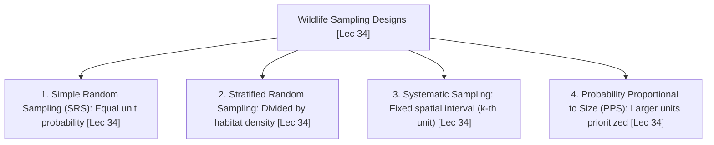
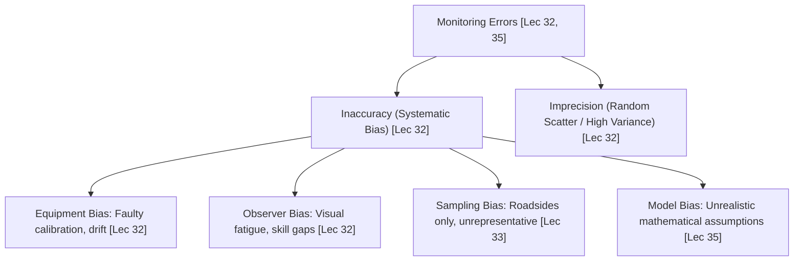
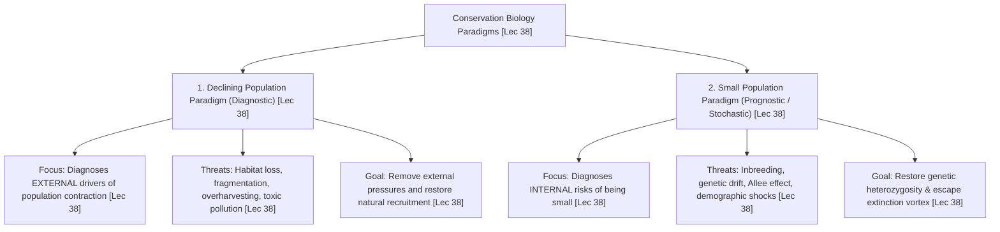
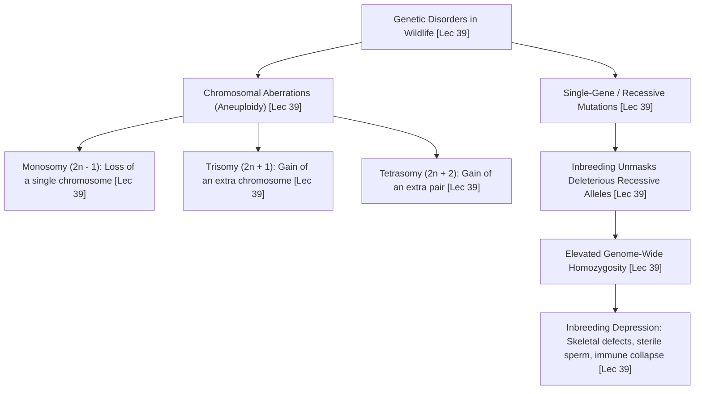
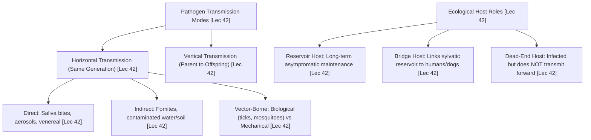
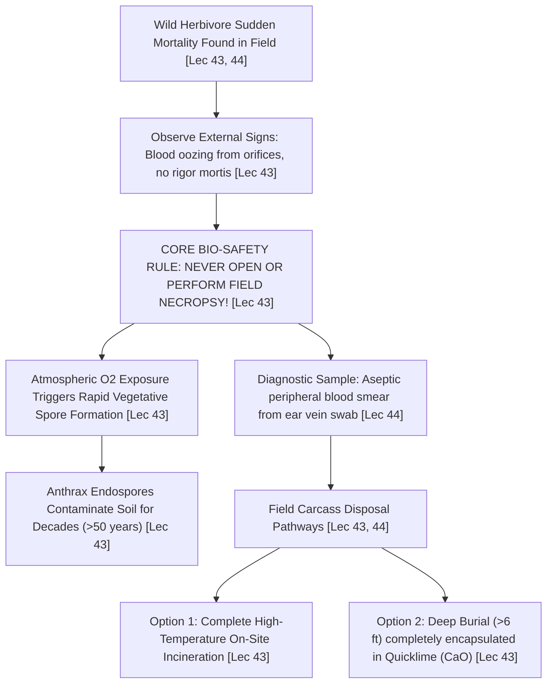

# Part 3: Measuring Biodiversity, Genetics & Wildlife Health (Weeks 07–09)

**Course:** Biodiversity for Sustainability  
**Instructor:** Dr. Ankur Awadhiya, IFS (Indian Forest Service)  
**Curriculum Mapping:** Lectures 31 to 45 (Weeks 7, 8, and 9)  
**Target File:** `textbook/part_3_weeks_07_09.md`  

---

## Comprehensive Table of Contents

### [Week 7: Measuring Biodiversity (Lectures 31–35)](#week-7-measuring-biodiversity)
1. **Lecture-by-Lecture Deep Dive**
   - **Lecture 31:** Do We Need Numbers? Measuring Biodiversity for Conservation Decisions *(Sampling Intensity formula n/N, Simple Random Sampling vs. Systematic Grid Sampling, Stratified Random Sampling for Heterogeneous Landscapes, Probability Proportional to Size [PPS], All India Tiger Estimation [AITE])*
   - **Lecture 32:** Sampling Considerations: Scale, Rare Species, and Observer Bias *(Spatial & Temporal Grain/Extent, Detectability p < 1, Detection Probability Equation E[C] = N * p, Equipment Bias & Double-Blind Protocols, Rare & Cryptic Species Sampling, Environmental DNA [eDNA])*
   - **Lecture 33:** Forest and Vegetational Measurements: Density, Basal Area, and Biomass *(Point Transects vs. Line Transects, Distance Sampling & Half-Normal Detection Function, Circular Plots & Bitterlich Wedge Prisms, Basal Area Formula BA = pi * (DBH/2)^2, Allometric Equations, Non-Destructive Forest Biomass)*
   - **Lecture 34:** Animal Counting Techniques: Line Transects, Camera Traps, and Mark-Recapture *(Biological Population Definition, BIDE Dynamic Balance: N_{t+1} = N_t + B - D + I - E, Closed vs. Open Populations, Lincoln-Petersen Mark-Recapture Estimator N = (M * C) / R with Chapman Small-Sample Correction, Spatially Explicit Capture-Recapture [SECR] & Unique Tiger Stripe Identification)*
   - **Lecture 35:** Indices and Ecological Indicators: Shannon-Wiener, Simpson, and Beyond *(Species Richness S vs. Pielou's Evenness J', Shannon-Wiener Diversity Index H' = - sum p_i ln(p_i), Simpson's Dominance Index D = sum p_i^2 and Gini-Simpson Index 1 - D, Sorenson & Jaccard Community Similarity Coefficients, Ecological Indicator Species [Bioindicators])*
2. **Week 7 Master Reference Tables** *(Unabridged Probability Sampling Matrix, Vegetation & Biomass Metrics, Animal Census & Mark-Recapture Models, Mathematical Biodiversity Indices)*
3. **Official Quiz Breakdown & Trap Analysis** *(Assignment 7: Q1–Q10 Detailed Rationale & Distractor Traps)*

---

### [Week 8: Biodiversity — Genetic Aspects (Lectures 36–40)](#week-8-biodiversity--genetic-aspects)
1. **Lecture-by-Lecture Deep Dive**
   - **Lecture 36:** Foundations of Genetics *(Chromosomes as Long DNA-Protein Structures Carrying Many Genes, Locus & Alleles, Allele Frequency, Genotype vs. Phenotype, Codominance with Full Expression of Both Alleles, Bengal Tiger Coat Color Genetics, Indian Muntjac Chromosomal Evolution)*
   - **Lecture 37:** Genetic Variation: Origin, Maintenance, and Evolutionary Forces *(Mutation as Ultimate Novelty Source, Sexual Recombination, Genetic Drift in Finite Populations, Founder Effect & Allelic Depletion, Gene Flow & Metapopulations, Natural Selection Modes: Directional, Stabilizing, Disruptive, Hardy-Weinberg Equilibrium Conditions)*
   - **Lecture 38:** Population Genetics in Conservation: Inbreeding and Outbreeding *(Heterozygosity H_o vs H_e, Inbreeding Coefficient F, Inbreeding Depression & Expression of Deleterious Recessives, Cheetah Genome Monomorphism, Outbreeding Depression & Disruption of Coadapted Gene Complexes, Genetic Rescue in Florida Panther & Greater Prairie Chicken)*
   - **Lecture 39:** Conservation Genetics: Principles and Management Tools *(Conservation Genetics Definition & Goals, Caughley's Small Population Paradigm vs. Declining Population Paradigm, Franklin's 50/500 Rule & Frankham's 100/1000 Revision, Effective Population Size N_e, Allee Effect Fitness Crash, Pedigree Analysis in Captive Breeding)*
   - **Lecture 40:** Molecular Tools in Biodiversity Conservation *(DNA Extraction Protocols, PCR Thermal Cycling, Sanger Sequencing & Next-Gen Sequencing [NGS], Microsatellites / SSRs for Kinship, Single Nucleotide Polymorphisms [SNPs], Non-Invasive Genetic Sampling [Scat, Hair], Wildlife Forensic Genetics & CITES Seizure Verification)*
2. **Week 8 Master Reference Tables** *(Unabridged Molecular Genetics Foundations, Evolutionary Forces & HW Equilibrium, Conservation Genetics Paradigms & Thresholds, Molecular Marker Diagnostic Suite)*
3. **Official Quiz Breakdown & Trap Analysis** *(Assignment 8: Q1–Q10 Detailed Rationale & Distractor Traps)*

---

### [Week 9: Biodiversity — Health Aspects (Lectures 41–45)](#week-9-biodiversity--health-aspects)
1. **Lecture-by-Lecture Deep Dive**
   - **Lecture 41:** Concepts of Health and Disease in Wildlife *(Wildlife Health Dynamic Definition Across Individual, Population, and Ecosystem Levels, Wildlife Disease Definition, Acute vs. Chronic Clinical Courses, Predisposing vs. Precipitating Factors, Kyasanur Forest Disease [KFD] Tick Dynamics)*
   - **Lecture 42:** Disease Transmission, Host-Pathogen Ecology, and Reservoir Hosts *(The Epidemiological Triad: Host, Agent, Environment, Horizontal vs. Vertical Transmission, Reservoir Hosts vs. Dead-End Hosts, Basic Reproductive Number R_0 & Epidemic Thresholds, Dilution Effect vs. Amplification Effect, Spillover at Forest Edges)*
   - **Lecture 43:** Major Wildlife Diseases: Viral, Bacterial, Fungal, and Parasitic *(Anthrax Bacillary Carcass Management Protocols, Canine Distemper Virus [CDV] in Asiatic Lions, Rinderpest & African Ungulate Collapse, Bat White-Nose Syndrome Pseudogymnoascus destructans, Chytridiomycosis Amphibian Extinctions, Chronic Wasting Disease [CWD] Prions, Avian Botulism at Sambhar Salt Lake)*
   - **Lecture 44:** Non-Infectious Diseases and Environmental Toxicants *(Diclofenac Veterinary Toxicity & Indian Vulture Crash [Gyps bengalensis], Organochlorine Bioamplification & Eggshell Thinning in Raptors, Lead Poisoning from Gunshot Ammunition, Plastic Ingestion Impaction in Marine Turtles & Ungulates, Acid Mine Drainage & Heavy Metal Toxicity)*
   - **Lecture 45:** Disease Management, Surveillance, and the One Health Approach *(Wildlife Disease Surveillance: Passive vs. Active, Biosafety & Post-Mortem Necropsy Protocols, Quarantine, Ring Vaccination, Habitat Sanitization, The One Health Triad: Interconnected Human, Animal, and Environmental Health)*
2. **Week 9 Master Reference Tables** *(Unabridged Wildlife Health Taxonomy, Host-Pathogen Ecological Matrix, Etiological Wildlife Pathogen Roster, Environmental Toxicology & One Health Protocols)*
3. **Official Quiz Breakdown & Trap Analysis** *(Assignment 9: Q1–Q10 Detailed Rationale & Distractor Traps)*

---

# Week 7: Measuring Biodiversity

## 1. Lecture-by-Lecture Deep Dive

### Lecture 31: Do We Need Numbers? Measuring Biodiversity for Conservation Decisions

#### The Core Story & Mental Model
In Lecture 31, Dr. Ankur Awadhiya addresses an essential governance question: *Do we really need numbers in biodiversity conservation?* To a casual observer, counting animals in a dense, impenetrable jungle might seem like an unnecessary academic obsession. After all, if a forest looks green and tigers are occasionally spotted, why waste scarce government funds on complex mathematical censuses? Dr. Awadhiya rejects this complacency. In wildlife conservation, **management without numbers is blind guesswork**. Without reliable quantitative baselines, a protected area manager cannot know whether an endangered rhino population is expanding, stabilizing, or crashing toward extinction; whether an anti-poaching patrol strategy is effective; or whether an expensive habitat intervention is helping or harming wildlife.

However, counting wild animals is fundamentally different from counting livestock in a barn. Free-ranging wildlife is elusive, cryptic, mobile, and actively avoids human observers. A complete head-count (a **total census**) is physically impossible across large landscapes. Therefore, wildlife managers must rely on **Sampling**—measuring a carefully chosen, statistically representative subset of the landscape and using probability theory to estimate the total population with quantified confidence intervals. Dr. Awadhiya introduces the concept of **Sampling Intensity**, which is mathematically formulated as:
$$\text{Sampling Intensity } (f) = \frac{n}{N}$$
where $n$ is the number of sampling units surveyed (e.g., grid cells, transects, or quadrats), and $N$ is the total number of sampling units available across the entire landscape.

The lecture explores four foundational **Probability Sampling Designs**:
1. **Simple Random Sampling (SRS):** Every sampling unit in the total population has an **equal and independent probability of selection**. While mathematically pristine and free from selection bias, SRS can perform poorly in heterogeneous terrain because purely random coordinates may accidentally cluster in one corner of the forest while leaving vast swathes completely unvisited.
2. **Systematic Sampling:** Sampling units are selected at fixed, regular geographic intervals across the landscape following a single random starting point (e.g., establishing a camera trap every $2\text{ km}$ along a grid, or surveying every $k\text{-th}$ forest compartment). This ensures uniform, even spatial coverage across the entire reserve.
3. **Stratified Random Sampling:** The entire heterogeneous landscape is partitioned into mutually exclusive, internally homogeneous sub-populations or ecological "strata" based on prior knowledge (e.g., Stratum 1: high-density alluvial riverine grassland; Stratum 2: medium-density mixed deciduous forest; Stratum 3: low-density rocky plateau). Independent random samples are then drawn from each stratum. Dr. Awadhiya emphasizes that **stratified sampling is indispensable when animal density varies significantly across habitat types**, as it dramatically reduces statistical variance ($\sigma^2$) and boosts the precision of the overall population estimate.
4. **Probability Proportional to Size (PPS) Sampling:** A specialized sampling design where **larger sampling units receive a proportionally higher probability of selection** than smaller units.

#### Spoken Case Studies & Examples Explained
- **All India Tiger Estimation (AITE):** Dr. Awadhiya describes the world's largest wildlife survey: the All India Tiger Estimation conducted every four years by the National Tiger Conservation Authority (NTCA) and the Wildlife Institute of India (WII). Covering over $380,000\text{ km}^2$ of forest terrain across 20 states, surveyors cannot count every tiger directly. The methodology uses **stratified sampling**: dividing forests into landscape strata, walking thousands of line transects to record prey density, and deploying paired camera traps across tens of thousands of square-kilometer grid cells to estimate tiger numbers using spatially explicit capture-recapture (SECR) models. **Exam Takeaway:** Stratified sampling is essential when wildlife density varies across distinct habitat types.
- **The Pitfall of Simple Random Sampling in Swamp Deer Monitoring:** If managers in Kaziranga National Park used simple random sampling to survey the endangered Swamp Deer / Barasingha (*Rucervus duvaucelii*), a random generator might place half the sample plots in elevated woodland ridges where barasingha never occur, while missing the marshy *beels* where the entire population aggregates. By using stratified sampling, surveyors allocate more sampling effort to the wetland stratum, avoiding massive sampling error.
- **Systematic Grid Trapping in Kanha:** Dr. Awadhiya explains how managers in Kanha Tiger Reserve overlay a systematic $2\text{ km} \times 2\text{ km}$ digital grid across the reserve, placing a pair of camera traps in each cell. This guarantees that no territorial male tiger's home range escapes detection.

#### Verbatim Definitions & Etymology Callout
> **Sampling Intensity:** The proportion of the total statistical population or total geographical landscape that is surveyed, mathematically calculated as:
> $$\text{Sampling Intensity } (f) = \frac{n}{N} = \frac{\text{Number of Sample Units Surveyed}}{\text{Total Available Population Units}}$$
>
> **Simple Random Sampling (SRS):** A probability sampling design wherein every individual sampling unit in the total population possesses an exact, equal, and independent probability of being selected.
>
> **Stratified Sampling:** A sampling technique where a heterogeneous landscape or population is divided into non-overlapping, internally homogeneous subgroups (strata)—particularly based on varying habitat quality or wildlife density—with independent samples drawn from each stratum.
>
> **Probability Proportional to Size (PPS) Sampling:** A sampling design where the probability of selecting any given sampling unit is directly proportional to its physical size, area, or demographic weight.

---

### Lecture 32: Sources of Error in Sampling

#### The Core Story & Mental Model
In Lecture 32, Dr. Awadhiya tackles a critical epistemic question: *How trustworthy are the numbers we collect in the field?* In field ecology, no number is ever 100% exact. Every field estimate is surrounded by potential errors. A good wildlife biologist is not someone who claims their estimate is perfect; a good biologist is someone who understands the sources of error, designs surveys to minimize them, and rigorously quantifies the remaining uncertainty.

Dr. Awadhiya establishes the vital scientific distinction between **Accuracy** and **Precision**:
- **Accuracy** refers to how close an estimated measurement is to the true, actual population value ($\mu$).
- **Precision** refers to the repeatability, closeness, or tightness of repeated measurements to one another, irrespective of whether they are close to the true value (governed by variance, $\sigma^2$).
A survey can be highly precise (repeatedly estimating 50 tigers in a valley with very narrow confidence intervals) but completely inaccurate (if the true number of tigers is actually 150, because the cameras were placed only on high ridges).

The lecture dissects the nature of **Bias**. Dr. Awadhiya delivers the formal scientific definition: **Bias is the systematic deviation of an estimator from the true population value**. Unlike random sampling error—which scatters symmetrically around the true mean and can be reduced simply by increasing the sample size ($n$)—bias consistently pulls the estimate in one fixed direction (either chronic overestimation or chronic underestimation). Increasing your sample size in a biased study does not fix the error; it merely gives you high confidence in a wrong answer!

Dr. Awadhiya categorizes the primary **Sources of Bias in Wildlife Surveys**:
1. **Equipment Bias:** Systematic measurement distortions caused by physical flaws, faulty calibration, electronic drift, or degradation of a measuring instrument. For example:
   - A laser rangefinder that is improperly calibrated, systematically recording animal distances as $10\text{ meters}$ shorter than reality.
   - A spring balance that has lost its elasticity, consistently underestimating the body weight of captured animals.
   - Camera traps with slow passive infrared (PIR) trigger speeds, failing to capture fast-running carnivores.
2. **Observer Bias:** Systematic errors introduced by the human surveyor's subjective perception, skill level, visual acuity, fatigue, or preconceptions. For example, inexperienced observers undercounting birds in dense canopy, or overestimating the size of deer herds due to counting excitement.
3. **Terrain / Habitat Bias:** Unequal detectability of animals across different structural environments. Animals in open savanna grasslands are easily spotted at 200 meters, whereas animals in dense bamboo thickets remain invisible at 10 meters. If a biologist uses raw counts without correcting for visibility differences, they will falsely conclude that savannas have higher density than bamboo forests.
4. **Model / Assumption Bias:** Errors introduced when the mathematical assumptions of an estimator are violated in the field (e.g., assuming a population is closed when animals are actively emigrating).

#### Spoken Case Studies & Examples Explained
- **Equipment Bias in Laser Rangefinders during Distance Sampling:** Dr. Awadhiya explains how distance sampling on line transects relies heavily on measuring the exact perpendicular distance from the transect line to the detected animal using an optical laser rangefinder. If a ranger drops the rangefinder and its internal optical calibration shifts, consistently recording every distance as $15\%$ shorter than reality, the software's detection probability curve will narrow artificially, and the final mathematical model will **systematically overestimate animal density**. **Exam Takeaway:** Equipment bias is defined precisely by faulty calibration or physical malfunction of a measuring device.
- **The Historical Pugmark Census Controversy in India:** For decades, Indian forest departments counted tigers using the "Pugmark Census Technique"—tracking plaster casts and tracings of tiger paw-prints (pugmarks) on glass tiger-tracers. The method assumed that every individual tiger's left hind pugmark was uniquely distinguishable by eye, like a human fingerprint. However, extensive scientific experiments conducted by Dr. K. Ullas Karanth revealed immense **observer bias**: different forest rangers tracing the exact same pugmark in different soil substrates produced wildly different tracings, and independent experts given the same casts could not agree on whether they represented two tigers or ten tigers! The method suffered severe systematic bias and was officially replaced by scientific camera-trapping.
- **Double-Counting Bias Along Road Transects:** When survey vehicles drive along dirt roads to count ungulates, bold animals that feed on roadside grassy verges are repeatedly counted, while shy, forest-interior specialists are systematically missed, introducing profound spatial habitat bias.

#### Verbatim Definitions & Etymology Callout
> **Accuracy:** The degree of closeness or proximity between a sample estimate and the true, actual population parameter being measured.
>
> **Precision:** The degree of mutual agreement, tightness, or repeatability among independent measurements of the same quantity under identical conditions, inversely related to statistical variance ($\sigma^2$).
>
> **Bias:** The **systematic deviation** of a statistical sample estimate or measurement from the true population parameter, which cannot be eliminated by merely increasing sample size.
>
> **Equipment Bias:** Systematic measurement distortion introduced into field data by the physical defect, mechanical wear, or **faulty calibration of a measuring instrument or device**.
>
> **Observer Bias:** Systematic error resulting from individual variations in human observer perception, visual/auditory acuity, field experience, or subjective recording tendencies.

---

### Lecture 33: Wildlife Census: Applications & Conservation Decision Making

#### The Core Story & Mental Model
In Lecture 33, Dr. Awadhiya explores how wildlife abundance is determined in practice through **Wildlife Censuses and Modern Photographic Capture-Recapture**. A foundational rule of field ecology is understanding the strict difference between a **Total Census** and a **Sample Count**:
- A **Total Census** is the complete, direct, 100% enumeration of every single individual living within a defined boundary at a specific point in time. It requires that no individuals are missed and none are double-counted. In the wild, total censuses are extraordinarily rare and practically feasible only for large, conspicuous species inhabiting open, highly visible terrains (e.g., direct total counts of Greater One-horned Rhinos in the open floodplains of Kaziranga, or counting breeding colonies of colonial seabirds on cliff faces).
- A **Sample Count** estimates the population by systematically surveying a fraction of the landscape and mathematically scaling the count using an estimated detection probability.

For cryptic, low-density, territorial carnivores—such as tigers (*Panthera tigris*), leopards (*Panthera pardus*), and snow leopards (*Panthera uncia*)—neither total censuses nor direct visual counts work. These animals are nocturnal, solitary, and inhabit dense jungles or rugged mountains. Wildlife managers therefore deploy **Camera Traps**—automated weatherproof digital cameras triggered by passive infrared (PIR) heat-and-motion sensors, mounted on trees along animal trails, fire lines, and scent-marking trees.

The revolutionary scientific breakthrough that makes camera trapping rigorous is **Individual Identification by Unique Natural Pelage Markings**. Dr. Awadhiya explains that just as human beings possess unique, unalterable friction ridge skin patterns on their fingers (fingerprints), individual tigers possess **unique, asymmetrical stripe patterns** on their flanks and faces. No two tigers in the world have the same stripe arrangement, and the left flank of a tiger has a completely different stripe pattern from its right flank! By setting paired camera traps (photographing both the left and right flanks of a passing tiger simultaneously), biologists can conclusively identify every individual tiger, compiling a lifetime capture history ($1$ if photographed, $0$ if not) for every animal in the reserve.

To translate these photographic capture histories into an absolute population estimate ($N$), biologists use **Capture-Mark-Recapture (CMR)** models, originating from the classic **Lincoln-Petersen Index**:
$$N = \frac{M \times C}{R}$$
where:
- $M$ = Number of individual animals marked (photographed and identified) during the first sampling occasion.
- $C$ = Total number of animals captured (photographed) during the second sampling occasion.
- $R$ = Number of marked animals recaptured (photographed again) during the second occasion.

The mathematical logic is built on simple proportions: the proportion of marked animals in the second sample ($R / C$) must equal the proportion of marked animals in the total population ($M / N$).

#### Spoken Case Studies & Examples Explained
- **Tiger Identification by Flank Stripe Patterns:** Dr. Awadhiya details how specialized computer software (such as ExtractCompare and StripeSpotter) maps the three-dimensional geometric contours of a tiger's dark vertical stripes against its orange coat. In reserves across India, software maintains digital "stripe databases." When a newly photographed tiger matches a profile in the database, its location is added to its territorial capture history. If the stripe pattern does not match any existing record, it is entered as a newly recruited individual. **Exam Takeaway:** In camera-trap based tiger estimation, individual tigers are identified specifically by their **unique stripe patterns**.
- **The Lincoln-Petersen Mathematical Example:** Dr. Awadhiya provides a concrete numerical calculation: A wildlife team captures and ear-tags 50 spotted deer in a forest sanctuary ($M = 50$). A month later, they return and capture a second sample of 40 deer ($C = 40$). Upon checking the 40 deer, they find that 10 individuals are carrying ear-tags from the first capture ($R = 10$). Applying the formula:
  $$N = \frac{50 \times 40}{10} = 200 \text{ deer}$$
  The total population estimate is 200 deer.
- **Rosette Patterns in Leopards and Jaguars:** The professor explains that the same capture-recapture principles apply to leopards (*Panthera pardus*) and jaguars (*Panthera onca*) using their **rosette spot clusters**, to cheetahs (*Acinonyx jubatus*) using their solid spot arrangements, and to humpback whales using the unique serration patterns and scarring on the underside of their tail flukes.

#### Verbatim Definitions & Etymology Callout
> **Total Census:** An absolute, exhaustive enumeration of every single individual organism present within a defined geographic boundary at a given time ($C = N$), requiring zero detection error ($p = 1.0$).
>
> **Camera Trapping:** A non-invasive wildlife survey methodology utilizing automated cameras triggered by passive infrared (PIR) heat-and-motion sensors to record the presence, identity, and behavior of wild animals.
>
> **The Lincoln-Petersen Index:** The foundational two-sample mark-recapture estimator for closed populations:
> $$N = \frac{M \times C}{R}$$
>
> **Unique Natural Markings:** Stable, individual-specific phenotypic markings—such as **stripe patterns in tigers**, rosette patterns in leopards, or fluke scars in whales—that serve as permanent non-invasive biological identifiers.

---

### Lecture 34: Wildlife Sampling: Conceptual Foundations & Techniques

#### The Core Story & Mental Model
In Lecture 34, Dr. Awadhiya bridges theoretical sampling design and field execution by examining the practical mechanics of **Field Sampling Techniques for Terrestrial Wildlife**. He explores how field ecologists select sampling units, deploy physical sampling frames, and control spatial sampling intensity to maximize precision while working within limited field budgets and rugged terrain.

The lecture conducts a comparative analysis of primary field sampling units:
1. **Plot / Quadrat Sampling:** Physical frames or demarcated geometric boundaries (squares, rectangles, circles) placed across the landscape to sample sessile organisms (plants, trees) or slow-moving animals (snails, dung beetles). Quadrat size must match the scale of the organism: $1\text{ m} \times 1\text{ m}$ frames for herbaceous understory vegetation, $5\text{ m} \times 5\text{ m}$ plots for shrubs and saplings, and $20\text{ m} \times 20\text{ m}$ or $0.1\text{ ha}$ quadrats for mature canopy trees.
2. **Point Counts:** An observer stands at a geo-referenced point station for a standardized duration (e.g., 5 to 10 minutes), recording all animals seen or heard within a fixed or open radius. Point counts are the international gold standard for surveying birds and vocalizing primates in dense tropical rainforest canopies where walking transects creates too much rustling noise.
3. **Strip Transects:** An observer walks, drives, or flies along a predetermined line of length $L$, recording all animals detected within a predetermined fixed strip width ($W$) on either side of the line. The effective surveyed area is simply $A = 2 \times L \times W$. The fatal limitation of strip transects is its unrealistic assumption: it assumes that **100% of all animals within the strip are detected with certainty ($p = 1.0$)**, which is almost never true in dense forest terrain.

Dr. Awadhiya then revisits **Probability Proportional to Size (PPS) Sampling**. In many regional wildlife surveys, administrative forest beats or village resource blocks vary dramatically in physical size—one beat might be 500 hectares, while an adjacent mountain beat is 10,000 hectares. If an ecologist uses simple random sampling, every beat has the same probability of selection, meaning small, marginal beats are oversampled while vast, ecologically dominant tracts are neglected. Under **PPS sampling**, **larger sampling units receive a proportionally higher probability of selection**, ensuring that sampling effort scales proportionally with physical habitat area and ecological importance.

#### Spoken Case Studies & Examples Explained
- **Point Count Sampling for Avian Diversity in the Western Ghats:** Dr. Awadhiya illustrates the deployment of point count stations along elevation gradients in the Silent Valley National Park. Observers arrive at designated coordinates before sunrise, wait 2 minutes for birds to resume normal activity following human approach, and then record all bird calls for 10 minutes. This technique successfully detects cryptic, canopy-dwelling endemic species (like the Malabar Trogon and Nilgiri Laughingthrush) that are never seen from ground-level paths.
- **Quadrat Size Selection in Sal Forests:** The professor explains the disaster of using improperly sized quadrats. If a researcher uses a $1\text{ m} \times 1\text{ m}$ quadrat to measure tiger prey trees (like Sal, *Shorea robusta*), most quadrats contain zero trees, yielding an absurd variance ($\sigma^2$). By enlarging the quadrat to $20\text{ m} \times 20\text{ m}$, every quadrat captures representative tree stems, stabilizing statistical confidence.
- **PPS Sampling in Village Resource Allocation:** In community-based forest management, large tribal village forests containing thousands of hectares receive a proportionally higher selection probability in state-wide surveys than small urban village woodlots, ensuring that forest policy reflects the realities of the largest landscapes. **Exam Takeaway:** PPS sampling means larger units have a higher probability of selection.

#### Verbatim Definitions & Etymology Callout
> **Quadrat (Plot) Sampling:** A sampling unit defined by a demarcated area (square, rectangular, or circular) of standardized dimensions, placed across a landscape to quantify the abundance, density, or cover of organisms.
>
> **Point Count:** An ecological census technique wherein a stationary observer records all individual organisms detected visually or acoustically within a standardized time window from a fixed observation station.
>
> **Strip Transect:** A continuous linear survey corridor of predetermined length ($L$) and fixed width ($W$) wherein an observer moves along the centerline assuming all target organisms within the corridor are detected with complete certainty ($p = 1.0$).
>
> **PPS Sampling Rationale:** A statistical strategy designed to allocate sampling effort efficiently across unequal-sized units by assigning selection probabilities proportional to unit size ($p_i \propto \text{Size}_i$).

---

### Lecture 35: Distance Sampling and Transects (Population Dynamics & The BIDE Model)

#### The Core Story & Mental Model
In Lecture 35, Dr. Awadhiya explores the crown jewel of modern field monitoring: **Distance Sampling**, and connects field numbers to the fundamental drivers of **Population Dynamics**.

Distance sampling, developed by David T. Buckland and colleagues, was invented to overcome the fatal flaw of traditional strip transects: the unrealistic assumption that all animals in a survey strip are seen. In the real world, **detection probability decreases as distance from the observer increases**. An animal standing directly on the transect line is almost certainly seen, but an animal standing 50 meters away behind a bamboo clump has a high chance of being missed.

In **Line Transect Distance Sampling**, an observer walks along a straight, surveyed line of length $L$, carrying a compass and laser rangefinder. When an animal or group of animals is spotted, the observer records two crucial measurements: the direct radial distance ($r$) from the observer to the animal, and the sighting angle ($\theta$) between the transect line and the animal. From these, simple trigonometry yields the **perpendicular distance ($x$)**:
$$x = r \times \sin(\theta)$$

By compiling hundreds of perpendicular distances, specialized distance sampling software (such as **Program DISTANCE**) models the **Detection Function, $g(x)$**—a declining curve representing the probability of detecting an animal given that it is at perpendicular distance $x$ from the line. The foundational assumption of distance sampling is **$g(0) = 1.0$**—meaning that all animals standing directly on the centerline of the transect are detected with $100\%$ certainty. The software integrates the detection function to calculate the **Effective Strip Half-Width ($\mu$ or $ESW$)**, transforming a messy, imperfect field survey into an unbiased, statistically rigorous animal density estimate ($D$):
$$\hat{D} = \frac{n}{2 \times L \times \hat{ESW}}$$

Dr. Awadhiya then transitions to the demographic heartbeat of conservation: **Population Dynamics**. He begins by establishing the rigorous biological definition of a **Population**: **a group of individuals of the same species living within a defined geographical area that are capable of interbreeding and producing fertile offspring**.

The numerical size of any wildlife population across time ($N_t \rightarrow N_{t+1}$) is governed by exactly four fundamental demographic parameters, encapsulated in the universal **BIDE Equation**:
$$N_{t+1} = N_t + B + I - D - E$$
- **Population Gains (Inputs):** **Births (Natality, $B$)** and **Immigration ($I$)** (individuals moving into the population from outside).
- **Population Losses (Outputs):** **Deaths (Mortality, $D$)** and **Emigration ($E$)** (individuals permanently leaving the population).

If Gains exceed Losses ($(B + I) > (D + E)$), the population expands; if Losses exceed Gains ($(D + E) > (B + I)$), the population enters a decline. Managing a wildlife population is essentially the science of managing these four BIDE demographic levers.

#### Spoken Case Studies & Examples Explained
- **Distance Sampling of Ungulates in Bandipur Tiger Reserve:** Dr. Awadhiya details how line transects are walked at dawn by paired forest staff across Bandipur. Observers walk 2-kilometer transects at a steady pace of $1.5\text{ km/h}$, recording perpendicular distances to herds of Chital (*Axis axis*), Sambar (*Rusa unicolor*), and Gaur (*Bos gaurus*). The resulting detection curves show that Chital in open woodland have an $ESW$ of 45 meters, while Sambar in dense bamboo thickets have an $ESW$ of only 18 meters. By calculating separate $ESW$ values, managers obtain true, unbiased density estimates for each prey species, determining how many tigers the prey base can support. **Exam Takeaway:** Distance sampling uses perpendicular distances to correct for imperfect detection away from the centerline.
- **The BIDE Equation in the Sariska Tiger Reintroduction:** In 2004, poachers completely exterminated the entire tiger population of Sariska Tiger Reserve in Rajasthan ($D$ wiped out $N$). In 2008, the Indian government initiated a historic reintroduction by physically translocating tigers from Ranthambore into Sariska. Because Sariska was an isolated habitat island, natural immigration was impossible ($I = 0$). The translocation functioned as artificial **Immigration ($I$)**. Once translocated, managers focused entirely on minimizing mortality ($D$) through armed anti-poaching patrols and village relocation, allowing natural births ($B$) to take over and rebuild the population. **Exam Takeaway:** Population gains consist strictly of births and immigration; population losses consist strictly of mortality and emigration.
- **Pika Population Fluctuation in the Himalayas:** Dr. Awadhiya illustrates demographic accounting in high-altitude Himalayan Pikas (*Ochotona roylei*). During harsh winters, freezing temperatures and snowpack freeze food caches, causing mortality ($D$) to skyrocket, while emigration ($E$) is blocked by rocky glaciers. Population persistence depends entirely on whether summer natality ($B$) can compensate for winter mortality losses.

#### Verbatim Definitions & Etymology Callout
> **Population (Biological Definition):** An assemblage of individuals belonging to the **same species** co-occurring within a defined geographic space and time that are **capable of interbreeding**.
>
> **The BIDE Model of Population Dynamics:** The fundamental demographic mass-balance equation:
> $$N_{t+1} = N_t + B + I - D - E$$
> - **Gains to Population:** **Births (Natality) and Immigration** ($B + I$)
> - **Losses from Population:** **Mortality (Deaths) and Emigration** ($D + E$)
>
> **Distance Sampling:** An advanced quantitative methodology that estimates animal density by modeling a detection function ($g(x)$) from measured perpendicular distances to detected organisms, correcting for the reality that detectability decreases with distance.
>
> **Effective Strip Width ($ESW$):** The distance from the transect line at which the number of undetected animals closer than $ESW$ equals the number of detected animals beyond $ESW$.

---

## 2. Week 7 Master Reference Tables

## 1. High-Yield Terminological & Definitional Matrix

| Citation | Term / Concept | Operational Scientific Definition | Exam Archetype | Exam Question Tag |
| :--- | :--- | :--- | :--- | :--- |
| `[Lec 31]` | **Population in Wildlife Studies** | Individuals of the same biological species occupying a defined geographical area that are capable of naturally interbreeding. | Forward Definition | `[TESTED - 30% REPEAT POOL]` (W7-Q7) |
| `[Lec 31]` | **Population Gains Pair** | The two demographic mechanisms that increase population size: **Births (Natality)** and **Immigration ($B + I$)**. | Set Pair | `[TESTED - 30% REPEAT POOL]` (W7-Q8) |
| `[Lec 31]` | **Population Losses Pair** | The two demographic mechanisms that decrease population size: **Deaths (Mortality)** and **Emigration ($D + E$)**. | Set Pair | `[TESTED - 30% REPEAT POOL]` (W7-Q6) |
| `[Lec 31]` | **Absolute vs. Relative Abundance** | Absolute: total number of individual organisms in an area; Relative: an index or proxy metric of abundance (e.g., encounter rate, dung piles/km) used to track temporal trends. | Contrastive Pair | `[UNSEEN HIGH-YIELD - 70% FINAL POOL]` |
| `[Lec 32]` | **Accuracy (Correctness)** | The closeness of a measured or estimated value to the actual, true underlying population parameter. | Forward Definition | `[UNSEEN HIGH-YIELD - 70% FINAL POOL]` |
| `[Lec 32]` | **Precision (Repeatability)** | The degree of mutual agreement, closeness, or clustering among repeated independent measurements of the same quantity under identical conditions. | Forward Definition | `[UNSEEN HIGH-YIELD - 70% FINAL POOL]` |
| `[Lec 32]` | **Systematic Bias** | Consistent directional deviation of a sample estimate from the true population value caused by flawed equipment, unrepresentative design, or observer error. | Forward Definition | `[TESTED - 30% REPEAT POOL]` (W7-Q4) |
| `[Lec 32]` | **Equipment Bias** | Systematic distortion in data collection resulting directly from the physical failure, drift, or faulty calibration of a measuring instrument. | Reverse Definition | `[TESTED - 30% REPEAT POOL]` (W7-Q3) |
| `[Lec 32]` | **Observer Bias** | Systematic differences in detection, counting, or measurement caused by variations in observer visual acuity, field experience, alertness, or search speed. | Reverse Definition | `[UNSEEN HIGH-YIELD - 70% FINAL POOL]` |
| `[Lec 32]` | **Sampling Intensity Formula** | The ratio of the number of sample units surveyed ($n$) to the total population units existing in the defined study area ($N$): $\text{Sampling Intensity} = n / N$. | Exact Formula | `[TESTED - 30% REPEAT POOL]` (W7-Q10) |
| `[Lec 33]` | **Tiger Camera-Trap Identification** | Methodology using remote sensor camera traps to identify individual Bengal tigers based on their unique, lifelong, asymmetrical flank stripe patterns. | Applied Survey | `[TESTED - 30% REPEAT POOL]` (W7-Q5) |
| `[Lec 33]` | **Passive Acoustic Monitoring (PAM)** | Continuous recording of underwater or terrestrial soundscapes using automated hydrophones/recorders to detect vocalizations of deep-diving cetaceans, bats, or birds. | Field Protocol | `[UNSEEN HIGH-YIELD - 70% FINAL POOL]` |
| `[Lec 33]` | **Pugmark Census Method** | Historical Indian forestry tracking protocol recording plaster casts or tracings of the left-hind pugmark on Pugmark Impression Pads (PIPs) to estimate carnivore numbers. | Field Method | `[UNSEEN HIGH-YIELD - 70% FINAL POOL]` |
| `[Lec 34]` | **Simple Random Sampling (SRS)** | Probability sampling design where every sampling unit in the target population has an equal, non-zero, and independent probability of being selected ($1/N$). | Forward Definition | `[TESTED - 30% REPEAT POOL]` (W7-Q1) |
| `[Lec 34]` | **Stratified Random Sampling** | Sampling design partitioning a heterogeneous landscape into non-overlapping homogeneous strata (e.g., habitat types); applied when animal density varies across habitats. | Applied Design | `[TESTED - 30% REPEAT POOL]` (W7-Q2) |
| `[Lec 34]` | **Probability Proportional to Size (PPS)** | Sampling design where larger sampling units (by geographical area, biomass, or volume) have a proportionally higher mathematical probability of being selected. | Forward Definition | `[TESTED - 30% REPEAT POOL]` (W7-Q9) |
| `[Lec 34]` | **Systematic Sampling** | Selection of sampling units at regular spatial or temporal intervals ($k^{\text{th}}$ unit) along transects or grids; vulnerable to hidden landscape periodicity. | Applied Design | `[UNSEEN HIGH-YIELD - 70% FINAL POOL]` |
| `[Lec 34]` | **Pan Trapping for Pollinators** | Standardized insect survey using shallow bowls painted in UV-reflective primary colors (yellow, blue, white) filled with soapy water placed at surrounding vegetation height. | Invertebrate Gear | `[UNSEEN HIGH-YIELD - 70% FINAL POOL]` |
| `[Lec 34]` | **Lincoln-Petersen Capture-Recapture** | Classical two-sample estimator for closed populations based on the proportion of marked animals recaptured in a subsequent trapping session: $N = (M \cdot n) / m$. | Mathematical Model | `[UNSEEN HIGH-YIELD - 70% FINAL POOL]` |
| `[Lec 35]` | **Distance Sampling (Line Transect)** | Density estimation method that models the detection probability function $g(y)$ as a decreasing function of perpendicular distance $y$ from the surveyed centerline. | Statistical Model | `[UNSEEN HIGH-YIELD - 70% FINAL POOL]` |
| `[Lec 35]` | **Zero Distance Detection Assumption: $g(0) = 1$** | Fundamental premise of distance sampling: all individual animals located directly on the centerline transect ($y = 0$) are detected with absolute $100\%$ certainty. | Critical Assumption | `[UNSEEN HIGH-YIELD - 70% FINAL POOL]` |
| `[Lec 35]` | **Effective Strip Half-Width ($\mu$ / ESHW)** | The perpendicular distance from a transect line such that the number of animals missed within $\mu$ equals the number detected beyond $\mu$: $\mu = \int_0^w g(y)\,dy$. | Quantitative Metric | `[UNSEEN HIGH-YIELD - 70% FINAL POOL]` |
| `[Lec 35]` | **Akaike Information Criterion (AIC)** | An information-theoretic statistical metric used in distance sampling to select the most parsimonious detection function model by balancing goodness-of-fit against parameters. | Model Metric | `[UNSEEN HIGH-YIELD - 70% FINAL POOL]` |

---

## 2. Core Quantitative Formulas & Mathematical Models

### 2.1 Basic Population Balancing Equation
$$\mathbf{N_{t+1} = N_t + (B + I) - (D + E)}$$
* `[Lec 31]` $N_{t+1}$ = Population size at time step $t+1$.
* `[Lec 31]` $N_t$ = Initial population size at time step $t$.
* `[Lec 31]` **Gains $\mathbf{(B + I)}$:** Births / Natality ($B$) and In-migration / Immigration ($I$) `[TESTED - 30% REPEAT POOL]` (W7-Q8).
* `[Lec 31]` **Losses $\mathbf{(D + E)}$:** Deaths / Mortality ($D$) and Out-migration / Emigration ($E$) `[TESTED - 30% REPEAT POOL]` (W7-Q6).

### 2.2 Sampling Intensity Formula
$$\mathbf{\text{Sampling Intensity}} = \frac{\mathbf{\text{Sample Units surveyed } (n)}}{\mathbf{\text{Total Population Units in universe } (N)}}$$
* `[Lec 32, 34]` Expresses the surveyed proportion of the target landscape or total administrative compartments `[TESTED - 30% REPEAT POOL]` (W7-Q10).

### 2.3 Lincoln-Petersen Capture-Recapture Index
$$\frac{\mathbf{M}}{\mathbf{N}} = \frac{\mathbf{m}}{\mathbf{n}} \implies \mathbf{N = \frac{M \cdot n}{m}}$$
* `[Lec 34]` $M$ = Number of individuals captured, marked, and released in Session 1.
* `[Lec 34]` $n$ = Total number of individuals (both marked and unmarked) captured in Session 2.
* `[Lec 34]` $m$ = Number of marked individuals recaptured in Session 2.
* `[Lec 34]` $N$ = Estimated total population size.
* `[Lec 34]` **Three Inviolate Assumptions:** (1) The population is demographically closed (no births, deaths, immigration, emigration); (2) Marks are neither lost nor overlooked; (3) Marked and unmarked individuals exhibit **equal catchability** `[UNSEEN HIGH-YIELD - 70% FINAL POOL]`.

### 2.4 Distance Sampling Wildlife Density Estimator
$$\mathbf{\hat{D} = \frac{n}{2 \cdot L \cdot \mu}}$$
* `[Lec 35]` $\hat{D}$ = Estimated animal density per unit area.
* `[Lec 35]` $n$ = Number of animals detected from the transect line.
* `[Lec 35]` $L$ = Total cumulative length of the surveyed line transect.
* `[Lec 35]` $\mu$ = Effective Strip Half-Width: $\mu = \int_0^w g(y)\,dy$.
* `[Lec 35]` $w$ = Truncation distance (maximum perpendicular distance recorded) `[UNSEEN HIGH-YIELD - 70% FINAL POOL]`.

---

## 3. Four Probability Sampling Designs Comparative Matrix (Lecture 34)



| Citation | Sampling Design | Mathematical Selection Rule | Primary Field Use Condition | Major Field Risk / Advantage |
| :--- | :--- | :--- | :--- | :--- |
| `[Lec 34]` | **Simple Random Sampling (SRS)** | Every sampling unit has an identical probability: $P(i) = 1/N$ `[TESTED - 30% REPEAT POOL]` (W7-Q1). | Homogeneous landscapes where animal distribution is uniform and terrain is easily accessible. | Advantage: Completely unbiased; Risk: Can cluster units randomly, leaving large remote sectors entirely unvisited. |
| `[Lec 34]` | **Stratified Random Sampling** | Landscape divided into mutually exclusive strata; units sampled randomly within each stratum `[TESTED - 30% REPEAT POOL]` (W7-Q2). | **Heterogeneous landscapes where animal density varies sharply across habitat types** (e.g., riparian vs. dry scrub). | Advantage: Substantially lowers overall estimate variance; ensures rare habitats are adequately sampled. |
| `[Lec 34]` | **Systematic Sampling** | First unit selected randomly; subsequent units chosen at a fixed regular spacing ($k = N/n$). | Linear surveys along logging trails, transect lines, or regular compass grid points. | Risk: **Periodic alignment trap** — if interval matches a repeating environmental feature (e.g., parallel ridges), estimates become severely biased `[UNSEEN HIGH-YIELD - 70% FINAL POOL]`. |
| `[Lec 34]` | **Probability Proportional to Size (PPS)** | Unit selection probability is directly proportional to its auxiliary size metric: $P(i) \propto \text{Size}_i$ `[TESTED - 30% REPEAT POOL]` (W7-Q9). | Watersheds, forest compartments, or lakes of vastly unequal geographical area or biomass. | Advantage: Prevents tiny fragments from having the same sampling weight as massive continuous forest blocks. |

---

## 4. Sources of Bias & Errors in Ecological Monitoring



* `[Lec 32]` **Accuracy vs. Precision Independence:** A survey method can be **highly precise but completely inaccurate** (e.g., an uncalibrated rangefinder yielding identical but systematically shifted distances) `[UNSEEN HIGH-YIELD - 70% FINAL POOL]`.
* `[Lec 32]` **Equipment Bias:** Defective instruments, miscalibrated GPS units, faulty laser rangefinders, or misaligned camera-trap PIR motion sensors `[TESTED - 30% REPEAT POOL]` (W7-Q3).
* `[Lec 32]` **Observer Bias:** Individual differences in visual acuity, hearing thresholds, species identification confidence, and fatigue. Mitigated by joint calibration walks and blind double-observer protocols `[UNSEEN HIGH-YIELD - 70% FINAL POOL]`.
* `[Lec 33]` **Convenience / Access Bias:** Placing transects exclusively along paved safari tracks and roadsides; over-represents disturbance-tolerant generalists and omits deep interior specialists `[UNSEEN HIGH-YIELD - 70% FINAL POOL]`.
* `[Lec 35]` **Visibility Bias in Distance Sampling:** Dense vegetative cover, fog, or steep terrain suppresses the detection curve $g(y)$ faster than in open grasslands; distance sampling corrects for this by estimating effective strip width per habitat `[UNSEEN HIGH-YIELD - 70% FINAL POOL]`.

---

## 5. Applied Wildlife Census Methodologies & Species Case Studies

| Citation | Survey Method | Target Wildlife Taxa | Operational Field Protocol & Scientific Metric | Conservation Application & Institutional Context |
| :--- | :--- | :--- | :--- | :--- |
| `[Lec 33]` | **Camera Trapping Capture-Recapture** | Bengal Tiger (*Panthera tigris*), Common Leopard (*Panthera pardus*) | Motion-triggered paired camera traps deployed on trails; captures left and right flank stripe/rosette patterns `[TESTED - 30% REPEAT POOL]` (W7-Q5). | National Tiger Conservation Authority (NTCA) All-India Tiger Estimation; generates spatially explicit capture-recapture (SECR) density estimates. |
| `[Lec 33]` | **Pugmark Census Method (PIP)** | Large Felids (Tigers, Leopards) | Tracking tracks on prepared soft-earth Pugmark Impression Pads; measurements taken of total length, width, and stride. | Historical Indian Forest Service method; largely superseded by camera trapping due to high observer bias across soil substrates `[UNSEEN HIGH-YIELD - 70% FINAL POOL]`. |
| `[Lec 33]` | **Dung / Pellet Group Counting** | Asian Elephant (*Elephas maximus*), Spotted Deer (*Axis axis*) | Line transects counting dung piles; requires calculating the daily defecation rate ($D$) and dung decay/disappearance rate ($r$). | Enables non-invasive density estimation in dense tropical rainforests where animals are rarely seen; fresh dung yields fecal DNA for microsatellites `[UNSEEN HIGH-YIELD - 70% FINAL POOL]`. |
| `[Lec 33]` | **Passive Acoustic Monitoring (PAM)** | Cetaceans (Whales, Dolphins), Bats (Microchiroptera) | Submerged moored hydrophones recording ultrasonic echolocation clicks and mating songs continuously. | Surveys deep-diving pelagic species that surface only briefly; monitors noise pollution impacts from shipping corridors `[UNSEEN HIGH-YIELD - 70% FINAL POOL]`. |
| `[Lec 33]` | **Satellite Earth Observation** | Mangrove Forest Canopies (*Rhizophora*, *Avicennia*) | Landsat, Sentinel-2 remote sensing; multispectral NDVI mapping across Sundarbans, Mahanadi Delta, and Andaman Islands. | Detects large-scale canopy dieback, illegal coastal embankment construction, and tracks coastal carbon stocks `[UNSEEN HIGH-YIELD - 70% FINAL POOL]`. |
| `[Lec 34]` | **Coloured Pan Traps** | Wild Pollinators (Hymenoptera, Diptera) | Shallow yellow, blue, and white plastic bowls with $1\%$ unscented surfactant soap water, elevated to inflorescence height. | Passive, standardized entomological sampling for assessing wild bee abundance and crop pollination security `[UNSEEN HIGH-YIELD - 70% FINAL POOL]`. |
| `[Lec 35]` | **Line Transect Distance Sampling** | Ungulate Communities (Chital, Sambar, Nilgai) | Observers walk straight cut-lines recording sighting distance ($r$) and sighting angle ($\theta$); perpendicular distance $y = r \cdot \sin(\theta)$. | Generates detection curves $g(y)$ via program DISTANCE; standard protocol for herbivore prey density estimation in tiger reserves `[UNSEEN HIGH-YIELD - 70% FINAL POOL]`. |

---

## 6. Contrastive Paradigms & Distractor Diagnostic Traps

* `[Lec 31]` **Gains vs. Losses Set Traps:**
  * *Gains:* **Births and Immigration** `[TESTED - 30% REPEAT POOL]` (W7-Q8).
  * *Losses:* **Mortality and Emigration** `[TESTED - 30% REPEAT POOL]` (W7-Q6).
  * *Distractors:* Frequently pair one gain with one loss (*"Births and deaths"* or *"Immigration and emigration"*) to trap students who do not read both items in the pair.
* `[Lec 32]` **Accuracy vs. Precision Trap:**
  * *Accuracy:* How close the estimate is to the **true population value** `[UNSEEN HIGH-YIELD - 70% FINAL POOL]`.
  * *Precision:* Closeness of **repeated measurements to each other** (low variance).
  * *Distractor Definition of Bias:* Claims bias is *"random scatter around a true value"* (which is random error!); correct definition is **systematic deviation from the true value** `[TESTED - 30% REPEAT POOL]` (W7-Q4).
* `[Lec 34]` **Sampling Design Selection Traps:**
  * *Simple Random Sampling:* **Every unit has an equal chance** `[TESTED - 30% REPEAT POOL]` (W7-Q1).
  * *Stratified Sampling:* Used specifically when **density varies across habitat types** `[TESTED - 30% REPEAT POOL]` (W7-Q2).
  * *PPS Sampling:* **Larger units receive a higher chance of selection** `[TESTED - 30% REPEAT POOL]` (W7-Q9).
* `[Lec 34]` **Sampling Intensity Formula Trap:**
  * *Correct:* $\text{Sample units} / \text{Total population units}$ `[TESTED - 30% REPEAT POOL]` (W7-Q10).
  * *Distractors:* Invert into animal density (*"Total animals / Total area"*) or capture ratios (*"Marked / Recaptured"*).
* `[Lec 35]` **Zero Distance Assumption Trap:** On the transect line ($y = 0$), detection probability $g(0)$ MUST equal $1.0$. Distractors claim detection is equal at all distances or that animal movement before detection does not matter.

---

## 3. Official Quiz Breakdown & Trap Analysis

### Question 1
> **Q1. Simple random sampling gives:**  
> (A) Larger units a higher chance of selection  
> **(B) Every sampling unit an equal chance of selection**  
> (C) Only remote areas a chance of selection  
> (D) Every kth unit after a fixed start without randomness  
> **Correct Answer:** `(B)`

- **Why it is right & Rationale:** By mathematical definition, Simple Random Sampling (SRS) ensures that every single sampling unit within the total population has an exact, equal, and independent probability of being selected (`[Lec 31]`).
- **Trap Analysis:** Option `(A)` is the definition of *PPS sampling*, `(C)` introduces geographic selection bias, and `(D)` defines *systematic sampling*, testing precise knowledge of probability sampling designs.

---

### Question 2
> **Q2. Stratified sampling is especially useful when:**  
> (A) The whole landscape is uniform  
> **(B) Animal density varies across habitat types**  
> (C) Complete census is always possible  
> (D) Sampling units cannot be mapped  
> **Correct Answer:** `(B)`

- **Why it is right & Rationale:** Stratified sampling is specifically designed for heterogeneous landscapes, dividing the area into distinct, internally homogeneous strata (e.g., high-density vs. low-density zones) to reduce variance and boost precision (`[Lec 31]`).
- **Trap Analysis:** Option `(A)` describes conditions where simple random sampling suffices, `(C)` renders sampling unnecessary, and `(D)` would make establishing strata cartographically impossible.

---

### Question 3
> **Q3. Which is an example of equipment bias?**  
> (A) Missed detections due to low observer skill  
> **(B) Faulty calibration of a measuring device**  
> (C) Dense vegetation hiding animals  
> (D) Unrealistic movement assumptions in a model  
> **Correct Answer:** `(B)`

- **Why it is right & Rationale:** Equipment bias refers specifically to systematic measurement distortions introduced by the physical defect, mechanical wear, or faulty calibration of an instrument or sensor (`[Lec 32]`).
- **Trap Analysis:** Option `(A)` is the definition of *observer bias*, `(C)` represents *terrain/habitat visibility bias*, and `(D)` represents *model assumption bias*, testing the student's ability to categorize sources of error.

---

### Question 4
> **Q4. Bias in wildlife monitoring means:**  
> (A) Random scatter around a true value  
> **(B) Systematic deviation from the true value**  
> (C) Higher cost of data collection  
> (D) Larger sample size than required  
> **Correct Answer:** `(B)`

- **Why it is right & Rationale:** In statistical and ecological science, bias is formally defined as the systematic directional deviation of an estimator or measurement away from the true population value (`[Lec 32]`).
- **Trap Analysis:** Option `(A)` defines *random error or sampling variance*, while options `(C)` and `(D)` refer to logistical survey expenditures and sample design size, contrasting random noise with directional bias.

---

### Question 5
> **Q5. In camera-trap based tiger estimation, individual tigers can be identified by:**  
> (A) Herd size  
> (B) Nesting banks  
> **(C) Unique stripe patterns**  
> (D) Flowering season  
> **Correct Answer:** `(C)`

- **Why it is right & Rationale:** Individual Bengal tigers possess completely unique, stable, and asymmetrical flank stripe patterns that function as natural photographic barcodes for capture-recapture analysis (`[Lec 33]`).
- **Trap Analysis:** Option `(A)` is absurd (tigers are solitary, not herd animals), `(B)` applies to crocodilians or birds, and `(D)` applies to botanical phenology, using humorous cross-taxa distractors.

---

### Question 6
> **Q6. Which pair represents losses from a population?**  
> (A) Natality and immigration  
> (B) Births and recruitment  
> **(C) Mortality and emigration**  
> (D) Density and dispersal  
> **Correct Answer:** `(C)`

- **Why it is right & Rationale:** In the universal BIDE population dynamics model ($N_{t+1} = N_t + B + I - D - E$), the two demographic mechanisms that reduce population numbers are mortality (deaths, $D$) and emigration ($E$) (`[Lec 35]`).
- **Trap Analysis:** Option `(A)` represents population *gains*, `(B)` lists reproductive inputs, and `(D)` lists population state and movement parameters, testing the fundamental demographic accounting equation.

---

### Question 7
> **Q7. A population in wildlife studies is best understood as which of the following?**  
> (A) All species living in a habitat during one season  
> **(B) Individuals of the same species in a defined area that are capable of interbreeding**  
> (C) All animals counted during a field survey  
> (D) Individuals of different species using the same corridor  
> **Correct Answer:** `(B)`

- **Why it is right & Rationale:** In biology, a population is rigorously defined as an intraspecific group of organisms belonging to the same species that co-occur in a defined geographical space and possess the potential to interbreed (`[Lec 35]`).
- **Trap Analysis:** Option `(A)` defines a multi-species *ecological community*, `(C)` describes a sample cohort, and `(D)` describes an assemblage of diverse taxa utilizing a wildlife corridor.

---

### Question 8
> **Q8. Which pair represents gains to a population?**  
> **(A) Births and immigration**  
> (B) Deaths and emigration  
> (C) Births and deaths  
> (D) Immigration and emigration  
> **Correct Answer:** `(A)`

- **Why it is right & Rationale:** Under the BIDE framework, numerical additions to a population occur exclusively through reproductive births (natality, $B$) and physical immigration ($I$) from outside the boundary (`[Lec 35]`).
- **Trap Analysis:** Option `(B)` represents population *losses*, while options `(C)` and `(D)` combine one gain parameter with one loss parameter, testing exact familiarity with demographic flow directions.

---

### Question 9
> **Q9. PPS sampling means:**  
> **(A) Larger sampling units receive a higher chance of selection**  
> (B) Every unit has the same chance regardless of size  
> (C) Only point transects are used  
> (D) Animals are removed after each capture  
> **Correct Answer:** `(A)`

- **Why it is right & Rationale:** In Probability Proportional to Size (PPS) sampling, the probability of any given sampling unit being chosen is directly proportional to its physical area, size, or population weight (`[Lec 31, 34]`).
- **Trap Analysis:** Option `(B)` describes *simple random sampling*, `(C)` restricts sampling to point transects, and `(D)` describes *removal sampling*, testing precision in sampling terminology.

---

### Question 10
> **Q10. Sampling intensity is calculated as:**  
> (A) Total animals divided by total area  
> **(B) Sample units divided by total population units**  
> (C) Marked animals divided by recaptured animals  
> (D) Detection distance divided by transect length  
> **Correct Answer:** `(B)`

- **Why it is right & Rationale:** Sampling intensity ($f$) is the ratio of the number of sample units surveyed ($n$) to the total number of available population units ($N$) in the entire universe ($f = n / N$) (`[Lec 31]`).
- **Trap Analysis:** Option `(A)` is the definition of *crude animal density*, `(C)` is an inverted component of the *Lincoln-Petersen index*, and `(D)` is a meaningless geometric fraction.


---

# Week 8: Biodiversity — Genetic Aspects

## 1. Lecture-by-Lecture Deep Dive

### Lecture 36: Foundations of Genetics

#### The Core Story & Mental Model
In Week 8, the curriculum descends from landscapes and populations to the molecular engine that powers all evolution and adaptation: **Genetics**. In Lecture 36, Dr. Ankur Awadhiya establishes the foundational molecular architecture of heredity. To manage biodiversity effectively, a conservationist must understand what is happening inside the nucleus of every living cell.

At the heart of cellular biology lies deoxyribonucleic acid (**DNA**)—a double-helical polymer constructed from four nitrogenous bases: Adenine ($A$), Thymine ($T$), Cytosine ($C$), and Guanine ($G$). However, DNA does not float loose inside the nucleus; it is tightly condensed, wound around alkaline histone proteins, and packaged into thread-like microscopic structures known as **Chromosomes**. Dr. Awadhiya delivers the precise scientific definition: **Chromosomes are long, highly organized DNA-protein structures carrying many genes along their length**. Every sexually reproducing organism inherits two sets of homologous chromosomes: one maternal set and one paternal set.

Along the linear length of each chromosome lie functional units called **Genes**—discrete sequences of nucleotides that encode specific functional polypeptide chains (proteins) or RNA molecules. The physical, geo-referenced address of a gene on a chromosome is its **Locus** (plural: *loci*). Because diploid organisms carry homologous chromosome pairs, they possess two copies of each gene. These alternative nucleotide versions or functional forms of a gene residing at the exact same locus are called **Alleles**. The relative proportion or frequency of a specific allele among all copies of that gene locus within an entire interbreeding population is termed the **Allele Frequency**.

Dr. Awadhiya then draws the crucial distinction between **Genotype** and **Phenotype**:
- **Genotype** is the complete internal, underlying genetic constitution of an organism—the specific combination of alleles it carries at one or more loci (e.g., $AA$, $Aa$, or $aa$).
- **Phenotype** is the **observable physical, physiological, morphological, and behavioral expression of traits** produced by the interaction of the organism's genotype with its surrounding environment (e.g., orange fur with black stripes, high thermal tolerance, or rapid sprint speed).

Finally, the lecture explores the non-Mendelian inheritance pattern of **Codominance**. In classic complete dominance, the dominant allele completely masks the recessive allele in a heterozygote. In **Codominance**, by contrast, **both alleles in a heterozygous organism are fully, simultaneously, and distinctly expressed without blending**. A classic example is the $AB$ blood type in humans (where both $A$ and $B$ carbohydrate antigens are expressed on red blood cell membranes) or roan coat coloration in cattle and horses (where red and white hairs grow intermingled across the hide).

#### Spoken Case Studies & Examples Explained
- **Coat Color Alleles in the Bengal Tiger (*Panthera tigris*):** Dr. Awadhiya explains the genetics of the famous "White Tiger." Normal Bengal tigers have an orange coat with black stripes. The white coat is caused by a recessive mutant allele ($w$) at the *SLC45A2* transporter gene locus. An individual with genotype $WW$ or $Ww$ expresses the wild-type orange phenotype. Only when two carrier tigers mate and produce a homozygous recessive individual ($ww$) does the white phenotype appear—exhibiting white fur, brown stripes, and blue eyes. In historical hunting reserves and inbred safari zoos, excessive inbreeding to produce "profitable" white tigers led to severe congenital defects: clubbed feet, crossed eyes (strabismus), shortened tendons, and kidney failure. **Exam Takeaway:** Phenotype is the observable trait resulting from the underlying genotype interacting with the environment.
- **Chromosomes in the Muntjac Deer (*Muntiacus*):** The professor highlights an astonishing evolutionary oddity: the Indian Muntjac (*Muntiacus muntjak*) has the lowest chromosome number of any mammal—females have only $2n = 6$ chromosomes, and males have $2n = 7$. By contrast, the closely related Reeves's Muntjac (*Muntiacus reevesi*) has $2n = 46$ chromosomes. Despite having virtually identical amounts of DNA, ancient chromosomal tandem fusions reorganized the genome into massive, elongated chromosomes.
- **Codominance in Cattle Roan Coat (*Bos taurus*):** Crossing a homozygous red bull ($C^R C^R$) with a homozygous white cow ($C^W C^W$) produces roan offspring ($C^R C^W$). Under close inspection, the roan coat is not pink or blended; individual red hairs and individual white hairs grow side-by-side from distinct hair follicles, demonstrating the independent, simultaneous phenotypic expression of both alleles.

#### Verbatim Definitions & Etymology Callout
> **Chromosome:** A long, thread-like cellular structure composed of a tightly wound complex of DNA and histone proteins (chromatin) that carries hereditary genetic information in the form of many genes.
>
> **Allele Frequency:** The proportion or relative frequency of a specific allele among all copies of that gene locus present within an entire interbreeding population.
>
> **Genotype:** The internal, underlying genetic constitution of an organism, representing the specific combination of alleles present at one or more genetic loci.
>
> **Phenotype:** The **observable physical, physiological, morphological, and behavioral expression of traits** in an individual organism, resulting from the interaction of its genotype with environmental influences.
>
> **Codominance:** A genetic interaction pattern wherein **both alleles at a heterozygous locus are fully, distinctly, and simultaneously expressed in the phenotype** without dilution, masking, or blending.

---

### Lecture 37: Genetics of Wildlife Populations

#### The Core Story & Mental Model
In Lecture 37, Dr. Awadhiya scales genetic concepts up to the population level: **Population Genetics**. An individual organism does not evolve; an individual is born with a fixed genotype, lives, and dies. Evolution is a population-level phenomenon defined as the **change in allele frequencies within a population's gene pool across successive generations**.

A central concept in evolutionary biology that is routinely distorted on exams is **Evolutionary Fitness ($w$)**. In colloquial English, people use "fitness" to describe physical athletic prowess—how fast a cheetah runs, how large a tiger's biceps are, or how heavy a stag's antlers are. Dr. Awadhiya shatters this misconception: in evolutionary biology, **fitness means relative reproductive success across generations**. An enormous, hyper-muscular male tiger that dominates a large territory but is sterile or dies without fathering cubs has an evolutionary fitness of **zero**. Conversely, a smaller, less aggressive male tiger that fathers twelve cubs that survive to reproduce has extraordinarily high evolutionary fitness. Fitness is measured strictly by an individual's proportional genetic contribution to the gene pool of the next generation.

To model how allele frequencies behave, population genetics relies on the foundational **Hardy-Weinberg Equilibrium Principle**, formulated independently in 1908 by the English mathematician G.H. Hardy and the German physician Wilhelm Weinberg. The theorem states that in a sexually reproducing diploid population, allele frequencies and genotype frequencies will remain constant (in equilibrium) from generation to generation, provided **Five Strict Baseline Conditions** are met:
1. **No Mutations:** No new alleles are created by DNA sequence alterations.
2. **No Gene Flow (Migration):** The population is completely closed; no individuals enter (immigration) or leave (emigration).
3. **Infinite (Extremely Large) Population Size:** Sampling error of gametes is zero, completely eliminating the effects of **genetic drift**.
4. **Random Mating (Panmixia):** Every individual has an equal probability of mating with any other individual of the opposite sex; zero sexual selection or assortative mating.
5. **No Natural Selection:** All genotypes have identical survival and reproductive rates (equal fitness).

Under these five conditions, if a locus has two alleles, $A$ (with frequency $p$) and $a$ (with frequency $q$, where $p + q = 1.0$), the genotype frequencies in the next generation will follow the binomial expansion:
$$p^2 + 2pq + q^2 = 1.0$$
where $p^2$ is the frequency of homozygous dominant individuals ($AA$), $2pq$ is the frequency of heterozygotes ($Aa$), and $q^2$ is the frequency of homozygous recessives ($aa$).

Because natural populations in the real world violate one or more of these five assumptions, the Hardy-Weinberg equation serves as a null model—allowing conservation geneticists to detect and measure the evolutionary forces (selection, drift, mutation, gene flow) driving population change.

#### Spoken Case Studies & Examples Explained
- **Industrial Melanism in the Peppered Moth (*Biston betularia*):** Dr. Awadhiya discusses the famous field example of directional natural selection. In pre-industrial Britain, light-colored peppered moths blended seamlessly against pale, lichen-encrusted tree trunks, while rare melanic (black) mutant moths were quickly spotted and eaten by birds. When the Industrial Revolution coated forests with black coal soot and sulfur dioxide killed the lichens, the selective landscape reversed: black moths became camouflaged, while white moths were preyed upon heavily. Within decades, the frequency of the melanic allele surged from $<1\%$ to over $98\%$ in industrial cities like Manchester. When clean air legislation reduced soot decades later, lichens returned, and the allele frequency of the light morph rebounded. **Exam Takeaway:** Fitness is relative and context-dependent, shifting as environmental selective pressures change.
- **Sickle Cell Heterozygote Advantage in Malaria Zones:** In tropical regions where falciparum malaria is endemic, individuals homozygous for the sickle-cell allele ($Hb^S Hb^S$) suffer severe anemia and early mortality. However, heterozygous individuals ($Hb^A Hb^S$) possess remarkable resistance to malaria parasites because sickle-shaped red blood cells leak potassium and are cleared by the spleen before the parasite can replicate. Heterozygotes have higher evolutionary fitness than homozygous normal individuals ($Hb^A Hb^A$), maintaining the lethal sickle-cell allele at high frequencies in the population through balancing selection.
- **Hardy-Weinberg Calculation Example:** If the frequency of a recessive albino allele ($q$) in a wild deer herd is $0.1$ ($10\%$), the frequency of the dominant wild-type allele is $p = 1 - 0.1 = 0.9$. The expected proportion of heterozygous carrier deer in the herd is $2pq = 2 \times 0.9 \times 0.1 = 0.18$ ($18\%$).

#### Verbatim Definitions & Etymology Callout
> **Evolutionary Fitness ($w$):** The quantitative measure of an individual's **relative reproductive success across generations**, calculated as the proportion of genes an individual contributes to the gene pool of the next generation relative to other individuals in the population.
>
> **Hardy-Weinberg Equilibrium:** The mathematical principle stating that allele and genotype frequencies in a sexually reproducing population remain constant from generation to generation in the absence of evolutionary influences (no mutation, no migration, infinite population size, random mating, and no natural selection):
> $$p^2 + 2pq + q^2 = 1.0$$
>
> **Gene Pool:** The aggregate total of all genes, alleles, and genetic information present in all breeding individuals within an interbreeding population at a given time.
>
> **Heterozygote Advantage (Overdominance):** A condition wherein the heterozygous genotype ($Aa$) exhibits higher evolutionary fitness than either homozygous genotype ($AA$ or $aa$), maintaining genetic polymorphism in the population.

---

### Lecture 38: Population Viability Analysis (PVA), Extinction Risk & Persistence

#### The Core Story & Mental Model
In Lecture 38, Dr. Awadhiya explores how conservation biologists forecast the future survival of endangered species through **Population Viability Analysis (PVA)**. PVA is a computer-based modeling methodology that combines demographic parameters (age-specific birth and death rates), environmental variability, genetic factors (inbreeding depression), and catastrophic event probabilities to estimate the likelihood that a population will persist for a specified number of years into the future.

PVA is anchored in Graeme Caughley's (1994) foundational distinction between **Two Conservation Paradigms**:
1. **The Declining Population Paradigm:** This perspective is fundamentally diagnostic and ecological. It asks: **What external environmental pressures made a population small in the first place?** Was it overhunting, habitat fragmentation, pesticide poisoning, or logging? The goal of this paradigm is to identify the agent of decline, neutralize the external threat, and allow the population to recover naturally.
2. **The Small Population Paradigm:** This perspective is theoretical and genetic. It asks: **Once a population is already small, what intrinsic, stochastic risks threaten its immediate persistence, and how do we prevent it from collapsing?** It focuses on the internal mechanics of smallness: inbreeding depression, loss of heterozygosity via genetic drift, demographic fluctuations, and the Allee effect.

To prevent small populations from entering the extinction vortex, conservation geneticists determine the **Minimum Viable Population (MVP)**—the smallest isolated population size that has a high probability (e.g., $99\%$ chance) of surviving for a specified time horizon (e.g., 100 to 1,000 years) despite demographic, environmental, and genetic stochasticity.

This led to the formulation of the legendary **50/500 Rule**, proposed by Ian Franklin (1980) and Michael Soulé (1980):
- **Effective Population Size $N_e \ge 50$:** A minimum of 50 breeding individuals is required to prevent immediate, catastrophic **inbreeding depression** in the short term.
- **Effective Population Size $N_e \ge 500$:** A minimum of 500 breeding individuals is required to maintain long-term **evolutionary adaptive potential**, balancing the loss of quantitative genetic variation from genetic drift against the generation of new variation through mutation.

Dr. Awadhiya clarifies that the **Effective Population Size ($N_e$)** is almost always substantially smaller than the total census count ($N$). Unequal sex ratios, high reproductive variance (a few alpha males monopolizing all matings), and historical population crashes reduce $N_e$ to typically only $10\text{ to }30\%$ of the census count $N$.

#### Spoken Case Studies & Examples Explained
- **PVA Forecasting for the Asiatic Lion (*Panthera leo persica*):** The world's entire wild population of Asiatic lions (roughly 600 individuals) lives in a single geographic landscape: the Gir forest and surrounding agro-pastoral districts of Saurashtra, Gujarat. PVA models reveal that while the population has grown demographically, it remains extraordinarily vulnerable. Because all individuals descend from a tiny bottleneck of perhaps fewer than 20 lions in the early twentieth century, they are highly inbred. A single stochastic disaster—such as a catastrophic cyclone or an outbreak of **Canine Distemper Virus (CDV)** (which killed over two dozen Gir lions in 2018)—could exterminate the entire species. PVA models strongly urge the establishment of an independent, geographically separated second free-ranging population (such as the proposed translocation to Kuno National Park in Madhya Pradesh). **Exam Takeaway:** PVA integrates demographic, genetic, and environmental stochasticity to estimate extinction probability.
- **The 50/500 Rule in White Rhino Conservation:** In the early 1900s, the Southern White Rhino (*Ceratotherium simum simum*) was reduced to fewer than 50 individuals in South Africa ($N_e < 50$). Through extraordinary military-level anti-poaching and habitat protection in the Hluhluwe-iMfolozi Park, the population rebounded to over 18,000 rhinos, though genome sequencing shows severe loss of historical genetic diversity. By contrast, the Northern White Rhino (*Ceratotherium simum cottoni*) dropped below viable thresholds, leaving only two living non-breeding females, functionally terminating the subspecies.
- **Declining vs. Small Paradigm in the Lord Howe Woodhen (*Hypotaenidia sylvestris*):** The Lord Howe Woodhen, a flightless rail endemic to Lord Howe Island, dropped to fewer than 30 birds. The *Declining Population Paradigm* diagnosed that introduced feral pigs were devouring ground nests and introduced goats were stripping understory cover. Eradicating the feral pigs and goats eliminated the external pressure, allowing the captive-reared rails to rebound successfully to over 300 birds.

#### Verbatim Definitions & Etymology Callout
> **The Declining Population Paradigm (Caughley, 1994):** The conservation biology perspective that investigates, diagnoses, and remediates **what external environmental pressures drove a population down to small numbers**.
>
> **The Small Population Paradigm:** The conservation biology perspective that investigates the internal, intrinsic risks (genetic drift, inbreeding depression, demographic stochasticity) that threaten a population's persistence **once it has already become small**.
>
> **Minimum Viable Population (MVP):** The smallest isolated population size having a specified high probability (e.g., $95\text{--}99\%$) of persisting for a defined future timeframe (e.g., 100 to 1,000 years) despite all stochastic hazards.
>
> **The 50/500 Rule (Franklin & Soulé, 1980):** A baseline conservation guideline stating that an effective population size of $N_e \ge 50$ is needed to avoid immediate inbreeding depression, while $N_e \ge 500$ is required to retain long-term evolutionary adaptability.
>
> **Effective Population Size ($N_e$):** The size of an idealized, panmictic population (with equal sex ratios and random reproductive success) that would experience the same rate of genetic drift or inbreeding as the actual census population ($N$).

---

### Lecture 39: Genetic Disorders, Inbreeding & Cellular Threats to Populations

#### The Core Story & Mental Model
In Lecture 39, Dr. Awadhiya explores how cellular and molecular genetic failures manifest as population-level disasters: **Genetic Disorders, Chromosomal Abnormalities, and Inbreeding Depression**.

The lecture begins with chromosomal aberrations, dividing them into:
1. **Aneuploidy:** The gain or loss of individual specific chromosomes, caused by non-disjunction during meiosis. Examples include Trisomy 21 (Down syndrome, $2n + 1 = 47$) and Monosomy X (Turner syndrome, $2n - 1 = 45$).
2. **Polyploidy:** The possession of three or more complete sets of chromosomes ($3n, 4n, 6n$). While generally lethal in vertebrates, polyploidy is an extraordinarily common and creative evolutionary force in flowering plants (angiosperms), driving rapid sympatric speciation (e.g., cultivated wheat, *Triticum aestivum*, is an allohexaploid, $6n = 42$).

Dr. Awadhiya then conducts a deep forensic dive into **Inbreeding Depression**. In wild outbred populations, every individual carries hundreds of potentially harmful recessive mutations scattered across its genome. In large populations, these mutations remain clinically harmless because they are almost always paired in a heterozygous state ($Aa$) with a dominant, healthy wild-type allele ($A$). When a population becomes small and isolated, individuals are forced to mate with siblings, parents, or cousins. Mating between close relatives causes genome-wide **homozygosity** to surge. Previously hidden recessive deleterious mutations are suddenly paired together ($aa$), unmasking severe hereditary disorders: congenital heart deformities, skeletal malformations, cleft palates, cryptorchidism (failure of testes to descend), high infant mortality, compromised antibody production, and severe sperm malformations.

The lecture then examines the **Founder Effect**—a specialized form of genetic drift that occurs when **a new population is established by a very small number of founding individuals carrying only a tiny, unrepresentative fraction of the genetic diversity present in the original parental population**. The founder individuals act as a genetic bottleneck; any rare, neutral, or harmful alleles carried by the founders will be present at extraordinarily high frequencies in all subsequent generations.

Finally, the lecture revisits the **Allee Effect**: the ecological and demographic collapse that occurs when a population's size or density becomes so low that cooperative social dynamics, communal predator defense, group foraging, and mate-finding mechanisms completely break down.

#### Spoken Case Studies & Examples Explained
- **Extreme Inbreeding in the Ngorongoro Crater Lions:** Dr. Awadhiya details the famous genetic tragedy of the lions in Tanzania's Ngorongoro Crater. In 1962, an intense plague of biting stable flies (*Stomoxys calcitrans*) coupled with severe rains decimated the crater lion population, leaving only one male and nine females surviving. Two years later, seven outside males immigrated into the crater, but after that, the steep crater walls and expanding pastoral settlements closed the population completely. For over six decades, the crater lions mated exclusively with close relatives. Today, the population suffers severe inbreeding depression: over $85\%$ of all male sperm is grossly deformed (two heads, coiled tails), reproductive fertility has plummeted, and the lions are exceptionally vulnerable to viral epidemics. **Exam Takeaway:** Isolation of small populations drives inbreeding depression and accumulation of morphological defects.
- **The Founder Effect in the Amish Community:** A classic medical illustration of the founder effect. The Old Order Amish of Lancaster County, Pennsylvania, were founded in the 1700s by approximately 200 German immigrants who practiced strict religious endogamy. One founding couple happened to carry a rare, recessive mutation for **Ellis-van Creveld syndrome** (a severe disorder causing dwarfism, extra fingers/polydactyly, and congenital heart defects). In the general global population, Ellis-van Creveld syndrome occurs in 1 in 60,000 births. Among the Lancaster Amish, the allele frequency is so concentrated that the disorder occurs in **1 in 200 births**. **Exam Takeaway:** The founder effect occurs when a new population starts from a few individuals carrying only a fraction of the original genetic diversity.
- **The Allee Effect in African Wild Dogs (*Lycaon pictus*):** African wild dogs are obligate cooperative pack hunters. A pack requires a minimum of 6 to 8 adult dogs to successfully run down large ungulates (like wildebeest), protect kills from scavenging spotted hyenas, and leave sentinels behind to guard pups in underground dens. When a pack drops below 4 or 5 adults due to rabies or snares, the Allee effect strikes: hunting success collapses, hyenas steal all food, pups starve, and the entire pack disintegrates.

#### Verbatim Definitions & Etymology Callout
> **Inbreeding Depression:** The reduction in individual fitness, survival, growth, and reproductive output in a population resulting from matings between close genetic relatives, driven by increased genome-wide homozygosity unmasking deleterious recessive alleles.
>
> **The Founder Effect (Mayr, 1942):** The loss of genetic variation and establishment of atypical allele frequencies that occurs when a new colony or subpopulation is **founded by a very small number of individuals carrying only a small, non-representative sample of the genetic diversity of the original ancestral population**.
>
> **Aneuploidy vs. Polyploidy:** Aneuploidy is the abnormal condition involving the gain or loss of individual specific chromosomes ($2n \pm 1$); Polyploidy is the possession of three or more complete sets of chromosomes ($3n, 4n, 6n$).
>
> **The Allee Effect (in Conservation Genetics):** The decline in individual fitness or population growth rate at low population density, caused by the failure of cooperative social foraging, mate finding, or communal defense.

---

### Lecture 40: Reintroductions, Outbreeding & Genetic Rescue

#### The Core Story & Mental Model
In Lecture 40, Dr. Awadhiya synthesizes the genetic module by examining practical applied interventions: **Reintroductions, Translocations, and Genetic Rescue**. He begins with the rigorous definition of **Conservation Genetics**: **the applied scientific discipline that uses genetic theories, concepts, and molecular tools to preserve biodiversity, manage captive breeding programs, diagnose inbreeding, and guide endangered species recovery**.

When a wildlife population becomes critically small, isolated, and inbred, classical habitat protection alone is no longer sufficient. You can build an impenetrable fence around an inbred population and provide endless food, but if male sperm motility is $5\%$ and females are sterile due to accumulated deleterious mutations, the population will inexorably die. In these desperate situations, conservationists deploy **Genetic Rescue**. Dr. Awadhiya establishes the exact operational definition: **Genetic Rescue is the deliberate introduction of novel genetic variation (alleles) into an isolated, inbred population—by translocating individuals from a genetically healthy, outbred external population—to reduce inbreeding depression, restore heterozygosity, and boost population fitness and survival**.

However, Dr. Awadhiya issues a crucial scientific warning: genetic rescue is not a simple matter of throwing any two animal populations together. Biologists must carefully weigh the immense benefits of genetic rescue against the acute hazard of **Outbreeding Depression**.
- **Inbreeding Depression** occurs from mating with individuals that are *too genetically similar*.
- **Outbreeding Depression** occurs from mating with individuals that are *too genetically divergent*.

Outbreeding depression manifests through two distinct biological pathways:
1. **Disruption of Local Adaptation:** Distinct geographic populations often possess specialized genetic adaptations finely tuned to their local environmental conditions (e.g., coat thickness adapted to sub-zero winters, or physiological resistance to a specific local parasite). Crossing these individuals with stock from a warm, dry climate can dilute or destroy these locally adapted gene complexes, producing hybrid offspring that cannot survive the local winter.
2. **Breakdown of Co-adapted Gene Complexes:** Genomes evolve over millions of years as integrated networks where alleles at different loci interact harmoniously. Hybridization between deeply divergent lineages can disrupt these epistatic interactions, causing cellular and developmental abnormalities in second-generation ($F_2$) backcrosses.

Therefore, conservation translocations require careful molecular screening (using microsatellites and single nucleotide polymorphisms, SNPs) to verify that donor and recipient populations share close phylogenetic lineages, eliminating outbreeding depression while maximizing genetic rescue.

#### Spoken Case Studies & Examples Explained
- **The Textbook Triumph of Genetic Rescue: The Florida Panther:** Dr. Awadhiya revisits the celebrated case of the Florida Panther (*Puma concolor coryi*). Reduced to fewer than 30 inbred cats in south Florida by 1995, individuals were crippled by cryptorchidism, heart defects, and low sperm motility. Eight female cougars from Texas (*Puma concolor stanleyana*, a historically contiguous subspecies) were released. The Texas females successfully integrated and bred. The outbred hybrid offspring exhibited **heterosis (hybrid vigor)**: cub survival doubled, genetic defects dropped from $>90\%$ to $<10\%$, and the population quadrupled to over 120 individuals, pulling the subspecies out of the extinction vortex. **Exam Takeaway:** Genetic rescue is the introduction of external genetic variation into small, isolated populations to reduce inbreeding depression and increase fitness.
- **The Tragedy of Outbreeding Depression in the Tatra Mountain Ibex:** Dr. Awadhiya details the famous cautionary tale of outbreeding depression in the Tatra Mountains of Czechoslovakia. The native Alpine Ibex (*Capra ibex ibex*) population had been extirpated. Managers attempted to re-establish the herd by translocating ibex from Austria, but they also introduced ibex from Turkey and the Sinai Desert (*Capra ibex nubiana*). The desert ibex carried genes adapted to arid Mediterranean climates, where rutting and calving occur in the dry autumn. The hybrid offspring inherited these desert breeding cues, dropping their newborn calves in the dead of the freezing Carpathian February! Every single hybrid calf froze to death in the snowpack, and the reintroduced population went completely extinct.
- **The Genetic Rescue of the Greater Prairie Chicken (*Tympanuchus cupido pinnatus*):** In Illinois, habitat fragmentation reduced the prairie chicken to fewer than 50 birds, and egg hatching success crashed from $90\%$ down to $38\%$ due to inbreeding. Translocating hundreds of genetically diverse birds from large populations in Kansas, Minnesota, and Nebraska restored hatching success to over $85\%$ and reversed population decline.

#### Verbatim Definitions & Etymology Callout
> **Conservation Genetics:** An applied, interdisciplinary scientific field that utilizes genetic theory, molecular markers, and evolutionary concepts to diagnose threats, preserve biological diversity, and guide the recovery of imperiled species.
>
> **Genetic Rescue:** The **introduction of novel genetic variation into small, isolated, inbred populations** from an external population, specifically designed to reduce inbreeding depression, restore genome-wide heterozygosity, and enhance population fitness.
>
> **Outbreeding Depression:** A reduction in individual fitness, survival, or reproductive capability occurring when matings take place between individuals from two deeply divergent populations, caused by the **disruption of local environmental adaptations** or the **breakdown of co-adapted epistatic gene complexes**.
>
> **Heterosis (Hybrid Vigor):** The marked increase in physiological vigor, survival, growth rate, or reproductive fitness exhibited by heterozygous hybrid offspring relative to their inbred parental lines.

---

## 2. Week 8 Master Reference Tables

## 1. High-Yield Terminological & Definitional Matrix

| Citation | Term / Concept | Operational Scientific Definition | Exam Archetype | Exam Question Tag |
| :--- | :--- | :--- | :--- | :--- |
| `[Lec 36]` | **Conservation Genetics** | Applied discipline employing molecular genetic tools and population genetic theory to preserve biodiversity, reduce extinction risk, and manage wild populations. | Forward Definition | `[TESTED - 30% REPEAT POOL]` (W8-Q1) |
| `[Lec 36]` | **Chromosomes** | Cellular filamentous structures composed of condensed DNA wrapped around histone proteins, carrying hundreds to thousands of linear genes. | Forward Definition | `[TESTED - 30% REPEAT POOL]` (W8-Q3) |
| `[Lec 36]` | **Phenotype** | The physical, physiological, anatomical, or behavioral observable expression of an organism's traits, produced by genotype-environment interactions. | Reverse Definition | `[TESTED - 30% REPEAT POOL]` (W8-Q8) |
| `[Lec 36]` | **Genotype** | The underlying, heritable genetic and allelic constitution of an individual organism at specified gene loci. | Forward Definition | `[UNSEEN HIGH-YIELD - 70% FINAL POOL]` |
| `[Lec 36]` | **Codominance** | Pattern of inheritance where both distinct alleles at a locus are fully, simultaneously, and independently expressed in the heterozygote without phenotypic blending. | Reverse Definition | `[TESTED - 30% REPEAT POOL]` (W8-Q7) |
| `[Lec 36]` | **Incomplete Dominance** | Pattern of inheritance where the heterozygote displays an intermediate, blended phenotype between the two homozygous parental traits (e.g., Red $\times$ White $\rightarrow$ Pink). | Reverse Definition | `[UNSEEN HIGH-YIELD - 70% FINAL POOL]` |
| `[Lec 37]` | **Allele Frequency** | The relative mathematical proportion or percentage of a specific allele among all copies of that gene locus within a defined population gene pool. | Forward Definition | `[TESTED - 30% REPEAT POOL]` (W8-Q2) |
| `[Lec 37]` | **Evolutionary Fitness ($w$)** | Relative lifetime reproductive success: the genetic contribution of an individual or genotype to the fertile offspring of subsequent generations. | Forward Definition | `[TESTED - 30% REPEAT POOL]` (W8-Q4) |
| `[Lec 37]` | **Hardy-Weinberg Equilibrium** | Principle stating that allele and genotype frequencies in a sexually reproducing population remain constant across generations in the absence of evolutionary forces. | Mathematical Law | `[UNSEEN HIGH-YIELD - 70% FINAL POOL]` |
| `[Lec 38]` | **Declining Population Paradigm** | Conservation biology perspective asking *what external anthropogenic or ecological forces drove a population down to small size?*; focuses on diagnosing primary causes. | Reverse Definition | `[TESTED - 30% REPEAT POOL]` (W8-Q6) |
| `[Lec 38]` | **Small Population Paradigm** | Conservation perspective asking *what internal stochastic, demographic, and genetic hazards threaten a population once it is already small?* | Reverse Definition | `[UNSEEN HIGH-YIELD - 70% FINAL POOL]` |
| `[Lec 38]` | **Population Viability Analysis (PVA)** | Quantitative predictive modeling assessing the mathematical probability that a population will persist over a specified time horizon (e.g., $\ge 95\%$ persistence over 100 years). | Management Tool | `[UNSEEN HIGH-YIELD - 70% FINAL POOL]` |
| `[Lec 38]` | **Minimum Viable Population (MVP)** | The smallest isolated wild population size that possesses a high statistical confidence of surviving ecological and genetic stochasticity over long periods. | Quantitative Metric | `[UNSEEN HIGH-YIELD - 70% FINAL POOL]` |
| `[Lec 38]` | **Allee Effect (Demographic Trap)** | Inverse density dependence where per-capita reproductive rate or individual survival crashes when population density falls below a critical minimum threshold. | Population Dynamic | `[TESTED - 30% REPEAT POOL]` (W8-Q9) |
| `[Lec 39]` | **Founder Effect** | Severe loss of genetic diversity occurring when a new colony is established by a very small number of individuals carrying only a biased fraction of the source gene pool. | Forward Definition | `[TESTED - 30% REPEAT POOL]` (W8-Q5) |
| `[Lec 39]` | **Genetic Drift** | Random fluctuations in population allele frequencies across generations due to stochastic sampling error; causes non-adaptive fixation or total loss of alleles in small populations. | Evolutionary Mechanism | `[UNSEEN HIGH-YIELD - 70% FINAL POOL]` |
| `[Lec 39]` | **Inbreeding Depression** | Reduction in biological fitness, fertility, and survival resulting from mating between closely related kin, which increases genome-wide homozygosity and unmasks deleterious recessives. | Genetic Hazard | `[UNSEEN HIGH-YIELD - 70% FINAL POOL]` |
| `[Lec 40]` | **Genetic Rescue** | Deliberate introduction of outside, unrelated breeding individuals into an inbred, isolated population to restore heterozygosity, suppress defects, and elevate demographic growth. | Applied Genetics | `[TESTED - 30% REPEAT POOL]` (W8-Q10) |
| `[Lec 40]` | **Outbreeding Depression** | A fitness reduction occurring in offspring when two highly differentiated, locally adapted parent populations are crossed, caused by ecological maladaptation or genetic incompatibility. | Genetic Risk | `[UNSEEN HIGH-YIELD - 70% FINAL POOL]` |
| `[Lec 40]` | **Soft Release vs. Hard Release** | Soft release: animals acclimatized in pre-release bomas with transitional food and care; Hard release: animals released directly into wilderness without post-release support. | Applied Translocation | `[UNSEEN HIGH-YIELD - 70% FINAL POOL]` |

---

## 2. Hardy-Weinberg Equilibrium: Five Conditions & Exact Calculation

### 2.1 The Two Fundamental Equations
$$\mathbf{p + q = 1} \quad \text{(Allele Frequencies)}$$
$$\mathbf{p^2 + 2pq + q^2 = 1} \quad \text{(Genotype Frequencies)}$$
* `[Lec 37]` $p =$ frequency of dominant allele ($R$).
* `[Lec 37]` $q =$ frequency of recessive allele ($r$).
* `[Lec 37]` $p^2 =$ expected frequency of homozygous dominant genotype ($RR$).
* `[Lec 37]` $2pq =$ expected frequency of heterozygous genotype ($Rr$).
* `[Lec 37]` $q^2 =$ expected frequency of homozygous recessive genotype ($rr$).

### 2.2 Standard Population Allele Frequency Calculation (Lecture 37)
* `[Lec 37]` **Given Wild Population:** $N = 1,000$ diploid animals ($2N = 2,000$ total gene copies):
  * $640\text{ }RR$ (Homozygous Dominant)
  * $320\text{ }Rr$ (Heterozygous)
  * $40\text{ }rr$ (Homozygous Recessive)
* `[Lec 37]` **Step 1: Calculate Frequency of Allele $R$ ($p$):**
  $$\text{Count of } R = (640 \times 2) + 320 = 1,280 + 320 = 1,600$$
  $$\mathbf{p = f(R) = \frac{1,600}{2,000} = 0.80 \quad (80\%)} \quad \text{`[UNSEEN HIGH-YIELD - 70% FINAL POOL]`}$$
* `[Lec 37]` **Step 2: Calculate Frequency of Allele $r$ ($q$):**
  $$\text{Count of } r = (40 \times 2) + 320 = 80 + 320 = 400$$
  $$\mathbf{q = f(r) = \frac{400}{2,000} = 0.20 \quad (20\%)} \quad \text{`[UNSEEN HIGH-YIELD - 70% FINAL POOL]`}$$
* `[Lec 37]` **Step 3: Verification:** $p + q = 0.80 + 0.20 = 1.00$ ($100\%$).

### 2.3 Five Mandatory Conditions for Hardy-Weinberg Stasis (No Evolution)
1. `[Lec 37]` **Infinitely Large Population Size:** Eliminates sampling error and random genetic drift.
2. `[Lec 37]` **Completely Random Mating (Panmixia):** No mate choice, sexual selection, or inbreeding.
3. `[Lec 37]` **No Mutations:** No spontaneous biochemical conversion of one allele to another.
4. `[Lec 37]` **No Gene Flow / Migration:** Completely closed genetic system with zero immigration or emigration.
5. `[Lec 37]` **No Natural Selection:** All genotypes possess identical evolutionary fitness ($w = 1.0$).

---

## 3. Dual Conservation Paradigms Framework (Graeme Caughley, Lecture 38)



| Diagnostic Metric | Declining Population Paradigm `[TESTED - 30% REPEAT POOL]` (W8-Q6) | Small Population Paradigm `[UNSEEN HIGH-YIELD - 70% FINAL POOL]` |
| :--- | :--- | :--- |
| **Core Scientific Question** | *What external environmental pressures made the population small?* | *What internal genetic and demographic hazards threaten a population once it is already small?* |
| **Primary Threats Evaluated** | Habitat destruction, linear infrastructure, toxic chemical pollution, invasive alien species, overexploitation. | Inbreeding depression, loss of heterozygosity, accumulation of deleterious alleles, genetic drift, Allee effect. |
| **Underlying Disciplinary Base** | Field ecology, biogeography, wildlife management, landscape planning. | Theoretical population genetics, mathematical modeling, pedigree analysis, studbook management. |
| **Key Management Solutions** | Protected area creation, corridor restoration, anti-poaching enforcement, pollution abatement. | Genetic rescue translocations, captive breeding programs, artificial insemination, biobanking. |

---

## 4. Empirical Wildlife Case Studies & Genetic Disorders

| Citation | Common Name / Case Study | Scientific Binomial | Geographic Site / Habitat | Documented Genetic Disorder & Ecological Mechanism |
| :--- | :--- | :--- | :--- | :--- |
| `[Lec 39]` | **Isle Royale Island Wolves** | *Canis lupus* | Isle Royale National Park, Lake Superior (USA) | Severe inbreeding depression: Closed founder pack ($N < 30$) suffered extreme spinal malformations (lumbosacral vertebral deformities) and cataract blindness; population collapsed to 2; moose (*Alces alces*) exploded and devastated balsam fir `[UNSEEN HIGH-YIELD - 70% FINAL POOL]`. |
| `[Lec 39]` | **Tasmanian Devil Facial Tumor Disease** | *Sarcophilus harrisii* | Island of Tasmania (Australia) | Contagious clonally transmissible cancer (DFTD) spread by social face-biting; historical founder effect caused near-zero diversity at Major Histocompatibility Complex (MHC); host immune system fails to recognize tumor cells as foreign `[UNSEEN HIGH-YIELD - 70% FINAL POOL]`. |
| `[Lec 37, 40]` | **Gir Forest Asiatic Lions** | *Panthera leo persica* | Gir National Park & Sanctuaries, Gujarat (India) | Extreme historic bottleneck (~20 individuals around 1900); high homozygosity, low sperm motility ($>70\%$ morphological abnormalities), kinked tail tips; highly vulnerable to catastrophic single-pathway epidemics (e.g., Canine Distemper Virus) `[UNSEEN HIGH-YIELD - 70% FINAL POOL]`. |
| `[Lec 40]` | **Florida Panther Genetic Rescue** | *Puma concolor coryi* | Big Cypress / Everglades, Florida (USA) | Population declined to ~30 in 1990s; inbreeding manifested as kinked tails, atrial septal heart defects, and cryptorchidism; introduction of 8 female Texas pumas (*P. c. stanleyana*) restored gene flow, rebounding population to $>200$ `[TESTED - 30% REPEAT POOL]` (W8-Q10). |
| `[Lec 40]` | **Indian Translocation Case Studies** | Gaur (*Bos gaurus*), Gharial (*Gavialis gangeticus*) | Bandhavgarh Tiger Reserve & Chambal River (India) | Planned reintroductions: Gaur translocated from Kanha to Bandhavgarh; captive-reared Gharial hatchlings soft-released into Chambal River to re-establish breeding colonies `[UNSEEN HIGH-YIELD - 70% FINAL POOL]`. |

---

## 5. Genetic Disorders, Aneuploidy & Inbreeding Mechanics (Lecture 39)



* `[Lec 39]` **Aneuploidy Classifications:**
  * *Monosomy ($2n - 1$):* Missing one chromosome from a diploid set; usually lethal during embryonic development.
  * *Trisomy ($2n + 1$):* One extra chromosome present; severely disrupts developmental gene dosage balance.
  * *Tetrasomy ($2n + 2$):* Two extra homologous chromosomes present `[UNSEEN HIGH-YIELD - 70% FINAL POOL]`.
* `[Lec 39]` **Founder Effect vs. Bottleneck Effect:**
  * *Founder Effect:* A small detachment of individuals departs to colonize an isolated island or novel habitat `[TESTED - 30% REPEAT POOL]` (W8-Q5).
  * *Bottleneck Effect:* A catastrophic environmental shock, epidemic, or slaughter decimates an established population down to a handful of survivors `[UNSEEN HIGH-YIELD - 70% FINAL POOL]`.

---

## 6. Contrastive Paradigms & Distractor Diagnostic Traps

* `[Lec 36]` **Codominance vs. Incomplete Dominance vs. Complete Dominance:**
  * *Codominance:* **Both alleles are fully and simultaneously expressed** (e.g., AB blood type) `[TESTED - 30% REPEAT POOL]` (W8-Q7).
  * *Incomplete Dominance:* Heterozygote shows an **intermediate blended trait** (Red $\times$ White $\rightarrow$ Pink) `[UNSEEN HIGH-YIELD - 70% FINAL POOL]`.
  * *Complete Dominance:* Dominant allele completely masks recessive allele ($AA = Aa$).
* `[Lec 36]` **Phenotype vs. Genotype Trap:**
  * *Phenotype:* **Observable expression of physical, physiological, or behavioral traits** `[TESTED - 30% REPEAT POOL]` (W8-Q8).
  * *Genotype:* The internal, non-visible genetic sequence/allelic combination.
* `[Lec 37]` **Evolutionary Fitness Trap:** Distractors define fitness as *"physical strength, fighting prowess, or body speed"*; correct evolutionary definition is strictly **relative reproductive success across generations** `[TESTED - 30% REPEAT POOL]` (W8-Q4).
* `[Lec 37]` **Allele Frequency Definition Trap:** Correct answer is **the proportion of a particular allele among all copies of that gene** `[TESTED - 30% REPEAT POOL]` (W8-Q2). Distractors define it as *"a fixed number of animals"* or *"movement across habitats"*.
* `[Lec 38]` **Declining vs. Small Population Paradigm Trap (`EXAM_PATTERN.md` Gold Example 6):**
  * *Question Stem:* "Which perspective asks what external pressures made a population small?"
  * *Trap Distractor:* `(A) Small population paradigm` (traps students who word-match "small").
  * *Correct Answer:* **`(C) Declining population paradigm`** `[TESTED - 30% REPEAT POOL]` (W8-Q6).
* `[Lec 38, 39]` **Allee Effect Trap:** Distractors define it as *"large populations declining"* or *"all mutations improving fitness"*; correct definition is **reduced survival/reproduction in very small populations due to low density** `[TESTED - 30% REPEAT POOL]` (W8-Q9).
* `[Lec 40]` **Genetic Rescue vs. Outbreeding Depression:**
  * *Genetic Rescue:* Introduction of outside genes **improves fitness and fertility** `[TESTED - 30% REPEAT POOL]` (W8-Q10).
  * *Outbreeding Depression:* Crossing divergent lineages breaks co-adapted gene complexes, **reducing hybrid fitness** `[UNSEEN HIGH-YIELD - 70% FINAL POOL]`.

---

## 3. Official Quiz Breakdown & Trap Analysis

### Question 1
> **Q1. Which statement best describes conservation genetics?**  
> (A) It studies only visible animal behaviour in protected areas  
> (B) It replaces habitat management with captive breeding  
> **(C) It applies genetic tools to biodiversity protection**  
> (D) It measures only the age structure of populations  
> **Correct Answer:** `(C)`

- **Why it is right & Rationale:** Conservation genetics is formally defined as the application of genetic concepts, principles, and molecular biotechnological tools to the conservation and protection of biological diversity (`[Lec 40]`).
- **Trap Analysis:** Option `(A)` describes *ethology/behavioral ecology*, `(B)` advocates an extreme anti-in-situ policy, and `(D)` describes *demographic age-structure modeling*, using exclusionary qualifiers (*"only"*) to flag false choices.

---

### Question 2
> **Q2. What is allele frequency?**  
> (A) A fixed number of individuals in a population  
> (B) A measure of animal movement across habitats  
> (C) A record of all chromosomes in one cell  
> **(D) The proportion of a particular allele among all copies of that gene**  
> **Correct Answer:** `(D)`

- **Why it is right & Rationale:** Allele frequency is strictly defined as the relative proportion of a specific allele variant among all alleles at that specific gene locus within the population's gene pool (`[Lec 36, 37]`).
- **Trap Analysis:** Option `(A)` is a census population count, `(B)` describes *migration or dispersal rate*, and `(C)` defines a cellular *karyotype*, testing precise genetic terminology.

---

### Question 3
> **Q3. What are chromosomes?**  
> (A) Short-term environmental pressures on wildlife  
> **(B) Long DNA-protein structures carrying many genes**  
> (C) Behavioural adaptations learned during life  
> (D) Statistical outputs of viability models  
> **Correct Answer:** `(B)`

- **Why it is right & Rationale:** Chromosomes are long, highly organized structural complexes composed of linear DNA wrapped around histone proteins (chromatin) that carry hundreds or thousands of genes within a cell nucleus (`[Lec 36]`).
- **Trap Analysis:** Option `(A)` describes environmental stress, `(C)` refers to *learned behavioral plasticity*, and `(D)` refers to *PVA simulation parameters*, testing basic cellular biology definitions.

---

### Question 4
> **Q4. What does fitness mean in evolutionary terms?**  
> (A) Physical strength or speed alone  
> **(B) Relative reproductive success across generations**  
> (C) Ability to occupy the largest territory  
> (D) Ability to avoid all competition  
> **Correct Answer:** `(B)`

- **Why it is right & Rationale:** In evolutionary and population genetics, fitness is defined strictly as an individual's relative reproductive success—the proportion of fertile offspring and genes contributed to subsequent generations relative to others (`[Lec 37]`).
- **Trap Analysis:** Option `(A)` tests the common layperson's misconception that "survival of the fittest" means brute physical strength or athletic speed, while `(C)` and `(D)` confuse territorial behavior with genetic transmission.

---

### Question 5
> **Q5. What is the founder effect?**  
> (A) A selection process where predators remove weak individuals  
> (B) A condition where all individuals have identical chromosomes  
> (C) A disease caused by increased heterozygosity  
> **(D) A new population starting from a few individuals and carrying only part of the original genetic diversity**  
> **Correct Answer:** `(D)`

- **Why it is right & Rationale:** The founder effect is a specific form of genetic drift that occurs when a new colony or subpopulation is established by a very small founding group carrying only a tiny, unrepresentative sample of the genetic diversity of the parent population (`[Lec 39]`).
- **Trap Analysis:** Option `(A)` describes *natural predatory selection*, `(B)` describes complete isogenic cloning, and `(C)` is absurd because heterozygosity prevents genetic disease rather than causing it.

---

### Question 6
> **Q6. Which perspective asks what external pressures made a population small?**  
> (A) Small population paradigm  
> (B) Genetic rescue model  
> **(C) Declining population paradigm**  
> (D) Outbreeding enhancement model  
> **Correct Answer:** `(C)`

- **Why it is right & Rationale:** In Graeme Caughley's framework, the *Declining Population Paradigm* investigates the external ecological pressures (habitat destruction, hunting, pollution) that drove a population down to small numbers (`[Lec 38]`).
- **Trap Analysis:** Option `(A)` is the primary trap—students see *"made a population small"* and click *Small Population Paradigm*, which actually studies the internal genetic/demographic risks of *being* small, not what made it small.

---

### Question 7
> **Q7. Which inheritance pattern occurs when both alleles are fully expressed?**  
> (A) Complete dominance  
> (B) Incomplete dominance  
> **(C) Codominance**  
> (D) Segregation  
> **Correct Answer:** `(C)`

- **Why it is right & Rationale:** Codominance is the genetic inheritance pattern wherein both alternative alleles at a heterozygous locus are fully, distinctly, and simultaneously expressed in the phenotype without masking or blending (`[Lec 36]`).
- **Trap Analysis:** Option `(A)` describes complete masking of the recessive allele, `(B)` describes intermediate phenotypic blending (e.g. pink flowers from red and white parents), and `(D)` is Mendel's first law of chromosomal separation.

---

### Question 8
> **Q8. Which statement correctly describes phenotype?**  
> (A) It is the hidden genetic constitution of an organism  
> **(B) It is the observable expression of traits**  
> (C) It is the total genetic variation of a population  
> (D) It is the location of a gene on a chromosome  
> **Correct Answer:** `(B)`

- **Why it is right & Rationale:** Phenotype is the composite observable physical, morphological, physiological, biochemical, and behavioral traits of an organism, generated by the interaction of its genotype with environmental conditions (`[Lec 36]`).
- **Trap Analysis:** Option `(A)` defines the internal *genotype*, `(C)` defines the *gene pool*, and `(D)` defines the genetic *locus*, testing exact pairs in genetics.

---

### Question 9
> **Q9. What is the Allee effect?**  
> (A) A condition where large populations always decline  
> (B) A process where all mutations improve fitness  
> (C) A method for calculating allele frequency  
> **(D) Lower survival or reproduction in very small populations because density is too low**  
> **Correct Answer:** `(D)`

- **Why it is right & Rationale:** Formulated by Warder Allee, the Allee effect describes positive density dependence where individual fitness, survival, or per-capita reproductive rate collapses when population size or density falls below a critical minimum threshold (`[Lec 39]`).
- **Trap Analysis:** Option `(A)` contradicts ecology (density-dependent competition limits large populations), `(B)` is false (most mutations are neutral or deleterious), and `(C)` refers to *Hardy-Weinberg mathematics*.

---

### Question 10
> **Q10. What is genetic rescue?**  
> (A) A method of counting chromosomes under a microscope  
> **(B) Introduction of new genetic variation into small, isolated populations to reduce inbreeding depression and increase fitness**  
> (C) Removal of all predators from a protected area  
> (D) Use of only visually rare animals for captive breeding  
> **Correct Answer:** `(B)`

- **Why it is right & Rationale:** Genetic rescue is the deliberate translocation and introduction of outbred individuals from an external population into an inbred population to introduce fresh alleles, boost genome-wide heterozygosity, and reverse inbreeding depression (`[Lec 40]`).
- **Trap Analysis:** Option `(A)` describes cytogenetic *karyotyping*, `(C)` describes predator control, and `(D)` describes artificial selection for rare coat morphs, which actually *causes* inbreeding depression.


---

# Week 9: Biodiversity — Health Aspects

## 1. Lecture-by-Lecture Deep Dive

### Lecture 41: Concepts of Health and Disease in Wildlife

#### The Core Story & Mental Model
In Week 9, the course turns to an indispensable, frequently neglected dimension of conservation biology: **Wildlife Health and Disease Ecology**. Historically, wildlife managers viewed disease as an unfortunate veterinary accident—an issue handled only when an individual sick animal was found lying by a road. In this lecture, Dr. Ankur Awadhiya establishes a modern, systemic perspective: disease is a primary ecological force that regulates population size, alters competitive balances between species, drives evolutionary natural selection, and, in severe cases, triggers the catastrophic extinction of imperiled species.

Dr. Awadhiya establishes the comprehensive, multi-scalar definition of **Wildlife Health in Conservation Management**: **Wildlife health is not a fixed, static condition measured merely by the absence of visible injury or physical trauma; it is a dynamic state of physical, physiological, and behavioral equilibrium involving normal functioning across three concurrent levels of ecological organization: the Individual level, the Population level, and the Ecosystem level**.
- At the **Individual level**, health means normal physiological homeostasis, organ function, immune competence, and energetic vitality.
- At the **Population level**, health means demographic resilience—stable age-sex structures, sustainable birth and recruitment rates, and the capacity to absorb mortality without population collapse.
- At the **Ecosystem level**, health means the maintenance of vital ecological processes—predation, herbivory, decomposition, and nutrient cycling—without pathogenic breakdown.

The lecture then formulates the operational definition of **Wildlife Disease**: **any impairment, abnormal condition, or physiological/structural disturbance that disrupts the normal functioning of an organism, affecting its behavior, physiology, fecundity, or survival**. Diseases can be infectious (caused by living biological pathogens: viruses, bacteria, fungi, protozoans, helminths) or non-infectious (caused by genetic mutations, nutritional deficiencies, toxic chemical poisoning, or physical trauma).

Dr. Awadhiya contrasts the clinical progression of diseases across time:
- **Acute Disease:** Characterized by a **rapid clinical onset, short temporal duration, severe physiological distress, and the potential for explosive, sudden mortality events**. An animal can appear completely healthy in the morning and be dead by evening (e.g., anthrax or hemorrhagic septicemia).
- **Chronic Disease:** Characterized by an **insidious, slow onset, subtle early clinical signs, and a protracted, debilitating pathological course lasting months or years**. It causes progressive tissue destruction, organ failure, and gradual body wasting (e.g., bovine tuberculosis or chronic wasting disease).

Finally, the lecture establishes the causal distinction between **Predisposing Factors** and **Precipitating Factors**:
- **Predisposing Factors:** Underlying, pre-existing structural conditions that lower an animal's baseline immune resistance over extended periods, making it vulnerable to infection. Examples include extreme old age, chronic malnutrition, heavy background parasite burdens, and inbreeding homozygosity.
- **Precipitating Factors:** Acute, immediate, short-term environmental triggers that **precipitate overt clinical disease expression in an already susceptible, infected animal**. Classic examples include the physical exhaustion of seasonal migration, severe sudden cold snaps, heatwaves, or drought shocks that overwhelm the animal's stressed immune system.

#### Spoken Case Studies & Examples Explained
- **Anthrax Outbreaks in Kaziranga National Park:** Dr. Awadhiya discusses acute disease dynamics in Kaziranga. *Bacillus anthracis* endospores lie dormant in low-lying alluvial floodplain soils for decades. Following heavy monsoon floods and subsequent dry spells, the soil dries out, and grazing herbivores (such as the Greater One-horned Rhino, *Rhinoceros unicornis*, and Asiatic Wild Water Buffalo, *Bubalus arnee*) ingest spores with dusty grass roots. Anthrax acts as a classic **acute disease**: vegetative bacteria multiply explosively in the bloodstream, releasing lethal toxins that destroy vascular endothelial cells. Animals die within 24 to 48 hours with dark, uncoagulated blood oozing from all natural body orifices, suffering sudden peracute mortality. **Exam Takeaway:** Acute diseases have rapid onset, short duration, and cause sudden mass mortality.
- **Migration Stress as a Precipitating Factor in Waterfowl:** Millions of migratory waterfowl (bar-headed geese, pintails) fly thousands of kilometers across the Himalayas from Central Asia to Indian wetlands. The birds carry latent low-pathogenic avian influenza viruses in their intestines with zero clinical symptoms. However, the extreme physiological exhaustion, dehydration, and sub-zero temperatures of crossing high-altitude mountain passes act as a classic **precipitating factor**—suppressing the birds' immune systems and triggering overt clinical viral replication, resulting in outbreaks upon arrival at staging wetlands like Keoladeo National Park. **Exam Takeaway:** Migration stress is an acute trigger (precipitating factor) that causes clinical disease expression in susceptible hosts.
- **Chronic Wasting Disease (CWD) in Cervids:** The professor contrasts acute anthrax with Chronic Wasting Disease, a fatal neurodegenerative disease caused by misfolded infectious prions in deer and elk (*Cervidae*). CWD exhibits a protracted **chronic** course: an infected deer shows zero symptoms for an incubation period of 18 to 24 months, followed by slow, progressive behavioral deterioration, tremors, drooling, severe emaciation (wasting), and death over several years.

#### Verbatim Definitions & Etymology Callout
> **Wildlife Health (in Conservation Management):** A **dynamic state involving normal physical, physiological, and behavioral functioning at individual, population, and ecosystem levels**, rather than merely the passive absence of visible injury.
>
> **Wildlife Disease:** Any structural, biochemical, or functional disturbance that disrupts the normal biological functioning of an organism, with measurable negative consequences for behavior, physiology, reproduction, or survival.
>
> **Acute Disease:** A pathological condition characterized by **rapid onset, short duration, severe clinical signs, and potential for sudden mass mortality**.
>
> **Chronic Disease:** A persistent, long-term pathological condition characterized by slow onset, subtle early manifestations, and progressive debilitating tissue degradation.
>
> **Predisposing Factor:** An underlying, pre-existing physiological or genetic condition (e.g., old age, genetic homozygosity, chronic malnutrition) that progressively lowers an animal's resistance to disease over time.
>
> **Precipitating Factor:** An acute, immediate external event or environmental stressor (e.g., migration exhaustion, severe weather shock, drought) that **triggers the active expression of clinical disease in an already susceptible host**.

---

### Lecture 42: Population Level Disease Dynamics & Classification

#### The Core Story & Mental Model
In Lecture 42, Dr. Awadhiya explores how pathogens move through populations: **Veterinary Epidemiology**. To diagnose disease outbreaks and design quarantine or vaccination strategies, a conservationist must master the exact quantitative vocabulary of epidemiological metrics. On exams, Dr. Awadhiya frequently pairs sibling metrics in adjacent questions to test whether students memorize definitions or truly understand the underlying biological mechanisms.

Dr. Awadhiya establishes the rigorous diagnostic matrix for **Four Sibling Epidemiological Metrics**:
1. **Infectivity:** The biological capability of a pathogen to breach external host barriers, invade tissues, establish an active infection, and replicate inside the host organism following exposure. High infectivity means only a tiny dose of pathogens (a low $ID_{50}$) is required to establish infection.
2. **Pathogenicity:** The statistical proportion of infected animals within an exposed cohort that go on to develop overt clinical symptoms ($\text{Clinically Diseased} / \text{Infected}$). A pathogen with high infectivity but low pathogenicity produces widespread asymptomatic carrier states.
3. **Virulence:** The **quantitative degree of disease severity, tissue destruction, morbidity, or mortality caused by a pathogen once clinical symptoms manifest**. Virulence is the measure of the pathogen's destructive power inside the host's body.
4. **Case Fatality Rate (CFR):** The statistical probability that a clinically diseased individual will die from the infection, mathematically calculated as $\text{Total Deaths} / \text{Confirmed Clinical Cases}$.

The lecture then analyzes the ecological taxonomy of **Host Classifications**:
- **Reservoir Host:** A biological host species, population, or ecosystem complex that naturally sustains an infectious pathogen indefinitely in the wild without experiencing lethal population collapse, serving as a permanent natural source of infection for other vulnerable species (e.g., fruit bats acting as reservoirs for Nipah virus).
- **Dead-End (Accidental) Host:** A host species that becomes infected with a pathogen but **fails to develop sufficient levels of viremia, bacteremia, or pathogen shedding to transmit the infection forward to new hosts or biological vectors** (e.g., humans infected with West Nile Virus or Rabies; the chain of transmission terminates in the dead-end host).
- **Bridge Host:** A domestic or peridomestic animal species (e.g., domestic dogs or feral swine) that physically and spatially bridges the ecological gap between wild sylvatic reservoir populations in deep forests and domestic livestock or human habitations.

Finally, Dr. Awadhiya classifies disease occurrences across spatial and temporal dimensions:
- **Sporadic Disease:** **Irregular, infrequent, and isolated occurrence of disease cases without an established spatial cluster or predictable temporal pattern** (e.g., an occasional isolated tetanus or snakebite case).
- **Endemic (Enzootic) Disease:** The regular, constant baseline presence or expected historical incidence of a disease within a specific geographic locality or wildlife population.
- **Epidemic (Epizootic) Disease:** A sudden, explosive surge in disease incidence within a wildlife population that clearly and substantially exceeds the normal historical baseline expectation.
- **Horizontal Transmission:** The direct or indirect spread of an infectious pathogen **between individual organisms belonging to the same generation** via airborne droplets, physical contact, contaminated water/soil, or vectors.
- **Vertical Transmission:** The direct transmission of a pathogen from a parent organism to its offspring via transplacental infection in utero, transovarial transmission in eggs, or through maternal milk.

#### Spoken Case Studies & Examples Explained
- **West Nile Virus (WNV) and Dead-End Hosts:** Dr. Awadhiya explains the transmission cycle of West Nile Virus, a flavivirus transmitted by *Culex* mosquitoes. Wild birds (such as robins and crows) act as **amplifying reservoir hosts**—they develop massive viral loads in their bloodstream (viremia), allowing uninfected mosquitoes to bite them and transmit the virus forward. However, when an infected mosquito bites a human or a horse, the virus infects them, but the level of virus in human and horse blood is extraordinarily low. Mosquitoes feeding on an infected human cannot pick up enough viral particles to transmit the disease. **Humans and horses are classic Dead-End Hosts**—the transmission chain stops permanently with them. **Exam Takeaway:** A dead-end host is infected but does not sustain further transmission.
- **Infectivity vs. Virulence in Rabies and Canine Distemper:** The rabies virus exhibits moderate infectivity (requiring direct saliva inoculation through a bite), but **extreme virulence** and a Case Fatality Rate of virtually $100\%$ once neurological symptoms appear. Canine Distemper Virus (CDV) exhibits **high infectivity** (transmitting rapidly through airborne respiratory aerosols across entire carnivore social groups) and high virulence in wild felids.
- **The Domestic Dog as a Bridge Host in the Serengeti:** Dr. Awadhiya details the tragic 1994 epidemic in the Serengeti National Park, Tanzania. Wild lions (*Panthera leo*) do not interact with domestic livestock. However, hundreds of thousands of unvaccinated domestic pastoralist dogs living along the borders of the national park contracted Canine Distemper Virus (CDV). The domestic dogs acted as a **bridge host**, transmitting CDV to wild spotted hyenas and jackals roaming the edges, which in turn carried the virus into the reserve core, killing over 1,000 Serengeti lions (a catastrophic $30\%$ population crash).

#### Verbatim Definitions & Etymology Callout
> **Infectivity:** The biological capability of a pathogen to successfully invade, establish, and multiply within a host organism following initial exposure.
>
> **Virulence:** The **degree of pathogenicity and clinical severity of disease** produced by a pathogen, quantitatively reflected in tissue destruction, morbidity, and case fatality rates.
>
> **Dead-End (Accidental) Host:** A biological host species that becomes infected with a pathogen but **does not develop sufficient pathogen titers or shedding to sustain further forward transmission** to other hosts or vectors.
>
> **Reservoir Host:** An ecological host population or species that permanently harbors and sustains an infectious pathogen without suffering severe population-level mortality, serving as an enduring source of infection.
>
> **Sporadic Disease Occurrence:** The **irregular, infrequent, and isolated occurrence of disease cases** without an established geographical cluster or predictable temporal rhythm.
>
> **Horizontal Transmission:** The infectious transfer of a pathogen **between individual organisms of the same generation**, via direct physical contact, respiratory aerosols, contaminated fomites, water, soil, or biological vectors.

---

### Lecture 43: Principles of Disease Management in Wildlife Populations

#### The Core Story & Mental Model
In Lecture 43, Dr. Awadhiya explores how wildlife managers and veterinarians prevent, monitor, and suppress disease outbreaks in wild ecosystems: **Wildlife Disease Surveillance and Bio-Security Management**. Managing disease in free-ranging wildlife is infinitely more complex than managing disease in domestic livestock. You cannot herd 500 wild tigers into a squeeze crush to administer daily antibiotic injections, nor can you place thousands of wild migratory birds in indoor quarantine barns. Management must operate at the population and landscape scale.

To diagnose disease causation, Dr. Awadhiya introduces the foundational epidemiological framework known as the **Epidemiological Triad**:
$$\text{Disease Outbreak} = f(\text{Host}, \text{Agent / Pathogen}, \text{Environment})$$
Disease expression does not occur simply because a pathogen exists. Disease occurs only when an interactive equilibrium between three pillars is breached:
1. **The Host:** Genetic susceptibility, baseline immune status, nutritional condition, age, sex, and density.
2. **The Agent (Pathogen):** Infectivity, virulence, environmental persistence of spores/cysts, mutation rate, and transmission mode.
3. **The Environment:** Ambient temperature, moisture, rainfall extremes, habitat fragmentation, stocking density of domestic livestock, and anthropogenic pollution.
Wildlife managers cannot easily alter the genetic makeup of wild hosts, but they can aggressively manage the **Environment**—eliminating stagnant artificial waterholes, vaccinating domestic buffer livestock, reducing fragmentation stress, and preventing agricultural contamination.

The absolute pinnacle of Lecture 43—and one of Dr. Awadhiya's most frequently tested gold-standard exam questions—is the **Biosafety Protocol for Suspected Anthrax Carcass Management**.
In standard veterinary field practice, when an animal dies of unknown causes, the first mandatory action is to perform a post-mortem necropsy: the veterinarian cuts open the carcass with a scalpel, inspects the internal organs (liver, lungs, spleen), collects tissue biopsy samples, and sends them to a diagnostic laboratory.

**IN SUSPECTED ANTHRAX, THIS STANDARD PROTOCOL IS A CATASTROPHIC, FORBIDDEN ERROR!**
Dr. Awadhiya explains the deadly microbiological reason: *Bacillus anthracis* is an encapsulated, rod-shaped bacterium that lives in an active, vegetative form inside the blood and oxygen-poor tissues of the infected animal. In an intact, unopened carcass, the vegetative bacteria quickly consume all available oxygen. Once the oxygen is depleted, anaerobic putrefactive bacteria proliferate, which naturally destroy and kill the delicate vegetative *Bacillus anthracis* cells within a few days!
However, if an inexperienced ranger or veterinarian **cuts open the carcass**—or if avian scavengers (vultures, crows) and carnivores (hyenas, jackals) rip the carcass open—the vegetative bacteria are suddenly exposed to **atmospheric oxygen**. Exposure to atmospheric oxygen immediately triggers the bacteria to undergo **sporulation**—transforming into microscopic, nearly indestructible **anthrax endospores**. Anthrax spores possess a thick proteinaceous coat that can survive boiling water, chemical disinfectants, intense solar radiation, and desert drying, persisting in the surrounding topsoil for **$50\text{ to }70\text{ years}$**. Every animal that grazes near that contaminated spot for the next half-century will inhale or ingest spores and die!

Therefore, the **Central Rule of Anthrax Management** is: **Careful carcass handling to reduce environmental contamination, with strict non-invasive carcass disposal without opening the body**. Confirmation must be performed using a single drop of blood collected from an ear-tip scratch or peripheral vein smeared on a slide and stained with polychrome methylene blue (McFadyean's reaction), followed by immediate deep burial with quicklime ($CaO$) or complete high-temperature incineration on site.

#### Spoken Case Studies & Examples Explained
- **The Disaster of Opening an Anthrax Carcass in an African Park:** Dr. Awadhiya recounts an operational disaster where a field team cut open a dead hippopotamus to inspect its spleen. Blood flowed out onto the floodplain mud. When rains fell, the soil was saturated with trillions of anthrax endospores. Over the subsequent dry seasons, migrating zebras, wildebeest, and domestic pastoralist cattle grazed on the grass growing over the site, triggering an explosive regional epizootic that killed hundreds of animals. **Exam Takeaway:** Central to anthrax management is careful carcass handling and rapid disposal without opening the body to prevent sporulation and environmental contamination.
- **The Buffer Vaccination Barrier Around Tiger Reserves:** In Indian tiger reserves (such as Kanha, Corbett, and Ranthambore), forest departments implement mandatory ring-vaccination programs for all domestic cattle, water buffaloes, and feral dogs living in villages within a 5-kilometer buffer zone surrounding the park. By vaccinating domestic animals against **Haemorrhagic Septicaemia (HS)**, **Black Quarter (BQ)**, and **Foot-and-Mouth Disease (FMD)**, managers build an immune "firewall" that prevents livestock pathogens from jumping into wild gaur, sambar, and wild boar.
- **Managing Artificial Waterholes During Drought:** In arid reserves like Sariska and Gir, managers construct artificial concrete waterholes replenished by solar water pumps. However, if waterholes are not disinfected regularly, hundreds of animals from different species drink from the same stagnant puddle, turning the waterhole into an epidemiological hotspot for the transmission of tuberculosis and enteric parasites. Managers must implement rotation and chlorination protocols.

#### Verbatim Definitions & Etymology Callout
> **The Epidemiological Triad:** A foundational conceptual model of disease causation analyzing the dynamic, interactive equilibrium among the **Host**, the **Agent (Pathogen)**, and the **Environment**.
>
> **Anthrax Carcass Biosafety Rule:** The mandatory wildlife health protocol requiring **rapid, careful carcass containment and non-invasive disposal without opening the body**, preventing atmospheric oxygen from triggering *Bacillus anthracis* vegetative cells to undergo sporulation.
>
> **Endospore Sporulation:** The adaptive microbiological transition wherein vegetative bacteria, upon exposure to environmental stress or atmospheric oxygen, package their genetic material into a cryptobiotic, highly resistant dormant endospore capable of decades-long survival in soil.
>
> **Ring Vaccination (Buffer Immunization):** An epidemiological defense strategy wherein domestic animals and livestock residing in the perimeter buffer zone surrounding a protected area are systematically vaccinated to create an immune barrier, preventing pathogen transmission into wild populations.

---

### Lecture 44: Major Wildlife Diseases and Their Management - Part I

#### The Core Story & Mental Model
In Lecture 44, Dr. Awadhiya conducts a deep forensic clinical review of the major viral and bacterial pathogens that threaten wildlife conservation in India and globally. These diseases are not hypothetical possibilities; they have caused real-world catastrophes, crashing wildlife populations and spilling over into human communities.

The lecture systematically analyzes:
1. **Anthrax (*Bacillus anthracis*):** Gram-positive, spore-forming rod bacterium. Affects all mammals, but peracute susceptibility is highest in wild herbivores (elephants, rhinos, gaur, deer). Clinical hallmark: sudden peracute death, absence of rigor mortis, incomplete blood clotting, dark tarry blood oozing from mouth, nostrils, and anus, and extreme splenomegaly (enlarged spleen). Treatment is impossible in wild free-ranging animals; management relies on immediate carcass incineration or deep burial under six feet of soil capped with quicklime.
2. **Bovine Tuberculosis (*Mycobacterium bovis*):** Chronic, slow-progressing, acid-fast bacterium causing chronic granulomatous lesions (tubercles) in lungs, pleura, and lymph nodes of wild ungulates and big cats. Transmitted primarily through aerosols and ingestion of contaminated unpasteurized milk or carcasses. Bovine TB was introduced to wild African buffalo (*Syncerus caffer*) in Kruger National Park via infected domestic cattle, and has now spilled over into apex lions, causing chronic emaciation, pulmonary distress, and social pride disintegration.
3. **Canine Distemper Virus (CDV):** A highly contagious, enveloped, single-stranded RNA **Morbillivirus** (family *Paramyxoviridae*). While historically a domestic dog disease, CDV has crossed species barriers into wild carnivores: African lions, Bengal tigers, leopards, dholes, and endangered Ethiopian wolves. CDV attacks respiratory, gastrointestinal, and central nervous systems, producing biphasic fever, nasal discharge, lung consolidation, violent muscle twitching (myoclonus), seizures, and a catastrophic loss of natural fear of humans.
4. **Kyasanur Forest Disease (KFD / "Monkey Fever"):** A zoonotic arboviral hemorrhagic disease caused by a **Flavivirus** (family *Flaviviridae*). Discovered in 1957 in the Kyasanur forest of Shimoga district, Karnataka, India. KFD is maintained in an enzootic forest cycle involving small forest rodents (shrews, white-bellied rats) and hard ticks of the genus ***Haemaphysalis* (specifically *Haemaphysalis spinigera*)**. When black-faced langurs (*Semnopithecus entellus*) and bonnet macaques (*Macaca radiata*) are bitten by infected tick nymphs, they develop fatal hemorrhagic disease; dead monkeys dropping from trees alert forest villagers that an outbreak is underway (hence "Monkey Fever"). When humans enter degraded forest margins to collect fuelwood, infected ticks bite them, causing sudden high fever, frontal headache, conjunctival bleeding, and severe hemorrhagic prostration.
5. **Rabies (Lyssavirus):** Fatal neurotropic rhabdovirus transmitted through the saliva of infected mammals via bites. In India, feral and free-ranging domestic dogs (*Canis familiaris*) act as the primary vector responsible for $>95\%$ of wildlife and human rabies cases, threatening wild canids (Indian Fox, *Vulpes bengalensis*; Dhole, *Cuon alpinus*).

#### Spoken Case Studies & Examples Explained
- **The 2018 Gir Forest Canine Distemper Epizootic:** In September 2018, over two dozen endangered Asiatic lions (*Panthera leo persica*) died in the Dalkhaniya range of Gir National Park within a few weeks. Laboratory testing by the National Institute of Virology confirmed Canine Distemper Virus (CDV) combined with the tick-borne blood parasite *Babesia*. The source was traced to feral domestic dogs scavenging along peripheral tourist and cattle routes. Forest authorities initiated an emergency rescue: capturing vulnerable lion prides, placing them in specialized isolation enclosures, and importing recombinant canarypox-vectored CDV vaccines from the United States to vaccinate over 50 wild lions. **Exam Takeaway:** CDV is a lethal morbillivirus capable of spilling over from domestic dogs to wipe out wild felid populations.
- **The Discovery of Kyasanur Forest Disease (KFD):** Dr. Awadhiya recounts how forest department laborers and villagers in the Western Ghats began dying of mysterious hemorrhagic fevers in the late 1950s. Indian scientists noticed that human cases were always preceded by sudden die-offs of wild langurs in the same forest patches. The virus was isolated from the brain of a dead langur and the nymphs of the *Haemaphysalis spinigera* tick, linking forest habitat fragmentation directly to human zoonotic disease emergence.
- **Rinderpest (Cattle Plague) in Wildlife History:** The professor reviews the catastrophic history of Rinderpest—a viral disease that escaped European cattle into East Africa in 1889, killing over $90\%$ of wild buffalo, wildebeest, and giraffe across the continent and causing mass human starvation, before becoming only the second disease in history (after smallpox) to be declared completely eradicated worldwide in 2011.

#### Verbatim Definitions & Etymology Callout
> **Canine Distemper Virus (CDV):** A highly contagious single-stranded RNA Morbillivirus that causes multisystemic respiratory, gastrointestinal, and neurological disease in wild canids, felids, and mustelids.
>
> **Kyasanur Forest Disease (KFD / Monkey Fever):** A tick-borne zoonotic Flavivirus endemic to the Western Ghats of India, maintained in wild rodents and primates via *Haemaphysalis spinigera* ticks, characterized by hemorrhagic fever in humans and high mortality in wild monkeys.
>
> **Enzootic Cycle:** The continuous, baseline transmission cycle of an infectious pathogen maintained naturally within wild reservoir host populations and vectors in a natural forest ecosystem without requiring human or domestic animal involvement.
>
> **Zoonosis:** Any infectious disease or pathogen that is naturally transmissible between vertebrate animals and humans.

---

### Lecture 45: Major Wildlife Diseases and Their Management - Part II & The One Health Paradigm

#### The Core Story & Mental Model
In the final lecture of Week 9, Dr. Awadhiya explores catastrophic **Fungal and Parasitic Wildlife Diseases**, and synthesizes the entire module into the governing global paradigm of modern public health and conservation: **The One Health Framework**.

The lecture analyzes two of the most devastating global fungal pandemics in biological history:
1. **Chytridiomycosis:** Caused by the microscopic, flagellated aquatic chytrid fungus ***Batrachochytrium dendrobatidis* ($Bd$)** (and the related salamander pathogen *B. salamandrivorans*, $Bsal$). Widely regarded by biologists as the single most destructive pathogen to biodiversity in recorded history, $Bd$ has driven over 200 species of amphibians to total biological extinction and caused catastrophic declines in over 500 species across Central America, Australia, North America, and Europe. The fungus infects the keratinized outer epidermal skin layers of adult frogs and toads. Amphibian skin is an active physiological organ responsible for cutaneous respiration, electrolyte transport, and water balance. The fungal sporangia disrupt epidermal sodium and potassium transport channels. Blood electrolyte levels plummet, causing severe hypokalemia and cardiac arrest.
2. **White-Nose Syndrome (WNS):** Caused by the psychrophilic (cold-loving) geophilic fungus ***Pseudogymnoascus destructans* ($Pd$)**. Accidentally introduced into a tourist cave in upstate New York in 2006 (likely from Europe on a caver's boots), WNS has killed over 6 million hibernating bats across North America. The fungus grows exclusively in cold cave temperatures ($4\text{--}15^\circ\text{C}$), invading the delicate wing membranes, ears, and muzzles of hibernating bats, forming a visible white fungal fuzz. The fungal irritation disrupts winter torpor, causing bats to awaken prematurely dozens of times throughout the freezing winter. Every time a bat arouses from torpor, its metabolic rate surges, burning through its vital fat reserves. Months before spring arrives and insects emerge, the bats exhaust their fat, emerge from caves into freezing snowstorms, and starve to death.

Dr. Awadhiya culminates the module with the **One Health Approach**. One Health is a collaborative, multisectoral, and transdisciplinary approach working at local, regional, national, and global levels to achieve optimal health outcomes by recognizing the **inextricable, fundamental interconnectedness among Human Health, Domestic Animal Health, and Wildlife / Ecosystem Health**. Over $60\%$ of all known human infectious diseases, and over $75\%$ of all emerging infectious diseases (EIDs)—including HIV, Ebola, SARS-CoV-1, MERS, Avian Influenza, Nipah virus, and SARS-CoV-2 (COVID-19)—are **zoonotic**, originating from wildlife.

Pathogens do not jump randomly; **zoonotic spillover events** are driven by human ecological disruption:
- Bulldozing tropical rainforests brings human settlements into direct contact with deep-forest wildlife reservoirs.
- Commercial bushmeat hunting, wildlife trafficking, and unsanitary live-animal "wet markets" cram stressed, immunocompromised wild animals into tiny wire cages stacked on top of one another, creating ideal biological incubators for viral recombination and direct spillover to humans.

Protecting biodiversity, maintaining intact predator-prey webs, ending wildlife trafficking, and preserving intact forest ecosystems are not merely environmental concerns; they are the most cost-effective first line of defense for **Global Public Health and Pandemic Prevention**.

#### Spoken Case Studies & Examples Explained
- **The Nipah Virus Spillover in Malaysia and India:** Dr. Awadhiya details the 1998 emergence of the lethal Nipah virus (a Henipavirus) in Sungai Nipah, Malaysia. Deforestation forced fruit bats (*Pteropus* spp., the wild reservoir) out of primary rainforests to feed on flowering mango trees planted directly over commercial industrial pig farms. Partially eaten fruits coated with bat saliva and urine dropped into open pig pens. Pigs consumed the fruit, contracted the virus, amplified it, and transmitted it to abattoir workers, causing severe, fatal encephalitis. In Kerala, India, recurring Nipah outbreaks occur when humans drink raw date-palm sap collected in earthen pots that fruit bats drink from and urinate into at night. **Exam Takeaway:** Habitat destruction and unhygienic livestock interfaces drive zoonotic spillover from wildlife reservoirs to humans.
- **The Global Amphibian Collapse via the African Clawed Frog:** *Batrachochytrium dendrobatidis* ($Bd$) was spread across the globe in the mid-twentieth century through the international trade of the African Clawed Frog (*Xenopus laevis*). Historically, *Xenopus* was used worldwide in human pregnancy testing (injecting pregnant human urine into female frogs stimulated egg laying). Because *Xenopus* evolved with the fungus, it is an asymptomatic carrier; when laboratory frogs were released into the wild in the Americas and Europe, the novel pathogen devastated naive local amphibian species lacking evolutionary immunity.
- **Bat Conservation as an Economic Health Service:** The professor highlights that the 6 million bats killed by White-Nose Syndrome previously consumed over 1,300 metric tons of agricultural insect pests annually. Their loss has forced American farmers to spray millions of pounds of toxic chemical pesticides, leading to higher agricultural input costs and measurable increases in human infant respiratory mortality in affected agricultural counties.

#### Verbatim Definitions & Etymology Callout
> **One Health:** An integrated, unifying approach that aims to sustainably balance and optimize the health of people, animals, and ecosystems, recognizing that the health of humans, domestic and wild animals, plants, and the wider environment are closely linked and interdependent.
>
> **Chytridiomycosis:** A lethal, pandemic amphibian cutaneous disease caused by the zoosporic chytrid fungus *Batrachochytrium dendrobatidis* ($Bd$), which disrupts epidermal electrolyte transport and triggers fatal cardiac arrest.
>
> **White-Nose Syndrome (WNS):** A fungal disease of hibernating bats caused by *Pseudogymnoascus destructans*, characterized by white fungal mycelial growth on muzzles and wings, disruption of winter torpor, premature depletion of fat reserves, and fatal winter starvation.
>
> **Zoonotic Spillover:** The critical ecological transmission event wherein a pathogen naturally circulating in an animal reservoir population overcomes species barriers to successfully infect and cause disease in humans.

---

## 2. Week 9 Master Reference Tables

## 1. High-Yield Terminological & Definitional Matrix

| Citation | Term / Concept | Operational Scientific Definition | Exam Archetype | Exam Question Tag |
| :--- | :--- | :--- | :--- | :--- |
| `[Lec 41]` | **Wildlife Health in Conservation** | A dynamic state of physical and ecological equilibrium involving normal physiological, behavioral, and demographic functioning across **Individual, Population, and Ecosystem levels**. | Comprehensive Definition | `[TESTED - 30% REPEAT POOL]` (W9-Q2) |
| `[Lec 41]` | **Wildlife Disease** | Any impairment, abnormal condition, or disturbance that disrupts the normal functioning of an organism, affecting behavior, physiology, fecundity, or survival. | Forward Definition | `[TESTED - 30% REPEAT POOL]` (W9-Q4) |
| `[Lec 41]` | **Acute Disease** | Pathological condition characterized by rapid clinical onset, short temporal duration, severe physiological distress, and potential for explosive sudden mortality events. | Clinical Progression | `[TESTED - 30% REPEAT POOL]` (W9-Q6) |
| `[Lec 41]` | **Chronic Disease** | Protracted pathological condition marked by insidious, slow onset, subtle early signs, persistent debilitating course, and progressive tissue wasting over months or years. | Clinical Progression | `[UNSEEN HIGH-YIELD - 70% FINAL POOL]` |
| `[Lec 41]` | **Precipitating Factor** | An acute, immediate environmental trigger (e.g., migration exhaustion, severe cold snap, drought shock) that initiates clinical disease expression in an already susceptible host. | Causal Rationale | `[TESTED - 30% REPEAT POOL]` (W9-Q9) |
| `[Lec 41]` | **Predisposing Factor** | An underlying, pre-existing structural condition (e.g., extreme youth/old age, genetic homozygosity, poor baseline nutritional status) that lowers an animal's resistance to infection. | Background Factor | `[UNSEEN HIGH-YIELD - 70% FINAL POOL]` |
| `[Lec 42]` | **Infectivity** | The biological capability of a pathogen to successfully breach host barriers, establish an active infection, and replicate following initial exposure. | Reverse Definition | `[TESTED - 30% REPEAT POOL]` (W9-Q1) |
| `[Lec 42]` | **Virulence** | The degree of pathogenicity: the quantitative severity of disease, tissue destruction, or mortality caused by a pathogen once clinical symptoms manifest. | Reverse Definition | `[TESTED - 30% REPEAT POOL]` (W9-Q10) |
| `[Lec 42]` | **Pathogenicity** | The statistical proportion of infected animals within a cohort that go on to develop overt clinical symptoms ($\text{Clinically Diseased} / \text{Infected}$). | Epidemiological Metric | `[UNSEEN HIGH-YIELD - 70% FINAL POOL]` |
| `[Lec 42]` | **Case Fatality Rate (CFR)** | The probability that a clinically diseased animal will die from the infection ($\text{Total Deaths} / \text{Confirmed Cases}$). | Epidemiological Metric | `[UNSEEN HIGH-YIELD - 70% FINAL POOL]` |
| `[Lec 42]` | **Basic Reproduction Number ($R_0$)** | The average number of secondary infectious cases generated by a single infected individual in a completely susceptible host population. | Mathematical Model | `[UNSEEN HIGH-YIELD - 70% FINAL POOL]` |
| `[Lec 42]` | **Dead-End (Accidental) Host** | A host species that becomes infected with a pathogen but fails to develop sufficient viremia/shedding to sustain further forward transmission to new hosts. | Host Classification | `[TESTED - 30% REPEAT POOL]` (W9-Q3) |
| `[Lec 42]` | **Reservoir Host** | An ecological host species or population that sustains an infectious pathogen long-term without experiencing fatal population decline, serving as a permanent infection source. | Host Classification | `[UNSEEN HIGH-YIELD - 70% FINAL POOL]` |
| `[Lec 42]` | **Bridge Host** | A domestic or peridomestic animal species (e.g., domestic dogs) that physically bridges the spatial gap between sylvatic wildlife reservoirs and human/livestock populations. | Host Classification | `[UNSEEN HIGH-YIELD - 70% FINAL POOL]` |
| `[Lec 42]` | **Sporadic Disease Occurrence** | Irregular, infrequent, and isolated occurrence of disease cases without an established geographical cluster or predictable temporal pattern. | Spatial/Temporal | `[TESTED - 30% REPEAT POOL]` (W9-Q7) |
| `[Lec 42]` | **Endemic (Enzootic)** | The constant, regular baseline presence or expected incidence of a disease within a specific geographical locality or wildlife population. | Spatial/Temporal | `[UNSEEN HIGH-YIELD - 70% FINAL POOL]` |
| `[Lec 42]` | **Epidemic (Epizootic)** | A sudden, explosive surge in disease incidence within a wildlife population clearly exceeding the normal historical baseline expectation. | Spatial/Temporal | `[UNSEEN HIGH-YIELD - 70% FINAL POOL]` |
| `[Lec 42]` | **Horizontal Transmission** | The spread of an infectious pathogen between individual organisms belonging to the same generation through direct contact, aerosols, water, soil, or vectors. | Forward Definition | `[TESTED - 30% REPEAT POOL]` (W9-Q8) |
| `[Lec 42]` | **Vertical Transmission** | Direct transmission of a pathogen from a parent organism to its offspring via transplacental transfer in-utero, transovarial passage in eggs, or lactation. | Forward Definition | `[UNSEEN HIGH-YIELD - 70% FINAL POOL]` |
| `[Lec 43]` | **Anthrax Management Protocol** | Core field protocol requiring **meticulous, non-invasive carcass disposal without opening the body**, preventing atmospheric oxygen from triggering bacterial sporulation. | Field Protocol | `[TESTED - 30% REPEAT POOL]` (W9-Q5) |
| `[Lec 43]` | **Epidemiological Triad** | Conceptual framework analyzing disease causation through the dynamic equilibrium of three interactive pillars: **Host, Pathogen (Agent), and Environment**. | System Model | `[UNSEEN HIGH-YIELD - 70% FINAL POOL]` |

---

## 2. Sibling Epidemiological Metrics Diagnostic Matrix (Lecture 42)

```mermaid
flowchart LR
    EX["Host Exposure to Pathogen [Lec 42]"] -->|Infectivity (Establishment rate)| INF["Asymptomatic Infection [Lec 42]"]
    INF -->|Pathogenicity (Clinical illness rate)| ILL["Clinical Disease Manifestation [Lec 42]"]
    ILL -->|Virulence (Pathological severity)| SEV["Severe Morbidity / Tissue Damage [Lec 42]"]
    SEV -->|Case Fatality Rate (Lethality)| DTH["Host Death [Lec 42]"]
```

| Citation | Metric Name | Precise Scientific Definition | Operational Mathematical Formulation | Exam Distractor Alert |
| :--- | :--- | :--- | :--- | :--- |
| `[Lec 42]` | **Infectivity** | Ability of a pathogen to invade, establish, and multiply in host tissues after exposure `[TESTED - 30% REPEAT POOL]` (W9-Q1). | $\frac{\text{Number of Individuals Infected}}{\text{Number of Susceptible Individuals Exposed}}$ | *Trap:* Distractors substitute definitions of virulence (*"severity of disease"*) or CFR (*"probability that an animal dies"*). |
| `[Lec 42]` | **Pathogenicity** | Ability of an infectious agent to induce observable clinical signs and sickness in infected hosts. | $\frac{\text{Number of Clinically Diseased Individuals}}{\text{Total Number of Individuals Infected}}$ | *Trap:* High infectivity does NOT equal high pathogenicity (e.g., asymptomatic viral carriers). |
| `[Lec 42]` | **Virulence** | The quantitative severity or pathological damage produced by the pathogen during active disease `[TESTED - 30% REPEAT POOL]` (W9-Q10). | $\frac{\text{Number of Severe or Fatal Clinical Cases}}{\text{Total Number of Clinical Cases}}$ | *Trap:* Distractors define virulence as *"infectivity"*, *"number of species infected"*, or *"rainfall before an outbreak"*. |
| `[Lec 42]` | **Case Fatality Rate (CFR)** | The statistical probability that an animal with overt clinical disease will die from that specific infection. | $\frac{\text{Number of Cause-Specific Deaths}}{\text{Total Number of Confirmed Clinical Cases}}$ | *Trap:* Expresses lethality among clinically ill animals, distinct from population-wide mortality rate. |
| `[Lec 42]` | **Basic Reproduction Number ($R_0$)** | Average number of secondary cases produced by one infectious case in a naive host population. | $R_0 = \beta \cdot c \cdot D$ (Transmission rate $\times$ Contact rate $\times$ Infectious duration) | $R_0 > 1$: Exponential outbreak; $R_0 = 1$: Stable endemic/enzootic; $R_0 < 1$: Extinction of outbreak. |

---

## 3. Host Classifications & Transmission Taxonomy



* `[Lec 42]` **Dead-End Host Mechanism:** The pathogen enters and produces clinical pathology, but tissue shedding, viremia, or salivary titers are too low to transmit the agent to other individuals or vectors (e.g., humans and horses infected with West Nile Virus; humans infected with Rabies) `[TESTED - 30% REPEAT POOL]` (W9-Q3).
* `[Lec 42]` **Bridge Host Mechanism:** Domestic animals sharing grazing lands or human settlements (e.g., feral domestic dogs in buffer zones of tiger reserves) acquire sylvatic pathogens and transfer them to endangered wild carnivores or villagers `[UNSEEN HIGH-YIELD - 70% FINAL POOL]`.
* `[Lec 42]` **Mechanical vs. Biological Vectors:**
  * *Mechanical Vector:* Passive physical transport; no multiplication or cyclic development occurs within the vector (e.g., housefly transferring enteric bacteria on its tarsi) `[UNSEEN HIGH-YIELD - 70% FINAL POOL]`.
  * *Biological Vector:* Active biological intermediate; pathogen must replicate, undergo developmental transformation, or reach sexual maturity inside vector tissues before becoming infectious (e.g., *Plasmodium* in mosquitoes; ticks transmitting Kyasanur Forest Disease) `[UNSEEN HIGH-YIELD - 70% FINAL POOL]`.

---

## 4. Empirical Wildlife Diseases: Pathogens, Taxa & Management Protocols

| Citation | Disease Name | Pathogen / Etiology | Primary Wildlife & Domestic Hosts | Clinical Hallmark, Transmission Pathway & Management Protocol |
| :--- | :--- | :--- | :--- | :--- |
| `[Lec 43, 44]` | **Anthrax** | *Bacillus anthracis* (Spore-forming Gram+ bacterium) | Wild Herbivores (Ungulates, Elephants, Bison), Domestic Cattle | Peracute sudden death, dark tarry unclotted blood oozing from mouth/nostrils/anus, incomplete rigor mortis. **DO NOT OPEN CARCASS!** Oxygen triggers sporulation; deep burial ($>6\text{ ft}$) with quicklime ($CaO$) or high-temperature incineration `[TESTED - 30% REPEAT POOL]` (W9-Q5). |
| `[Lec 44]` | **Rabies** | Lyssavirus (Rhabdoviridae family) | Canids, Felids, Bats, Humans (Feral Dogs = Bridge Host) | Neurotropic encephalomyelitis, hydrophobic spasms, aggression, salivary shedding. Management: Mass domestic dog vaccination ($>70\%$ barrier coverage); aerial oral bait vaccination (ORVs) for wild mesopredators `[UNSEEN HIGH-YIELD - 70% FINAL POOL]`. |
| `[Lec 44]` | **Canine Distemper Virus (CDV)** | Morbillivirus (Paramyxoviridae family) | African Lions (*Panthera leo*), Asiatic Lions (Gir), Tigers, Wild Dogs | Multisystemic respiratory, gastrointestinal, and neurological spasms; decimated $>1,000$ Serengeti lions in 1994; outbreaks in Gir Forest (2018); domestic dog vaccination creates a disease-free buffer `[UNSEEN HIGH-YIELD - 70% FINAL POOL]`. |
| `[Lec 44]` | **Bovine Tuberculosis (bTB)** | *Mycobacterium bovis* (Acid-fast bacterium) | African Buffalo (*Syncerus caffer*), Badgers, Deer, Cattle | Chronic wasting disease, granulomatous pulmonary tubercles; aerosol and oral transmission via contaminated pasture/waterholes; interface control between wild bovids and domestic cattle `[UNSEEN HIGH-YIELD - 70% FINAL POOL]`. |
| `[Lec 44]` | **Avian Botulism** | *Clostridium botulinum* (Neurotoxin Type C/E) | Waterfowl, Shorebirds, Migratory Pelicans | Flaccid motor paralysis ("limberneck"); proliferation in warm, shallow, anaerobic alkaline wetlands with decaying organic matter; managed by carcass retrieval and water level manipulation `[UNSEEN HIGH-YIELD - 70% FINAL POOL]`. |
| `[Lec 44]` | **Leptospirosis** | *Leptospira interrogans* (Zoonotic Spirochete) | Rodents, Marine Mammals (California Sea Lions) | Renal nephritis, acute jaundice; excreted in urine; marine epidemic in California sea lions (*Zalophus californianus*) causing renal failure; demonstrates land-to-sea transmission `[UNSEEN HIGH-YIELD - 70% FINAL POOL]`. |
| `[Lec 45]` | **Chytridiomycosis** | *Batrachochytrium dendrobatidis* (Bd fungus) | Global Amphibian Fauna ($>200$ species affected) | Hyperkeratosis of skin, electrolyte transport collapse, fatal cardiac arrest; caused extinction of Costa Rican Golden Toad (*Incilius periglenes*) in 1989; biosecurity and antifungal baths for captive breeding `[UNSEEN HIGH-YIELD - 70% FINAL POOL]`. |
| `[Lec 45]` | **White-Nose Syndrome (WNS)** | *Pseudogymnoascus destructans* (Cold-loving fungus) | Cave-Hibernating Insectivorous Micro-Bats | Fungal erosion of wing membranes during winter torpor; causes premature arousal, winter flight, catastrophic fat store depletion, and death ($>90\%$ colony mortality) `[UNSEEN HIGH-YIELD - 70% FINAL POOL]`. |
| `[Lec 45]` | **Toxoplasmosis (Land-to-Sea)** | *Toxoplasma gondii* (Coccidian Protozoan) | Felids (Definitive), Southern Sea Otters (*Enhydra lutris*) | Cat feces washed via urban runoff into coastal waters; filter-feeding bivalves (clams, mussels) concentrate oocysts; otters consume bivalves, developing fatal protozoal meningoencephalitis `[UNSEEN HIGH-YIELD - 70% FINAL POOL]`. |
| `[Lec 45]` | **Sarcoptic Mange** | *Sarcoptes scabiei* (Parasitic Astigmatid Mite) | Canids (Red Fox, Dhole), Ungulates, Wombats | Intradermal tunneling mites causing severe pruritus, allergic dermatitis, hair loss (alopecia), secondary bacterial pyoderma, and death by hypothermia `[UNSEEN HIGH-YIELD - 70% FINAL POOL]`. |

---

## 5. The Anthrax Carcass Handling Bio-Safety Algorithm



* `[Lec 43]` **The Fatal Mistake (`EXAM_PATTERN.md` Gold Example 8):** In standard veterinary medicine, necropsy is mandatory to establish cause of death. In suspected Anthrax, **opening the carcass is the single most hazardous mistake possible**! Bacilli are vegetative and unstable inside the anaerobic carcass; slicing the carcass exposes infected blood to atmospheric oxygen, instantly inducing spore formation and permanently seeding the pasture `[TESTED - 30% REPEAT POOL]` (W9-Q5).
* `[Lec 43]` **Disposal Protocol:** Cordon off site; cover carcass with heavy tarpaulins to prevent avian scavenger access (vultures, crows); burn carcass on a metal rail grid or bury under 6 feet of earth saturated with quicklime ($CaO$) `[UNSEEN HIGH-YIELD - 70% FINAL POOL]`.

---

## 6. Contrastive Paradigms & Distractor Diagnostic Traps

* `[Lec 41]` **Acute vs. Chronic Progression Trap:**
  * *Acute:* **Rapid onset, short duration, sudden mortality** (e.g., Anthrax, Ebola in gorillas) `[TESTED - 30% REPEAT POOL]` (W9-Q6).
  * *Chronic:* **Slow, insidious onset, protracted wasting course** (e.g., Bovine tuberculosis, Sarcoptic mange) `[UNSEEN HIGH-YIELD - 70% FINAL POOL]`.
* `[Lec 41, 43]` **Predisposing vs. Precipitating Factors:**
  * *Predisposing:* Background susceptibility (old age, poor nutrition, genetic inbreeding) `[UNSEEN HIGH-YIELD - 70% FINAL POOL]`.
  * *Precipitating:* Immediate acute shock (**migration stress, acute drought**) triggering clinical disease `[TESTED - 30% REPEAT POOL]` (W9-Q9).
* `[Lec 42]` **Infectivity vs. Virulence Trap (`EXAM_PATTERN.md` Gold Example 7):**
  * *Infectivity:* **Ability of a pathogen to establish infection after exposure** `[TESTED - 30% REPEAT POOL]` (W9-Q1).
  * *Virulence:* **Severity of disease caused after symptoms appear** `[TESTED - 30% REPEAT POOL]` (W9-Q10).
  * *Distractor Swap:* Distractors for infectivity are verbatim the definitions of virulence and case fatality rate.
* `[Lec 42]` **Horizontal vs. Vertical Transmission Trap:**
  * *Horizontal:* **Between individuals of the same generation** `[TESTED - 30% REPEAT POOL]` (W9-Q8).
  * *Vertical:* Direct transfer from mother to fetus/offspring (transplacental, milk) `[UNSEEN HIGH-YIELD - 70% FINAL POOL]`.
* `[Lec 42]` **Dead-End Host Trap:**
  * *Correct:* **Host becomes infected but does NOT sustain further transmission** `[TESTED - 30% REPEAT POOL]` (W9-Q3).
  * *Distractors:* Claim dead-end hosts *"increase pathogen abundance"* or *"always act as biological vectors"*.
* `[Lec 42]` **Sporadic vs. Endemic vs. Epizootic Trap:**
  * *Sporadic:* **Irregular and isolated occurrence without a predictable pattern** `[TESTED - 30% REPEAT POOL]` (W9-Q7).
  * *Endemic:* Continuous, predictable baseline presence in a local area.
  * *Epizootic:* Sudden surge in disease frequency far above historical baseline.
* `[Lec 43]` **Anthrax Management Trap (`EXAM_PATTERN.md` Gold Example 8):**
  * *Correct:* **Careful carcass handling to reduce environmental contamination** `[TESTED - 30% REPEAT POOL]` (W9-Q5).
  * *Distractor:* `(A) Opening carcasses immediately for visual diagnosis` (this is the fatal field blunder!).

---

## 3. Official Quiz Breakdown & Trap Analysis

### Question 1
> **Q1. What does infectivity mean?**  
> **(A) Ability of a pathogen to establish infection after exposure**  
> (B) Severity of disease caused after symptoms appear  
> (C) Probability that a diseased animal dies  
> (D) Number of carcasses found in an outbreak zone  
> **Correct Answer:** `(A)`

- **Why it is right & Rationale:** Infectivity is strictly defined in epidemiology as the biological capability of an infectious pathogen to invade, establish, and multiply inside host tissues following exposure (`[Lec 42]`).
- **Trap Analysis:** Option `(B)` is the exact definition of *virulence* (tested in Q10), `(C)` defines the *case fatality rate*, and `(D)` is a raw mortality carcass count, representing Dr. Awadhiya's classic distractor-pairing architecture.

---

### Question 2
> **Q2. Which statement best describes wildlife health in conservation management?**  
> (A) A fixed condition measured only by absence of visible injury  
> (B) A veterinary issue unrelated to population survival  
> **(C) A dynamic state involving normal function at individual, population, and ecosystem levels**  
> (D) A measure based only on body size and population count  
> **Correct Answer:** `(C)`

- **Why it is right & Rationale:** In conservation science, wildlife health is a systemic, multi-scalar dynamic equilibrium encompassing normal physical, physiological, and behavioral functioning across individual, population, and ecosystem levels (`[Lec 41]`).
- **Trap Analysis:** Option `(A)` reduces health to a superficial visual check, `(B)` falsely claims disease has no conservation impact, and `(D)` uses the narrow qualifier *"based only on body size"*.

---

### Question 3
> **Q3. What is a dead-end host?**  
> (A) A host that increases pathogen abundance  
> **(B) A host that becomes infected but does not sustain further transmission**  
> (C) A host that always acts as a biological vector  
> (D) A host that supports the complete adult parasite cycle  
> **Correct Answer:** `(B)`

- **Why it is right & Rationale:** A dead-end (or accidental) host is an organism that contracts an infection but does not produce sufficient viremia or pathogen shedding to transmit the disease forward to other susceptible hosts or vectors (`[Lec 42]`).
- **Trap Analysis:** Option `(A)` describes an *amplifying reservoir host*, `(C)` describes a *biological vector*, and `(D)` defines a *definitive (primary) host* in parasitology.

---

### Question 4
> **Q4. What is disease in wildlife health assessment?**  
> **(A) A condition that disrupts normal function and may affect behavior, physiology, reproduction, or survival**  
> (B) A temporary injury that always results from external trauma  
> (C) A normal ecological process that never affects conservation outcomes  
> (D) A population increase caused by improved habitat quality  
> **Correct Answer:** `(A)`

- **Why it is right & Rationale:** Disease is formally defined as any pathological impairment, disturbance, or abnormal condition that compromises the normal functioning of an organism, impairing behavior, physiology, fecundity, or survival (`[Lec 41]`).
- **Trap Analysis:** Option `(B)` restricts disease to external physical injuries, `(C)` falsely asserts that disease never impacts conservation, and `(D)` describes population growth, testing core definitional comprehension.

---

### Question 5
> **Q5. Which action is central to anthrax management in wildlife areas?**  
> (A) Opening carcasses immediately for visual diagnosis  
> **(B) Careful carcass handling to reduce environmental contamination**  
> (C) Increasing scavenger access to remove infected remains  
> (D) Moving infected carcasses to shared grazing areas  
> **Correct Answer:** `(B)`

- **Why it is right & Rationale:** In suspected anthrax (*Bacillus anthracis*), the mandatory biosafety protocol is non-invasive carcass containment and disposal without opening the body, preventing atmospheric oxygen from triggering bacterial sporulation into indestructible soil-contaminating endospores (`[Lec 43]`).
- **Trap Analysis:** Option `(A)` is the most lethal field mistake (opening exposes bacteria to oxygen, causing sporulation), `(C)` spreads spores via scavenger feces/feathers, and `(D)` fatally contaminates shared pastures.

---

### Question 6
> **Q6. Which description best fits an acute disease?**  
> (A) Slow onset with subtle signs over many years  
> **(B) Rapid onset, short duration, and possible sudden mortality events**  
> (C) Low disease burden with no visible population impact  
> (D) Permanent genetic condition passed through inheritance only  
> **Correct Answer:** `(B)`

- **Why it is right & Rationale:** Acute disease is characterized by a rapid, explosive clinical onset, short temporal course, severe physiological disruption, and potential for sudden mortality events (`[Lec 41]`).
- **Trap Analysis:** Option `(A)` is the exact definition of a *chronic disease*, `(C)` describes subclinical or commensal states, and `(D)` describes inherited genetic disorders.

---

### Question 7
> **Q7. What does sporadic disease occurrence mean?**  
> (A) Disease that persists regularly in a local reservoir  
> **(B) Irregular and isolated disease occurrence without a predictable pattern**  
> (C) Sudden mass mortality across multiple countries  
> (D) Continuous spread through every susceptible host  
> **Correct Answer:** `(B)`

- **Why it is right & Rationale:** Sporadic occurrence describes irregular, infrequent, solitary, and geographically isolated disease events lacking a predictable temporal cycle or established spatial focus (`[Lec 42]`).
- **Trap Analysis:** Option `(A)` is the definition of an *endemic (enzootic)* disease, `(C)` defines a *pandemic*, and `(D)` describes an uncontained *epizootic*.

---

### Question 8
> **Q8. What is horizontal transmission?**  
> **(A) Transmission between individuals of the same generation**  
> (B) Transmission only through inherited genetic traits  
> (C) Transmission only through contaminated soil  
> (D) Transmission only from domestic animals to wildlife  
> **Correct Answer:** `(A)`

- **Why it is right & Rationale:** Horizontal transmission is the infectious spread of a pathogen between individual organisms belonging to the same generation via direct contact, aerosols, water, soil, or vectors (`[Lec 42]`).
- **Trap Analysis:** Option `(B)` describes *vertical or genetic inheritance*, while options `(C)` and `(D)` use the absolute qualifier *"only"* to restrict transmission to specific media or cross-species events.

---

### Question 9
> **Q9. Which is an example of a precipitating factor?**  
> (A) Old age lowering resistance over time  
> (B) Strong immunity reducing spread  
> **(C) Migration stress triggering disease expression in already susceptible animals**  
> (D) Genetic diversity improving population resilience  
> **Correct Answer:** `(C)`

- **Why it is right & Rationale:** A precipitating factor is an acute, immediate external event or environmental stressor (e.g. migration exhaustion, severe weather shock) that triggers overt clinical disease expression in an already susceptible host (`[Lec 41]`).
- **Trap Analysis:** Option `(A)` is a classic *predisposing factor* (chronic background vulnerability), while options `(B)` and `(D)` describe protective physiological and genetic resistance mechanisms.

---

### Question 10
> **Q10. What does virulence describe?**  
> (A) Number of species living in the disease area  
> (B) Proportion of animals with background immunity  
> **(C) Severity of disease caused by a pathogen**  
> (D) Amount of rainfall before an outbreak  
> **Correct Answer:** `(C)`

- **Why it is right & Rationale:** Virulence is the quantitative measure of pathogenicity—reflecting the severity, tissue damage, morbidity, or case fatality rate caused by a pathogen once clinical infection is established (`[Lec 42]`).
- **Trap Analysis:** Option `(A)` describes local *species richness*, `(B)` describes *herd immunity*, and `(D)` is a meteorological rainfall covariate, testing epidemiological precision against Q1 (*infectivity*).
