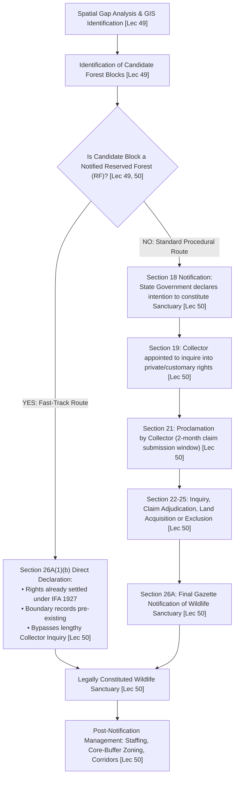
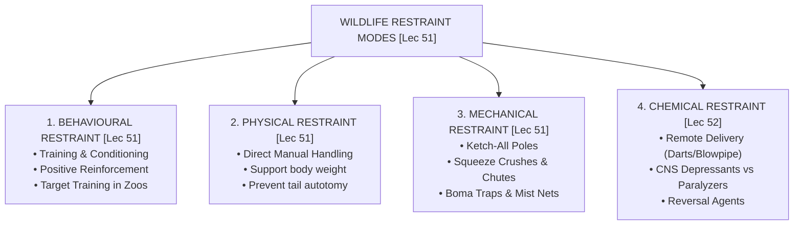
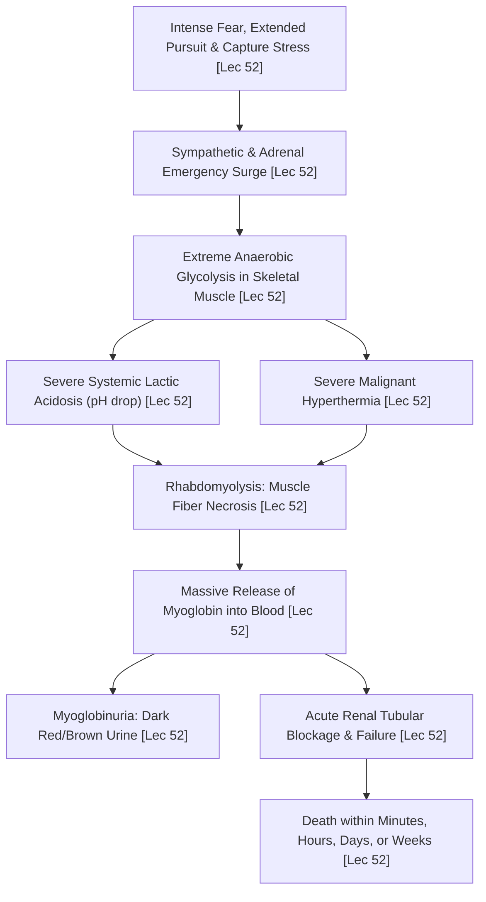
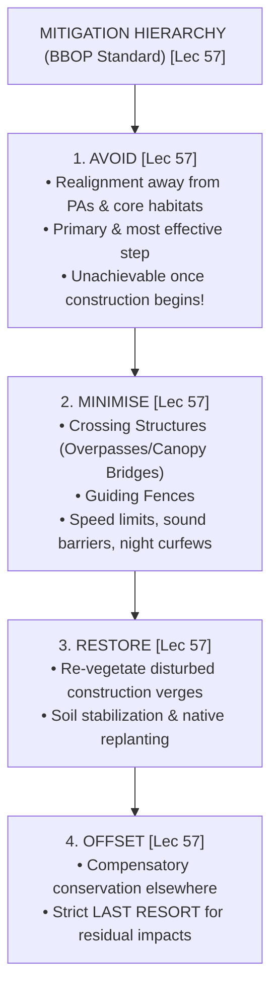
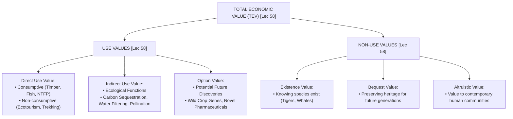

# Part 4: Managing Biodiversity, Infrastructure Mitigation & Course Synthesis (Weeks 10–12)

**Course:** Biodiversity for Sustainability  
**Instructor:** Dr. Ankur Awadhiya, IFS (Indian Forest Service)  
**Curriculum Mapping:** Lectures 46 to 60 (Weeks 10, 11, and 12)  
**Target File:** `textbook/part_4_weeks_10_12.md`  

---

## Comprehensive Table of Contents

### [Week 10: Managing Biodiversity — I (Lectures 46–50)](#week-10-managing-biodiversity--i)
1. **Lecture-by-Lecture Deep Dive**
   - **Lecture 46:** Principles of Biodiversity Management *(Ecological Function Taxonomy [Pollination, Dispersal, Predation, Decomposition, Nutrient Cycling], Adaptive Management Cycle [Plan-Act-Monitor-Evaluate-Adjust], Problem Tree Analysis [Trunk vs. Roots], Four-Step Management Chain, Project Tiger Evolution)*
   - **Lecture 47:** Ex-Situ Conservation *(Ex-Situ Insurance Strategy, Habitat-Like Enclosure Requirements for Welfare and Reproduction, Representative Sampling to Prevent Allelic Loss, Studbooks and Pedigree Management, Stereotypies and Behavioral Enrichment, Orthodox vs. Recalcitrant Seeds, Cryopreservation at -196°C, Pygmy Hog Recovery)*
   - **Lecture 48:** In-Situ Conservation *(In-Situ Primacy, Indian Statutory Protected Area Categories under WLPA 1972 [National Parks, Sanctuaries, Conservation Reserves, Community Reserves], Jared Diamond's Reserve Design Principles, Compact/Circular Reserves Reducing Edge Effects, Connectivity Planning in Fragmented Landscapes, Paper Parks, Terai Arc Corridors)*
   - **Lecture 49:** Design of a Sanctuary - I (Scientific Identification and Design) *(Designer Sanctuaries Framework, Kunming-Montreal Global 30 by 30 Target, Multi-Criteria GIS Layers, Biodiversity Intactness Index [BII], Umbrella Corridors, Cadastral Tenure Screening, Natural Feature Boundaries)*
   - **Lecture 50:** Design of a Sanctuary - II (Procedural Journey and Statutory Notification) *(Statutory Notification Marathon under WLPA 1972, Section 18 Intention Declaration, Section 20 Bar of Rights, Section 21 Proclamation, Section 19–25 Collector Rights Inquiry, Section 26A Final Declaration, Section 26A(1)(b) Reserved Forest Fast-Track Notification Bypassing Decades of Collector Inquiry)*
2. **Week 10 Master Reference Tables** *(Unabridged In-Situ vs. Ex-Situ Architectural Matrix, Jared Diamond Geometric Rules, Statutory WLPA 1972 Notification Workflow, Seed Banking Protocols, Multi-Criteria GIS Workflow)*
3. **Official Quiz Breakdown & Trap Analysis** *(Assignment 10: Q1–Q10 Detailed Rationale & Distractor Traps)*

---

### [Week 11: Managing Biodiversity — II (Lectures 51–55)](#week-11-managing-biodiversity--ii)
1. **Lecture-by-Lecture Deep Dive**
   - **Lecture 51:** Restraint and Mechanical Capture of Wildlife *(Four Modes of Restraint: Behavioural [Conditioning/Desensitisation], Physical [Manual Handling], Mechanical [Cages/Poles/Chutes], Chemical; Ketch-All Pole for Standoff Control, Small Reptile Body Support to Prevent Caudal Autotomy, Subcutaneous PIT Tags for Permanent Identification)*
   - **Lecture 52:** Chemical Restraint, Darting Systems, and Field Handling *(Remote Delivery Systems: Hand Syringes, Jab Sticks for Confined/Approachable Animals, Blowpipes, CO2 Dart Rifles, Powder Projector Guns; Pharmacology: Neuromuscular Blockers Paralyzing Muscles Without Sedation/Analgesia vs. CNS Depressants; The Fatal Capture Myopathy Cascade [Acidosis, Hyperthermia, Rhabdomyolysis, Myoglobinuria, Renal Failure], Boma Mass Capture Technique)*
   - **Lecture 53:** Active Habitat Management *(The Central Habitat Management Caution [Tools Can Help or Harm Depending on Timing, Intensity, Location, and Monitoring], Prescribed Burning Risks, Artificial Water Provisioning Hazards [Piosphere Effect, Pathogen Concentration, Predator Ambush], Plantation vs. Native Ecological Restoration, Lantana camara Root-Stock Eradication)*
   - **Lecture 54:** Wildfire Management: Behavior, Impacts, and Suppression *(Combustion Scale Triangle, Wildfire Hierarchy: Surface Fires, Smoldering Peat Ground Fires, Wind-Driven Crown Fires Burning Treetops, Ladder Fuels, Post-Fire Soil Hydrophobicity Causing Runoff/Mudslides, Fire Breaks, Counter Burning / Backfiring)*
   - **Lecture 55:** Plastic Pollution and Wildlife Impacts *(Plastic Dimensional Hierarchy [Macro-, Meso-, Micro- < 5mm, Nanoplastics], Solar UV Photolysis Degradation, Ghost Fishing by Abandoned Fishing Gear [ALDFG], Microplastics as Chemical Sponges for POPs, Endocrine Disrupting Chemicals [EDCs: BPA and Phthalates], Nilgiri Tahr Plastic Impaction in Mukurthi NP)*
2. **Week 11 Master Reference Tables** *(Unabridged Wildlife Restraint Modes Matrix, Remote Chemical Delivery Spectrum, Chemical Immobilization Pharmacology & Capture Myopathy Triad, Wildfire Dynamics & Firelines, Plastic Size Hierarchy & Toxicological Pathways)*
3. **Official Quiz Breakdown & Trap Analysis** *(Assignment 11: Q1–Q10 Detailed Rationale & Distractor Traps)*

---

### [Week 12: Final Words and Conclusion (Lectures 56–60)](#week-12-final-words-and-conclusion)
1. **Lecture-by-Lecture Deep Dive**
   - **Lecture 56:** Oil Spills: Ecological Impacts and Response Strategies *(Liquid Petroleum Hydrocarbon Spills, Polycyclic Aromatic Hydrocarbons [PAHs] Driving Biological Toxicity, Feather/Fur Maceration Collapsing Air Layer Causing Fatal Hypothermia, Toxic Ingestion, Containment Booms, Mechanical Skimmers, In-Situ Burning, Chemical Dispersants and the Water-Column Poisoning Trade-Off)*
   - **Lecture 57:** Linear Infrastructure and Wildlife Mitigation *(Linear Infrastructure Definition [Roads, Railways, Power Lines, Canals], Mortality vs. The Barrier Effect [Behavioral Movement Avoidance], BBOP Mitigation Hierarchy [Avoid, Minimise, Restore, Offset], Canopy Bridges for Arboreal Fauna, Wildlife Overpasses / Ecoducts, Wildlife Underpasses and Openness Index, Flared Guide Fences)*
   - **Lecture 58:** Economic Valuation of Nature's Benefits *(Why Quantify Nature in Money, Total Economic Value [TEV] Framework: Direct Use, Indirect Use, Option Value, Existence Value, Bequest Value; Valuation Methodologies: Market Price, Travel Cost Method [TCM] for Protected Areas, Hedonic Pricing, Replacement Cost, Contingent Valuation Method [CVM] for Non-Use Values via WTP Surveys, Benefits Transfer)*
   - **Lecture 59:** Thinking Like a Biodiversity Professional *(Anticipating Unintended Consequences, Systems Thinking Across Working Landscapes, The Precautionary Principle Under Scientific Uncertainty, Conservation Triage in Resource Allocation, Interdisciplinary Governance)*
   - **Lecture 60:** Course Synthesis, Final Recap, and Conclusion *(Grand Synthesis of 12 Weeks / 60 Lectures, The Keystone Course Doctrine: Variation at Every Scale as the Bedrock of Resilience and Sustainability, India's Civilizational Conservation Ethos, Passenger Pigeon Extinction Warning)*
2. **Week 12 Master Reference Tables** *(Unabridged Linear Infrastructure Mitigation Hierarchy & Crossing Matrix, Total Economic Value Architecture, Valuation Methodologies Comparison, Oil Spill Response Matrix)*
3. **Official Quiz Breakdown & Trap Analysis** *(Assignment 12: Q1–Q10 Detailed Rationale & Distractor Traps)*

---

# Week 10: Managing Biodiversity — I

## 1. Lecture-by-Lecture Deep Dive

### Lecture 46: Principles of Biodiversity Management

#### The Core Story & Mental Model
In Lecture 46, Dr. Ankur Awadhiya shifts the course from purely diagnostic, ecological understanding to concrete, strategic action: *Once we understand what biodiversity is and how it is threatened, how do we actually manage it?* To manage biodiversity effectively, a conservationist cannot operate on romantic intuition or arbitrary guesswork. Management means making real choices, setting explicit conservation targets, deploying calibrated interventions, and continuously monitoring outcomes against quantitative baselines.

Dr. Awadhiya establishes that true biodiversity management must look beyond merely protecting individual charismatic animal species. It must actively manage and sustain **Ecological Functions**—the vital biological, chemical, and physical interactions that maintain ecosystem structure and energy flow. These functions encompass **pollination, seed dispersal, predation, decomposition, and nutrient cycling**. If an endangered forest tree species is fenced off from logging but its native insect pollinators or fruit-eating dispersers have been extirpated, the tree population is ecologically defunct and doomed to extinction. Management must preserve the functional web, not just static museum specimens.

To guide conservation interventions, Dr. Awadhiya introduces two foundational frameworks:
1. **The Four-Step Management Chain:** A linear causal logic mapping conservation action:
   $$\text{Threat} \longrightarrow \text{Ecological Change} \longrightarrow \text{Strategic Response} \longrightarrow \text{Ecosystem Recovery}$$
   Managers must diagnose the specific threat, analyze the resulting ecological distortion, design a targeted response, and monitor for functional recovery.
2. **Problem Tree Analysis:** A diagnostic root-cause methodology where the visible conservation decline (such as a drop in tiger numbers or dying trees) is treated as the **tree trunk**. Managers who only treat the trunk (e.g., adding more anti-poaching guards) will fail if they ignore the **roots**—the deep socioeconomic, political, institutional, and livelihood pressures that drive the problem. Interventions must target the roots to achieve lasting recovery.

Finally, Dr. Awadhiya stresses **Adaptive Management**: conservation is not a rigid blueprint executed once and forgotten. Ecosystems are complex, non-linear, and unpredictable. Adaptive management treats every conservation policy as a testable scientific hypothesis through an iterative, self-correcting cycle:
$$\text{Plan} \longrightarrow \text{Act} \longrightarrow \text{Monitor} \longrightarrow \text{Evaluate} \longrightarrow \text{Adjust / Revise}$$

#### Spoken Case Studies & Examples Explained
- **Project Tiger Evolution:** Dr. Awadhiya explains how India's Project Tiger began in 1973 with a narrow focus on armed anti-poaching protection for a single charismatic predator. Over subsequent decades, wildlife managers realized that saving the tiger required managing the entire ecological matrix: relocating villages voluntarily from core zones, managing grasslands to sustain ungulate prey (chital, sambar), controlling invasive weeds (*Lantana camara*), and maintaining hydrological flow. **Exam Takeaway:** Biodiversity management is the management of functional ecological processes, not isolated species.
- **Restoring Grasslands for the Barasingha in Kanha:** When hard-ground swamp deer (*Rucervus duvaucelii branderi*) crashed to under 70 individuals in Kanha, managers applied the 4-step chain: identified cattle overgrazing and woody brush encroachment (threat), grassland succession failure (ecological change), fenced predator-proof breeding paddocks and cleared woody brush (strategic response), leading to population rebound above 1,000 individuals (ecosystem recovery).
- **Problem Tree Analysis in Forest Fire Governance:** If villagers deliberately ignite fires in dry deciduous forests, treating the fire alone (buying more water tankers) treats only the trunk. A problem tree analysis reveals the roots: villagers burn dry leaf litter to collect non-timber forest products (Mahua flowers, *Madhuca longifolia*) or to stimulate fresh grass for livestock grazing. Real management requires addressing local livelihoods and harvesting techniques.

#### Verbatim Definitions & Etymology Callout
> **Ecological Function:** The biological, physical, and chemical processes—including **pollination, seed dispersal, predation, decomposition, and nutrient cycling**—that sustain energy flow, structural integrity, and resilience within an ecosystem.
>
> **Adaptive Management:** An iterative, self-correcting decision-making process that treats conservation interventions as testable hypotheses, continuously incorporating new monitoring data to adjust policies via: **Plan $\rightarrow$ Act $\rightarrow$ Monitor $\rightarrow$ Evaluate $\rightarrow$ Adjust**.
>
> **Problem Tree Analysis:** A diagnostic management tool that separates the visible symptoms of conservation decline (the trunk) from the underlying socioeconomic and institutional root causes (the roots).
>
> **Four-Step Management Chain:** The sequential operational progression guiding conservation action: **Threat $\rightarrow$ Ecological Change $\rightarrow$ Strategic Response $\rightarrow$ Ecosystem Recovery**.

---

### Lecture 47: Ex-Situ Conservation

#### The Core Story & Mental Model
In Lecture 47, Dr. Awadhiya turns to **Ex-Situ Conservation** (from the Latin *ex-situ*, meaning "off-site"). Ex-situ conservation is the preservation of biological diversity components **outside their natural habitats** by transferring individual living organisms, tissues, seeds, or genetic material into designated, highly controlled artificial facilities. These facilities include modern zoological parks, rescue centres, aquaria, botanical gardens, arboreta, bambuseta, seed banks, and cryopreservation vaults.

Dr. Awadhiya explains that ex-situ conservation is primarily designed as an **Insurance Strategy**. When a wild species is pushed into an extinction vortex—where its native habitat has been obliterated by logging or human settlement, or where relentless poaching, novel disease epidemics, or catastrophic wildfires make immediate survival in the wild impossible—in-situ protection alone is insufficient. Ex-situ conservation creates an offsite safety net, preventing irreversible extinction by maintaining a captive reservoir of genetic material. If the wild population collapses, captive individuals can eventually be used for breeding, reintroduction, and ecosystem re-wilding.

However, running an effective ex-situ facility is extraordinarily challenging. Dr. Awadhiya highlights four core operational pillars:
1. **Habitat-Like Enclosures:** Barren concrete cages with iron bars cause severe physical and psychological trauma. Enclosures must replicate natural landscapes—incorporating appropriate substrate (soil, sand, leaf litter), climbing branches, natural vegetation, shaded retreat dens, and environmental complexity. This is essential **to support natural movement, natural behavior, physical welfare, physiological health, and successful reproduction**.
2. **Behavioral Enrichment:** Providing mental and sensory stimulation (e.g., hidden foraging puzzles, novel scents, varying feeding schedules, social groupings) to prevent **Stereotypies**—abnormal, repetitive, functionless motor behaviors such as pacing, bar-biting, head-bobbing, and self-mutilation that signal chronic psychological distress.
3. **Representative Sampling:** When founding a captive or seed-bank population, collectors must take a representative, unbiased sample of genetic diversity from multiple wild populations. Collecting only the largest, "best-looking" specimens or collecting from a single convenient roadside patch introduces extreme selection bias, purging rare alleles that may contain critical drought- or disease-resistance genes.
4. **Studbooks and Pedigree Management:** Captive populations are small and vulnerable to inbreeding depression. A **Studbook** is an exhaustive, chronological register tracking the ancestry, parentage, births, deaths, and transfers of every individual animal in a breeding program. Studbook keepers use algorithmically computed "mean kinship" to arrange matings between the least-related individuals, preserving maximum genetic heterozygosity across generations.

#### Spoken Case Studies & Examples Explained
- **The Pygmy Hog (*Porcula salvania*) Recovery Program:** The world's smallest wild pig was on the brink of absolute extinction in the tall alluvial grasslands of Assam due to agricultural drainage and uncontrolled burning. Biologists captured a small founder group of wild hogs, established a specialized breeding center in Basistha (Guwahati), maintained detailed studbooks, and provided habitat-like enclosures with tall elephant grass. Once the population stabilized, captive-bred hogs were successfully reintroduced into Manas and Orang National Parks. **Exam Takeaway:** Ex-situ conservation serves as an insurance strategy that feeds back into in-situ recovery.
- **Cheetah Genome and Zoo Breeding Challenges:** Captive cheetahs (*Acinonyx jubatus*) suffered historically from poor reproductive rates and high juvenile mortality in conventional cages. Only when zoos introduced large, habitat-like savannah enclosures with visual seclusion and behavioral enrichment did breeding success improve.
- **Svalbard Global Seed Vault & Millennium Seed Bank:** Dr. Awadhiya highlights the global architecture of ex-situ plant conservation. Conventional seed banking stores **orthodox seeds** (which tolerate drying to $3-7\%$ moisture) in sub-zero vaults at $-18^\circ\text{C}$ to $-20^\circ\text{C}$. For **recalcitrant seeds** (such as mango, rubber, or tropical rainforest trees that die when desiccated), germplasm is stored via **cryopreservation** in liquid nitrogen at $-196^\circ\text{C}$.

#### Verbatim Definitions & Etymology Callout
> **Ex-Situ Conservation:** The conservation of components of biological diversity **outside their natural habitats** in designated controlled facilities (Latin *ex* = out of, off; *situ* = site).
>
> **Ex-Situ Insurance Strategy:** A conservation safeguard that **prevents immediate extinction in high-risk taxa and preserves individuals or genetic material outside threatened habitats** as an emergency reservoir for future restoration.
>
> **Habitat-Like Enclosure:** An engineered captive animal housing environment that replicates natural physical structures, retreat shelters, vegetation, and substrate **to support natural movement, behaviour, welfare, health, and breeding**.
>
> **Representative Sampling:** A collection protocol designed to **capture the full breadth of wild genetic variation and avoid the loss of alleles**, avoiding artificial collector bias.
>
> **Studbook:** An exhaustive genealogical record and register documenting the **ancestry, parentage, births, deaths, transfers, and breeding history** of individuals within a captive population to guide scientific genetic management.
>
> **Stereotypies:** Repetitive, invariant, and functionless behavioral patterns (e.g., pacing, bar-biting, head-weaving) displayed by captive wildlife under chronic environmental stress or confinement.
>
> **Arboretum:** A specialized ex-situ botanical institution dedicated to the living cultivation, scientific study, and conservation of woody tree and shrub species (Latin *arbor* = tree).
>
> **Bambusetum:** A specialized botanical garden or living collection dedicated exclusively to the propagation, conservation, and taxonomic study of bamboo species (*Poaceae: Bambusoideae*).

---

### Lecture 48: In-Situ Conservation

#### The Core Story & Mental Model
In Lecture 48, Dr. Awadhiya turns to **In-Situ Conservation** (from the Latin *in-situ*, meaning "on-site"). In-situ conservation is the conservation of ecosystems, natural habitats, and the maintenance and recovery of viable populations of species **in their natural surroundings**. While ex-situ facilities provide crucial insurance, in-situ conservation remains the premier, irreplaceable gold standard of biodiversity protection because it allows evolutionary processes, natural selection, ecological competition, and community interactions to continue unhindered across wild landscapes.

The primary institutional tools for in-situ conservation are **Protected Areas (PAs)**. Under India's **Wildlife (Protection) Act, 1972 (WLPA)**, there are four statutory categories of protected areas, each tailored with distinct legal and governance regimes:
1. **National Parks:** Areas of high ecological, floral, faunal, or zoological significance declared under Section 35. They enjoy the highest degree of statutory protection: **no human rights, grazing, private land ownership, or resource extraction is permitted**. The boundary cannot be altered without the recommendation of the National Board for Wildlife (NBWL).
2. **Wildlife Sanctuaries:** Areas declared under Section 18 / 26A for protecting wildlife. While strictly protected, certain limited customary rights (such as grazing of cattle or right of way) may be permitted by the Chief Wildlife Warden if deemed non-detrimental to wildlife.
3. **Conservation Reserves:** Government-owned lands declared under Section 36A—typically acting as buffer zones or landscape corridors connecting national parks and sanctuaries—managed through a Conservation Reserve Management Committee that incorporates local community participation.
4. **Community Reserves:** Declared under Section 36C on private or community-owned lands where an individual or a community volunteers to conserve wildlife, co-managed through a Community Reserve Management Committee.

Dr. Awadhiya then analyzes **Reserve Design Principles** rooted in island biogeography (the SLOSS debate: Single Large vs. Several Small reserves):
- **Reserve Shape and Edge Effects:** **Compact or roughly circular reserves are generally preferred over elongated, linear, or irregular shapes**. A circular reserve minimizes the perimeter-to-area (edge-to-area) ratio. This shields the core forest from edge effects: microclimatic drying, wind penetration, invasive weed ingress, and external disturbances from human settlements.
- **Connectivity Planning:** In fragmented landscapes where roads, agriculture, and human settlements isolate wildlife populations, the single most critical management priority is **Connectivity Planning**. By creating continuous ecological corridors, riparian buffer strips, and stepping-stone patches, managers enable dispersal, gene flow, seasonal migration, and metapopulation recolonization, rescuing small isolated demes from inbreeding depression and local extinction.

#### Spoken Case Studies & Examples Explained
- **Corridors in the Terai Arc Landscape (TAL):** Dr. Awadhiya highlights the critical Chilla-Motichur and Kansrau-Barkot elephant corridors between Rajaji and Corbett National Parks. When highways, railway lines, and army camps severed these corridors, elephants were confined into isolated sub-populations, causing severe localized habitat degradation and escalating human-elephant conflict. Restoring corridor connectivity allowed free movement across the landscape. **Exam Takeaway:** A fragmented landscape with isolated populations requires connectivity planning as its main management focus.
- **Paper Parks in Tropical Forestry:** The professor issues a stern warning against "Paper Parks"—reserves that look impressive on colored government GIS maps and in international treaty reports, but on the ground possess zero field staff, no boundary beacons, no patrolling vehicles, and no anti-poaching wireless networks. A declared sanctuary overrun by armed poachers or illegal cattle grazing is merely a paper park.
- **Kaziranga Flood Highlands and Karbi Anglong Migration:** During annual Brahmaputra monsoon floods, wild animals in Kaziranga National Park must flee the flooded riverine plains to reach the elevated forested hills of Karbi Anglong. If the highway separating Kaziranga from Karbi Anglong is walled off or lined with commercial resorts, thousands of animals drown or are struck by vehicles. Maintaining ecological connectivity between the two zones is a matter of life and death.

#### Verbatim Definitions & Etymology Callout
> **In-Situ Conservation:** The conservation of ecosystems and natural habitats and the maintenance and recovery of viable populations of species in their natural surroundings (Latin *in* = in; *situ* = site).
>
> **Indian Statutory Protected Areas:** The four legal classes of protected areas established under the Wildlife (Protection) Act, 1972: **National Park, Wildlife Sanctuary, Conservation Reserve, and Community Reserve**.
>
> **Compact / Circular Reserve:** A reserve design geometry that minimizes the perimeter-to-area (edge-to-area) ratio, thereby **reducing edge effects, invasive species encroachment, and outside disturbance**.
>
> **Connectivity Planning:** The strategic identification, legal protection, and restoration of ecological corridors, stepping-stone patches, and movement pathways **linking fragmented landscapes and isolated populations**.
>
> **Paper Park:** A legally declared protected area that exists on paper and maps but fails to provide actual conservation protection due to an absence of funding, field staff, infrastructure, and law enforcement.
>
> **Gap Analysis:** An analytical conservation planning technique that overlays maps of existing protected area networks onto species distribution and vegetation maps to identify unprotected ecosystems and threatened taxa.

---

### Lecture 49: Design of a Sanctuary - I (Scientific Identification and Design)

#### The Core Story & Mental Model
In Lecture 49, Dr. Awadhiya delves into the practical engineering of conservation: *How do we scientifically identify and design a brand-new wildlife sanctuary from scratch?* Historically, protected areas were often designated through opportunistic or emotional choices—a Maharaja's former hunting preserve, a scenic mountain peak, or a remote tract of land that nobody wanted for farming. Dr. Awadhiya introduces the modern concept of **Designer Sanctuaries**: proposed protected areas that emerge systematically from objective, multi-criteria spatial analysis and rigorous conservation science.

A designer sanctuary workflow integrates international commitments with cutting-edge geospatial technology. The design process is anchored in the **Kunming-Montreal Global Biodiversity Framework (GBF)** adopted at CBD COP-15, which established the landmark **30 by 30 Target**: protecting at least **$30\%$ of the world's terrestrial, inland water, and coastal/marine areas by the year 2030**. To achieve this target without causing massive social conflict, governments must identify high-priority lands that maximize biodiversity return per square kilometer protected.

The scientific identification workflow utilizes a multi-layered Geographic Information System (GIS) framework:
1. **Existing Protected Area Network Layer:** Mapping all current national parks, sanctuaries, and reserves to detect geographic voids and underrepresented biogeographic zones.
2. **Species Distribution and Threatened Taxa Records:** Overlaying camera-trap detections, herbarium records, and IUCN Red List ranges to ensure high conservation value.
3. **Biodiversity Intactness Index (BII):** Satellite-derived ecological metrics assessing how much of a region's original native species abundance and forest composition remains intact.
4. **Landscape Corridors & Connectivity:** Identifying vital movement corridors (such as National Tiger Conservation Authority tiger corridor atlases) to ensure the candidate sanctuary bridges isolated habitats.
5. **Cadastral & Legal Tenure Layer:** Determining who owns the candidate land. Is it private farmland, community revenue land, Protected Forest (PF), or **Reserved Forest (RF)**?

Dr. Awadhiya emphasizes that **Reserved Forest blocks are strategically the most valuable candidates for fast sanctuary notification**. When drawing sanctuary boundaries, managers should follow **natural topographic features**—such as high mountain ridge lines, perennial river channels, deep gorges, or escarpments—rather than straight geometric lines on a cadastral survey map. Natural boundaries are easily identified by patrolling forest guards on foot and are respected by moving wildlife.

#### Spoken Case Studies & Examples Explained
- **Ratapani Tiger Sanctuary Proposal in Madhya Pradesh:** Dr. Awadhiya describes the field planning of Ratapani in Central India. Planners did not arbitrarily pick a circle on a map; they analyzed satellite imagery of continuous teak-bamboo forest canopy, overlaid camera-trap data showing breeding tigresses, mapped the vital corridor linking Ratapani to the Bhimbetka UNESCO World Heritage site and onward to Raisen, and verified that the candidate compartments were existing Reserved Forests under the Forest Department. **Exam Takeaway:** Designer sanctuaries integrate satellite intactness indices, species distributions, and existing legal forest tenure.
- **The Pitfall of Ignoring Land Tenure:** The professor recounts cases where enthusiastic conservationists proposed a sanctuary over a mosaic of private agrarian villages and communal grazing commons. The proposal immediately ignited violent public protests, political backlash, and decades of litigation, completely stalling conservation. Choosing pre-notified Reserved Forests avoids this political minefield.

#### Verbatim Definitions & Etymology Callout
> **Designer Sanctuary:** A protected area scientifically planned, bounded, and proposed through multi-criteria geospatial analysis, biodiversity metrics, and legal-tenure screening rather than arbitrary selection.
>
> **Global 30 by 30 Target:** Target 3 of the Kunming-Montreal Global Biodiversity Framework (CBD COP-15) mandating the protection and conservation of at least **$30\%$ of terrestrial, inland water, and coastal/marine areas globally by 2030**.
>
> **Biodiversity Intactness Index (BII):** A modeled geospatial metric estimating the average abundance of native terrestrial species relative to their pre-modern, undisturbed baseline populations.
>
> **Umbrella Corridor:** A landscape-scale movement corridor identified for a wide-ranging apex carnivore (e.g., Bengal tiger) that simultaneously preserves dispersal pathways for co-occurring sympatric biodiversity.

---

### Lecture 50: Design of a Sanctuary - II (Procedural Journey and Statutory Notification)

#### The Core Story & Mental Model
In Lecture 50, Dr. Awadhiya addresses the legal and bureaucratic reality of conservation: *Once you have designed the perfect sanctuary on a GIS map, how do you legally notify it under Indian law?* A sanctuary does not exist because a scientist published a paper; it exists when it is officially published in the **Government Gazette**. Understanding the statutory procedural journey under the **Wildlife (Protection) Act, 1972 (WLPA)** is an indispensable skill for every wildlife manager.

The standard legal process for notifying a Wildlife Sanctuary on non-reserved land is an exhaustive, multi-step statutory marathon:
1. **Section 18 Declaration of Intention:** The State Government issues a preliminary notification declaring its intention to constitute an area as a Wildlife Sanctuary if it considers the area has adequate ecological, floral, faunal, or zoological significance.
2. **Section 18A Interim Protection:** Provides that pending the final notification, the provisions of Sections 27 to 33A (prohibiting entry without permit, hunting, destruction of habitat) apply to the candidate area.
3. **Section 19 Appointment of District Collector:** The State Government appoints an officer (usually the District Collector or Sub-Divisional Officer) to **inquire into and determine the existence, nature, and extent of any private rights** claimed by any person in or over the land.
4. **Section 20 Bar of Accrual of Rights:** Once Section 18 is notified, no person can acquire any new property, timber, or grazing rights over the specified land.
5. **Section 21 Public Proclamation:** The Collector publishes a proclamation in the local language across neighboring villages requiring all persons claiming rights to submit a written claim within **2 months** of the date of proclamation.
6. **Sections 22 to 25 Rights Adjudication & Settlement:** The Collector conducts formal inquiries, examines land records, and decides whether to admit, reject, or purchase the rights. The Collector may exclude the land from the sanctuary boundaries, grant financial compensation under the Land Acquisition Act, or allow certain regulated rights in consultation with the Chief Wildlife Warden.
7. **Section 26A(1)(a) Final Declaration:** Once all claims under Sections 19 through 25 are formally adjudicated, settled, or acquired, the State Government issues the final Gazette notification formally constituting the Wildlife Sanctuary.

This standard route frequently bogs down. In practice, the Collector's inquiry into private rights and ancestral land claims can drag on for 10, 20, or even 30 years! Here, Dr. Awadhiya reveals the masterstroke of Indian conservation administration: **The Reserved Forest Fast-Track Notification under Section 26A(1)(b)**. 

Under the Indian Forest Act, 1927 (IFA), an area was constituted as a **Reserved Forest** only after an exhaustive, quasi-judicial Forest Settlement Officer (FSO) inquiry settled all private rights decades ago. Because land status, physical boundary pillars, legal title, and rights registers are **already well-structured and documented**, Section 26A(1)(b) allows the State Government to **issue the final sanctuary declaration directly**, bypassing the entire multi-decade Section 19–25 Collector inquiry!

#### Spoken Case Studies & Examples Explained
- **Sanctuaries in Section 18 Limbo:** Dr. Awadhiya explains that dozens of sanctuaries across India remained trapped in "Section 18 preliminary intention" status for over two decades because District Collectors, busy with routine revenue administration, failed to complete the formal Section 19–25 rights settlement. Until Section 26A is issued, the sanctuary's legal status remains precarious and vulnerable to legal challenge.
- **The Strategic Speed of Section 26A(1)(b):** By selecting blocks already notified as Reserved Forests under the Indian Forest Act, 1927, state forest departments in Central India successfully declared new wildlife sanctuaries and tiger reserve extensions in a matter of months rather than decades. **Exam Takeaway:** Reserved forests are strategically useful because their land status, boundary demarcations, and rights positions are already legally settled.

#### Verbatim Definitions & Etymology Callout
> **Section 18 Notification (WLPA 1972):** The statutory notification by a State Government declaring its preliminary **intention to constitute an area as a Wildlife Sanctuary** based on its ecological or zoological value.
>
> **Section 20 (Bar of Accrual of Rights):** The legal provision prohibiting the creation, acquisition, or accrual of any new private property, agricultural, or grazing rights over the proposed sanctuary land after the issuance of Section 18.
>
> **Section 21 Proclamation:** A public proclamation published by the District Collector in regional languages requiring all claimants to submit written statements of existing rights within a strict **2-month statutory window**.
>
> **Section 26A(1)(b) Reserved Forest Fast-Track:** The statutory mechanism under WLPA 1972 that permits direct final notification of a Wildlife Sanctuary over existing **Reserved Forests**, bypassing the lengthy Collector rights inquiry because land boundaries, tenure, and rights were already settled under the Indian Forest Act, 1927.

---

## 2. Week 10 Master Reference Tables

## 1. High-Yield Terminological & Definitional Matrix

| Citation | Term / Concept | Operational Scientific Definition | Exam Archetype | Exam Question Tag |
| :--- | :--- | :--- | :--- | :--- |
| `[Lec 46]` | **Ecological Function** | Biotic and abiotic processes—including **pollination, seed dispersal, predation, decomposition, and nutrient cycling**—that sustain ecosystem energy flow, structure, and productivity. | Functional Classification | `[TESTED - 30% REPEAT POOL]` (W10-Q6) |
| `[Lec 46]` | **Adaptive Management** | An iterative, systematic conservation decision process treating management interventions as testable hypotheses: **Plan $\rightarrow$ Act $\rightarrow$ Monitor $\rightarrow$ Evaluate $\rightarrow$ Adjust/Revise**. | Decision Model | `[UNSEEN HIGH-YIELD - 70% FINAL POOL]` |
| `[Lec 46]` | **Problem Tree Analysis** | Diagnostic root-cause methodology where the visible conservation decline is the **trunk**, but interventions must target the underlying socioeconomic/governance **roots**. | Diagnostic Tool | `[UNSEEN HIGH-YIELD - 70% FINAL POOL]` |
| `[Lec 46]` | **Four-Step Management Chain** | Sequential causal progression guiding conservation: **Threat $\rightarrow$ Ecological Change $\rightarrow$ Strategic Response $\rightarrow$ Ecosystem Recovery**. | Sequential Logic | `[UNSEEN HIGH-YIELD - 70% FINAL POOL]` |
| `[Lec 47]` | **Ex-Situ Conservation** | The conservation of biological diversity components outside their natural habitats by moving individuals or genetic material to designated controlled facilities. | Core Definition | `[TESTED - 30% REPEAT POOL]` (W10-Q7) |
| `[Lec 47]` | **Ex-Situ Insurance Strategy** | Conservation fallback preventing immediate catastrophic extinction in high-risk taxa and safeguarding germplasm/alleles outside deteriorating wild landscapes. | Strategic Rationale | `[TESTED - 30% REPEAT POOL]` (W10-Q10) |
| `[Lec 47]` | **Habitat-Like Enclosure** | Captive enclosure replicating natural substrate, vegetation, retreat cover, and environmental complexity to support natural movement, behavior, welfare, health, and breeding. | Welfare & Housing | `[TESTED - 30% REPEAT POOL]` (W10-Q1) |
| `[Lec 47]` | **Representative Sampling** | Ex-situ sampling protocol capturing the full breadth of wild genetic variation across diverse populations, avoiding artificial selection bias and loss of rare alleles. | Sampling Methodology | `[TESTED - 30% REPEAT POOL]` (W10-Q2) |
| `[Lec 47]` | **Studbook** | An exhaustive chronological register documenting the ancestry, parentage, births, deaths, transfers, and reproductive history of every individual in a captive breeding program. | Record Management | `[TESTED - 30% REPEAT POOL]` (W10-Q9) |
| `[Lec 47]` | **Behavioral Enrichment** | Environmental manipulations (climbing structures, foraging puzzles, sensory scents, social groupings) designed to prevent abnormal stereotypic behaviors. | Captive Husbandry | `[UNSEEN HIGH-YIELD - 70% FINAL POOL]` |
| `[Lec 47]` | **Stereotypies** | Repetitive, invariant, and functionless behavioral patterns (pacing, bar-biting, over-grooming) triggered by chronic stress, confinement, or barren captive enclosures. | Pathological Indicator | `[UNSEEN HIGH-YIELD - 70% FINAL POOL]` |
| `[Lec 47]` | **Arboretum** | A specialized ex-situ botanical facility dedicated to cultivating, preserving, and scientifically studying living collections of woody tree and shrub species. | Ex-Situ Facility | `[UNSEEN HIGH-YIELD - 70% FINAL POOL]` |
| `[Lec 47]` | **Bambusetum** | A specialized ex-situ botanical collection dedicated specifically to the conservation, propagation, and taxonomic study of bamboo taxa (*Poaceae: Bambusoideae*). | Ex-Situ Facility | `[UNSEEN HIGH-YIELD - 70% FINAL POOL]` |
| `[Lec 47]` | **Cryopreservation** | Long-term preservation of living germplasm, gametes, embryos, or recalcitrant plant tissues in liquid nitrogen at ultralow temperatures ($-196^\circ\text{C}$). | Ex-Situ Technology | `[UNSEEN HIGH-YIELD - 70% FINAL POOL]` |
| `[Lec 48]` | **In-Situ Conservation** | The conservation of ecosystems and natural habitats and the maintenance and recovery of viable populations of species in their natural surroundings. | Core Definition | `[UNSEEN HIGH-YIELD - 70% FINAL POOL]` |
| `[Lec 48]` | **Indian Statutory PAs** | The four legal categories of protected areas established under India's Wildlife (Protection) Act, 1972: **National Park, Sanctuary, Conservation Reserve, Community Reserve**. | Statutory Taxonomy | `[TESTED - 30% REPEAT POOL]` (W10-Q5) |
| `[Lec 48]` | **Compact / Circular Reserve** | Reserve shape that minimizes perimeter-to-area (edge-to-area) ratio, buffering core wilderness against edge effects, invasive species encroachment, and external disturbances. | Reserve Geometry | `[TESTED - 30% REPEAT POOL]` (W10-Q3) |
| `[Lec 48]` | **Connectivity Planning** | Strategic establishment of continuous ecological corridors or stepping-stone patches linking fragmented habitats to enable gene flow, dispersal, and migration. | Spatial Planning | `[TESTED - 30% REPEAT POOL]` (W10-Q4) |
| `[Lec 48]` | **Paper Park** | A legally decreed or mapped protected area that fails to achieve conservation outcomes in reality due to lack of field staff, funding, enforcement, or ecological monitoring. | Governance Pathology | `[UNSEEN HIGH-YIELD - 70% FINAL POOL]` |
| `[Lec 48]` | **Gap Analysis** | Spatial planning method overlaying existing protected area networks on biodiversity distribution maps to identify underrepresented ecosystems and unprotected taxa. | Systematic Planning | `[UNSEEN HIGH-YIELD - 70% FINAL POOL]` |
| `[Lec 49]` | **Global 30 by 30 Target** | Target 3 of the Kunming-Montreal Global Biodiversity Framework (CBD COP-15): protect at least **30% of terrestrial, inland water, and coastal/marine areas by 2030**. | International Treaty Target | `[UNSEEN HIGH-YIELD - 70% FINAL POOL]` |
| `[Lec 49]` | **Biodiversity Intactness Index (BII)** | Quantitative metric assessing average abundance of native species relative to undisturbed baseline populations across varying degrees of land-use pressure. | Spatial Metric | `[UNSEEN HIGH-YIELD - 70% FINAL POOL]` |
| `[Lec 49]` | **Umbrella Corridor** | Movement corridors delineated for a large-ranging apex species (e.g., Tiger corridor maps) that simultaneously safeguard movement for sympatric biodiversity. | Landscape Ecology | `[UNSEEN HIGH-YIELD - 70% FINAL POOL]` |
| `[Lec 49, 50]` | **Reserved Forest Fast-Track** | Strategic sanctuary notification shortcut using forest land whose legal tenure, boundaries, records, and rights position are already settled under Indian Forest Act, 1927. | Administrative Strategy | `[TESTED - 30% REPEAT POOL]` (W10-Q8) |
| `[Lec 50]` | **Section 18 Declaration** | Initial notification by State Government under Wildlife (Protection) Act, 1972 declaring its intention to constitute an area as a Wildlife Sanctuary. | Legal Procedure | `[UNSEEN HIGH-YIELD - 70% FINAL POOL]` |
| `[Lec 50]` | **Section 26A Declaration** | Final statutory notification of a Wildlife Sanctuary in the Official Gazette following completion of rights inquiry or directly for existing Reserved Forests. | Legal Procedure | `[UNSEEN HIGH-YIELD - 70% FINAL POOL]` |

---

## 2. In-Situ vs. Ex-Situ Conservation Architectural Comparison

```mermaid
flowchart TD
    BIO["Biodiversity Conservation Management [Lec 46]"] --> INS["IN-SITU CONSERVATION [Lec 48]\n(Within Natural Habitat)"]
    BIO --> EXS["EX-SITU CONSERVATION [Lec 47]\n(Outside Natural Habitat)"]
    
    INS --> PA["Statutory PAs (WLPA 1972) [Lec 48]:\n• National Parks\n• Wildlife Sanctuaries\n• Conservation Reserves\n• Community Reserves"]
    INS --> LD["Landscape Design [Lec 48, 49]:\n• SLOSS Principles\n• Compact/Circular Shapes\n• Corridors / Stepping Stones"]
    
    EXS --> ZOO["Living Collections [Lec 47]:\n• Zoos / Rescue Centres\n• Botanical Gardens\n• Arboreta / Bambuseta"]
    EXS --> BNK["Germplasm Storage [Lec 47]:\n• Seed Banks (Orthodox seeds)\n• Cryobanks (-196°C)"]
    
    EXS -->|Studbook Breeding & Behavioral Enrichment [Lec 47]| REINTRO["Reintroduction / Translocation Bridge [Lec 46, 48]"]
    REINTRO -->|Restocking Viable Wild Populations [Lec 46]| INS
```

| Citation | Attribute / Dimension | In-Situ Conservation (Lecture 48) | Ex-Situ Conservation (Lecture 47) |
| :--- | :--- | :--- | :--- |
| `[Lec 46, 47, 48]` | **Primary Definition** | Protecting species within dynamic native ecosystems `[UNSEEN HIGH-YIELD - 70% FINAL POOL]`. | Moving species or germplasm to designated facilities outside native habitat `[TESTED - 30% REPEAT POOL]` (W10-Q7). |
| `[Lec 46, 47]` | **Strategic Function** | Sustains evolutionary processes, multi-species interactions, and ecosystem services at scale `[UNSEEN HIGH-YIELD - 70% FINAL POOL]`. | Insurance strategy against immediate wild extinction; rescue and captive breeding reservoir `[TESTED - 30% REPEAT POOL]` (W10-Q10). |
| `[Lec 47, 48]` | **Facilities / Units** | National Parks, Sanctuaries, Conservation Reserves, Community Reserves `[TESTED - 30% REPEAT POOL]` (W10-Q5). | Zoos, aquaria, botanical gardens, arboreta, bambuseta, seed banks, cryobanks `[UNSEEN HIGH-YIELD - 70% FINAL POOL]`. |
| `[Lec 47]` | **Cost Scaling vs Body Size** | Relatively constant area-based management costs across taxa `[UNSEEN HIGH-YIELD - 70% FINAL POOL]`. | Captive breeding costs escalate sharply with large animal body size (space, food, veterinary care) `[UNSEEN HIGH-YIELD - 70% FINAL POOL]`. |
| `[Lec 47]` | **Pedigree & Genetic Tool** | Natural panmixia and natural selection within connected metapopulations `[UNSEEN HIGH-YIELD - 70% FINAL POOL]`. | **Studbooks** (tracking ancestry, births, deaths, transfers, parentage to prevent inbreeding) `[TESTED - 30% REPEAT POOL]` (W10-Q9). |
| `[Lec 47]` | **Enclosure / Housing Requirement** | Not applicable (natural landscape). | **Habitat-like enclosures** supporting natural movement, welfare, foraging, and breeding `[TESTED - 30% REPEAT POOL]` (W10-Q1). |
| `[Lec 47]` | **Behavioral Husbandry** | Free-ranging natural behavioral expression. | **Behavioral enrichment** required to prevent repetitive stereotypies `[UNSEEN HIGH-YIELD - 70% FINAL POOL]`. |
| `[Lec 46, 47, 48]` | **Ultimate Synergy** | Provides the receiving habitats and ecological processes for species recovery `[UNSEEN HIGH-YIELD - 70% FINAL POOL]`. | Produces genetically sound founder stock for eventual **wild reintroduction** `[UNSEEN HIGH-YIELD - 70% FINAL POOL]`. |

---

## 3. Jared Diamond's Reserve Design Principles (Lecture 48)

| Citation | Geometric Feature | Preferred Design Principle | Ecological Scientific Rationale | Exam Distractor Alert |
| :--- | :--- | :--- | :--- | :--- |
| `[Lec 48]` | **Reserve Size (SLOSS)** | **Single Large > Several Small** (of equal total area) `[UNSEEN HIGH-YIELD - 70% FINAL POOL]`. | Minimizes extinction rates; sustains large minimum viable populations (MVP); buffers home ranges of wide-ranging apex carnivores. | *Trap:* Claiming several small reserves are always superior because they "sample more habitats". |
| `[Lec 48]` | **Reserve Shape** | **Compact / Circular > Elongated / Linear** `[TESTED - 30% REPEAT POOL]` (W10-Q3). | Minimizes perimeter-to-area (edge-to-area) ratio; drastically reduces invasive weed penetration, microclimate drying, and human poaching disturbance. | *Trap:* Stating elongated shapes are preferred to "maximize border contact with towns". |
| `[Lec 48]` | **Spatial Distribution** | **Clustered > Linear / Scattered** `[UNSEEN HIGH-YIELD - 70% FINAL POOL]`. | Shortens inter-patch dispersal distances; facilitates metapopulation "rescue effect" and recolonization following local catastrophes. | *Trap:* Claiming isolated reserves prevent all disease spread so linear isolated reserves are ideal. |
| `[Lec 48]` | **Connectivity** | **Connected (Corridors) > Disconnected / Isolated** `[TESTED - 30% REPEAT POOL]` (W10-Q4). | Facilitates continuous gene flow; prevents inbreeding depression; allows climate-induced range shifts and seasonal migrations. | *Trap:* Confusing connectivity planning with captive display planning or uniform boundary fencing. |
| `[Lec 48]` | **Zonation Structure** | **Core Zone surrounded by Buffer Zone** `[UNSEEN HIGH-YIELD - 70% FINAL POOL]`. | Strict inviolate core preserves intact ecological processes; outer multi-use buffer absorbs peripheral anthropogenic pressure and livestock grazing. | *Trap:* Suggesting human extractive activities should be centered inside the reserve core. |

---

## 4. Statutory Wildlife Sanctuary Notification Workflow under Indian WLPA 1972 (Lectures 49 & 50)



| Citation | Legal Section (WLPA 1972) | Procedural Mandate & Action Required | Strategic Governance Insight |
| :--- | :--- | :--- | :--- |
| `[Lec 50]` | **Section 18** | Declaration of intention by State Government to constitute any area as a Wildlife Sanctuary `[UNSEEN HIGH-YIELD - 70% FINAL POOL]`. | Triggered when area possesses adequate ecological, faunal, floral, geomorphological, or zoological significance. |
| `[Lec 50]` | **Section 18A** | Statutory protection of candidate sanctuary pending rights inquiry `[UNSEEN HIGH-YIELD - 70% FINAL POOL]`. | Prevents destructive land-use conversions during administrative processing. |
| `[Lec 50]` | **Section 19** | Mandatory inquiry by District Collector to determine existence, nature, and extent of rights `[UNSEEN HIGH-YIELD - 70% FINAL POOL]`. | Covers private land claims, grazing concessions, water rights, and non-timber forest produce (NTFP) access. |
| `[Lec 50]` | **Section 20** | **Bar of accrual of rights** `[UNSEEN HIGH-YIELD - 70% FINAL POOL]`. | No new civil or property rights can be acquired in the proposed land after Section 18 notification date. |
| `[Lec 50]` | **Section 21** | Proclamation by Collector in local language specifying boundaries `[UNSEEN HIGH-YIELD - 70% FINAL POOL]`. | Requires all claimants to submit written claims within **2 months** of proclamation date. |
| `[Lec 50]` | **Section 24** | Adjudication options: Admit, exclude land, acquire rights under Land Acquisition Act `[UNSEEN HIGH-YIELD - 70% FINAL POOL]`. | Collector may accept claim and acquire land/rights via compensation, or alter boundaries to exclude contested parcels. |
| `[Lec 50]` | **Section 26A(1)(a)** | Final notification of Wildlife Sanctuary following complete settlement of rights `[UNSEEN HIGH-YIELD - 70% FINAL POOL]`. | Issued only after all claims under Sections 19 to 25 have been formally disposed of. |
| `[Lec 49, 50]` | **Section 26A(1)(b)** | **Reserved Forest Fast-Track Notification** `[TESTED - 30% REPEAT POOL]` (W10-Q8). | **Bypasses Section 19–25 inquiry entirely** because Reserved Forests under Indian Forest Act, 1927 already have fully settled rights, verified land titles, and legal boundary compartment registers! |

---

## 5. Seed Banking and Germplasm Management Protocols (Lecture 47)

| Citation | Operational Stage | Detailed Scientific Protocol & Parameters | Quality Control / Failure Risk |
| :--- | :--- | :--- | :--- |
| `[Lec 47]` | **1. Field Collection** | **Representative sampling** across multiple geographic populations, microclimates, and maternal lines `[TESTED - 30% REPEAT POOL]` (W10-Q2). | *Common Error:* Collecting only from the most vigorous/healthiest individuals introduces severe **selection bias**, purging alleles adapted to marginal stress. |
| `[Lec 47]` | **2. Seed Cleaning & Sorting** | Threshing, sieving, winnowing, sorting, and grading to isolate plump, mature, undamaged seed accessions `[UNSEEN HIGH-YIELD - 70% FINAL POOL]`. | Chaff, debris, and aborted seeds harbor fungal pathogens; grading standardizes physical viability. |
| `[Lec 47]` | **3. Phytosanitary Inspection** | Meticulous inspection and fumigation to exclude insect larvae, seed borers, and seed-borne microflora `[UNSEEN HIGH-YIELD - 70% FINAL POOL]`. | Introducing contaminated germplasm into long-term storage can destroy entire accession collections. |
| `[Lec 47]` | **4. Moisture Desiccation** | Reducing seed moisture content down to **$3\text{--}7\%$** equilibrium in controlled dehumidification rooms `[UNSEEN HIGH-YIELD - 70% FINAL POOL]`. | *Seed Class Division:* **Orthodox seeds** survive desiccation and sub-zero storage; **Recalcitrant seeds** die if dried below $20\text{--}30\%$ moisture. |
| `[Lec 47]` | **5. Hermetic Packaging** | Sealing dried seeds in moisture-proof, air-tight foil laminates or glass ampoules `[UNSEEN HIGH-YIELD - 70% FINAL POOL]`. | Prevents moisture re-absorption from ambient atmosphere and excludes atmospheric oxygen. |
| `[Lec 47]` | **6. Low-Temperature Vault Storage** | Conventional seed banking at **$-18^\circ\text{C}\text{ to } -20^\circ\text{C}$** in darkness; recalcitrant tissues in liquid nitrogen at **$-196^\circ\text{C}$** `[UNSEEN HIGH-YIELD - 70% FINAL POOL]`. | Inhibits cellular respiration, free radical generation, and enzymatic degradation; preserves viability for decades or centuries. |
| `[Lec 47]` | **7. Viability Monitoring** | Periodic germination trials and tetrazolium chloride testing on seed subsamples `[UNSEEN HIGH-YIELD - 70% FINAL POOL]`. | Regeneration/grow-out required when accession viability falls below $85\%$ of baseline. |

---

## 6. Systematic Multi-Criteria GIS Sanctuary Identification Workflow (Lecture 49)

| Citation | Spatial Planning Layer | Data Source / Ecological Significance | Operational Design Consideration |
| :--- | :--- | :--- | :--- |
| `[Lec 49]` | **Existing PA Network Layer** | Geo-referenced polygons of all National Parks, Wildlife Sanctuaries, Conservation Reserves `[UNSEEN HIGH-YIELD - 70% FINAL POOL]`. | Base map for identifying spatial voids, unrepresented biogeographic zones, and critical corridor disconnects. |
| `[Lec 49]` | **Species Distribution & IUCN Records** | Occurrence records, camera-trap databases, herbarium records, IUCN Red List categories `[UNSEEN HIGH-YIELD - 70% FINAL POOL]`. | Avoid single-flagship bias: cross-check with amphibians, endemic flora, and non-iconic threatened taxa. |
| `[Lec 49]` | **Biodiversity Intactness Index (BII)** | Satellite-derived intactness indices and habitat condition layers `[UNSEEN HIGH-YIELD - 70% FINAL POOL]`. | Prioritize medium-threat areas with high intactness where timely legal protection yields maximum conservation return. |
| `[Lec 49]` | **Landscape Connectivity / Corridor Layer** | National Tiger Conservation Authority (NTCA) tiger corridor maps, river networks `[UNSEEN HIGH-YIELD - 70% FINAL POOL]`. | Locate candidate sanctuaries in bottleneck zones or stepping-stone patches to maintain functional metapopulation flow. |
| `[Lec 49]` | **Anthropogenic Threat Layer** | Linear infrastructure (roads, railways, power lines), active mining leases, agricultural encroachments `[UNSEEN HIGH-YIELD - 70% FINAL POOL]`. | Identifies fracture zones requiring mitigation or realignment during boundary drawing. |
| `[Lec 49, 50]` | **Cadastral & Legal Tenure Layer** | Forest compartment maps classified by legal tenure: Reserved Forest (RF) vs. Protected Forest (PF) vs. Revenue Land `[TESTED - 30% REPEAT POOL]` (W10-Q8). | Filter candidate polygons to prioritize RF blocks to eliminate lengthy Section 19–25 civil land acquisition disputes. |
| `[Lec 49, 50]` | **Natural Feature Boundary Drawing** | Topographic contour lines, ridge lines, river channels, natural watershed divides `[UNSEEN HIGH-YIELD - 70% FINAL POOL]`. | Boundaries aligned to identifiable natural landscape features are easily defended in court and enforceable on patrol. |

---

## 7. Question Bank: Tested vs. High-Yield Unseen Extraction

### Tested Repeat Pool (Assignment 10 Direct Hits)
- `[Lec 47] [TESTED - 30% REPEAT POOL]` **Why should captive enclosures be habitat-like?** To support natural movement, behaviour, welfare, health, and breeding (W10-Q1).
- `[Lec 47] [TESTED - 30% REPEAT POOL]` **Why is representative sampling important in ex-situ conservation?** It captures wild genetic variation and avoids the loss of rare alleles (W10-Q2).
- `[Lec 48] [TESTED - 30% REPEAT POOL]` **Why are compact or circular reserves generally preferred where feasible?** They reduce edge-to-area ratios, edge effects, and outside disturbance (W10-Q3).
- `[Lec 48] [TESTED - 30% REPEAT POOL]` **A fragmented landscape with isolated wildlife populations mainly requires which management focus?** Connectivity planning (wildlife corridors and stepping stones) (W10-Q4).
- `[Lec 48] [TESTED - 30% REPEAT POOL]` **Which group correctly represents protected-area categories used for in-situ conservation in India?** National Park, Sanctuary, Conservation Reserve, and Community Reserve (under Wildlife Protection Act, 1972) (W10-Q5).
- `[Lec 46] [TESTED - 30% REPEAT POOL]` **Pollination, seed dispersal, predation, decomposition, and nutrient cycling represent which aspect of biodiversity management?** Ecological function (W10-Q6).
- `[Lec 47] [TESTED - 30% REPEAT POOL]` **What does ex-situ conservation involve?** Moving species or genetic material to designated facilities outside natural habitats (W10-Q7).
- `[Lec 49, 50] [TESTED - 30% REPEAT POOL]` **Why can reserved forests be strategically useful for faster sanctuary notification?** Their land status, boundaries, records, and rights position are often already well structured or documented (W10-Q8).
- `[Lec 47] [TESTED - 30% REPEAT POOL]` **What is the main function of studbooks in conservation breeding?** They record ancestry, parentage, births, deaths, transfers, and breeding history to guide genetic management and prevent inbreeding (W10-Q9).
- `[Lec 47] [TESTED - 30% REPEAT POOL]` **Why is ex-situ conservation described as an insurance strategy?** It prevents immediate extinction in high-risk cases and preserves individuals or genetic material outside threatened habitats (W10-Q10).

### Unseen High-Yield Question Bank (70% Final Pool)
- `[Lec 46] [UNSEEN HIGH-YIELD - 70% FINAL POOL]` **What are the five steps of the adaptive management cycle?** Plan $\rightarrow$ Act $\rightarrow$ Monitor $\rightarrow$ Evaluate $\rightarrow$ Adjust/Revise.
- `[Lec 46] [UNSEEN HIGH-YIELD - 70% FINAL POOL]` **In problem tree analysis, what do the visible tree trunk and tree roots represent?** Trunk = Visible ecological decline (e.g. population drop); Roots = Underlying root drivers (e.g. governance failure, poverty, lack of enforcement).
- `[Lec 47] [UNSEEN HIGH-YIELD - 70% FINAL POOL]` **What is the fundamental difference between orthodox and recalcitrant seeds?** Orthodox seeds tolerate drying ($3\text{--}7\%$ moisture) and cold storage ($-20^\circ\text{C}$); Recalcitrant seeds lose viability if dried and must be preserved via cryopreservation ($-196^\circ\text{C}$ in liquid nitrogen).
- `[Lec 47] [UNSEEN HIGH-YIELD - 70% FINAL POOL]` **What is an arboretum vs. a bambusetum?** An arboretum is a botanical collection specialized for trees; a bambusetum is a botanical collection specialized for bamboo taxa.
- `[Lec 47] [UNSEEN HIGH-YIELD - 70% FINAL POOL]` **What are stereotypies in captive wildlife?** Repetitive, invariant, functionless abnormal motor behaviors (e.g., pacing, head-weaving) indicating chronic welfare compromise and lack of environmental stimulation.
- `[Lec 48] [UNSEEN HIGH-YIELD - 70% FINAL POOL]` **What is a "Paper Park"?** A protected area that exists in legal decree or on a map but lacks real field staffing, equipment, boundary enforcement, and monitoring.
- `[Lec 48] [UNSEEN HIGH-YIELD - 70% FINAL POOL]` **What is Gap Analysis in reserve network planning?** An analytical GIS overlay comparing existing protected area networks with species distributions to find unrepresented ecosystems and missing habitats.
- `[Lec 49] [UNSEEN HIGH-YIELD - 70% FINAL POOL]` **What is the global "30 by 30" target adopted at CBD COP-15 (Kunming-Montreal GBF)?** Conserving at least $30\%$ of terrestrial, inland water, and marine areas by the year $2030$.
- `[Lec 50] [UNSEEN HIGH-YIELD - 70% FINAL POOL]` **Under what section of India's Wildlife (Protection) Act, 1972 is the initial intention to declare a Sanctuary issued?** Section 18.
- `[Lec 50] [UNSEEN HIGH-YIELD - 70% FINAL POOL]` **Under what section of WLPA 1972 does the Collector conduct an inquiry into private rights?** Section 19 (claims submitted within 2 months under Section 21).
- `[Lec 50] [UNSEEN HIGH-YIELD - 70% FINAL POOL]` **Under what section of WLPA 1972 can a sanctuary be notified directly if the area is already a Reserved Forest?** Section 26A(1)(b), which completely bypasses the Section 19–25 inquiry.

---

## 3. Official Quiz Breakdown & Trap Analysis

### Question 1
> **Q1. Why should captive enclosures be habitat-like?**  
> (A) To reduce documentation requirements  
> **(B) To support natural movement, behaviour, welfare, health, and breeding**  
> (C) To make all species follow the same diet  
> (D) To avoid scientific management  
> **Correct Answer:** `(B)`

- **Why it is right & Rationale:** Captive enclosures must replicate natural environmental complexity, substrate, and retreat cover so that animals can express their natural behavioral repertoire, maintain physiological well-being, avoid stress-induced stereotypies, and breed successfully (`[Lec 47]`).
- **Trap Analysis:** Options `(A)` and `(D)` suggest an evasion of regulatory or scientific responsibility, while `(C)` proposes an absurd, biologically lethal uniformity in nutrition.

---

### Question 2
> **Q2. Why is representative sampling important in ex-situ conservation?**  
> (A) It ensures only the best-looking individuals are collected  
> **(B) It helps capture genetic variation and avoid loss of alleles**  
> (C) It prevents the need for records  
> (D) It replaces future restoration planning  
> **Correct Answer:** `(B)`

- **Why it is right & Rationale:** Representative sampling ensures that the captive or seed-bank population mirrors the full genetic diversity of wild populations, preventing the inadvertent loss of rare or stress-tolerant alleles (`[Lec 47]`).
- **Trap Analysis:** Option `(A)` reflects the classic "collector's bias" (artificial aesthetic selection), which degrades adaptive genetic diversity, while `(C)` and `(D)` falsely assert that sampling eliminates administrative records or restoration planning.

---

### Question 3
> **Q3. Why are compact or circular reserves generally preferred where feasible?**  
> (A) They are easier to convert into zoos  
> (B) They have higher edge-to-area pressure  
> **(C) They usually reduce edge effects and outside disturbance**  
> (D) They prevent natural dispersal  
> **Correct Answer:** `(C)`

- **Why it is right & Rationale:** Circular or compact geometric shapes minimize the perimeter-to-area (edge-to-area) ratio, buffering core habitats against microclimatic changes, invasive species ingress, and human disturbance from the periphery (`[Lec 48]`).
- **Trap Analysis:** Option `(B)` states the exact mathematical opposite (compact shapes *minimize*, rather than increase, edge-to-area ratios), while `(A)` and `(D)` describe nonsensical conservation outcomes.

---

### Question 4
> **Q4. A fragmented landscape with isolated wildlife populations mainly requires which management focus?**  
> **(A) Connectivity planning**  
> (B) Captive display planning  
> (C) Scenic viewpoint development  
> (D) Uniform fencing across all habitats  
> **Correct Answer:** `(A)`

- **Why it is right & Rationale:** In landscapes fragmented by infrastructure and land-use change, establishing corridors and stepping-stone patches (connectivity planning) is paramount to enable gene flow, dispersal, and metapopulation persistence (`[Lec 48]`).
- **Trap Analysis:** Option `(B)` confuses in-situ landscape ecology with ex-situ zoo exhibitions, `(C)` targets tourist aesthetics, and `(D)` proposes uniform fencing, which would worsen fragmentation and trap wildlife.

---

### Question 5
> **Q5. Which group correctly represents protected-area categories used for in-situ conservation in India?**  
> **(A) National Park, Sanctuary, Conservation Reserve, and Community Reserve**  
> (B) Zoo, aquarium, seed bank, and cryobank  
> (C) Arboretum, bambusetum, gene bank, and rescue centre  
> (D) Nursery, enclosure, corridor map, and field camp  
> **Correct Answer:** `(A)`

- **Why it is right & Rationale:** The four statutory in-situ protected area categories established under India's Wildlife (Protection) Act, 1972 are National Parks, Wildlife Sanctuaries, Conservation Reserves, and Community Reserves (`[Lec 48]`).
- **Trap Analysis:** Options `(B)` and `(C)` list *ex-situ* conservation facilities (zoos, arboreta, gene banks), while option `(D)` lists field equipment and administrative terms.

---

### Question 6
> **Q6. Pollination, seed dispersal, predation, decomposition, and nutrient cycling are important because they represent which aspect of biodiversity management?**  
> (A) Revenue generation  
> (B) Boundary demarcation  
> **(C) Ecological function**  
> (D) Species display  
> **Correct Answer:** `(C)`

- **Why it is right & Rationale:** These processes represent fundamental ecological functions—the dynamic interactions and regulatory mechanisms that sustain ecosystem productivity, nutrient cycling, and resilience (`[Lec 46]`).
- **Trap Analysis:** Options `(A)`, `(B)`, and `(D)` divert attention to commercial exploitation, legal boundary surveys, or zoo exhibits, testing the student's understanding of functional ecology.

---

### Question 7
> **Q7. What does ex-situ conservation involve?**  
> (A) Maintaining species only through community grazing systems  
> (B) Protecting species only by expanding natural corridors  
> (C) Preventing all movement of species between facilities  
> **(D) Moving species or genetic material to designated facilities outside natural habitats**  
> **Correct Answer:** `(D)`

- **Why it is right & Rationale:** By strict definition, ex-situ conservation involves the maintenance, breeding, and safeguarding of wild species or germplasm outside their native environments in designated controlled facilities (`[Lec 47]`).
- **Trap Analysis:** Options `(A)` and `(B)` describe community-based and landscape-scale *in-situ* practices, while option `(C)` incorrectly asserts that ex-situ management prohibits inter-facility animal transfers (which are necessary to prevent inbreeding).

---

### Question 8
> **Q8. Why can reserved forests be strategically useful for faster sanctuary notification?**  
> (A) They require no ecological significance  
> (B) They are automatically free from all human use  
> (C) They are suitable only for ex-situ conservation  
> **(D) Their land status, boundaries, records, and rights position are often already well structured or documented**  
> **Correct Answer:** `(D)`

- **Why it is right & Rationale:** Under Section 26A(1)(b) of the WLPA 1972, Reserved Forests can be declared sanctuaries directly without a lengthy Collector inquiry because their legal tenure, boundaries, and rights were already settled under the Indian Forest Act, 1927 (`[Lec 49, 50]`).
- **Trap Analysis:** Option `(A)` falsely claims ecological significance is not required (Section 18 mandates ecological value), `(B)` ignores that some customary rights may have been admitted, and `(C)` confuses in-situ forests with ex-situ facilities.

---

### Question 9
> **Q9. What is the main function of studbooks in conservation breeding?**  
> **(A) They record ancestry, births, deaths, transfers, and breeding history to guide management**  
> (B) They replace veterinary care  
> (C) They identify tourist routes inside zoos  
> (D) They eliminate the need for genetic diversity  
> **Correct Answer:** `(A)`

- **Why it is right & Rationale:** Studbooks are comprehensive genealogical records used in captive breeding to track individual pedigrees and mean kinship, allowing managers to pair genetically distant individuals and avoid inbreeding depression (`[Lec 47]`).
- **Trap Analysis:** Option `(B)` suggests record-keeping replaces medical care, `(C)` confuses genealogical studbooks with tourist guide maps, and `(D)` claims pedigree records eliminate the need for genetic variation.

---

### Question 10
> **Q10. Why is ex-situ conservation described as an insurance strategy?**  
> (A) It guarantees automatic reintroduction success  
> **(B) It prevents immediate extinction in high-risk cases and preserves individuals or genetic material outside threatened habitats**  
> (C) It removes the need for genetic management  
> (D) It works best when habitat loss continues unchecked  
> **Correct Answer:** `(B)`

- **Why it is right & Rationale:** Ex-situ conservation acts as an insurance policy by safeguarding living specimens, gametes, or seeds away from catastrophic wild threats, providing an emergency reservoir to prevent total species extinction (`[Lec 47]`).
- **Trap Analysis:** Option `(A)` falsely claims reintroduction is guaranteed, `(C)` denies the necessity of genetic management, and `(D)` promotes the fatalistic fallacy that ex-situ conservation can substitute for habitat protection.


---

# Week 11: Managing Biodiversity — II

## 1. Lecture-by-Lecture Deep Dive

### Lecture 51: Restraint and Mechanical Capture of Wildlife

#### The Core Story & Mental Model
In Lecture 51, Dr. Ankur Awadhiya examines the direct physical handling of wild animals: *When wildlife must be rescued from wells, treated for injuries, translocated to new habitats, or fitted with scientific tracking transmitters, how do we capture and hold them safely?* Wildlife capture is inherently dangerous. A frightened wild animal will fight with fangs, claws, horns, or venom to defend itself, while human handlers risk severe trauma or zoonotic infection. Simultaneously, the animal faces grave physiological risks from panic and physical injury.

Dr. Awadhiya establishes the four fundamental modes of **Wildlife Restraint**:
1. **Behavioural Restraint:** Non-invasive handling based on **training, conditioning, habituation, and positive desensitisation**. Widely used in captive facilities (such as target training zoo elephants to present their foot for nail trimming or primates to present an arm for blood draw), it relies entirely on the animal's voluntary cooperation. However, it requires weeks or months of patient conditioning and is entirely useless in emergency wild captures.
2. **Physical Restraint:** Direct manual restraint using human hands, body weight, towels, or blankets without mechanical devices or drugs. It is suitable only for small, non-venomous, low-power animals (songbirds, small rodents, juvenile mammals, non-venomous reptiles).
3. **Mechanical Restraint:** Restricting animal movement using structural equipment and barriers: **cages, box traps, corral bomas, drop nets, squeeze crushes, chutes, and poles**.
4. **Chemical Restraint:** Using sedatives, anesthetics, and neuromuscular paralyzing drugs administered remotely or manually (explored in Lecture 52).

The lecture details essential mechanical tools and field handling rules:
- **The Ketch-All Pole:** A rigid aluminum pole fitted with a vinyl-coated aircraft cable loop that can be extended, looped over an animal's neck or torso, and tightened from the operator's end with an instant emergency release. Its primary function is to **provide short-distance control while keeping handlers at a safe physical distance**, particularly when extracting aggressive carnivores or feral dogs from tight spaces.
- **Handling Small Reptiles:** Handlers must **support the full body weight and avoid squeezing**. Squeezing constricts lungs and crushes delicate ribs. Crucially, **handlers must never hold a lizard by its tail alone**, as this triggers **caudal autotomy**—the reflexive muscular fracture and shedding of the tail, which severely handicaps the reptile's locomotion, fat storage, and social dominance.
- **Scientific Marking with PIT Tags:** Permanent marking is essential to distinguish individual animals across longitudinal ecological studies. While ear tags can tear out and radio collars have battery limits, a **Passive Integrated Transponder (PIT Tag)** is an unpowered, biocompatible glass-encapsulated microchip injected subcutaneously. When an external RFID scanner passes over the animal, the chip is energized by radio frequency and transmits a unique, permanent alphanumeric code, enabling lifelong individual identification.

#### Spoken Case Studies & Examples Explained
- **Rescuing Leopards (*Panthera pardus*) from Open Wells:** In rural Maharashtra and Madhya Pradesh, free-ranging leopards frequently tumble into dry or water-filled agricultural open wells. Forest department rescue teams do not attempt dangerous physical wrestling. They lower a specialized wooden ladder and a baited mechanical **squeeze cage** into the well. The exhausted leopard climbs the ladder into the cage, the spring-loaded trapdoor shuts, and the animal is hauled up safely. **Exam Takeaway:** Mechanical restraint using traps and cages protects both human handlers and wildlife.
- **Python Handling Techniques:** Dr. Awadhiya explains how rescued Indian Rock Pythons (*Python molurus*) must be held. One handler controls the head behind the jaw to prevent bites, while two or three handlers support the rest of the muscular body. If a $15\text{-foot}$ python is held only by the neck while its heavy body dangles, the weight dislocates cervical vertebrae, causing permanent paralysis.
- **PIT Tagging Confiscated Tortoises:** Indian Star Tortoises (*Geochelone elegans*) seized from illegal wildlife smuggling shipments are marked with subcutaneous PIT tags before being placed in breeding centers or released into wild sanctuaries, allowing wildlife law enforcement to detect recaptured poacher stock.

#### Verbatim Definitions & Etymology Callout
> **Wildlife Restraint:** The act of restricting, limiting, or controlling the voluntary physical movement of a wild animal to allow safe clinical examination, marking, transportation, or treatment.
>
> **Behavioural Restraint:** A handling strategy relying on **training, conditioning, operant learning, and positive desensitisation** to elicit voluntary animal cooperation without physical force.
>
> **Physical Restraint:** The direct manual holding, positioning, and immobilization of an animal using human physical effort and body mechanics without mechanical devices or pharmaceuticals.
>
> **Mechanical Restraint:** The immobilization or confinement of wildlife utilizing engineered equipment, structural barriers, and mechanical devices—including **cages, traps, poles, nets, crushes, and chutes**.
>
> **Ketch-All Pole:** A rigid pole equipped with an adjustable, release-assisted cable loop that **provides short-distance animal control while keeping handlers away at a safe distance**.
>
> **PIT Tag (Passive Integrated Transponder):** An unpowered subcutaneous electronic microchip that emits a unique numeric identifier when energized by an external radiofrequency scanner, providing **permanent, lifelong individual identification**.
>
> **Caudal Autotomy:** The reflexive, self-induced shedding or detachment of the tail in lizards and certain reptiles under predatory or handling stress (Greek *auto* = self, *tome* = cutting).

---

### Lecture 52: Chemical Restraint, Darting Systems, and Field Handling

#### The Core Story & Mental Model
In Lecture 52, Dr. Awadhiya moves to **Chemical Restraint**: the use of veterinary pharmaceuticals to immobilize free-ranging or captive animals that are too large, aggressive, or dangerous to handle mechanically. Chemical restraint is an advanced surgical field operation conducted in uncontrolled wilderness environments, requiring an intimate knowledge of pharmacology, ballistics, and emergency veterinary resuscitation.

The lecture surveys the spectrum of **Remote Chemical Delivery Systems**:
1. **Direct Hand Syringe:** Range $0\text{ m}$. Administered directly by hand into the thigh or neck of an animal that is fully comatose or restrained in a squeeze cage.
2. **Jab Stick:** Range $1-2\text{ m}$. A long, rigid pole fitted with a spring-loaded or air-pressurized hypodermic syringe at the tip. Dr. Awadhiya emphasizes that a jab stick is **most suitable when the animal is approachable, confined, or partially restrained**—such as an injured carnivore trapped inside a transport crate, a culvert, or behind cage bars.
3. **Blowpipe (Blowgun):** Range $< 5\text{ m}$. Uses human lung expiration power to silently launch lightweight plastic darts; silent and low-impact, perfect for zoo cages or tranquilizing arboreal primates.
4. **Compressed Air / $CO_2$ Dart Rifles:** Range $10-30\text{ m}$. Uses regulated gas pressure monitored via an adjustable manometer. Ideal for medium-range field darting of ungulates and carnivores without causing bone fracture.
5. **Gunpowder-Charge Projector Guns:** Range $30-60+\text{ m}$. Fires darts propelled by exploding $.22$ caliber blank powder charges for thick-skinned megafauna (elephants, rhinos). Dr. Awadhiya delivers a vital technical caution: **never fire lightweight plastic darts from powder projector guns**, as the extreme explosive force will shatter and disintegrate the plastic dart in mid-air!

Dr. Awadhiya analyzes the two major classes of **Immobilizing Drugs**:
- **Neuromuscular Blockers (NMBs):** Drugs such as succinylcholine and gallamine that block acetylcholine receptors at the motor end-plate, causing **flaccid paralysis of all voluntary skeletal muscles without providing sedation, analgesia, or loss of consciousness!** The animal remains fully conscious, terrified, and feels severe pain, suffocating to death if the respiratory diaphragm paralyzes. Dr. Awadhiya condemns their standalone use as inhumane and obsolete.
- **Central Nervous System (CNS) Depressants:** Agents acting on brain centers to provide genuine tranquility, analgesia, and anesthesia:
  - *Dissociative Anesthetics:* Ketamine, Tiletamine (maintain swallowing and corneal reflexes).
  - *Alpha-2 Adrenergic Agonists:* Xylazine, Medetomidine (profound sedation and muscle relaxation, readily reversed by **Atipamezole**).
  - *Potent Opioids:* Etorphine (M99), Carfentanil (potent narcotics for megaherbivores, instantly reversed with **Naloxone** or **Naltrexone**).

Finally, the lecture explores the deadly pathology of **Capture Myopathy**: a non-infectious, exertion-induced metabolic breakdown syndrome caused by prolonged pursuit, extreme terror, and intense physical struggle. The animal's skeletal muscles switch to frantic anaerobic glycolysis, producing overwhelming lactic acid and burning muscle tissue (**Rhabdomyolysis**). This causes profound systemic **Lactic Acidosis** and malignant **Hyperthermia** ($>42^\circ\text{C}$). Dying muscle fibers release massive quantities of toxic **Myoglobin** into the bloodstream. When filtered by the kidneys, this protein precipitates into and blocks renal tubules, causing **Myoglobinuria** (hallmark dark red/brown urine) and fatal acute kidney failure. Animals may die instantly on the ground or collapse days or weeks post-release. To prevent this, managers must avoid extended vehicle chases and deploy the **Boma Mass Capture Method** (using funnel-shaped canvas cloth walls that herd entire ungulate groups into holding bomas without chasing).

#### Spoken Case Studies & Examples Explained
- **One-Horned Rhino Translocations under Project Tiger:** Dr. Awadhiya describes capturing wild Greater One-Horned Rhinoceros (*Rhinoceros unicornis*) in Kaziranga for translocation to Manas. Darted from elephant-back with etorphine-acepromazine combinations, the $2\text{-tonne}$ animal collapses within minutes. Handlers monitor the ABCs (Airway, Breathing, Circulation), pack wet mud on the skin to prevent hyperthermia, blindfold the eyes, plug the ears with cotton, guide it into a padded transport crate, and immediately inject intravenous naltrexone to reverse opioid respiratory depression.
- **Blackbuck (*Antilope cervicapra*) Vulnerability to Capture Myopathy:** Dr. Awadhiya explains why Indian blackbucks cannot be pursued with jeeps or net-gunned. As hyper-excitable plains antelopes, an adrenaline-fueled chase lasting just $5\text{ minutes}$ triggers irreversible capture myopathy, causing sudden cardiac arrest or delayed death from renal shutdown three days later. Funnel bomas are the only safe capture methodology.
- **Darting Elephants in Crop Fields:** When wild bull elephants enter agricultural fields in West Bengal, wildlife teams must dart using powder-charged projectors and heavy metal-barreled darts. Using improper gas pressure or plastic darts results in dart bounce-off or deep muscle hematomas.

#### Verbatim Definitions & Etymology Callout
> **Jab Stick:** A pole-mounted hypodermic syringe operated by manual thrust, **most suitable when the animal is approachable, confined, or partially restrained** in crates, cages, or traps.
>
> **Neuromuscular Blockers (NMBs):** Chemical agents (e.g., succinylcholine) that **immobilise animals through paralysis of voluntary muscles without providing sedation or analgesia**.
>
> **Central Nervous System (CNS) Depressants:** Psychoactive pharmaceuticals (dissociatives, sedatives, opioids) that act directly on brain receptors to induce sedation, analgesia, amnesia, and safe chemical immobilization.
>
> **Capture Myopathy:** A severe, often fatal non-infectious metabolic syndrome in wild animals triggered by severe fear, exertion, and capture stress, characterized by **lactic acidosis, hyperthermia, rhabdomyolysis, myoglobinuria, and acute renal failure**.
>
> **Myoglobinuria:** The abnormal excretion of the muscle oxygen-binding protein myoglobin in urine, giving it a characteristic dark brown or red coloration, indicating acute rhabdomyolysis and renal tubular necrosis.
>
> **Boma Capture Technique:** A mass capture system utilizing long, converging funnel-shaped cloth or canvas barriers that guide herd animals into a holding pen without high-speed pursuit, drastically reducing capture myopathy.

---

### Lecture 53: Active Habitat Management

#### The Core Story & Mental Model
In Lecture 53, Dr. Awadhiya shifts focus from individual animals to the landscapes that sustain them: **Active Habitat Management**. A common romantic myth in popular ecology is that nature should simply be "left alone" without human intervention. Dr. Awadhiya dismantles this fallacy. In a modern Anthropocene world where natural wilderness is heavily fragmented, severed by highways, starved of historic flood pulses, and overrun by aggressive alien weeds, passive hands-off preservation often results in catastrophic habitat degradation and species extinction. Active habitat management is frequently indispensable to restore ecological balance.

However, Dr. Awadhiya delivers the **Central Caution in Habitat Management**: **Management tools can help or harm depending on timing, intensity, location, and monitoring**. There is no universal, silver-bullet habitat intervention. A tool that produces lush forage when applied in early winter can destroy entire wildlife generations if applied in the breeding spring. Every habitat tool is a double-edged sword:
1. **Prescribed Fire:** Cool-season controlled burns remove dense unpalatable dead thatch, stimulate tender green flush for herbivores, and suppress woody weed encroachment. But if burned too late in the dry season, fire burns uncontrollably, incinerates ground-nesting bird clutches, kills slow-moving reptiles, and burns living tree canopies.
2. **Artificial Water Provisioning:** Installing borewells, solar pumps, and concrete water troughs can prevent mass dehydration during severe summer droughts. However, poorly located waterholes concentrate wild animals, facilitating hyper-transmission of infectious diseases (such as anthrax and bovine tuberculosis), causing severe localized trampling and overgrazing ("piosphere degradation"), and providing ambush hubs where apex carnivores decimate rare, water-dependent antelopes.
3. **Vegetation Manipulation and Thinning:** Clearing canopy gaps promotes understory grasses and browse for wild herbivores. But if canopy opening is unmonitored, sunlight triggers the explosive germination of invasive weed seedbanks, converting pristine forest floor into impassable weed monocultures.
4. **Plantation vs. Ecological Restoration:** Dr. Awadhiya emphasizes that **planting trees is not automatically equal to habitat restoration!** Planting fast-growing exotic monocultures (such as *Eucalyptus* or *Acacia*) in a natural grassland or dry savanna destroys biodiversity, depletes groundwater tables, and obliterates specialist grassland habitats. True restoration requires reviving native plant assemblages, hydrology, and natural soil processes.

#### Spoken Case Studies & Examples Explained
- **The Waterhole Dilemma in Kruger National Park:** Dr. Awadhiya cites a legendary case study from South Africa's Kruger National Park. In the 1960s, managers drilled over 300 artificial borewells across arid landscapes to "help" wildlife. The artificial water subsidized common, water-dependent species (zebras, wildebeest) and attracted large lion prides into previously arid areas. The lions heavily preyed upon rare, arid-adapted roan (*Hippotragus equinus*) and sable (*Hippotragus niger*) antelopes, causing their populations to crash by $80\%$. Kruger managers eventually had to spend millions dynamiting and decommissioning dozens of artificial waterholes to restore natural landscape gradients. **Exam Takeaway:** Management tools can help or harm depending on timing, intensity, location, and monitoring.
- **Eradicating *Lantana camara* in Corbett and Kanha:** Dr. Awadhiya describes the massive effort required to control the invasive Neotropical shrub *Lantana camara*. Simply cutting or burning Lantana fails because its subterranean rootstock resprouts aggressively, producing thicker thickets. Foresters must use the specialized **root-stock cut method**—slicing the taproot $5-7\text{ cm}$ below ground level, inverting the root to dry in the sun, and immediately reseeding the bare ground with native grasses (*Themeda*, *Saccharum*) before Lantana seedlings can establish.
- **Grassland Burning Regimes in Kaziranga:** In Kaziranga, foresters ignite controlled patch fires in December-January to burn off tall, woody $5\text{-meter}$ elephant grass. The fire burns cool, clearing old stems while leaving root systems intact. Within weeks, moist soils produce tender green shoots, providing critical fodder for the park's dense populations of rhinos, wild water buffalo, and swamp deer.

#### Verbatim Definitions & Etymology Callout
> **Active Habitat Management:** Intentional, science-based manipulation of physical, vegetational, or hydrological factors within an ecosystem to maintain or restore biodiversity, ecological succession, and wildlife habitat quality.
>
> **The Habitat Management Caution:** The fundamental governing ecological axiom that **management tools can help or harm depending on timing, intensity, location, and monitoring**.
>
> **Prescribed Burning:** The planned, controlled application of fire to specific land areas under defined meteorological and moisture conditions to achieve explicit ecological and forestry management objectives.
>
> **Piosphere Effect:** The radial zone of severe vegetation depletion, soil compaction, and ecological degradation that surrounds a concentrated, permanent artificial water point due to heavy animal trampling and grazing pressure.

---

### Lecture 54: Wildfire Management: Behavior, Impacts, and Suppression

#### The Core Story & Mental Model
In Lecture 54, Dr. Awadhiya examines one of the most powerful, destructive, and misunderstood forces in forest ecosystems: **Wildfires**. Forest fires have shaped terrestrial biomes for hundreds of millions of years. However, in the modern world—exacerbated by extended anthropogenic droughts, climate change, forest fragmentation, and human ignitions—uncontrolled high-intensity wildfires represent an existential crisis for biodiversity and human safety.

The science of wildfire begins with the **Fire Triangle**:
$$\text{Fuel} + \text{Heat} + \text{Oxygen} = \text{Combustion}$$
Removing any one of these three elements extinguishes the fire. Dr. Awadhiya categorizes wildfires into three distinct structural types based on the vertical fuel layer in which they burn:
1. **Surface Fires:** Fires that burn through fallen dry leaf litter, twigs, dead wood, and cured grasses on the forest floor. They have moderate flame heights ($< 1-2\text{ m}$) and low-to-medium intensity. While they consume organic surface matter, they usually spare mature, thick-barked trees and can be controlled by direct ground suppression.
2. **Ground Fires:** Subsurface, smoldering fires that burn deep below the forest floor in organic soil, peat, muck, and subterranean root systems. Ground fires burn without visible open flames, produce enormous volumes of pungent smoke, and can smolder undetected for weeks or months beneath the surface, making them exceptionally difficult to detect and extinguish.
3. **Crown Fires:** High-intensity fires that **burn through the treetops and upper canopy layer, spreading rapidly across forest landscapes driven by high winds**. Crown fires are the most catastrophic and lethal wildfires. They create their own convective windstorms, send burning embers ("spot fires") kilometers ahead, incinerate canopy fauna, and are completely impossible to fight with direct hand tools.

Dr. Awadhiya explains how surface fires transition into crown fires via **Ladder Fuels**—shrubs, lianas, small understory saplings, and low-hanging dead branches that provide continuous vertical fuel pathways allowing ground flames to climb into the tree canopy.

The lecture uncovers a profound, frequently tested physical effect of wildfire: **Soil Hydrophobicity**. When intense wildfires scorch forest soils, the extreme heat volatilizes organic waxy substances present in burning plant tissues. These gaseous waxes diffuse downward into the cooler underlying soil profile, where they condense and coat mineral soil particles with a thin, water-repellent hydrocarbon layer. As a result, the **soil becomes hydrophobic (water-repellent), drastically reducing water infiltration and causing rainwater to sheet across the surface**. In the rainy season that follows a wildfire, this trigger severe surface runoff, devastating topsoil erosion, catastrophic flash flooding, and lethal hillside mudslides.

To manage wildfires, forest departments construct **Fire Lines (Fire Breaks)**—continuous strips of land cleared of all combustible vegetation and scraped down to bare mineral soil to halt advancing surface fires. When high-intensity wildfires breach standard fire breaks, suppression crews deploy **Counter-Burning (Backfiring)**: deliberately setting a fire along the inner edge of a prepared control line that burns backward against the wind toward the advancing wildfire front, completely consuming all combustible fuel ahead of the wildfire and starving it out.

#### Spoken Case Studies & Examples Explained
- **Wildfire Management in Bandipur and Mudumalai:** Dr. Awadhiya describes wildfire operations in South Indian tiger reserves. During the dry pre-monsoon months of February and March, the forest floor is blanketed with dried bamboo leaf litter and parched grass. Foresters cut and scrape hundreds of kilometers of fire lines along compartment boundaries and road verges, using tractor-mounted water tankers, leaf blowers, and fire beaters to maintain clear mineral soil buffers. **Exam Takeaway:** Crown fires burn treetops and spread rapidly, requiring indirect suppression strategies.
- **Post-Fire Flash Floods in Scorched Catchments:** Dr. Awadhiya explains how mountain slopes in Uttarakhand, after being scorched by intense pine forest fires, suffer catastrophic flash floods during the subsequent monsoon. The volatilized resinous waxes from *Pinus roxburghii* needles coat the forest soil, rendering it completely hydrophobic. Instead of soaking into the soil sponge, monsoon rains flow immediately down the rock face as massive torrents, washing away villages and silted river channels.
- **Peatland Fires in Southeast Asia:** The professor highlights the catastrophic ground fires in tropical peat swamp forests in Indonesia. When wetlands are drained for oil palm plantations, deep subsurface peat layers ignite and burn smoldering underground fires for months, blanketing entire nations in toxic transboundary haze and releasing gigatons of carbon dioxide.

#### Verbatim Definitions & Etymology Callout
> **Crown Fire:** A high-intensity wildfire that spreads through the **treetops and upper canopy layer of a forest, spreading rapidly across landscapes driven by winds**.
>
> **Surface Fire:** A wildfire that moves along the forest floor, consuming dry grasses, fallen leaf litter, dead twigs, and small woody debris.
>
> **Ground Fire:** A subsurface, smoldering fire that burns deep in peat, muck, humus, and subterranean organic soil horizons without open visible flames.
>
> **Ladder Fuels:** Combustible vegetation—such as tall shrubs, woody climbers, lianas, and low branches—that provides a vertical fuel bridge allowing surface fires to climb into the forest canopy.
>
> **Soil Hydrophobicity:** A physical post-fire soil condition where volatilized organic plant waxes re-condense onto mineral soil particles, creating a **water-repellent layer that drastically reduces water infiltration and dramatically increases surface runoff and soil erosion**.
>
> **Fire Line (Fire Break):** A continuous barrier devoid of combustible fuels, constructed by clearing vegetation down to bare mineral soil, used to check, control, or halt advancing wildfires.
>
> **Counter Burning (Backfiring):** A wildfire suppression tactic where a controlled fire is deliberately set along the inner edge of a control line to burn backward toward the advancing wildfire, **consuming fuel ahead of the main fire front**.

---

### Lecture 55: Plastic Pollution and Wildlife Impacts

#### The Core Story & Mental Model
In Lecture 55, Dr. Awadhiya explores a modern anthropogenic threat that has infiltrated every biome on Earth: **Plastic Pollution**. Synthesized from petroleum hydrocarbons, plastics are lightweight, durable, inexpensive, and structurally resistant to natural biological decomposition. However, the very durability that makes plastics industrially valuable makes them an ecological nightmare. Once released into the environment, plastics do not truly biodegrade; instead, they slowly fragment into increasingly microscopic particles that persist for centuries.

Dr. Awadhiya establishes the scientific size hierarchy of plastic debris:
1. **Macroplastics:** Particles $> 25\text{ mm}$ in diameter (intact beverage bottles, plastic bags, discarded synthetic ropes).
2. **Mesoplastics:** Particles measuring between $5\text{ mm}$ and $25\text{ mm}$ (bottle caps, fragments).
3. **Microplastics:** Any solid synthetic polymer particles measuring **$< 5\text{ mm}$ in diameter**. They originate either as *primary microplastics* (manufactured microbeads in cosmetics, industrial resin pellets/nurdles) or as *secondary microplastics* (fragments resulting from the weathering and breakdown of larger macroplastics).
4. **Nanoplastics:** Microscopic plastic fragments measuring $< 1\text{ }\mu\text{m}$ ($< 1,000\text{ nm}$), small enough to cross cellular membranes, pass the blood-brain barrier, and enter animal organ systems.

The breakdown of macroplastics into microplastics in nature is driven primarily by **Photolysis (Photo-Oxidative Degradation)**. Solar ultraviolet (UV) radiation cleaves the carbon-carbon backbone bonds of synthetic polymers. This chemical embrittlement causes the plastic to crack, flake, and shatter under the physical abrasion of ocean waves, wind, and river currents into trillions of secondary microplastics.

The ecological impacts of plastics on biodiversity occur across two interconnected pathways:
- **Physical Damage and Ghost Fishing:** Macroplastics cause severe external strangulation and internal gastrointestinal impaction. Marine animals ingest plastic bags mistaking them for jellyfish, filling their stomachs with indigestible plastic debris, leading to **false satiation**—the animal starves to death with a full stomach. A massive marine threat is **Ghost Fishing**: the passive, perpetual killing of marine fauna by abandoned, lost, or discarded fishing gear (ALDFG / **ghost nets**). These synthetic nylon monofilament nets drift indefinitely in ocean currents, entangling fish, turtles, and marine mammals, sinking to the seafloor when weighted down by rotting carcasses, and refloating once the bodies decompose to repeat the cycle indefinitely.
- **Toxicological and Endocrine Hazards:** Microplastics behave as **hydrophobic chemical sponges**. Because of their massive surface-area-to-volume ratio and hydrophobic chemical nature, microplastics absorb ambient persistent organic pollutants (POPs)—such as PCBs, DDT, dioxins, and polycyclic aromatic hydrocarbons (PAHs)—from seawater at concentrations up to a million times higher than background levels. When ingested by zooplankton, fish, or filter-feeders, these concentrated toxins desorb and bioaccumulate up the food web. Furthermore, plastics leach synthetic additives known as **Endocrine Disrupting Chemicals (EDCs)**—notably **Bisphenol A (BPA)** and **Phthalates**—which mimic endogenous reproductive hormones (such as estrogen), causing reproductive failure, altered sexual development, feminization of male fish, and metabolic collapse.

#### Spoken Case Studies & Examples Explained
- **Nilgiri Tahr Ingestion in Mukurthi National Park:** Dr. Awadhiya shares a poignant terrestrial case study from the high-altitude grasslands of Mukurthi National Park in the Nilgiri Hills, Tamil Nadu. Post-mortem necropsies of the endangered Nilgiri Tahr (*Nilgiritragus hylocrius*) revealed rumen impaction with plastic carry bags and food wrappers discarded by tourists along road verges. The tahr consume salty food wrappers, forming hard plastic bezoars in their stomach that block digestive flow, leading to emaciation and death. **Exam Takeaway:** Plastic pollution poses severe impaction threats to terrestrial ungulates in protected areas.
- **Ghost Nets in the Bay of Bengal and Olive Ridley Turtles:** Dr. Awadhiya describes how hundreds of thousands of Olive Ridley sea turtles (*Lepidochelys olivacea*) migrating to their mass nesting beaches (*arribadas*) in Gahirmatha, Odisha, become entangled in drifting abandoned nylon gillnets. Trapped underwater, air-breathing turtles drown within hours.
- **Midway Atoll Laysan Albatrosses:** The professor highlights the tragic fate of Laysan Albatross (*Phoebastria immutabilis*) chicks on remote Pacific atolls thousands of kilometers from industrial centers. Parent birds skim the ocean surface for squid, inadvertently scooping up floating plastic bottle caps, cigarette lighters, and toys, and regurgitate them into their chicks' gullets, causing thousands of chicks to die annually of gastric perforation and starvation.

#### Verbatim Definitions & Etymology Callout
> **Microplastics:** Synthetic solid polymer particles or fragments measuring **less than $5\text{ mm}$ in diameter ($< 5\text{ mm}$)**, existing as primary manufactured pellets or secondary breakdown fragments.
>
> **Photolysis (Photo-Oxidative Degradation):** The chemical degradation and cleavage of polymer bonds caused by **solar ultraviolet (UV) radiation**, causing plastics to embrittle and fragment into microscopic pieces (Greek *photo* = light, *lysis* = loosening/splitting).
>
> **Ghost Fishing:** The passive, continuous, and unmonitored entrapment and killing of marine organisms by **abandoned, lost, or discarded fishing gear (ghost nets)** that perpetually drifts through aquatic environments.
>
> **Chemical Sponge Effect:** The phenomenon where hydrophobic microplastic particles, possessing high surface-area-to-volume ratios, concentrate ambient hydrophobic pollutants (POPs, PCBs, DDT) from water bodies at concentrations orders of magnitude above background water levels.
>
> **Endocrine Disrupting Chemicals (EDCs):** Exogenous chemical compounds—such as **Bisphenol A (BPA) and phthalates**—that interfere with the synthesis, secretion, transport, binding, or action of natural hormones, disrupting development, growth, and reproduction.

---

## 2. Week 11 Master Reference Tables

## 1. High-Yield Terminological & Definitional Matrix

| Citation | Term / Concept | Operational Scientific Definition | Exam Archetype | Exam Question Tag |
| :--- | :--- | :--- | :--- | :--- |
| `[Lec 51]` | **PIT Tag (Passive Integrated Transponder)** | An unpowered microchip tag implanted subcutaneously in wildlife that emits a unique numeric identifier when scanned by an external radiofrequency reader, providing **permanent individual identification**. | Marking Technology | `[TESTED - 30% REPEAT POOL]` (W11-Q1) |
| `[Lec 51]` | **Physical Restraint** | Manual capture and physical immobilization of an animal using human hands and body mechanics (e.g., supporting reptile body weight, gripping raptor tarsi) without mechanical aids or drugs. | Restraint Mode | `[TESTED - 30% REPEAT POOL]` (W11-Q2) |
| `[Lec 51]` | **Mechanical Restraint** | Immobilization using specialized equipment and structural barriers—including **cages, traps, poles, nets, crushes, and chutes**—to physically restrict animal movement. | Restraint Mode | `[TESTED - 30% REPEAT POOL]` (W11-Q7) |
| `[Lec 51]` | **Behavioural Restraint** | Non-invasive handling strategy relying on **training, conditioning, habituation, and positive desensitisation** to elicit voluntary animal cooperation in captive or semi-captive settings. | Restraint Mode | `[TESTED - 30% REPEAT POOL]` (W11-Q6) |
| `[Lec 51]` | **Ketch-All Pole** | A rigid pole equipped with an adjustable, release-assisted cable loop that provides **short-distance animal control while keeping handlers at a safe physical distance**. | Capture Equipment | `[TESTED - 30% REPEAT POOL]` (W11-Q8) |
| `[Lec 51]` | **Caudal Autotomy Risk** | The reflexive shedding of the tail by lizards and reptiles under stress; triggered when handlers inappropriately grasp only the tail rather than supporting the full body. | Handling Pitfall | `[TESTED - 30% REPEAT POOL]` (W11-Q2) |
| `[Lec 52]` | **Jab Stick** | A pole-mounted hypodermic syringe suitable for intramuscular drug administration when an animal is **approachable, confined, or partially restrained** (e.g., in crates, traps, or squeeze cages). | Drug Delivery | `[TESTED - 30% REPEAT POOL]` (W11-Q4) |
| `[Lec 52]` | **Neuromuscular Blockers** | Immobilizing drugs (e.g., succinylcholine, gallamine) that cause flaccid paralysis of voluntary skeletal muscles **without providing sedation, analgesia, or loss of consciousness**. | Pharmacology Class | `[TESTED - 30% REPEAT POOL]` (W11-Q9) |
| `[Lec 52]` | **CNS Depressants** | Psychoactive agents (dissociatives, sedatives, tranquilizers, opioids) acting on the brain and spinal cord to induce sedation, tranquilization, analgesia, and chemical immobilization. | Pharmacology Class | `[UNSEEN HIGH-YIELD - 70% FINAL POOL]` |
| `[Lec 52]` | **Capture Myopathy** | A fatal, non-infectious metabolic syndrome in wild animals triggered by severe fear, exertion, and capture stress, culminating in lactic acidosis, hyperthermia, rhabdomyolysis, and death. | Capture Pathology | `[UNSEEN HIGH-YIELD - 70% FINAL POOL]` |
| `[Lec 52]` | **Myoglobinuria** | The excretion of muscle-breakdown protein (myoglobin) in urine, turning it dark brown/red; clinical hallmark of capture myopathy signaling acute renal tubule necrosis. | Clinical Pathology | `[UNSEEN HIGH-YIELD - 70% FINAL POOL]` |
| `[Lec 52]` | **Boma Capture Technique** | Mass capture system utilizing long, funnel-shaped cloth/canvas barriers to gently drive herds into narrowing holding bomas, drastically reducing chase duration and capture myopathy. | Mass Capture System | `[UNSEEN HIGH-YIELD - 70% FINAL POOL]` |
| `[Lec 53]` | **Habitat Management Caution** | The governing ecological principle that **management tools (fire, grazing, water provisioning, clearing) can help or harm depending on timing, intensity, location, and monitoring**. | Governance Rule | `[TESTED - 30% REPEAT POOL]` (W11-Q3) |
| `[Lec 54]` | **Crown Fire** | High-intensity wildfire that spreads through the upper **treetops and canopy layer**, spreading rapidly across forest landscapes driven by high winds. | Fire Classification | `[TESTED - 30% REPEAT POOL]` (W11-Q5) |
| `[Lec 54]` | **Surface Fire** | Wildfire that consumes ground litter, dry grasses, and low fallen debris on the forest floor at moderate flame heights and intensities. | Fire Classification | `[UNSEEN HIGH-YIELD - 70% FINAL POOL]` |
| `[Lec 54]` | **Ground Fire** | Subsurface, smoldering wildfire burning deep in peat, humus, and organic soil layers without visible surface flames; difficult to detect and suppress. | Fire Classification | `[UNSEEN HIGH-YIELD - 70% FINAL POOL]` |
| `[Lec 54]` | **Ladder Fuels** | Vertical fuels (shrubs, lianas, small understory trees, low branches) that allow low-intensity surface fires to climb into the tree canopy, igniting crown fires. | Fire Dynamics | `[UNSEEN HIGH-YIELD - 70% FINAL POOL]` |
| `[Lec 54]` | **Hydrophobic Soil** | Water-repellent soil condition created when intense wildfire volatilizes waxy plant organics, which re-condense onto cooler mineral soil particles, drastically reducing infiltration. | Physical Impact | `[TESTED - 30% REPEAT POOL]` (W11-Q10) |
| `[Lec 54]` | **Fire Line (Fire Break)** | A continuous strip of cleared ground devoid of combustible fuels constructed by hand or machinery to halt or check the spread of wildfires. | Fire Control | `[UNSEEN HIGH-YIELD - 70% FINAL POOL]` |
| `[Lec 54]` | **Backfiring / Counter Burning** | Deliberately igniting a fire along the inner edge of a control line that burns back toward the main wildfire front, consuming fuel ahead of it. | Suppression Tactic | `[UNSEEN HIGH-YIELD - 70% FINAL POOL]` |
| `[Lec 55]` | **Microplastics** | Synthetic solid polymer particles measuring **$< 5\text{ mm}$** in diameter, arising as primary manufactured microbeads or secondary fragments from weathering of macroplastics. | Pollutant Size | `[UNSEEN HIGH-YIELD - 70% FINAL POOL]` |
| `[Lec 55]` | **Photolysis (UV Degradation)** | The solar photochemical cleavage of polymer backbones by ultraviolet radiation, causing plastics to embrittle, crack, and fragment into micro- and nanoplastics. | Degradation Pathway | `[UNSEEN HIGH-YIELD - 70% FINAL POOL]` |
| `[Lec 55]` | **Ghost Fishing** | Passive, continuous killing of marine fauna by abandoned, lost, or discarded fishing gear (ALDFG / ghost nets) that perpetually drifts, sinks with carcasses, and refloats. | Ecological Hazard | `[UNSEEN HIGH-YIELD - 70% FINAL POOL]` |
| `[Lec 55]` | **Plastic Chemical Sponge Effect** | Phenomenon where hydrophobic microplastic particles, possessing high surface-area-to-volume ratios, concentrate ambient hydrophobic toxins (POPs, PAHs, PCBs, DDT) from water. | Toxicological Mechanism | `[UNSEEN HIGH-YIELD - 70% FINAL POOL]` |
| `[Lec 55]` | **Endocrine Disrupting Chemicals (EDCs)** | Plastic additives (e.g., **Bisphenol A / BPA, Phthalates**) that mimic or block endogenous hormones, impairing development, fertility, and thyroid function. | Toxicological Class | `[UNSEEN HIGH-YIELD - 70% FINAL POOL]` |

---

## 2. Four Modes of Wildlife Restraint Comparison Matrix (Lecture 51)



| Citation | Restraint Category | Primary Mechanism / Equipment | Key Target Taxa / Settings | Major Risk & Welfare Precaution | Exam Tag |
| :--- | :--- | :--- | :--- | :--- | :--- |
| `[Lec 51]` | **Behavioural Restraint** | Conditioning, operant training, positive food reinforcement, target desensitization. | Captive/semi-captive zoo megafauna (elephants, primates, marine mammals). | Requires weeks/months of prior training; useless in acute wild emergency capture. | `[TESTED - 30% REPEAT POOL]` (W11-Q6) |
| `[Lec 51]` | **Physical Restraint** | Manual handling using gloved hands, towels, blankets, padded boards. | Small reptiles, small rodents, passerine birds, juvenile mammals. | Supporting body and avoiding squeezing; **never hold by tail alone** (avoids caudal autotomy). | `[TESTED - 30% REPEAT POOL]` (W11-Q2) |
| `[Lec 51]` | **Mechanical Restraint** | Ketch-All poles, squeeze cages, drop nets, box traps, funnel bomas, crushes. | Mid-sized carnivores, ungulates, feral animals, feral dogs. | Ketch-All pole provides short-range standoff control; must prevent strangulation or limb fractures. | `[TESTED - 30% REPEAT POOL]` (W11-Q7, Q8) |
| `[Lec 52]` | **Chemical Restraint** | Intramuscular injection via jab sticks, blowpipes, CO2 dart rifles, powder projectors. | Dangerous large carnivores (tigers, leopards), free-ranging megaherbivores. | Respiratory arrest, hypothermia/hyperthermia, capture myopathy; requires immediate monitoring. | `[UNSEEN HIGH-YIELD - 70% FINAL POOL]` |

---

## 3. Remote Chemical Delivery Gear Spectrum (Lecture 52)

| Citation | Delivery Apparatus | Working Range | Propulsion Mechanism | Best Operational Context | Limitations & Technical Traps |
| :--- | :--- | :--- | :--- | :--- | :--- |
| `[Lec 52]` | **Direct Hand Syringe** | $0\text{ m}$ (Contact) | Manual thumb plunger pressure. | Sedated, comatose, or completely restrained animals in squeeze cages. | High physical risk if animal wakes or thrashes. |
| `[Lec 52]` | **Jab Stick** | $1\text{--}2\text{ m}$ | Pole-mounted manual thrust. | **Confined, approachable, or partially restrained animals** (crates, cage bars, traps) `[TESTED - 30% REPEAT POOL]` (W11-Q4). | Short reach; requires physical proximity and clear dart line. |
| `[Lec 52]` | **Blowpipe (Blowgun)** | $< 5\text{ m}$ (Short) | Human lung expiration pressure. | Quiet, indoor enclosures, zoo cages, close arboreal primates `[UNSEEN HIGH-YIELD - 70% FINAL POOL]`. | Ineffective in wind or long distances; requires operator lung capacity. |
| `[Lec 52]` | **Compressed Air / CO2 Rifle (e.g., Dan-Inject)** | $10\text{--}30\text{ m}$ (Medium) | Compressed gas/air with **adjustable pressure manometer**. | Free-ranging ungulates, medium carnivores, terrain with moderate standoff `[UNSEEN HIGH-YIELD - 70% FINAL POOL]`. | Pressure must be calibrated to avoid deep tissue trauma or bounce-off; double-barrel models require barrel verification! |
| `[Lec 52]` | **Gunpowder-Charge Projector Gun** | $30\text{--}60+\text{ m}$ (Long) | Exploding powder charge (.22 blank cartridges). | High standoff distances, thick-skinned large megafauna (elephants, rhinos) `[UNSEEN HIGH-YIELD - 70% FINAL POOL]`. | **Highest discharge force**; lightweight plastic darts will shatter/fragment under powder pressure! |

---

## 4. Chemical Immobilization Pharmacology & Capture Myopathy Triad (Lecture 52)



| Citation | Subject / Class | Scientific Classification / Compound | Clinical Mechanism of Action | Critical Safety / Field Reversal Precaution |
| :--- | :--- | :--- | :--- | :--- |
| `[Lec 52]` | **Neuromuscular Blockers (NMBs)** | Succinylcholine (depolarizing), Gallamine, d-Tubocurarine `[TESTED - 30% REPEAT POOL]` (W11-Q9). | Acetylcholine receptor blockade at motor end-plate $\rightarrow$ **flaccid voluntary muscle paralysis**. | **NO analgesia, NO sedation, NO amnesia!** Animal experiences severe distress and suffocates if diaphragm is paralyzed. Narrow safety index. |
| `[Lec 52]` | **Dissociative Anesthetics** | Ketamine hydrochloride, Tiletamine `[UNSEEN HIGH-YIELD - 70% FINAL POOL]`. | NMDA receptor antagonism; disrupts sensory perception with cataleptic state. | Swallowing and corneal reflexes maintained; pair with sedatives to prevent muscle rigidity. |
| `[Lec 52]` | **Alpha-2 Adrenergic Agonists** | Xylazine, Medetomidine, Detomidine `[UNSEEN HIGH-YIELD - 70% FINAL POOL]`. | Central alpha-2 receptor stimulation $\rightarrow$ profound sedation, analgesia, muscle relaxation. | Causes bradycardia and peripheral vasoconstriction; reversed quickly with **Atipamezole** or Yohimbine. |
| `[Lec 52]` | **Potent Opioids** | Etorphine (M99), Carfentanil `[UNSEEN HIGH-YIELD - 70% FINAL POOL]`. | Pure mu-opioid receptor agonists ($1,000\text{--}10,000\times$ more potent than morphine). | Severe respiratory depression; lethal to human handlers on accidental needle-prick; reversed with **Naloxone / Naltrexone**. |
| `[Lec 52]` | **Vital Monitoring Protocol** | **ABC Checklist**: **A**irway, **B**reathing, **C**irculation `[UNSEEN HIGH-YIELD - 70% FINAL POOL]`. | Continuous monitoring of body temp, respiration rate, CRT ($<2\text{ sec}$), eye reflexes. | Rectal thermometer mandatory: hyperthermia ($>40^\circ\text{C}$) triggers irreversible brain and muscle damage. |
| `[Lec 52]` | **Capture Myopathy Timeline** | Non-infectious metabolic capture syndrome `[UNSEEN HIGH-YIELD - 70% FINAL POOL]`. | Muscle lysis $\rightarrow$ dark urine (**myoglobinuria**) $\rightarrow$ acute renal failure. | Prevention is only cure: minimize chase ($<2\text{--}5\text{ min}$), use **Boma capture**, avoid darting in hot midday hours. Post-release monitoring for **3 to 10 days**. |

---

## 5. Wildfire Dynamics, Behavior & Control Lines Matrix (Lecture 54)

| Citation | Wildfire Layer / Phase | Burning Fuel Matrix | Fire Behavior & Rate of Spread | Suppression Technique & Ecological Consequence |
| :--- | :--- | :--- | :--- | :--- |
| `[Lec 54]` | **Surface Fire** | Dry grasses, fallen leaf litter, dead twigs on the forest floor `[UNSEEN HIGH-YIELD - 70% FINAL POOL]`. | Low-to-moderate intensity; flame lengths usually $< 1\text{--}2\text{ m}$; moves along floor. | Direct attack with water, beaters, and rake hoes; often controlled by basic cut fire lines. |
| `[Lec 54]` | **Crown Fire** | Living foliage, branches, and upper tree canopies `[TESTED - 30% REPEAT POOL]` (W11-Q5). | **Highest intensity and fastest spread**; generates firestorms and spot fires miles ahead. | Indirect attack only: requires wide rivers, highways, backfiring, and slurry bomber drops. Standard fire lines easily breached! |
| `[Lec 54]` | **Ground Fire** | Peat, muck, buried roots, deep organic soil layers `[UNSEEN HIGH-YIELD - 70% FINAL POOL]`. | Smoldering combustion without open flames; extremely slow spread; produces dense smoke. | Difficult to detect; requires deep trenching down to mineral bedrock and prolonged flooding. |
| `[Lec 54]` | **Combustion Scale Triangle** | **Fuel + Heat + Oxygen** `[UNSEEN HIGH-YIELD - 70% FINAL POOL]`. | Removing any single component extinguishes the chemical combustion reaction. | Fire line removes fuel; water removes heat; dirt/foam smothers oxygen. |
| `[Lec 54]` | **Soil Hydrophobicity** | Post-fire mineral soil alteration `[TESTED - 30% REPEAT POOL]` (W11-Q10). | Volatilized organic wax condenses onto soil particles $\rightarrow$ **soil repels water**. | **Drastically reduces infiltration and escalates surface runoff, flash flooding, and severe mudslides**. |
| `[Lec 54]` | **Direct Attack vs Indirect Attack** | Fireline construction strategy `[UNSEEN HIGH-YIELD - 70% FINAL POOL]`. | Direct = fighting directly at flaming edge (low intensity); Indirect = constructing containment line far ahead of advancing front. | Counter burning (backfiring) burns fuel between indirect control line and main fire front. |

---

## 6. Plastic Pollution Size Hierarchy & Toxicological Pathways (Lecture 55)

| Citation | Particle Size Class | Dimensional Range | Environmental Origin & Primary Source | Wildlife Hazard & Physiological Mechanism |
| :--- | :--- | :--- | :--- | :--- |
| `[Lec 55]` | **Macroplastics** | $> 25\text{ mm}$ ($> 2.5\text{ cm}$) `[UNSEEN HIGH-YIELD - 70% FINAL POOL]`. | Intact plastic bags, water bottles, food packaging, abandoned fishing gear (ALDFG). | Gastrointestinal impaction, false satiation, starvation, external strangulation and entanglement. |
| `[Lec 55]` | **Mesoplastics** | $5\text{ mm to } 25\text{ mm}$ `[UNSEEN HIGH-YIELD - 70% FINAL POOL]`. | Bottle caps, fragmented packaging, frayed industrial ropes. | Ingestion by seabirds (albatrosses, petrels), mistaken for cuttlefish or crustaceans. |
| `[Lec 55]` | **Microplastics** | $< 5\text{ mm}$ `[UNSEEN HIGH-YIELD - 70% FINAL POOL]`. | Primary: industrial microbeads, resin pellets; Secondary: weathered fragments via **photolysis**. | Trophic bioaccumulation; blocks microvilli in gut; adsorbed hydrophobic POPs leach into tissues. |
| `[Lec 55]` | **Nanoplastics** | $< 1\text{ }\mu\text{m}$ ($< 1000\text{ nm}$) `[UNSEEN HIGH-YIELD - 70% FINAL POOL]`. | Extreme mechanical abrasion and nano-fragmentation. | Crosses biological membranes: enters bloodstream, passes blood-brain barrier and placental barrier. |
| `[Lec 55]` | **Endocrine Disruptors** | Molecular additives: **Bisphenol A (BPA), Phthalates** `[UNSEEN HIGH-YIELD - 70% FINAL POOL]`. | Leached plasticizers and resin stabilizers. | Binds estrogen/androgen receptors; causes reproductive failure, feminization, disrupted metamorphosis. |
| `[Lec 55]` | **Case Study: Mukurthi NP** | Terrestrial herbivore ingestion `[UNSEEN HIGH-YIELD - 70% FINAL POOL]`. | Nilgiri Tahr (*Nilgiritragus hylocrius*) grazing near campsites/roads in Mukurthi National Park, Tamil Nadu. | Accidental ingestion of plastic waste discarded along trekking trails and scenic viewpoints. |

---

## 7. Question Bank: Tested vs. High-Yield Unseen Extraction

### Tested Repeat Pool (Assignment 11 Direct Hits)
- `[Lec 51] [TESTED - 30% REPEAT POOL]` **What is the main purpose of PIT tags?** To allow long-term, permanent individual identification (W11-Q1).
- `[Lec 51] [TESTED - 30% REPEAT POOL]` **Which practice is appropriate while physically handling small reptiles?** Supporting the body and avoiding squeezing (never grasp by tail alone) (W11-Q2).
- `[Lec 53] [TESTED - 30% REPEAT POOL]` **Which statement reflects the central caution in habitat management?** Management tools can help or harm depending on timing, intensity, location, and monitoring (W11-Q3).
- `[Lec 52] [TESTED - 30% REPEAT POOL]` **When is a jab stick most suitable?** When the animal is approachable, confined, or partially restrained (W11-Q4).
- `[Lec 54] [TESTED - 30% REPEAT POOL]` **Which type of wildfire burns treetops and can spread rapidly?** Crown fire (W11-Q5).
- `[Lec 51] [TESTED - 30% REPEAT POOL]` **Which form of restraint is based on training, conditioning, or desensitisation?** Behavioural restraint (W11-Q6).
- `[Lec 51] [TESTED - 30% REPEAT POOL]` **Which form of restraint uses cages, traps, poles, nets, or chutes?** Mechanical restraint (W11-Q7).
- `[Lec 51] [TESTED - 30% REPEAT POOL]` **Which statement best describes a Ketch-All pole?** It provides short-distance control while keeping handlers away at a safe distance (W11-Q8).
- `[Lec 52] [TESTED - 30% REPEAT POOL]` **Which drug group immobilises animals through paralysis of voluntary muscles without providing sedation or analgesia?** Neuromuscular blockers (W11-Q9).
- `[Lec 54] [TESTED - 30% REPEAT POOL]` **Which is a physical effect of wildfire?** Hydrophobic soil reducing infiltration and increasing runoff (W11-Q10).

### Unseen High-Yield Question Bank (70% Final Pool)
- `[Lec 51] [UNSEEN HIGH-YIELD - 70% FINAL POOL]` **What physiological risk occurs if an animal is pursued for a prolonged duration before capture?** Capture myopathy (severe lactic acidosis, hyperthermia, and rhabdomyolysis).
- `[Lec 52] [UNSEEN HIGH-YIELD - 70% FINAL POOL]` **Why should plastic darts never be fired using gunpowder-based projector guns?** The extreme discharge force of gunpowder systems will shatter or fragment lightweight plastic darts.
- `[Lec 52] [UNSEEN HIGH-YIELD - 70% FINAL POOL]` **What is myoglobinuria in captured wildlife?** Dark red/brown urine containing myoglobin from muscle breakdown, indicating acute kidney failure from capture myopathy.
- `[Lec 52] [UNSEEN HIGH-YIELD - 70% FINAL POOL]` **What is the Boma capture method?** Funnel-shaped cloth/canvas capture corrals used to capture herds without prolonged vehicle pursuit, preventing capture myopathy.
- `[Lec 52] [UNSEEN HIGH-YIELD - 70% FINAL POOL]` **For how long should post-release monitoring continue after a wildlife capture event?** For 3 to 10 days, as capture myopathy can cause delayed mortality days or weeks later.
- `[Lec 54] [UNSEEN HIGH-YIELD - 70% FINAL POOL]` **What are ladder fuels in forest fire science?** Low-hanging branches, tall shrubs, and lianas that bridge ground/surface fuels to tree crowns.
- `[Lec 54] [UNSEEN HIGH-YIELD - 70% FINAL POOL]` **What is counter burning (backfiring)?** Setting a controlled fire along the inner edge of a fire break to burn towards the advancing wildfire front, starving it of fuel.
- `[Lec 55] [UNSEEN HIGH-YIELD - 70% FINAL POOL]` **What is the size cutoff for microplastics?** Particles smaller than $5\text{ mm}$ ($< 5\text{ mm}$).
- `[Lec 55] [UNSEEN HIGH-YIELD - 70% FINAL POOL]` **What process converts macroplastics into microplastics in the ocean?** Photolysis (solar UV radiation breaking polymer chains) combined with mechanical wave abrasion.
- `[Lec 55] [UNSEEN HIGH-YIELD - 70% FINAL POOL]` **What endocrine disruptor is commonly found in polycarbonate plastics and epoxy resins?** Bisphenol A (BPA).
- `[Lec 55] [UNSEEN HIGH-YIELD - 70% FINAL POOL]` **Which endemic ungulate was documented ingesting plastic litter in Mukurthi National Park?** The Nilgiri Tahr (*Nilgiritragus hylocrius*).

---

## 3. Official Quiz Breakdown & Trap Analysis

### Question 1
> **Q1. What is the main purpose of PIT tags?**  
> (A) To sedate animals during transport  
> (B) To create artificial movement routes  
> (C) To prevent conflict with livestock  
> **(D) To allow long-term individual identification**  
> **Correct Answer:** `(D)`

- **Why it is right & Rationale:** Passive Integrated Transponder (PIT) tags are unpowered microchips injected subcutaneously that emit a unique alphanumeric code when energized by an RFID reader, providing permanent lifelong individual identification (`[Lec 51]`).
- **Trap Analysis:** Option `(A)` confuses electronic RFID transponders with chemical sedatives, while options `(B)` and `(C)` describe landscape corridors and predator fencing.

---

### Question 2
> **Q2. Which practice is appropriate while physically handling small reptiles?**  
> (A) Holding only the tail to restrict movement  
> **(B) Supporting the body and avoiding squeezing**  
> (C) Keeping the animal exposed to heat for long periods  
> (D) Applying pressure to the abdomen for control  
> **Correct Answer:** `(B)`

- **Why it is right & Rationale:** Safe physical handling of reptiles requires supporting their full body weight and avoiding excessive pressure to prevent bone fracture and suffocation (`[Lec 51]`).
- **Trap Analysis:** Option `(A)` is an egregious handling blunder that triggers caudal autotomy (reflexive tail shedding), `(C)` causes fatal hyperthermia, and `(D)` causes lethal organ rupture.

---

### Question 3
> **Q3. Which statement reflects the central caution in habitat management?**  
> (A) Fire and grazing always damage habitats  
> (B) Water provisioning is always beneficial  
> **(C) Management tools can help or harm depending on timing, intensity, location, and monitoring**  
> (D) Plantation is automatically equal to restoration  
> **Correct Answer:** `(C)`

- **Why it is right & Rationale:** The foundational rule of active habitat management is that every tool (fire, water, thinning, grazing) is a double-edged sword whose ecological outcome depends entirely on operational calibration and monitoring (`[Lec 53]`).
- **Trap Analysis:** Options `(A)`, `(B)`, and `(D)` make absolute, unscientific generalizations—falsely claiming fire is always destructive, water is always beneficial, or tree planting equals restoration.

---

### Question 4
> **Q4. When is a jab stick most suitable?**  
> (A) When the animal is distant and hidden in dense vegetation  
> **(B) When the animal is approachable, confined, or partially restrained**  
> (C) When no trained personnel are available  
> (D) When the animal must be monitored from the air  
> **Correct Answer:** `(B)`

- **Why it is right & Rationale:** A jab stick is a pole-mounted manual syringe with an effective reach of only $1-2\text{ meters}$, making it ideal when an animal is trapped in a crate, culvert, squeeze cage, or partially restrained (`[Lec 52]`).
- **Trap Analysis:** Option `(A)` describes a scenario requiring long-range dart rifles, `(C)` ignores that chemical immobilization always requires trained staff, and `(D)` describes aerial telemetry.

---

### Question 5
> **Q5. Which type of wildfire burns treetops and can spread rapidly?**  
> (A) Ground fire  
> (B) Surface fire  
> **(C) Crown fire**  
> (D) Prescribed fire  
> **Correct Answer:** `(C)`

- **Why it is right & Rationale:** Crown fires burn through the foliage and upper canopy layer of trees, spreading with extreme speed and intense heat across landscapes driven by winds (`[Lec 54]`).
- **Trap Analysis:** Option `(A)` describes subsurface smoldering fires in peat and root layers, `(B)` describes low-intensity ground litter fires, and `(D)` refers to controlled burns.

---

### Question 6
> **Q6. Which form of restraint is based on training, conditioning, or desensitisation?**  
> **(A) Behavioural restraint**  
> (B) Physical restraint  
> (C) Chemical restraint  
> (D) Mechanical restraint  
> **Correct Answer:** `(A)`

- **Why it is right & Rationale:** Behavioural restraint uses operant conditioning, positive food reinforcement, and desensitisation to gain an animal's voluntary cooperation during handling (`[Lec 51]`).
- **Trap Analysis:** Options `(B)`, `(C)`, and `(D)` represent the other three restraint classes—using manual force, pharmaceuticals, or structural equipment rather than psychological training.

---

### Question 7
> **Q7. Which form of restraint uses cages, traps, poles, nets, or chutes?**  
> (A) Chemical restraint  
> (B) Behavioural restraint  
> (C) Physical restraint  
> **(D) Mechanical restraint**  
> **Correct Answer:** `(D)`

- **Why it is right & Rationale:** Mechanical restraint relies on physical devices and structural barriers (including Ketch-All poles, squeeze cages, drop nets, and chutes) to limit animal mobility (`[Lec 51]`).
- **Trap Analysis:** Option `(A)` uses immobilizing drugs, `(B)` relies on operant training, and `(C)` relies exclusively on manual human holding without mechanical equipment.

---

### Question 8
> **Q8. Which statement best describes a Ketch-All pole?**  
> (A) It is used to create long-term animal enclosures  
> (B) It is a device for measuring animal temperature  
> **(C) It provides short-distance control while keeping handlers away**  
> (D) It is used to guide animals into pitfall traps  
> **Correct Answer:** `(C)`

- **Why it is right & Rationale:** A Ketch-All pole features a rigid pole with an adjustable locking cable noose, allowing a handler to securely hold an aggressive animal while maintaining a safe physical buffer (`[Lec 51]`).
- **Trap Analysis:** Option `(A)` confuses a handheld capture pole with boundary fencing, `(B)` describes a rectal thermometer, and `(D)` describes drift fencing for herpetofauna.

---

### Question 9
> **Q9. Which drug group immobilises animals through paralysis of voluntary muscles without providing sedation or analgesia?**  
> (A) CNS depressants  
> (B) Tranquillisers  
> (C) Dissociatives  
> **(D) Neuromuscular blockers**  
> **Correct Answer:** `(D)`

- **Why it is right & Rationale:** Neuromuscular blockers (e.g., succinylcholine) induce flaccid paralysis of voluntary skeletal muscles at the motor end-plate without depressing the central nervous system, providing zero sedation or pain relief (`[Lec 52]`).
- **Trap Analysis:** Options `(A)`, `(B)`, and `(C)` are all classes of central nervous system depressants that act directly on the brain to induce sedation, tranquilization, or unconsciousness.

---

### Question 10
> **Q10. Which is a physical effect of wildfire?**  
> (A) Endocrine disruption  
> **(B) Hydrophobic soil reducing infiltration and increasing runoff**  
> (C) Dart leakage during immobilisation  
> (D) Formation of ghost nets  
> **Correct Answer:** `(B)`

- **Why it is right & Rationale:** High wildfire temperatures vaporize organic waxes that recondense onto mineral soil particles, rendering the soil water-repellent (hydrophobic), which drastically cuts water infiltration and fuels runoff and erosion (`[Lec 54]`).
- **Trap Analysis:** Option `(A)` is a chemical toxicity effect associated with plastic additives (Lec 55), `(C)` is a mechanical failure in chemical darting (Lec 52), and `(D)` is a marine plastic hazard (Lec 55).


---

# Week 12: Final Words and Conclusion

## 1. Lecture-by-Lecture Deep Dive

### Lecture 56: Oil Spills: Ecological Impacts and Response Strategies

#### The Core Story & Mental Model
In Lecture 56, Dr. Ankur Awadhiya examines a catastrophic, highly visible marine and terrestrial disaster: **Oil Spills**. An oil spill is scientifically defined as the **accidental or operational release of liquid petroleum hydrocarbons into the marine, freshwater, or terrestrial environment**. Whether originating from catastrophic deep-sea drilling blowouts, capsized supertankers, ruptured pipelines, or illegal bilge-water flushing, petroleum spills introduce millions of liters of complex, toxic hydrocarbons into fragile aquatic ecosystems.

Crude petroleum oil is an intricate chemical mixture of thousands of organic compounds, ranging from volatile light fractions (such as benzene, toluene, and xylene) to heavy, complex organic structures. Among these, the most hazardous and toxicological compounds are **Polycyclic Aromatic Hydrocarbons (PAHs)**—fused aromatic ring structures that exhibit extreme chemical stability, environmental persistence, hydrophobicity, carcinogenicity, and mutagenicity. When PAHs enter aquatic ecosystems, they bioaccumulate in marine food chains and cause chronic developmental defects in fish embryos, cardiac abnormalities, and cellular necrosis.

The immediate pathology of oil on wildlife operates through two lethal mechanisms:
1. **Feather and Fur Maceration & Fatal Hypothermia:** Marine birds (such as auks, guillemots, and cormorants) and marine mammals (such as sea otters) depend on a meticulously groomed layer of trapped air within their plumage or pelage for thermal insulation and buoyancy. Petroleum oil acts as an aggressive solvent: it coats feathers and fur, dissolves natural waterproofing waxes, and destroys feather barbule interlocking structures. The trapped air layer collapses, allowing freezing water to soak directly to the skin. The animal suffers rapid, irreversible heat loss, culminating in **fatal hypothermia**. Simultaneously, loss of buoyancy causes exhausted birds to drown.
2. **Toxic Ingestion & Inhalation:** Oiled animals instinctively preen their feathers or groom their coats in a frantic attempt to clean themselves, ingesting large volumes of toxic petroleum. Ingestion causes gastrointestinal ulceration, severe liver and kidney damage, hemolytic anemia, and immune collapse. In addition, volatile organic vapors rising from surface slicks cause acute chemical pneumonitis and brain damage in marine mammals (dolphins, seals) surfacing to breathe.

Dr. Awadhiya then evaluates the primary **Oil Spill Response Technologies and Their Severe Ecological Trade-Offs**:
- **Containment Booms:** Floating mechanical barriers with weighted subsurface skirts deployed to corral surface slicks and prevent oil from washing into sensitive estuaries, mangroves, or coral reefs. However, booms fail completely in choppy seas ($> 1-2\text{ m}$ waves) due to splash-over and underflow currents.
- **Mechanical Skimmers:** Devices that physically vacuum, brush, or scrape floating oil directly from the water surface into recovery vessels. Effective only in calm water and easily clogged by floating debris and macroplastics.
- **In-Situ Burning:** Controlled ignition of contained oil slicks at sea. It rapidly eliminates up to $95\%$ of oil volume if slick thickness exceeds $2-3\text{ mm}$, but generates plumes of toxic soot, greenhouse gases, and leaves heavy, toxic, unburned tar residues that sink to poison benthic communities.
- **Chemical Dispersants:** Surfactant chemical cocktails (such as Corexit) sprayed from aircraft onto surface slicks to lower interfacial tension, breaking the slick into microscopic droplets dispersed throughout the water column. Dr. Awadhiya highlights the **profound ecological trade-off of dispersants**: *applying dispersants clears the sea surface, saving surface-dwelling seabirds and otters, but drives billions of toxic, hydrocarbon-laden micro-droplets deep into the water column, poisoning coral reef larvae, zooplankton, and pelagic fish nurseries!*

#### Spoken Case Studies & Examples Explained
- **The Deepwater Horizon (Macondo) Blowout (2010):** Dr. Awadhiya details the largest marine oil spill in history, which released over 4.9 million barrels of crude oil into the Gulf of Mexico. Millions of liters of chemical dispersants (Corexit 9500) were injected directly at the wellhead $1,500\text{ meters}$ underwater. While it prevented a massive continuous surface slick from hitting Louisiana beaches, it created massive deep-sea toxic plumes that caused catastrophic mortality in deep-sea corals, ruined pelagic fish larvae, and caused long-term reproductive failure in coastal bottlenose dolphins (*Tursiops truncatus*). **Exam Takeaway:** Oil toxicity is primarily driven by PAHs, and response tools involve severe ecological trade-offs.
- **The Exxon Valdez Grounding (Prince William Sound, 1989):** The supertanker *Exxon Valdez* struck Bligh Reef in Alaska, spilling 11 million gallons of crude oil into pristine sub-Arctic waters. Hundreds of thousands of seabirds and thousands of sea otters died of hypothermia within days. Decades later, unweathered subsurface oil rich in toxic PAHs remains buried beneath gravel beaches, continuously poisoning intertidal foraging harlequin ducks.
- **The Sundarbans Mangrove Oil Spill (2014):** Dr. Awadhiya highlights an Indian subcontinent emergency when an oil tanker capsized in the Shela River within the Bangladesh Sundarbans, home to the endangered Ganges River Dolphin (*Platanista gangetica*) and Irrawaddy Dolphin (*Orcaella brevirostris*). The thick oil coated pneumatophores (breathing roots) of mangrove trees (*Avicennia*, *Rhizophora*), suffocating root tissues, destroying fiddler crab colonies, and threatening aquatic apex predators.

#### Verbatim Definitions & Etymology Callout
> **Oil Spill:** The accidental or operational release of **liquid petroleum hydrocarbons into the marine, freshwater, or terrestrial environment**.
>
> **Polycyclic Aromatic Hydrocarbons (PAHs):** Fused multi-ring aromatic hydrocarbon compounds in petroleum oil that represent the **primary chemical agents of biological toxicity, carcinogenicity, and environmental persistence**.
>
> **Feather/Fur Maceration & Hypothermia:** The pathological process where oil dissolves plumage waxes and breaks structural barbule interlocking, collapsing the trapped insulating air layer and causing **rapid, fatal core body heat loss**.
>
> **Containment Booms:** Floating temporary mechanical barriers equipped with subsurface curtains deployed on water surfaces to **contain, divert, and concentrate oil slicks**.
>
> **Oil Skimmers:** Mechanical recovery devices that physically separate and collect floating oil directly from the water surface without chemical alteration.
>
> **Chemical Dispersants:** Surfactant chemical mixtures sprayed onto oil slicks to **break surface oil into microscopic sub-surface droplets**, trading surface protection for increased water-column and benthic toxicity.

---

### Lecture 57: Linear Infrastructure and Wildlife Mitigation

#### The Core Story & Mental Model
In Lecture 57, Dr. Awadhiya examines one of the most pervasive, fragmenting modern threats across terrestrial landscapes: **Linear Infrastructure**. Linear infrastructure is formally defined as **anthropogenic facilities that extend as long, narrow lines across continuous landscapes—including highways, railways, electric power transmission lines, oil and gas pipelines, and irrigation canals**. While these networks form the backbone of modern industrial commerce and human transportation, they represent severe physical and biological fractures cutting through intact wilderness.

Dr. Awadhiya breaks down the multifaceted ecological impacts of linear infrastructure into four distinct dimensions:
1. **Direct Mortality (Vehicle Strikes, Collisions, and Electrocution):** High-speed highways cause massive annual roadkill of ungulates, carnivores, amphibians, and reptiles; fast trains slice through elephant herds on railway lines; and high-voltage transmission lines electrocute large flying birds.
2. **Landscape Fragmentation & Habitat Loss:** Linear clearings dissect large contiguous biomes into small, genetically isolated habitat islands, disrupting territorial ranges.
3. **The Barrier Effect:** Dr. Awadhiya emphasizes that mortality is only the tip of the iceberg. The most insidious impact is the **Barrier Effect: wildlife ceases attempting to cross linear corridors due to traffic noise, dazzling headlights, vibration, human activity, or physical fences, resulting in severe behavioral avoidance and movement cessation**. The road becomes an invisible psychological wall. Even if not a single animal is struck by a vehicle, populations on opposite sides of the highway become demographically severed, halting gene flow and predisposing both sides to inbreeding depression and local extirpation.
4. **Conduit for Invasions and Human Exploitation:** Road verges act as open corridors allowing invasive alien weeds (*Lantana*, *Parthenium*) to penetrate deep into pristine forest interiors. Furthermore, logging roads grant commercial poachers and illegal miners easy motorized access to previously inaccessible wilderness cores.

To reconcile linear infrastructure with biodiversity conservation, Dr. Awadhiya introduces the internationally recognized **Mitigation Hierarchy** (developed under the Business and Biodiversity Offsets Programme / BBOP standard):
$$\textbf{Avoid} \longrightarrow \textbf{Minimise} \longrightarrow \textbf{Restore} \longrightarrow \textbf{Offset}$$
- **1. Avoid:** The primary, most decisive, and most effective step: **keeping infrastructure routes completely away from critical natural habitats, core wilderness zones, and designated protected areas**. Realignment must be designed during the initial desktop feasibility stage. Dr. Awadhiya delivers a crucial operational warning: *Avoidance is impossible once construction begins!*
- **2. Minimise:** When infrastructure cannot bypass an ecological corridor, engineers must install specialized crossing structures and mitigation gear:
  - **Canopy Bridges:** Suspended rope, mesh, or wooden ladder bridges suspended across forest highway canopy gaps, **specifically engineered for arboreal mammals (gibbons, langurs, arboreal squirrels) and climbing reptiles**.
  - **Wildlife Overpasses (Ecoducts / Green Bridges):** Broad hourglass-shaped bridges spanning multi-lane highways, covered with natural topsoil, native vegetation, and visual/noise barriers to allow large ungulates and carnivores (tigers, elephants, bears) to cross overhead without encountering traffic.
  - **Wildlife Underpasses & Box Culverts:** Concrete underpass structures constructed beneath elevated roadways. To prevent animal avoidance, underpasses must maintain a high **Openness Index** (calculated as $\text{Height} \times \text{Width} / \text{Length}$), ensuring animals see daylight and natural substrate rather than a dark, terrifying tunnel.
  - **Guide Fences (Drift Fences):** Continuous structural fencing flanking highway verges. Dr. Awadhiya delivers the key exam principle: **fences must not merely block animals; their function is to guide animals toward engineered safe crossing structures**. Furthermore, **fence ends must flare outward away from the road into the forest interior** to prevent animals from bypassing the fence and becoming trapped between the fence and moving traffic!
- **3. Restore:** Re-vegetating and restoring disturbed road verges, borrow pits, and construction debris sites with native species.
- **4. Offset:** Strict last-resort compensation for residual, unavoidable biodiversity loss by securing equivalent conservation gains elsewhere.

#### Spoken Case Studies & Examples Explained
- **The NH-44 Kanha-Pench Corridor Mitigation:** Dr. Awadhiya highlights India's gold-standard infrastructure mitigation project: the expansion of National Highway 44 cutting through the vital tiger corridor between Kanha and Pench National Parks in Madhya Pradesh and Maharashtra. Rather than constructing a conventional surface highway that would have severed the corridor, the National Highways Authority of India (NHAI) and Wildlife Institute of India (WII) constructed $16\text{ km}$ of elevated viaducts and 9 dedicated wildlife underpasses (including the world's longest dedicated wildlife underpass at $1.4\text{ km}$), fitted with sound attenuation barriers and guiding fences. Camera traps confirmed that tigers, leopards, wild dogs (dholes), and chital use these underpasses nightly. **Exam Takeaway:** Fences guide animals toward safe crossing structures, while underpasses reconnect fragmented corridors.
- **The Great Indian Bustard Powerline Crisis in the Thar Desert:** Dr. Awadhiya explains the catastrophic decline of the Critically Endangered Great Indian Bustard (*Ardeotis nigriceps*). Because bustards possess narrow frontal binocular vision (scanning the ground for grasshoppers while flying), they fail to see high-voltage overhead transmission lines connecting desert solar farms, crashing into them and dying of electrocution. Mitigation requires undergrounding high-voltage cables and installing dynamic bird-flight diverters on existing wires.
- **Gibbon Canopy Bridges in Assam:** In the Hollongapar Gibbon Sanctuary, a railway line split the forest canopy, trapping a sub-population of Western Hoolock Gibbons (*Hoolock hoolock*) on one side for decades. Because arboreal gibbons never descend to the ground to cross railway tracks, biologists and foresters constructed aerial canopy rope bridges. Within months, gibbon family groups learned to swing across the artificial canopy bridges, restoring genetic connectivity.

#### Verbatim Definitions & Etymology Callout
> **Linear Infrastructure:** Anthropogenic physical structures and networks that **extend as long, narrow lines across landscapes**—including highways, railways, power lines, pipelines, and canals.
>
> **The Barrier Effect:** The behavioral avoidance of linear infrastructure corridors by wildlife, where **animals avoid approaching or crossing roads due to disturbance, traffic noise, and headlights, reducing movement between habitat areas**.
>
> **Canopy Bridge:** An engineered arboreal crossing structure suspended across roadway canopy gaps specifically designed for **arboreal mammals and climbing reptiles**.
>
> **Guide Fences (Drift Fences):** Continuous physical barriers flanking highways designed to **prevent wildlife from entering traffic corridors and guide them safely toward engineered crossing structures**.
>
> **The Mitigation Hierarchy: Avoid:** The primary, indispensable phase of infrastructure planning mandating that **infrastructure routes be placed completely away from critical natural habitats where possible**.
>
> **Openness Index:** A geometric metric for wildlife underpass design calculated as:
> $$\text{Openness Index} = \frac{\text{Underpass Height } (\text{m}) \times \text{Underpass Width } (\text{m})}{\text{Underpass Length } (\text{m})}$$
> Higher openness indices reduce tunnel claustrophobia, dramatically increasing animal crossing rates.

---

### Lecture 58: Economic Valuation of Nature's Benefits

#### The Core Story & Mental Model
In Lecture 58, Dr. Awadhiya addresses an urgent practical question in public policy and environmental governance: *Why should we assign monetary values to nature's benefits?* To many conservation purists, putting a dollar or rupee value on a tiger, a wetland, or an ancient forest feels ethically uncomfortable or commodifying. Dr. Awadhiya dismantles this misunderstanding. In real-world government planning, finance ministries, and industrial courtrooms, projects are approved based on Cost-Benefit Analysis (CBA). If ecosystem services have no explicit economic valuation, their value is effectively treated as **zero**. As a result, pristine biodiverse catchments are routinely bulldozed for highways or mines because the timber or coal has a market price, while the watershed filtration, flood control, and carbon sequestration provided by the forest are economically invisible. Assigning economic value to nature makes its true contributions visible to decision-makers.

To quantify these contributions, environmental economists developed the comprehensive **Total Economic Value (TEV)** framework. Dr. Awadhiya explains that TEV is designed to **capture both Use Values and Non-Use Values**:
1. **Use Values:** Values derived from direct, indirect, or potential human interaction with biodiversity:
   - **Direct Use Value:** Arises from direct human interaction with the ecosystem. It subdivides into *consumptive use* (extractive harvesting: timber, fuel-wood, commercial fisheries, medicinal plants, fodder) and *non-consumptive use* (experiential, non-extractive enjoyment: safari ecotourism, birdwatching, white-water rafting).
   - **Indirect Use Value:** Arises from the background regulatory, life-support, and supporting ecosystem services that sustain economic production without physical extraction—including **watershed water purification, coastal storm protection by mangroves, carbon sequestration, soil erosion prevention, and wild bee crop pollination**.
   - **Option Value:** The economic premium that individuals are willing to pay today to preserve a biological resource for **unforeseen future uses, technological applications, or pharmaceutical discoveries** (e.g., wild rice gene varieties that may resist future viral blights, or unstudied plant chemicals that could cure cancer).
2. **Non-Use Values:** Values derived entirely independent of any direct, indirect, or future physical use by the individual:
   - **Existence Value:** The benefit and moral satisfaction people derive **simply from knowing that an endangered species, ecosystem, or wild landscape continues to exist in perpetuity**, even if they will never see, visit, or physically use it (e.g., an urban citizen donating money to save Snow Leopards or Blue Whales).
   - **Bequest Value:** The value individuals place on **preserving and passing down an intact natural heritage and functioning ecosystems to future human generations**.
   - **Altruistic Value:** The satisfaction derived from knowing that contemporary fellow human beings have access to intact nature.

The lecture then analyzes the primary **Ecosystem Valuation Methodologies**:
- **Market Price Method:** Multiplies harvest volumes by prevailing commercial market prices ($P \times Q$). Restricted to directly traded goods (timber, fish); fails completely for non-market public goods.
- **Travel Cost Method (TCM):** A revealed-preference methodology used to quantify the non-consumptive recreational value of National Parks, lakes, and ecotourism destinations. It calculates value based on the actual expenses visitors incur to visit the site—including fuel, transit tickets, lodging, entrance fees, and the opportunity cost of travel time.
- **Hedonic Pricing Method (HPM):** Isolates the environmental premium embedded within property and real estate markets (e.g., the statistical price premium of houses adjacent to an urban forested park or lake with clean air).
- **Damage Cost Avoided / Replacement Cost:** Calculates value based on the costs of damages prevented (e.g., flood damages avoided by retaining an upstream wetland) or the capital cost of constructing an artificial replacement facility (e.g., building a concrete storm wall vs. preserving a mangrove belt).
- **Contingent Valuation Method (CVM):** A stated-preference methodology that **uses structured survey questionnaires to directly ask people their Willingness to Pay (WTP)** for the conservation of a specific species or habitat. Dr. Awadhiya delivers the key methodological rule: **CVM is the ONLY valuation method capable of measuring Non-Use Values (Existence and Bequest values)**, because non-use values leave no behavioral footprint in commercial markets!
- **Benefits Transfer Method:** An economic shortcut that takes valuation estimates from a previously studied primary site and adapts them to a data-deficient policy site.

#### Spoken Case Studies & Examples Explained
- **Valuation of Indian Tiger Reserves (IIFM Study):** Dr. Awadhiya discusses landmark economic studies conducted by the Indian Institute of Forest Management (IIFM) for the National Tiger Conservation Authority (NTCA). When researchers valued six Indian tiger reserves (including Corbett, Kanha, and Kaziranga), they discovered that while annual government management budgets were a few tens of crores of rupees, each tiger reserve generated thousands of crores of rupees annually in ecosystem services: watershed protection, carbon storage, soil conservation, and ecotourism employment. **Exam Takeaway:** TEV captures both use and non-use values, proving conservation generates massive economic returns.
- **New York City and the Catskill Watershed:** When New York City faced deteriorating drinking water quality in the 1990s, building a high-tech artificial water filtration plant would have cost 8 to 10 billion dollars, plus hundreds of millions in annual operating costs. Instead, the city invested 1.5 billion dollars in watershed conservation in the Catskill Mountains—paying upstream forest landowners to manage forests, prevent agricultural runoff, and protect riparian buffers. The natural forest soil and root systems filtered the water perfectly at a fraction of the engineering cost.
- **CVM for Snow Leopard (*Panthera uncia*) Conservation:** Researchers deployed contingent valuation surveys among urban citizens across major Indian cities asking their willingness to pay (WTP) into a dedicated conservation trust fund to protect Snow Leopards in Ladakh and Spiti. Even though over $95\%$ of respondents stated they would never personally visit high-altitude Himalayan ranges, they pledged substantial monthly sums simply to ensure the apex predator does not go extinct—demonstrating massive quantifiable **Existence Value**.

#### Verbatim Definitions & Etymology Callout
> **Total Economic Value (TEV):** A comprehensive environmental economic framework that captures **both Use Values (Direct, Indirect, Option) and Non-Use Values (Existence, Bequest, Altruistic)** of biological resources.
>
> **Direct Use Value:** The economic value derived from the direct physical extraction, consumption, or non-extractive experiential enjoyment of biological resources.
>
> **Indirect Use Value:** The economic value generated by background regulatory and supporting ecological functions (e.g., **pollination, watershed water filtration, flood control, carbon storage**) that sustain production without physical extraction.
>
> **Option Value:** The premium an individual or society is willing to pay to preserve a biological resource for **unforeseen future uses, technological discoveries, or pharmaceutical applications**.
>
> **Existence Value:** The non-use economic and psychological value people assign to **simply knowing that a species, habitat, or wilderness continues to exist in perpetuity**, independent of any physical use.
>
> **Bequest Value:** The non-use economic value derived from **preserving intact natural ecosystems and biological heritage for the benefit of future generations**.
>
> **Contingent Valuation Method (CVM):** A stated-preference valuation technique that **uses structured surveys to ask individuals their Willingness to Pay (WTP)** for conservation, representing the only technique capable of valuing non-use values.
>
> **Travel Cost Method (TCM):** A revealed-preference valuation methodology that estimates the recreational value of protected areas based on **actual travel expenditures, entrance fees, lodging, and opportunity cost of travel time**.

---

### Lecture 59: Thinking Like a Biodiversity Professional

#### The Core Story & Mental Model
In Lecture 59, Dr. Awadhiya steps back from technical formulas to cultivate the mental architecture of a conservation leader: *How does a true biodiversity professional think?* A novice in conservation often operates with simplistic, emotional dichotomies: treating animals as purely good, humans as purely bad, and believing that every environmental problem can be solved by passing a strict law or building a fence. Dr. Awadhiya explains that professional conservation is an intricate, multi-dimensional discipline operating at the messy intersection of ecological biology, human sociology, administrative bureaucracy, finance, and criminal law.

A professional biodiversity practitioner is defined by four core mental models:
1. **Anticipating Unintended Consequences:** Ecosystems and human societies are complex, non-linear adaptive systems. A management action taken with good intentions in one domain frequently triggers disastrous unintended consequences in another. For example, digging an unmonitored artificial waterhole to "help thirsty animals" may concentrate prey, triggering an anthrax outbreak or drawing lions into a zone where they slaughter rare antelopes; building an unpatrolled road to facilitate anti-poaching patrols may inadvertently provide poachers and illegal timber mafias with motorized access to the forest core. A professional constantly asks: *And then what? What does this intervention disturb downstream?*
2. **Systems Thinking and Landscape Synthesis:** Moving beyond the island mentality of the traditional fortress conservation model. A protected area cannot survive as a gated fortress surrounded by impoverished, hostile villages. A professional manages the entire landscape matrix—balancing inviolate core wilderness zones with sustainable multi-use agricultural buffers, community forest rights, and functional movement corridors.
3. **The Precautionary Principle:** In field conservation, managers rarely have complete, 100% scientific certainty before making a critical decision. If an emergent disease or an invasive weed threatens an endangered species, waiting a decade for definitive academic research before taking action will result in extinction. The **Precautionary Principle** mandates that: **where there are threats of serious or irreversible environmental damage, lack of full scientific certainty shall not be used as a reason for postponing cost-effective measures to prevent degradation**.
4. **Conservation Triage:** In an ideal world, we would save every species, every tree, and every wetland. In the real world, conservation budgets, field rangers, vehicles, and political capital are severely limited. When multiple crises erupt simultaneously, a biodiversity professional must practice **Conservation Triage**: a systematic, objective protocol for prioritizing scarce resources toward species, populations, and habitats where intervention has a high probability of success, rather than sinking all resources into functionally extinct populations while salvageable populations collapse from neglect.

#### Spoken Case Studies & Examples Explained
- **Maldhari Pastoralists in Gir Forest:** Dr. Awadhiya highlights the nuanced social ecology of the Asiatic Lion (*Panthera leo persica*) in Gujarat's Gir Forest. For centuries, traditional Maldhari pastoralists have grazed indigenous cattle (*Kankrej*, *Gir*) inside the forest. While excessive cattle grazing can degrade vegetation, the cattle historically formed a major prey base for lions. When early administrators attempted heavy-handed, forced evictions of all Maldharis, social unrest erupted and habitat dynamics shifted unpredictably. Modern management practices professional diplomacy: voluntary, incentivized resettlements paired with rapid livestock depredation compensation schemes that maintain pastoralist goodwill.
- **The Pitfall of Single-Discipline Engineering in Linear Infrastructure:** The professor recounts cases where civil engineers designed highway expansion projects without consulting wildlife biologists. The engineers built deep concrete drainage ditches flanking the highway to prevent monsoon flooding. While hydraulically brilliant, the steep vertical concrete ditches functioned as lethal pitfall traps for wild elephant calves, deer, and pangolins, which fell in and starved. A professional biodiversity approach brings engineers and ecologists together before the blueprints are finalized.

#### Verbatim Definitions & Etymology Callout
> **Precautionary Principle:** An internationally recognized environmental decision-making principle stating that **where there are threats of serious or irreversible damage, lack of full scientific certainty shall not postpone cost-effective mitigation measures**.
>
> **Conservation Triage:** A systematic decision-making protocol for **allocating scarce conservation funds, personnel, and time to species or ecosystems where intervention maximizes the probability of long-term persistence**, rather than expending resources on functionally extinct lost causes.
>
> **Systems Thinking:** An analytical framework that views ecological and human communities not as isolated, independent components, but as deeply interconnected, dynamic feedback networks.

---

### Lecture 60: Course Synthesis, Final Recap, and Conclusion

#### The Core Story & Mental Model
In Lecture 60, Dr. Ankur Awadhiya brings this 60-lecture journey to its grand conclusion. Over twelve weeks, the course traversed the full spectrum of conservation science—from the sub-cellular genetics of DNA to the planetary dynamics of biogeochemical cycles; from mathematical sampling formulas to the procedural legalities of statutory notifications; from the physical mechanics of wildlife capture to the environmental economics of ecosystem valuation.

Dr. Awadhiya synthesizes the entire course into seven overarching thematic pillars:
1. **Foundations (Weeks 1–3):** Biodiversity is not merely a list of pretty animals; it is the multi-scalar architecture of life spanning genes, species, and ecosystems. It is governed by fundamental ecological principles: thermodynamic energy dissipation (Lindeman's $10\%$ law), biogeochemical matter cycling, competitive exclusion, and Shelford's Law of Tolerance.
2. **Modern Anthropogenic Threats (Weeks 3–4):** The biosphere faces unprecedented planetary shocks: the Sixth Mass Extinction, invasive alien species, pesticide biomagnification, ocean acidification, and climate change shifting 30-year climate baselines and pushing species into the extinction vortex.
3. **Coexistence over Fortress Isolation (Weeks 5–6):** The traditional Yellowstone fortress model has failed. With over $80\%$ of wildlife living outside formal protected areas in working agrarian and forestry matrices, sustainability requires human-wildlife coexistence, economic benefit-sharing, and community stewardship.
4. **Quantitative Ecology & Measurement (Week 7):** Management without numbers is blind guesswork. Quantitative sampling designs (SRS, Systematic, Stratified, PPS), sampling intensity ($f = n/N$), detection probability, SECR camera trapping, Lincoln-Petersen mark-recapture estimators, and diversity metrics (Shannon-Wiener $H'$, Simpson's $D$) provide the empirical bedrock of conservation.
5. **Genetics and Disease Ecology (Weeks 8–9):** Molecular tools are indispensable. Franklin's 50/500 rule, effective population size ($N_e$), inbreeding depression, and genetic rescue define population viability. Simultaneously, the Epidemiological Triad and the One Health approach unite human, veterinary, and environmental health against zoonotic spillover.
6. **Active Management & Legal Mastery (Weeks 10–11):** Direct interventions—from statutory protected area design (WLPA 1972: National Parks, Sanctuaries, Conservation/Community Reserves) and Section 26A(1)(b) fast-tracking of Reserved Forests, to ex-situ studbook insurance, humane capture restraint, wildfire suppression, and plastic pollution mitigation.
7. **Synthesis & Sustainability (Week 12):** Reconciling infrastructure with nature through the Mitigation Hierarchy (Avoid-Minimise-Restore-Offset), valuing nature's invisible contributions via Total Economic Value, and thinking with professional interdisciplinary rigor.

The ultimate takeaway of the entire course is crystallized in the **Keystone Course Doctrine**:
> **Variation at every hierarchical scale—from genetic polymorphisms within a single population, to species diversity within a community, to habitat heterogeneity across landscapes—is the ultimate bedrock of ecological resilience, evolutionary potential, and human civilizational sustainability.**

Uniformity breeds catastrophic fragility; diversity breeds enduring resilience. Protecting this diversity is not a luxury or a sentimental hobby—it is an absolute prerequisite for the survival of human civilization.

#### Spoken Case Studies & Examples Explained
- **The Indian Conservation Miracle:** Dr. Awadhiya closes with an inspiring reflection on India's conservation record. Despite hosting $1.4\text{ billion}$ human beings and over $500\text{ million}$ head of livestock on just $2.4\%$ of the world's landmass, India continues to harbor $75\%$ of the world's wild tigers, $60\%$ of Asian elephants, and the world's entire remaining population of Asiatic lions and Greater One-Horned Rhinos. This astonishing feat was achieved not through ruthless militarization, but through a unique civilizational ethos of coexistence, scientific forest administration, and strong statutory environmental legislation.
- **The Cautionary Tale of the Passenger Pigeon (*Ectopistes migratorius*):** In the 19th century, the passenger pigeon was the most abundant bird on Earth, numbering 3 to 5 billion individuals. Yet, relentless commercial hunting, railroad transport of game meat, and the Allee effect decimated the population until the last individual, "Martha," died alone in the Cincinnati Zoo in 1914. No species—no matter how abundant—is immune to extinction if management fails.

#### Verbatim Definitions & Etymology Callout
> **The Keystone Course Doctrine:** The scientific and philosophical realization that **biological variation at every hierarchical scale (genetic, species, ecosystem) is the fundamental foundation of ecological resilience, evolutionary adaptability, and human sustainability**.
>
> **Metapopulation Resilience:** The capacity of spatially separated sub-populations of a species to persist through extinction-recolonization dynamics facilitated by landscape connectivity and gene flow.
>
> **Sustainable Coexistence:** A state of dynamic equilibrium where human socioeconomic development and wildlife populations persist side-by-side across shared landscapes without compromising ecosystem integrity.

---

## 2. Week 12 Master Reference Tables

## 1. High-Yield Terminological & Definitional Matrix

| Citation | Term / Concept | Operational Scientific Definition | Exam Archetype | Exam Question Tag |
| :--- | :--- | :--- | :--- | :--- |
| `[Lec 56]` | **Oil Spill** | The accidental or operational release of liquid petroleum hydrocarbons into the marine, freshwater, or terrestrial environment. | Core Definition | `[TESTED - 30% REPEAT POOL]` (W12-Q7) |
| `[Lec 56]` | **Polycyclic Aromatic Hydrocarbons (PAHs)** | Fused aromatic ring compounds in petroleum oil exhibiting the highest biological toxicity, carcinogenicity, mutagenicity, and persistence. | Toxicological Class | `[TESTED - 30% REPEAT POOL]` (W12-Q10) |
| `[Lec 56]` | **Feather/Fur Maceration & Hypothermia** | Physical coating of plumage or pelt by oil destroying trapped insulating air layers, breaking waterproofing and causing fatal **hypothermia**. | Physiological Pathology | `[UNSEEN HIGH-YIELD - 70% FINAL POOL]` |
| `[Lec 56]` | **Containment Booms** | Temporary floating mechanical barriers deployed on the water surface to corral, concentrate, and prevent oil slicks from spreading into sensitive estuaries or mangroves. | Spill Response Gear | `[UNSEEN HIGH-YIELD - 70% FINAL POOL]` |
| `[Lec 56]` | **Oil Skimmers** | Mechanical devices that physically recover and skim oil directly from the water surface into recovery tanks in calm water conditions. | Spill Response Gear | `[UNSEEN HIGH-YIELD - 70% FINAL POOL]` |
| `[Lec 56]` | **Chemical Dispersants** | Surfactant mixtures sprayed onto oil slicks to disperse surface oil into minute sub-surface droplets; **trade-off: reduces surface hazard but escalates toxicity to benthic/pelagic life**. | Chemical Response | `[UNSEEN HIGH-YIELD - 70% FINAL POOL]` |
| `[Lec 57]` | **Linear Infrastructure** | Anthropogenic facilities that extend as narrow, continuous lines across landscapes—including **highways, railways, power lines, pipelines, and irrigation canals**. | Infrastructure Type | `[TESTED - 30% REPEAT POOL]` (W12-Q2, Q6) |
| `[Lec 57]` | **Barrier Effect** | Behavioral avoidance of linear corridors by wildlife where animals cease attempting to cross due to traffic noise, headlights, or disturbance, causing population isolation. | Ecological Impact | `[TESTED - 30% REPEAT POOL]` (W12-Q3) |
| `[Lec 57]` | **Canopy Bridge** | An artificial arboreal aerial crossing structure suspended across road gaps specifically engineered for **arboreal mammals and reptiles** that travel in the upper forest canopy. | Wildlife Crossing | `[TESTED - 30% REPEAT POOL]` (W12-Q8) |
| `[Lec 57]` | **Mitigation Hierarchy: Avoid** | The primary and most critical stage of the mitigation hierarchy mandating that **infrastructure routes be placed completely away from critical natural habitats**. | Hierarchy Phase | `[TESTED - 30% REPEAT POOL]` (W12-Q9) |
| `[Lec 57]` | **Guide Fences** | Structural fencing flanking highways and railways designed to **prevent random animal road entry and guide animals safely toward engineered wildlife crossing structures**. | Mitigation Engineering | `[TESTED - 30% REPEAT POOL]` (W12-Q1) |
| `[Lec 57]` | **Roadkill Hotspots** | Spatially concentrated clusters of repeated wildlife-vehicle collisions identified through GPS carcass surveys, defining priority crossing structure placement. | Spatial Metric | `[UNSEEN HIGH-YIELD - 70% FINAL POOL]` |
| `[Lec 57]` | **Ecoduct (Green Bridge / Overpass)** | Broad vegetated bridge constructed over highways or rail lines mimicking native ground cover, designed for wide-ranging ungulates and carnivores. | Wildlife Crossing | `[UNSEEN HIGH-YIELD - 70% FINAL POOL]` |
| `[Lec 58]` | **Total Economic Value (TEV)** | Comprehensive valuation framework integrating **both Use Values (Direct, Indirect, Option) and Non-Use Values (Existence, Bequest, Altruistic)** of biological resources. | Valuation Framework | `[TESTED - 30% REPEAT POOL]` (W12-Q4) |
| `[Lec 58]` | **Direct Use Value** | Economic value derived from direct human interaction with biodiversity, spanning consumptive uses (timber, fish, medicinal herbs) and non-consumptive uses (ecotourism, recreation). | Economic Value Class | `[UNSEEN HIGH-YIELD - 70% FINAL POOL]` |
| `[Lec 58]` | **Indirect Use Value** | Economic value provided by background ecosystem life-support functions (pollination, watershed purification, carbon sequestration, flood control) without direct physical extraction. | Economic Value Class | `[UNSEEN HIGH-YIELD - 70% FINAL POOL]` |
| `[Lec 58]` | **Option Value** | Premium placed on preserving biological resources for unforeseen future uses, discoveries (e.g., novel pharmaceuticals), or future technological applications. | Economic Value Class | `[UNSEEN HIGH-YIELD - 70% FINAL POOL]` |
| `[Lec 58]` | **Existence Value** | Benefit and satisfaction humans derive from simply knowing that a species, ecosystem, or wild landscape continues to exist, independent of any present or future use. | Non-Use Value Class | `[UNSEEN HIGH-YIELD - 70% FINAL POOL]` |
| `[Lec 58]` | **Bequest Value** | The economic and moral value individuals assign to passing down intact natural heritage and functioning ecosystems to future generations. | Non-Use Value Class | `[UNSEEN HIGH-YIELD - 70% FINAL POOL]` |
| `[Lec 58]` | **Contingent Valuation Method (CVM)** | Stated-preference valuation methodology using structured surveys to determine public **Willingness to Pay (WTP)** for conservation of non-market goods (non-use values). | Valuation Technique | `[TESTED - 30% REPEAT POOL]` (W12-Q5) |
| `[Lec 58]` | **Travel Cost Method (TCM)** | Revealed-preference valuation technique estimating recreational value of protected areas based on travel expenditures, lodging, entrance fees, and opportunity cost of travel time. | Valuation Technique | `[UNSEEN HIGH-YIELD - 70% FINAL POOL]` |
| `[Lec 58]` | **Hedonic Pricing Method (HPM)** | Valuation method isolating the environmental attribute premium reflected in market prices of related private goods (e.g., higher real estate values adjacent to urban green parks). | Valuation Technique | `[UNSEEN HIGH-YIELD - 70% FINAL POOL]` |
| `[Lec 58]` | **Benefits Transfer Method** | Economic procedure transferring existing valuation figures from a previously studied primary site to a target policy site where time or resources prevent primary surveys. | Valuation Technique | `[UNSEEN HIGH-YIELD - 70% FINAL POOL]` |
| `[Lec 59]` | **Precautionary Principle** | Environmental decision tenet stating that where there are threats of serious or irreversible damage, lack of full scientific certainty shall not postpone cost-effective mitigation. | Decision Philosophy | `[UNSEEN HIGH-YIELD - 70% FINAL POOL]` |
| `[Lec 59]` | **Conservation Triage** | Systematic prioritization protocol for allocating scarce conservation funding, personnel, and time to taxa or habitats where intervention maximizes long-term survival probability. | Resource Allocation | `[UNSEEN HIGH-YIELD - 70% FINAL POOL]` |
| `[Lec 60]` | **Course Keystone Doctrine** | Scientific realization that **variation at every hierarchical scale (genetic, species, ecosystem) is the true foundation of ecological resilience and human sustainability**. | Course Synthesis | `[UNSEEN HIGH-YIELD - 70% FINAL POOL]` |

---

## 2. Linear Infrastructure Mitigation Hierarchy & Crossing Matrix (Lecture 57)



| Citation | Infrastructure Mitigation Structure | Target Taxa / Ecological Function | Engineering Design Specifications | Critical Operational Safeguard / Trap |
| :--- | :--- | :--- | :--- | :--- |
| `[Lec 57]` | **Canopy Bridge** | Arboreal mammals (gibbons, langurs, squirrels) and climbing reptiles `[TESTED - 30% REPEAT POOL]` (W12-Q8). | Suspended rope/mesh bridges spanning highway canopy gaps; anchored into sturdy roadside trees. | Must align exactly with established natural canopy runways on both road margins. |
| `[Lec 57]` | **Guide Fences (Drift Fences)** | Ungulates, large carnivores, small vertebrates `[TESTED - 30% REPEAT POOL]` (W12-Q1). | Continuous chain-link or mesh fencing lining road verges leading toward crossing structures. | **Fence ends must flare away from the roadway** into the forest interior to prevent trapping animals between road and fence! |
| `[Lec 57]` | **Wildlife Overpass (Ecoduct)** | Large mammals (elephants, tigers, bears, ungulates) `[UNSEEN HIGH-YIELD - 70% FINAL POOL]`. | Hourglass-shaped wide bridge ($>50\text{ m}$ width) planted with native soil, grass, shrubs, and sound-dampening berms. | Barren concrete bridges will be rejected by wildlife; requires natural soil substrate and lateral visual screens. |
| `[Lec 57]` | **Wildlife Underpass / Box Culverts** | Deer, wild boar, carnivores, semi-aquatic mammals `[UNSEEN HIGH-YIELD - 70% FINAL POOL]`. | Concrete box culverts beneath raised roadway with high Openness Index ($\text{Height} \times \text{Width} / \text{Length}$). | Animals avoid long, dark, tunnel-like tubes; maintain natural light penetration and natural dirt floors. |
| `[Lec 57]` | **Small Fauna Culverts & Drift Fencing** | Amphibians (frogs, toads), reptiles, small rodents `[UNSEEN HIGH-YIELD - 70% FINAL POOL]`. | Small circular or square pipe culverts paired with low ($0.5\text{ m}$) solid drift walls along the curb. | Must maintain moisture and unblocked drainage grates; drift walls prevent amphibians from climbing onto hot asphalt. |

---

## 3. Total Economic Value (TEV) Framework Matrix (Lecture 58)



| Citation | Value Category | Economic Meaning | Concrete Field Examples | Appropriate Valuation Methodologies |
| :--- | :--- | :--- | :--- | :--- |
| `[Lec 58]` | **Direct Consumptive Use** | Commercial/subsistence extraction of physical biological resources `[UNSEEN HIGH-YIELD - 70% FINAL POOL]`. | Timber harvests, firewood, fish stocks, medicinal plants, fodder grass. | Market Price Method; Alternative Cost Method. |
| `[Lec 58]` | **Direct Non-Consumptive Use** | Experiential enjoyment without removing biological materials `[UNSEEN HIGH-YIELD - 70% FINAL POOL]`. | Safari tourism in Tiger Reserves, bird watching, recreational scuba diving. | **Travel Cost Method (TCM)**; Hedonic Pricing Method. |
| `[Lec 58]` | **Indirect Use Value** | Background regulatory and supporting ecological functions `[UNSEEN HIGH-YIELD - 70% FINAL POOL]`. | Mangrove coastal storm buffering, forest watershed filtration, wild bee crop pollination. | Damage Cost Avoided; Replacement Cost Method; Production Function. |
| `[Lec 58]` | **Option Value** | Premium for preserving future potential use options `[UNSEEN HIGH-YIELD - 70% FINAL POOL]`. | Wild rice germplasm (*Oryza nivara*) for future disease resistance genes; unstudied toxins. | Contingent Valuation Method (CVM); Option Pricing Models. |
| `[Lec 58]` | **Existence Value** | Satisfaction from knowing biodiversity exists in perpetuity `[UNSEEN HIGH-YIELD - 70% FINAL POOL]`. | Moral satisfaction that Snow Leopards or Blue Whales thrive, even if never seen. | **Contingent Valuation Method (CVM)** (Willingness to Pay - WTP). |
| `[Lec 58]` | **Bequest Value** | Value assigned to endowing future human generations with intact nature `[UNSEEN HIGH-YIELD - 70% FINAL POOL]`. | Leaving pristine Western Ghats shola-grassland mosaics intact for grandchildren. | **Contingent Valuation Method (CVM)**; Stated Choice Experiments. |

---

## 4. Ecosystem Valuation Methodologies Comparison (Lecture 58)

| Citation | Economic Valuation Method | Preference Approach | Core Input Data & Scientific Basis | Primary Exam Application & Critical Limitations |
| :--- | :--- | :--- | :--- | :--- |
| `[Lec 58]` | **Market Price Method** | Revealed Market Price `[UNSEEN HIGH-YIELD - 70% FINAL POOL]`. | Quantities of harvested biological goods multiplied by prevailing market prices ($P \times Q$). | Restricted to directly traded commodities; heavily distorted by subsidies and market failures. |
| `[Lec 58]` | **Travel Cost Method (TCM)** | Revealed Stated Travel `[UNSEEN HIGH-YIELD - 70% FINAL POOL]`. | Total expenditures on travel fuel, tickets, food, lodging, and opportunity cost of time spent traveling. | **Gold standard for recreational value of National Parks, lakes, and ecotourism sites**; ignores non-users. |
| `[Lec 58]` | **Hedonic Pricing Method (HPM)** | Revealed Property Market `[UNSEEN HIGH-YIELD - 70% FINAL POOL]`. | Statistical regression isolating price differential of real estate attributable to green views or clean air. | Urban wetland/park valuation; assumes frictionless property markets and complete buyer awareness. |
| `[Lec 58]` | **Damage Cost Avoided / Replacement Cost** | Cost-Based Imputation `[UNSEEN HIGH-YIELD - 70% FINAL POOL]`. | Cost of building artificial concrete seawalls vs mangrove storm defense; artificial chemical fertilizer vs bat guano. | Useful for regulatory functions; danger of overestimating if replacement facility would never actually be built. |
| `[Lec 58]` | **Contingent Valuation Method (CVM)** | **Stated Preference (Surveys)** `[TESTED - 30% REPEAT POOL]` (W12-Q5). | Structured willingness-to-pay (**WTP**) or willingness-to-accept (**WTA**) survey questionnaires. | **The ONLY method capable of estimating non-use values (Existence, Bequest)**; vulnerable to hypothetical bias. |
| `[Lec 58]` | **Benefits Transfer Method** | Secondary Extrapolation `[UNSEEN HIGH-YIELD - 70% FINAL POOL]`. | Unit values (e.g., \$/ha/year) adjusted from existing primary study sites to a data-deficient policy site. | Rapid and inexpensive; errors multiply if ecological context, socioeconomic baseline, or scale differ. |

---

## 5. Oil Spill Chemistry, Wildlife Pathology & Response Gear Matrix (Lecture 56)

| Citation | Petroleum Spill Aspect | Chemical / Mechanical Agent | Ecological Mechanism & Action | Environmental Trade-Off / Failure Mode |
| :--- | :--- | :--- | :--- | :--- |
| `[Lec 56]` | **Biological Toxicity Driver** | **Polycyclic Aromatic Hydrocarbons (PAHs)** `[TESTED - 30% REPEAT POOL]` (W12-Q10). | Hydrophobic aromatic hydrocarbons intercalate into cell membranes, mutagenize DNA, and cause tissue necrosis. | High molecular weight PAHs persist in sediments for decades; biomagnify in benthic food chains. |
| `[Lec 56]` | **Acute Wildlife Mechanism** | **Feather/Fur Maceration** `[UNSEEN HIGH-YIELD - 70% FINAL POOL]`. | Oil dissolves feather barbules and pelt lipids, displacing insulating air $\rightarrow$ **fatal hypothermia**. | Ingestion occurs during frantic grooming/preening; oil vapors cause acute respiratory inhalation injury. |
| `[Lec 56]` | **Containment Booms** | Floating curtain booms with subsurface skirts `[UNSEEN HIGH-YIELD - 70% FINAL POOL]`. | Encircle surface slick, preventing movement toward sensitive mangroves, mudflats, and coral reefs. | Useless in choppy seas ($>1\text{--}2\text{ m}$ waves) where waves splash oil over booms or underflow occurs. |
| `[Lec 56]` | **Mechanical Skimmers** | Drum, weir, disc, or oleophilic brush skimmers `[UNSEEN HIGH-YIELD - 70% FINAL POOL]`. | Mechanically lift separated surface oil into storage tanks without using chemical agents. | Requires calm waters; skimmer intake can easily be clogged by marine debris, seaweed, and garbage. |
| `[Lec 56]` | **Chemical Dispersants** | Surfactant cocktails (e.g., Corexit) `[UNSEEN HIGH-YIELD - 70% FINAL POOL]`. | Lowers surface tension, breaking surface slicks into microscopic droplets ($1\text{--}70\text{ }\mu\text{m}$) dispersed in water. | **Critical Ecological Trade-off:** Saves surface seabirds/otters, but drastically increases toxicity to water column fish and coral larvae! |
| `[Lec 56]` | **In-Situ Burning** | Controlled ignition of contained oil slicks `[UNSEEN HIGH-YIELD - 70% FINAL POOL]`. | Rapidly eliminates up to $95\%$ of surface oil volume if slick thickness exceeds $2\text{--}3\text{ mm}$. | Produces toxic black smoke plumes, greenhouse gases, and leaves heavy, toxic, unburned tarry residues that sink. |

---

## 6. Question Bank: Tested vs. High-Yield Unseen Extraction

### Tested Repeat Pool (Assignment 12 Direct Hits)
- `[Lec 57] [TESTED - 30% REPEAT POOL]` **What should fences do in wildlife-road mitigation?** Guide animals toward safe crossing structures (W12-Q1).
- `[Lec 57] [TESTED - 30% REPEAT POOL]` **Which of the following is an example of linear infrastructure?** Railway (or roads, power lines, pipelines) (W12-Q2).
- `[Lec 57] [TESTED - 30% REPEAT POOL]` **What is the barrier effect of a road?** Animals avoid crossing, reducing movement between habitat areas (W12-Q3).
- `[Lec 58] [TESTED - 30% REPEAT POOL]` **What is Total Economic Value designed to capture?** Both use and non-use values (W12-Q4).
- `[Lec 58] [TESTED - 30% REPEAT POOL]` **Which valuation method uses surveys to ask willingness to pay for conservation?** Contingent valuation method (CVM) (W12-Q5).
- `[Lec 57] [TESTED - 30% REPEAT POOL]` **What is linear infrastructure?** Facilities that extend as lines across landscapes (W12-Q6).
- `[Lec 56] [TESTED - 30% REPEAT POOL]` **What is an oil spill?** The release of liquid petroleum hydrocarbons into the environment (W12-Q7).
- `[Lec 57] [TESTED - 30% REPEAT POOL]` **Which structure is designed for arboreal mammals and some reptiles?** Canopy bridge (W12-Q8).
- `[Lec 57] [TESTED - 30% REPEAT POOL]` **Which mitigation hierarchy step means keeping infrastructure away from critical habitat where possible?** Avoid (W12-Q9).
- `[Lec 56] [TESTED - 30% REPEAT POOL]` **Which compounds are especially associated with toxicity in petroleum oil?** Aromatic hydrocarbons, especially PAHs (W12-Q10).

### Unseen High-Yield Question Bank (70% Final Pool)
- `[Lec 56] [UNSEEN HIGH-YIELD - 70% FINAL POOL]` **Why does oiling cause hypothermia in marine birds and sea otters?** Oil mats feathers/fur and destroys the layer of trapped air that provides insulation and waterproofing.
- `[Lec 56] [UNSEEN HIGH-YIELD - 70% FINAL POOL]` **What is the critical ecological trade-off of applying chemical dispersants to an oil spill?** Dispersants remove oil from the sea surface, protecting birds, but drive toxic dispersed droplets into the water column, poisoning fish, larvae, and coral reefs.
- `[Lec 57] [UNSEEN HIGH-YIELD - 70% FINAL POOL]` **What are the four sequential steps of the Mitigation Hierarchy?** Avoid $\rightarrow$ Minimise $\rightarrow$ Restore $\rightarrow$ Offset (Avoidance must occur prior to project construction).
- `[Lec 57] [UNSEEN HIGH-YIELD - 70% FINAL POOL]` **Why must the ends of wildlife exclusion fences flare away from the highway?** To prevent animals from bypassing the fence ends and getting trapped between the fence and the road corridor.
- `[Lec 57] [UNSEEN HIGH-YIELD - 70% FINAL POOL]` **What is the Openness Index in wildlife crossing design?** The geometric ratio $(\text{Height} \times \text{Width}) / \text{Length}$; higher index structures allow daylight through and prevent underpass avoidance.
- `[Lec 58] [UNSEEN HIGH-YIELD - 70% FINAL POOL]` **What are the two major subdivisions of Non-Use Value in the TEV framework?** Existence value (knowing it exists) and Bequest value (preserving it for future generations).
- `[Lec 58] [UNSEEN HIGH-YIELD - 70% FINAL POOL]` **Which valuation method is most appropriate for quantifying the recreational value of a Tiger Reserve?** The Travel Cost Method (TCM).
- `[Lec 58] [UNSEEN HIGH-YIELD - 70% FINAL POOL]` **What is Option Value in environmental economics?** The value placed on preserving a biological asset for possible unforeseen future applications (e.g., novel cures).
- `[Lec 59] [UNSEEN HIGH-YIELD - 70% FINAL POOL]` **What is Conservation Triage?** The structured process of deciding which species or habitats to prioritize for emergency intervention when conservation resources are limited.
- `[Lec 60] [UNSEEN HIGH-YIELD - 70% FINAL POOL]` **According to the course synthesis, what is the fundamental foundation of ecological resilience and human sustainability?** Biological variation across all scales—from genetic diversity to species richness and ecosystem complexity.

---

## 3. Official Quiz Breakdown & Trap Analysis

### Question 1
> **Q1. What should fences do in wildlife-road mitigation?**  
> (A) Block all animal movement permanently  
> **(B) Guide animals toward safe crossing structures**  
> (C) Increase vehicle speed near hotspots  
> (D) Replace monitoring after construction  
> **Correct Answer:** `(B)`

- **Why it is right & Rationale:** In linear infrastructure mitigation, fences (drift fences) are not meant to isolate populations permanently, but to prevent animals from entering traffic lanes and guide them safely toward engineered wildlife underpasses, overpasses, or culverts (`[Lec 57]`).
- **Trap Analysis:** Option `(A)` describes permanent barrier isolation which causes severe population fragmentation, `(C)` encourages reckless driving, and `(D)` falsely suggests mitigation eliminates post-construction monitoring.

---

### Question 2
> **Q2. Which of the following is an example of linear infrastructure?**  
> (A) Wetland food web  
> **(B) Railway**  
> (C) Tiger population  
> (D) Carbon stock  
> **Correct Answer:** `(B)`

- **Why it is right & Rationale:** Linear infrastructure refers to narrow, continuous physical structures constructed by humans across landscapes—including highways, railways, transmission power lines, pipelines, and canals (`[Lec 57]`).
- **Trap Analysis:** Options `(A)`, `(C)`, and `(D)` represent biological and biogeochemical ecosystem components (food webs, animal populations, carbon stocks) rather than built infrastructure.

---

### Question 3
> **Q3. What is the barrier effect of a road?**  
> (A) A road becomes wider after repeated use  
> (B) Animals are attracted to vegetation along road edges  
> **(C) Animals avoid crossing, reducing movement between habitat areas**  
> (D) Roadside soil becomes more fertile due to runoff  
> **Correct Answer:** `(C)`

- **Why it is right & Rationale:** The barrier effect is the behavioral avoidance of road corridors by wildlife due to vehicular noise, dazzling headlights, vibration, and disturbance, causing movement cessation and demographic isolation (`[Lec 57]`).
- **Trap Analysis:** Option `(A)` is physical road widening, `(B)` describes road-verge attraction (an ecological trap), and `(D)` refers to soil hydrology, missing the behavioral fragmentation mechanism.

---

### Question 4
> **Q4. What is Total Economic Value designed to capture?**  
> (A) Only direct market income from biodiversity  
> (B) Only tourism earnings from protected areas  
> **(C) Both use and non-use values**  
> (D) Only the cost of artificial habitat restoration  
> **Correct Answer:** `(C)`

- **Why it is right & Rationale:** Total Economic Value (TEV) is a comprehensive environmental economic framework designed to measure the full economic contribution of nature, integrating both Use Values (Direct, Indirect, Option) and Non-Use Values (Existence, Bequest, Altruistic) (`[Lec 58]`).
- **Trap Analysis:** Options `(A)` and `(B)` use the limiting qualifier *"only"* to restrict valuation to commercial market revenue or tourism, while option `(D)` refers to replacement costs.

---

### Question 5
> **Q5. Which valuation method uses surveys to ask willingness to pay for conservation?**  
> (A) Market price method  
> (B) Benefits transfer method  
> **(C) Contingent valuation method**  
> (D) Damage cost avoided method  
> **Correct Answer:** `(C)`

- **Why it is right & Rationale:** The Contingent Valuation Method (CVM) is a stated-preference technique that uses structured questionnaire surveys to elicit the public's Willingness to Pay (WTP) or Willingness to Accept (WTA) for conservation (`[Lec 58]`).
- **Trap Analysis:** Option `(A)` relies on actual market transactions, `(B)` adapts existing studies from secondary sites, and `(D)` evaluates costs of structural damage prevented.

---

### Question 6
> **Q6. What is linear infrastructure?**  
> **(A) Facilities that extend as lines across landscapes**  
> (B) A protected-area zoning system based on circles  
> (C) A method for valuing non-use benefits  
> (D) A seasonal migration pattern of animals  
> **Correct Answer:** `(A)`

- **Why it is right & Rationale:** By definition, linear infrastructure comprises anthropogenic physical facilities (roads, railways, power lines, pipelines) that extend as long, continuous lines across natural landscapes (`[Lec 57]`).
- **Trap Analysis:** Option `(B)` refers to circular reserve geometry (Lec 48), `(C)` refers to the Contingent Valuation Method (Lec 58), and `(D)` refers to biological migration.

---

### Question 7
> **Q7. What is an oil spill?**  
> (A) A gradual increase in salt concentration in coastal water  
> **(B) The release of liquid petroleum hydrocarbons into the environment**  
> (C) The natural movement of sediments along a shoreline  
> (D) The biological decay of organic matter in wetlands  
> **Correct Answer:** `(B)`

- **Why it is right & Rationale:** An oil spill is the accidental or operational release of liquid petroleum hydrocarbons (crude oil or refined fuels) into terrestrial, freshwater, or marine ecosystems (`[Lec 56]`).
- **Trap Analysis:** Option `(A)` defines salinization, `(C)` describes longshore coastal sediment drift, and `(D)` describes natural wetland microbial decomposition.

---

### Question 8
> **Q8. Which structure is designed for arboreal mammals and some reptiles?**  
> **(A) Canopy bridge**  
> (B) In-situ burn area  
> (C) Skimmer channel  
> (D) Benefits-transfer site  
> **Correct Answer:** `(A)`

- **Why it is right & Rationale:** Canopy bridges are suspended rope, ladder, or mesh structures installed across roadway canopy gaps specifically engineered to allow tree-dwelling arboreal mammals (gibbons, langurs, squirrels) and reptiles to cross safely overhead (`[Lec 57]`).
- **Trap Analysis:** Option `(B)` is an oil spill or wildfire combustion response, `(C)` is mechanical oil recovery gear, and `(D)` is an economic valuation terminology distractor.

---

### Question 9
> **Q9. Which mitigation hierarchy step means keeping infrastructure away from critical habitat where possible?**  
> (A) Restore  
> (B) Offset  
> (C) Minimise  
> **(D) Avoid**  
> **Correct Answer:** `(D)`

- **Why it is right & Rationale:** "Avoid" is the first and most critical stage of the Mitigation Hierarchy, which requires route realignment or project redesign to keep linear infrastructure completely out of critical natural habitats (`[Lec 57]`).
- **Trap Analysis:** "Minimise" reduces impacts through crossing structures, "Restore" rehabilitates disturbed verges after construction, and "Offset" compensates for residual loss elsewhere.

---

### Question 10
> **Q10. Which compounds are especially associated with toxicity in petroleum oil?**  
> (A) Biogenic sugars  
> (B) Pyrogenic salts  
> **(C) Aromatic hydrocarbons, especially PAHs**  
> (D) Soil nutrients  
> **Correct Answer:** `(C)`

- **Why it is right & Rationale:** Polycyclic Aromatic Hydrocarbons (PAHs) are fused aromatic ring structures in petroleum oil that exhibit extreme persistence, bioaccumulation, carcinogenicity, and biological toxicity (`[Lec 56]`).
- **Trap Analysis:** Options `(A)` and `(D)` are natural biological nutrients and carbohydrates, while option `(B)` is an invented chemical distractor.
